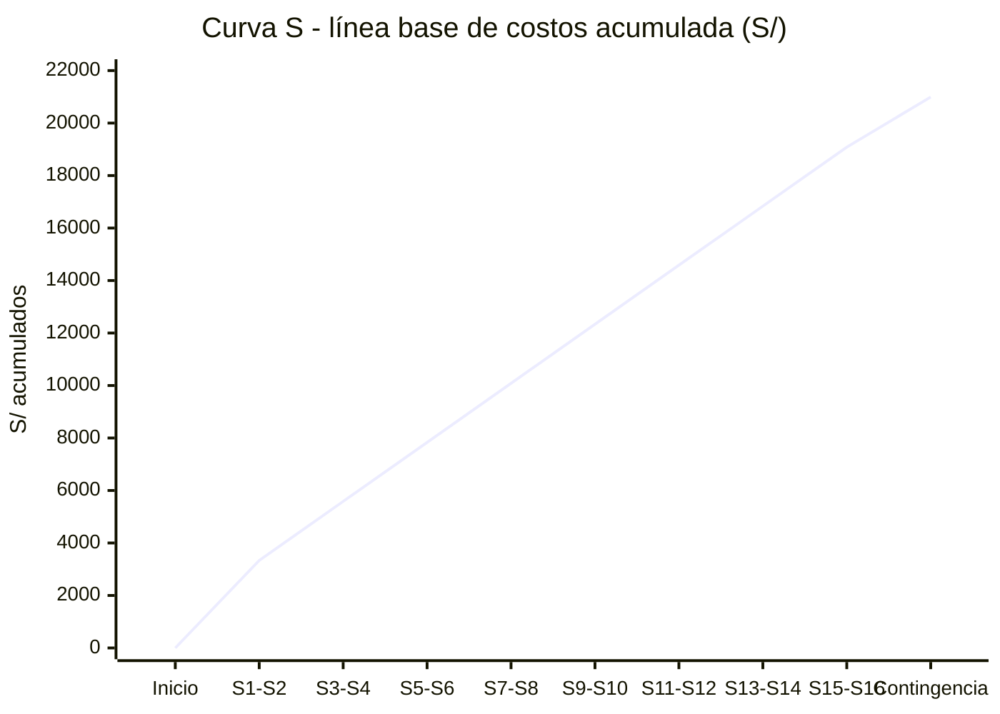

# 3.4 Gestión de Costos: presupuesto y línea base (CE0124)

El presupuesto total del proyecto es de S/ 20,992 (S/ 20,992.24; detalle en Entregable 2, sección 2.6). La línea base de costos se distribuye por sprint conforme al esfuerzo planificado (90 horas por sprint del equipo completo). La infraestructura de OnCargo (VPS Hostinger KVM 2 con prepago de 24 meses y dominio `oncargo.tech` por 2 años) se paga íntegramente en el mes 0, por lo que se imputa al Sprint 1 y no existe costo de infraestructura recurrente por sprint; los certificados TLS (Let's Encrypt vía Caddy) y el DNS/CDN de Cloudflare (plan gratuito) no tienen costo:

| **Periodo**             | **Costo de desarrollo (S/)** | **Otros costos (S/)** | **Acumulado (S/)** |
|-------------------------|------------------------------|-----------------------|--------------------|
| Sprint 1 (S1–S2)        | 2,250                        | 1,083.85 (VPS prepago 744.37 + dominio 339.48) | 3,333.85           |
| Sprint 2 (S3–S4)        | 2,250                        | 0                     | 5,583.85           |
| Sprint 3 (S5–S6)        | 2,250                        | 0                     | 7,833.85           |
| Sprint 4 (S7–S8)        | 2,250                        | 0                     | 10,083.85          |
| Sprint 5 (S9–S10)       | 2,250                        | 0                     | 12,333.85          |
| Sprint 6 (S11–S12)      | 2,250                        | 0                     | 14,583.85          |
| Sprint 7 (S13–S14)      | 2,250                        | 0                     | 16,833.85          |
| Sprint 8 (S15–S16)      | 2,250                        | 0                     | 19,083.85          |
| Reserva de contingencia |                              | 1,908.39              | 20,992.24          |

Composición: desarrollo S/ 18,000 (8 × 2,250) + infraestructura: VPS Hostinger KVM 2, prepago de 24 meses, S/ 744.37 (USD 8.99 × 24 = USD 215.76; × S/ 3.45) + dominio `oncargo.tech` por 2 años S/ 339.48 (USD 49.20 × 2 = USD 98.40; × S/ 3.45) = S/ 1,083.85 de otros costos (Sprint 1), + contingencia del 10% S/ 1,908.39 (10% sobre S/ 19,083.85) = S/ 20,992.24, igual que el Business Case (Entregable 2, sección 2.6). El tipo de cambio de S/ 3.45 por USD corresponde a la venta SUNAT del 06-11-2026 (S/ 3.452), redondeada.

Respecto de la línea base de la versión 1.0 (S/ 20,966, con infraestructura cloud en AWS imputada mes a mes durante el desarrollo), el presupuesto aumenta S/ 26 porque el prepago traslada al Sprint 1 el costo de servidor y dominio de todo el horizonte de 24 meses del Business Case. Los costos de operación posteriores al proyecto (S/ 858.05/mes: reserva de nube Cloudflare R2 de S/ 6.90 más otros costos operativos estimados de S/ 851.15) no forman parte de esta línea base; se evalúan en el TCO del Business Case (sección 2.6).

*Figura 7. Curva S de la línea base de costos acumulada, OnCargo (16 semanas), reconstruida a partir de la tabla anterior.*

Control presupuestal: el consumo real de horas se registra por sprint en la herramienta de gestión; una desviación acumulada mayor al 10% activa la revisión de alcance con el sponsor. La reserva de contingencia solo se libera contra riesgos materializados de la matriz RP.

