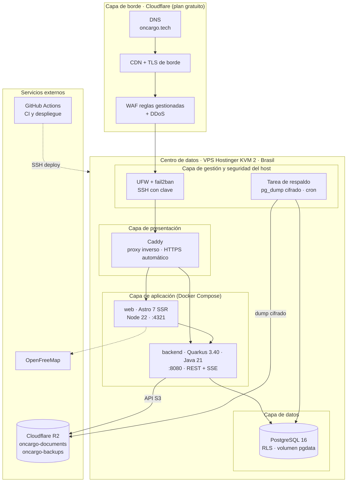

# S1 · Entregable 3 — Diseño de Centro de Datos (VPS Hostinger)
> Competencia C3.1 · Arquitectura, dimensionamiento y virtualización  
> Proyecto: OnCargo — Sistema Operativo Logístico Colaborativo para PYMEs  
> Equipo: Jorge Gutiérrez Miranda · Fabrizio Sanchez Saravia · Alex Coila Jarita  
> Semestre 1 · Junio 2026 · **Versión 2.0 (rediseño, noviembre 2026)** · Versión original 1.0 sobre AWS


!!! info "Versión 2.0: del centro de datos virtual en AWS a un VPS Hostinger"
    La versión 1.0 diseñó un centro de datos virtual multi-AZ en **AWS sa-east-1** (EC2 con Auto Scaling, RDS Multi-AZ, ElastiCache, S3, CloudFront, Wazuh, GuardDuty) con un costo de ~USD 333/mes. Con el sistema ya construido, el equipo rediseñó el despliegue por **costo y simplicidad**: un **VPS Hostinger KVM 2** (2 vCPU, 8 GB RAM, 100 GB NVMe, datacenter en Brasil) con Docker Compose y Caddy, documentos y respaldos en **Cloudflare R2** y DNS/CDN/WAF en **Cloudflare** (dominio `oncargo.tech`). El costo cae a unos USD 14/mes, a cambio de aceptar un único dominio de falla. El antes y el después se detallan en [Rebrand OnCargo y migración a Hostinger](../../software/cambios-diseno-inicial.md#7-rebrand-oncargo-y-migracion-a-hostinger).

    Se mantienen las decisiones de software ya alineadas con el sistema real: web Astro 7 SSR (contenedor Node), app Android nativa, **sin Redis**, tiempo real por SSE sobre un outbox en PostgreSQL (`LISTEN/NOTIFY`), PostgreSQL 16 con tres roles y RLS. Referencia operativa: `infra/docker-compose.yml`, `infra/README.md` y `docs/security.md` del monorepo `logyx`.

!!! warning "Diseño frente a implementación real (actualización 2.1, noviembre 2026)"
    Este documento es el **diseño**. El centro de datos en operación está en [Implementación de Datacenter](../semestre-2/implementacion-datacenter.md). Diferencias principales:

    - **Cinco contenedores** (Caddy, web, backend, PostgreSQL, MinIO) con límites reales de 128 MB, 512 MB, 1 GB, 768 MB y 384 MB (≈ 2.8 GB en total), en `infra/vps/compose.yml`.
    - **Documentos en MinIO** (volumen del VPS), no en R2. **Respaldos diarios cifrados** (age) desde la v2.2, pero en el mismo disco (copia externa pendiente); en lugar de Uptime Kuma, un chequeo de salud propio cada 5 minutos.
    - **Despliegue** con `infra/vps/deploy.sh` desde el equipo del administrador (`git archive` → `/opt/oncargo/src`, vuelta atrás con `src.old`); las imágenes se compilan en el VPS.
    - **Disco:** 96 GB utilizables; la región del centro de datos se confirma en el panel de Hostinger.
    - **Costo actual:** ≈ USD 13/mes (VPS en promoción + dominio), sin Cloudflare ni R2.

---

## Resumen Ejecutivo

El "Centro de Datos" de OnCargo es **un servidor virtual privado (VPS) Hostinger KVM 2** ubicado en un datacenter de **Brasil**, que aloja todos los servicios del sistema como contenedores de Docker Compose: Caddy (proxy con HTTPS automático), la web Astro SSR, el backend Quarkus y PostgreSQL 16. Los documentos de entrega y los respaldos viven fuera del servidor, en **Cloudflare R2**, y el borde (DNS, CDN, WAF, DDoS) lo provee **Cloudflare**.

La arquitectura sigue el patrón **3-tier** (presentación → aplicación → datos) en **un solo nodo**: se renuncia a la redundancia multi-AZ (equivalente **Tier I** en el origen) y se compensa con respaldos diarios fuera del proveedor y un procedimiento de reconstrucción de 2–4 h. El dimensionamiento cubre los 500 usuarios concurrentes del MVP con más de la mitad de la RAM libre y escala **verticalmente** (KVM 4 u 8) o separando la base de datos, sin rediseño estructural.

---

## Sección 1 — Definición de Arquitectura (Equivalencia Tier)

### 1.1 Equivalencia Tier según Uptime Institute

| Característica Tier | Tier I | Tier II | Tier III | **OnCargo (VPS Hostinger)** |
|--------------------|---------|---------|---------|--------------------|
| Componentes redundantes | No | Parcial | Sí (N+1) | **No** en el origen (un VPS); sí en el borde (Cloudflare) y en R2 |
| Rutas de distribución | 1 | 1 | Múltiple | 1 (un VPS, una IP) |
| Mantenimiento sin downtime | No | No | Sí | No (reinicios breves; ventana mensual) |
| Tolerancia a fallo único | No | No | Sí | No |
| **Disponibilidad de referencia** | 99.671% | 99.741% | 99.982% | **~99.5% (estimada, ver Anexo B)** |
| **Downtime anual de referencia** | ~29 h | ~22 h | ~1.6 h | **~46 h (estimado)** |

OnCargo clasifica como **Tier I equivalente en el origen**: es una decisión consciente de costo, coherente con el objetivo del SRS (RNF-02: disponibilidad ≥ 99%, es decir hasta ~88 h de caída al año) y con la fase MVP. No se afirma una certificación del proveedor.

### 1.2 Justificación basada en necesidades del negocio

| Necesidad de OnCargo | Nivel requerido | Justificación |
|-------------------|---------------|---------------|
| Marketplace de subastas activo | 99% (RNF-02) | Una subasta perdida es un contrato perdido, pero las subastas duran minutos u horas y los clientes reintentan; las caídas cortas son tolerables en el MVP |
| Tracking de envíos | 99% | La app del conductor encola la evidencia con reintentos automáticos, por lo que una caída corta no pierde entregas |
| Pagos (fase futura) | Mayor | Si se procesan pagos, se justifica la réplica de la BD y un segundo nodo (ver sección 4.4) |
| Costo controlado para una startup | Tier I–II | Tier III exigiría al menos dos servidores y réplica de BD, multiplicando el costo mensual por 3 a 5 sin una necesidad medida |

### 1.3 Arquitectura general



---

## Sección 2 — Diseño de Layout (infraestructura virtual)

### 2.1 Distribución por capas en el host

```
┌────────────────────────────────────────────────────────────────┐
│  PROVEEDOR: Hostinger · Datacenter Brasil · Hipervisor KVM     │
│                                                                │
│  VPS KVM 2 — 2 vCPU · 8 GB RAM · 100 GB NVMe · 8 TB/mes        │
│  Ubuntu Server 24.04 LTS + Docker Engine + Compose             │
│                                                                │
│  [HOST]                                                        │
│    UFW (80/443 desde Cloudflare, SSH con clave) · fail2ban     │
│    unattended-upgrades · cron/systemd timers (respaldo)        │
│                                                                │
│  [RED "edge"  172.20.0.0/24]                                   │
│    ┌─────────────┐   ┌──────────────┐   ┌─────────────────┐   │
│    │ caddy       │──►│ web          │   │ backend         │   │
│    │ 80/443      │   │ Astro SSR    │──►│ Quarkus JVM 21  │   │
│    │ ≈ 64 MB     │──────────────────────►│ :8080           │   │
│    └─────────────┘   │ :4321        │   │ usuario 10001   │   │
│                      └──────────────┘   └────────┬────────┘   │
│                                                  │             │
│  [RED "internal"  172.21.0.0/24]                 ▼             │
│                                         ┌─────────────────┐   │
│                                         │ db              │   │
│                                         │ postgres:16-alp │   │
│                                         │ volumen pgdata  │   │
│                                         │ sin puerto pub. │   │
│                                         └─────────────────┘   │
│                                                                │
│  [FUERA DEL SERVIDOR]                                          │
│  Cloudflare R2: oncargo-documents (privado)                    │
│  Cloudflare R2: oncargo-backups (retención 30 días)            │
│  Cloudflare: DNS, CDN, WAF · certificado de borde automático   │
└────────────────────────────────────────────────────────────────┘
```

### 2.2 Flujo de una petición HTTP

```
1. Usuario (Lima) → DNS oncargo.tech (Cloudflare, proxied)
2. Cloudflare → punto de presencia más cercano: TLS, WAF (reglas gestionadas), caché de estáticos
3. Cloudflare → IP del VPS por HTTPS (modo Full strict); UFW solo admite rangos de Cloudflare
4. Caddy (80/443) → contenedor web :4321 (oncargo.tech) o backend :8080 (api.oncargo.tech)
5. web (SSR) → backend :8080 por la red interna (la cookie httpOnly se convierte en Bearer)
6. backend → PostgreSQL :5432 (red internal): logyx_api con RLS; Flyway/SystemTx con logyx_owner
7. backend → Cloudflare R2 por HTTPS (API S3) para documentos y evidencia
8. Respuesta: backend → web → Caddy → Cloudflare → usuario (~70–120 ms estimados, ver C1.1)
Streams SSE (/api/v1/events/stream, /eventos): mismo camino, sin buffering ni compresión
y con latido de 20 s (inferior al tiempo de espera de lectura de Cloudflare).
```

---

## Sección 3 — Dimensionamiento de Capacidad

### 3.1 Cálculo de carga esperada

**Supuestos del MVP (todos son estimaciones; la medición con una prueba de carga está pendiente en la [Auditoría](../../software/entregable-4/auditoria.md)):**
- 200 PYMEs activas y 200 transportistas activos; 100 conductores.
- Pico: 500 usuarios concurrentes, cada uno con una conexión SSE abierta (500 streams) y una petición REST cada 5–10 s en promedio.
- Pico: 50–100 req/s sostenidos (la versión 1.0 suponía 5,000 req/s, valor que se descarta por irreal para el volumen del Business Case: ~10,830 operaciones en 24 meses).
- Foto de entrega: 2 MB; límite de subida de 10 MB (cuerpo HTTP 12 MB).

### 3.2 Dimensionamiento de memoria y CPU (un solo host)

| Servicio | `mem_limit` del compose actual | Valor propuesto en producción | Justificación |
|-----------|---------|---------|------|
| `caddy` | — | 128 MB | Proxy ligero; certificados y logs |
| `web` (Astro/Node 22) | 384 MB | 512 MB | SSR; proceso Node con islas React |
| `backend` (Quarkus JVM 21) | 768 MB | 1.5 GB | Dos pools (8 + 20 conexiones), SSE, outbox y jobs |
| `db` (PostgreSQL 16) | 512 MB | 2 GB | `shared_buffers` 512 MB, `effective_cache_size` 3 GB |
| Sistema operativo + Docker | — | ~0.8 GB | Ubuntu Server y daemon |
| **Total comprometido** | 1.7 GB | **≈ 5 GB de 8 GB** | **≈ 3 GB libres**: holgura para picos, compilación puntual y el motor de rutas propio (≈ 1–1.5 GB, ADR-0008) |

| Parámetro | Valor | Observación |
|-----------|-------|-------|
| vCPU | 2 compartidos entre los 4 contenedores | El backend usa < 1 vCPU en uso normal (estimado) |
| `max_connections` PostgreSQL | 100 | Pools del backend: 8 (`logyx_owner`) + 20 (`logyx_api`) = 28 por instancia; `logyx_api` con `CONNECTION LIMIT 50` |
| PgBouncer | No se usa | Con modo *transaction* el `LISTEN/NOTIFY` necesitaría conexión directa (documentado en `docs/security.md`) |
| Disco | 100 GB NVMe | Sistema y imágenes ≈ 10 GB; BD < 2 GB en 24 meses; logs rotados; margen > 80 GB |
| Transferencia | 8 TB/mes incluidos | Muy por encima del tráfico estimado (< 100 GB/mes) |

**Justificación:** Quarkus en modo JVM consume del orden de 300–600 MB de RAM en reposo con estos pools. El peso de memoria lo marcan PostgreSQL y los pools; la carga de CPU de 50–100 req/s es modesta para 2 vCPU. Cuando el CPU promedio supere el 70% o la RAM libre baje de 1.5 GB se escala verticalmente (KVM 4: 4 vCPU, 16 GB) o se separa la base de datos.

### 3.3 Dimensionamiento de PostgreSQL

| Parámetro | Valor | Justificación |
|-----------|-------|---------------|
| Imagen | `postgres:16-alpine` | La del `docker-compose.yml` |
| `shared_buffers` | 512 MB | ≈ 25% de los 2 GB asignados al contenedor |
| `effective_cache_size` | 3 GB | Caché del sistema operativo disponible |
| `max_connections` | 100 | Holgura sobre 28–50 conexiones reales |
| Almacenamiento | Volumen `pgdata` en NVMe | Sin réplica; protegido por respaldos diarios |
| Backup | `pg_dump -Fc` diario cifrado a R2 | Retención 30 días; ver C2.1 (POL-03) |
| Mantenimiento | Domingo 03:00 (hora de Lima) | Ventana de menor actividad |

**Estimado de crecimiento de almacenamiento de la base de datos:**

| Tabla | Tamaño/fila | Filas/mes | GB/mes |
|-------|-------------|-----------|--------|
| shipments | ~500 bytes | 3,000 | 0.0015 |
| shipment_stops | ~300 bytes | 9,000 | 0.003 |
| messages | ~200 bytes | 30,000 | 0.006 |
| audit_log | ~400 bytes | 50,000 | 0.02 |
| documents (metadatos) | ~200 bytes | 6,000 | 0.0012 |
| **Total BD/mes** | | | **~0.1 GB/mes** |

Con 100 GB de disco, la base de datos no es el factor limitante durante el horizonte del proyecto. El factor que crece es el almacenamiento de documentos, que no ocupa el disco del VPS porque va a R2.

### 3.4 Dimensionamiento de Cloudflare R2

| Bucket | Contenido | Tamaño unitario | Volumen | GB acumulados a 24 meses |
|--------|-----------|----------------|------------|--------|
| `oncargo-documents` | Fotos de entrega y firmas | 2 MB | Escenario del Business Case: ~10,830 operaciones en 24 meses (≈ 1 foto por operación) | **≈ 22 GB** |
| `oncargo-documents` | Escenario de estrés (cota superior) | 2 MB | 6,000 fotos/mes (supuesto de la versión 1.0) | 288 GB |
| `oncargo-backups` | `pg_dump` cifrados | ~0.1 GB | 30 respaldos retenidos | **≈ 3 GB** |

**Precios de R2 (verificados en noviembre de 2026):** USD 0.015 por GB-mes en la clase Standard; gratis los primeros 10 GB-mes, 1 millón de operaciones de clase A y 10 millones de clase B al mes; **sin cargo por salida de datos**. Costo estimado: escenario del Business Case ≈ USD 0.60/mes con una holgura de 50 GB; en el escenario de estrés (288 GB) ≈ USD 4.2/mes al mes 24. Los precios pueden cambiar.

**Ciclo de vida:** respaldos con regla de expiración a los 30 días; documentos sin expiración automática (evidencia contractual).

### 3.5 Resumen de recursos y costo mensual estimado

Tipo de cambio de referencia: **S/ 3.45 por USD** (BCRP/SUNAT, noviembre 2026).

| Servicio | Tipo/SKU | Cant | Costo unitario (USD/mes) | Total (USD/mes) |
|---------|----------|------|---------------------|----------------|
| VPS Hostinger | KVM 2, promoción con prepago de 24 meses | 1 | 8.99 | **8.99** |
| Cloudflare | Plan gratuito (DNS, CDN, WAF básico, DDoS) | 1 | 0.00 | 0.00 |
| Cloudflare R2 | Documentos y backups (≤ 50 GB-mes) | — | — | ≈ 0.60 |
| Dominio `oncargo.tech` | USD 49.20/año (referencia de registrador) | 1 | 4.10 | 4.10 |
| Caddy, Let's Encrypt, Docker, UFW, fail2ban | Software libre | — | 0.00 | 0.00 |
| **TOTAL MVP (promoción)** | | | | **≈ 13.69 (≈ S/ 47)** |
| **TOTAL MVP (renovación del VPS a USD 14.99)** | | | | **≈ 19.69 (≈ S/ 68)** |

Frente a los **~USD 333/mes** de la versión 1.0 en AWS, el diseño actual cuesta aproximadamente un 96% menos. El efecto en el Business Case se calcula en [E2 — Business Case](../../gestion-ti/entregable-2-business-case.md).

---

## Sección 4 — Virtualización y Cloud Híbrido

### 4.1 Modelo de computación adoptado: VPS (IaaS) + contenedores + servicios SaaS

OnCargo utiliza un modelo **híbrido** de virtualización de tres niveles:

| Workload | Tecnología | Justificación |
|----------|-----------|---------------|
| Servidor (host) | VPS KVM de Hostinger (IaaS) | Precio fijo y bajo; control total del sistema operativo |
| Backend Quarkus, web Astro SSR, PostgreSQL, Caddy | Contenedores Docker (Docker Compose) | Entornos reproducibles e idénticos en desarrollo, staging y producción |
| Jobs programados (cierre de subastas, Smart Load, outbox, mantenimiento de viajes) | Planificador interno de Quarkus dentro del backend | No requieren servicios adicionales: usan `@Scheduled` y `SystemTx` |
| DNS, CDN, WAF | Cloudflare (SaaS) | Capa de borde gratuita; oculta la IP de origen |
| Documentos y respaldos | Cloudflare R2 (SaaS, API S3) | Sin costo de salida; almacenamiento fuera del servidor |
| App Android | APK/AAB distribuidos | Sin infraestructura de servidor (cliente) |

### 4.2 Esquema de virtualización

```
┌─────────────────────────────────────────────────────────┐
│  CAPA DE VIRTUALIZACIÓN OnCargo                         │
│                                                         │
│  ┌──────────────────────────────────────────────────┐  │
│  │  Hostinger — Hipervisor KVM (administrado)       │  │
│  │  ┌────────────────────────────────────────────┐  │  │
│  │  │  Ubuntu Server 24.04 LTS (OS)              │  │  │
│  │  │  ┌─────────────────────────────────────┐   │  │  │
│  │  │  │  Docker Engine + Compose            │   │  │  │
│  │  │  │  ┌───────────┐ ┌───────────────┐   │   │  │  │
│  │  │  │  │ caddy     │ │ web (Astro)   │   │   │  │  │
│  │  │  │  └───────────┘ └───────────────┘   │   │  │  │
│  │  │  │  ┌───────────────┐ ┌────────────┐  │   │  │  │
│  │  │  │  │ backend       │ │ db         │  │   │  │  │
│  │  │  │  │ Quarkus JVM 21│ │ PostgreSQL │  │   │  │  │
│  │  │  │  └───────────────┘ └────────────┘  │   │  │  │
│  │  │  └─────────────────────────────────────┘   │  │  │
│  │  └────────────────────────────────────────────┘  │  │
│  └──────────────────────────────────────────────────┘  │
│                                                         │
│  SERVICIOS ADMINISTRADOS POR TERCEROS (SaaS)            │
│  Cloudflare → DNS, CDN, WAF, DDoS                       │
│  Cloudflare R2 → almacenamiento de objetos replicado    │
│  GitHub → código, CI y despliegue                       │
└─────────────────────────────────────────────────────────┘
```

### 4.3 Estrategia de contenedores

```
Imágenes: construidas desde el monorepo (backend/Dockerfile, web/Dockerfile)

Imagen backend: logyx-backend
  Multi-stage: Maven en eclipse-temurin:21-jdk-alpine → ejecución en 21-jre-alpine
  Usuario 10001 (no root) · healthcheck /q/health/ready · Flyway migra al arrancar

Imagen web: logyx-web
  Astro standalone en node:22-alpine · usuario node · API_URL=http://backend:8080

Imagen db: postgres:16-alpine (oficial)  ·  Imagen proxy: caddy:2-alpine (oficial)

Pipeline de actualización (diseño; el despliegue continuo sigue pendiente, ver Auditoría):
  Git push → GitHub Actions (CI: pruebas, contrato OpenAPI)
  → conexión SSH con clave limitada al usuario deploy
  → pg_dump previo a la migración
  → docker compose build (una imagen a la vez, por la memoria) → up -d
  → healthcheck /q/health/ready y prueba de humo (rollback: imagen anterior)
  Interrupción esperada por despliegue: segundos (reinicio del contenedor);
  no hay despliegue sin caída como con el rolling update de ECS.
```

### 4.4 Evolución y escalado (Roadmap)

El monolito modular puede evolucionar sin cambiar la red lógica:

| Paso | Disparador | Acción |
|------|-----------|--------|
| 1 | CPU > 70% sostenido o RAM libre < 1.5 GB | Subir el plan: KVM 2 → KVM 4 (4 vCPU / 16 GB) |
| 2 | Base de datos compite por recursos o se exige RPO < 24 h | PostgreSQL en su propio VPS, con archivado de WAL a R2 (pgBackRest/WAL-G) y, si procede, réplica de lectura |
| 3 | Servicio de rutas propio (ADR-0008, direcciones arbitrarias) | OSRM/Valhalla en contenedor aparte (≈ 1–1.5 GB de RAM); el preproceso del extracto de Perú se hace fuera del VPS |
| 4 | Más de un nodo de backend | Segundo VPS con Caddy/Cloudflare Load Balancing; el backend ya admite réplicas (JWT sin estado, outbox con `SKIP LOCKED`, SSE por `LISTEN/NOTIFY`); mover el *rate limiting* a la BD |
| 5 | Pagos u otros requisitos regulatorios | Réplica y conmutación manual o automática de PostgreSQL; evaluación de Tier II/III |

---

## Sección 5 — Cumplimiento de Estándares

| Estándar | Aplicación en OnCargo |
|---------|---------------------|
| **Uptime Institute Tier I** | Equivalencia declarada en el origen (un VPS); disponibilidad objetivo ≥ 99% (RNF-02) |
| **Prácticas de la Twelve-Factor App** | Configuración por variables de entorno, procesos sin estado (JWT), logs a stdout, paridad entre entornos con Compose |
| **ISO/IEC 27001** | Cifrado en tránsito (TLS), control de accesos (SSH con clave, 2FA en paneles), respaldos cifrados, política de parches (ver C2.1) |
| **CIS Benchmarks (Ubuntu 24.04 y Docker)** | Endurecimiento del host y de los contenedores (usuarios no root, redes separadas, sin puertos de BD publicados) |
| **NIST SP 800-145** | Definición de cloud computing: OnCargo usa IaaS (VPS), SaaS (Cloudflare, R2, GitHub) y contenedores sobre el IaaS |

---

## Anexos

### Anexo A — Comparativa DC físico vs AWS (v1.0) vs VPS Hostinger (v2.0)

| Aspecto | DC físico | AWS (diseño v1.0) | VPS Hostinger (v2.0) |
|---------|-----------|------------|------------|
| Inversión inicial | USD 50,000+ (servidores, switches, UPS) | USD 0 (pago por uso) | USD 0 (prepago de 24 meses: USD 215.76) |
| Tiempo de aprovisionamiento | 2–4 semanas | < 30 minutos (Terraform) | Minutos (panel) + 1–2 h de configuración |
| Redundancia física | 2 servidores mínimo | Multi-AZ incluido | **Ninguna** (un nodo); respaldos externos |
| Escalado | Manual (comprar hardware) | Automático (ASG) | Vertical manual (cambio de plan) |
| Mantenimiento OS/hardware | Equipo interno | AWS gestiona RDS/ElastiCache | Hostinger gestiona hardware; el equipo gestiona SO y contenedores |
| Disponibilidad | Depende del diseño | 99.99% (SLA Multi-AZ) | ~99.5% (estimación de diseño; sin SLA contractual asumido) |
| Costo mensual MVP | ~USD 800 (electricidad + depreciación) | ~USD 333 (pay-as-you-go) | **~USD 14 (≈ S/ 47)** |
| Complejidad operativa | Alta | Media-alta (muchos servicios) | **Baja** (4 contenedores) |

### Anexo B — Cálculo de disponibilidad (estimación de diseño)

```
Componentes en serie para el servicio completo (supuestos, no mediciones):
  Cloudflare (plan gratuito, sin SLA contractual):  99.90%  (supuesto prudente)
  VPS Hostinger (referencia Tier I):                99.671%
  Contenedores (reinicio automático):               99.90%  (supuesto)

Disponibilidad total ≈ 99.90% × 99.671% × 99.90%
                     ≈ 99.47%

Downtime anual estimado: (1 − 0.9947) × 8,760 h ≈ 46 horas
→ Por encima del objetivo de 99% del SRS (RNF-02, ≈ 88 h/año)
→ No alcanza 99.9%: ese objetivo exigiría un segundo nodo y réplica de BD (sección 4.4).

Cloudflare R2 solo afecta a la subida/descarga de documentos (SLA publicado de 99.9%);
no interviene en el camino crítico de subastas y negociación.
```

---

*OnCargo · S1 Entregable 3 · Diseño de Centro de Datos · Competencia C3.1 · Versión 2.0 · Noviembre 2026 (original: Junio 2026)*
