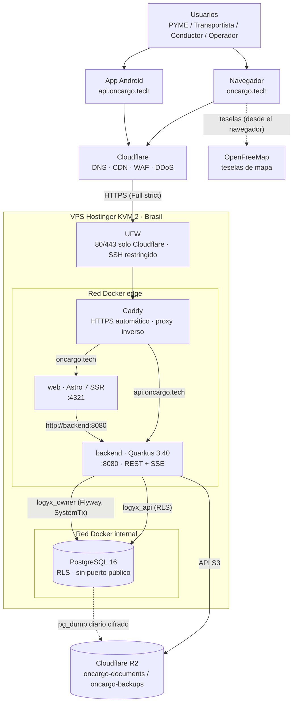
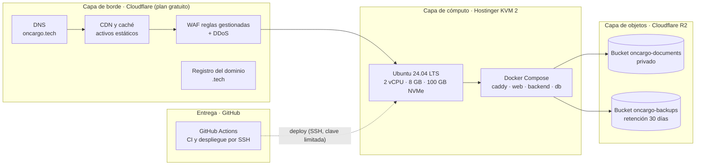

# S1 · Entregable 1 — Diseño de Red
> Competencia C1.1 · Diseño de infraestructura de conectividad  
> Proyecto: OnCargo — Sistema Operativo Logístico Colaborativo para PYMEs  
> Equipo: Jorge Gutiérrez Miranda · Fabrizio Sanchez Saravia · Alex Coila Jarita  
> Semestre 1 · Junio 2026 · **Versión 2.0 (rediseño, noviembre 2026)** · Versión original 1.0 sobre AWS


!!! info "Versión 2.0: el diseño de red se rehízo para un VPS Hostinger"
    La versión 1.0 diseñó la red sobre **AWS** (VPC multi-AZ, ALB, NAT Gateway, RDS, ElastiCache, CloudFront). Al construir el sistema y renombrar el producto a **OnCargo**, la infraestructura se rediseñó por **costo y simplicidad** (detalle y cifras en [Rebrand OnCargo y migración a Hostinger](../../software/cambios-diseno-inicial.md#7-rebrand-oncargo-y-migracion-a-hostinger)):

    - **Cómputo:** un único **VPS Hostinger KVM 2** (2 vCPU, 8 GB RAM, 100 GB NVMe, datacenter en Brasil) con Docker Compose.
    - **Borde y TLS:** **Caddy** como proxy inverso con HTTPS automático, detrás de **Cloudflare** (DNS, CDN y WAF gratuito) para el dominio **`oncargo.tech`**.
    - **Objetos y backups:** **Cloudflare R2** (API compatible con S3) en lugar de S3/MinIO.
    - **Sin Redis ni multi-AZ:** el sistema no usa Redis (tiempo real por SSE sobre un outbox en PostgreSQL) y un solo VPS implica un único dominio de falla; el costo en disponibilidad se analiza de forma explícita en la sección 3.
    - **Referencia operativa:** `infra/docker-compose.yml`, `infra/README.md` y `docs/security.md` del monorepo `logyx`. Allí ya existen las redes `internal` y `edge`, la base sin puertos publicados y los límites de memoria; el proxy Caddy, el firewall del host y los respaldos hacia R2 son el **diseño de despliegue** de este documento (estado indicado en cada tabla).

!!! warning "Diseño frente a implementación real (actualización 2.1, noviembre 2026)"
    Este documento es el **diseño**. El despliegue real (`infra/vps/` del monorepo, documentado en [Implementación de Red](../semestre-2/implementacion-red.md)) difiere en estos puntos:

    - **Sin Cloudflare:** los registros A de `oncargo.tech`, `www` y `api` están en el panel DNS de Hostinger y apuntan directo a la IP del VPS; Caddy obtiene el certificado de Let's Encrypt por sí mismo. No existe el filtro "solo Cloudflare" en `DOCKER-USER`.
    - **Redes Docker:** `edge` (Caddy, web, backend) e `internal` (backend, PostgreSQL, MinIO) con subredes asignadas por Docker (no 172.20.0.0/24 ni 172.21.0.0/24) y sin `internal: true`; `TRUSTED_PROXIES=172.16.0.0/12`.
    - **Puertos:** solo Caddy publica 80/tcp, 443/tcp y 443/udp (HTTP/3). UFW permite 22, 80 y 443.
    - **Documentos en MinIO** dentro del VPS (red `internal`), no en R2.
    - **Acceso temporal por IP** (`http://<IP>`, sin TLS) mientras el DNS propaga, y página de descarga del APK en `/app/`.
    - **Disco:** 96 GB utilizables.

---

## Resumen Ejecutivo

OnCargo es una plataforma SaaS logística B2B que conecta PYMEs y transportistas en el corredor Lima–Arequipa–Juliaca. Su infraestructura se despliega en **un VPS Hostinger KVM 2 ubicado en Brasil**, la región más cercana al Perú entre las ofrecidas por el proveedor (latencia estimada de 70–120 ms desde Lima; valor a verificar con mediciones en el aprovisionamiento).

El diseño sustituye la topología multi-capa de la nube pública por una red **en tres anillos**: (1) el borde de **Cloudflare**, que oculta la IP de origen, absorbe tráfico malicioso y sirve la caché; (2) el **host** con un firewall que solo admite 80/443 desde Cloudflare y SSH restringido; y (3) la **red de contenedores** de Docker Compose, donde la base de datos y el almacenamiento de respaldo no publican ningún puerto. No hay redundancia de hardware: se acepta un único dominio de falla a cambio de un costo mensual de unos USD 9 y se compensa con respaldos diarios fuera del proveedor (R2) y un procedimiento de reconstrucción documentado. La red soporta los 500 usuarios concurrentes de la fase MVP con holgura de memoria y escala **verticalmente** (plan KVM 4/8) o separando la base de datos a otro VPS sin rediseñar la red lógica.

---

## Sección 1 — Levantamiento de Requerimientos

### 1.1 Requerimientos Técnicos

| ID | Requerimiento | Valor objetivo | Justificación |
|----|--------------|----------------|---------------|
| RT-01 | Latencia API desde Lima | < 150 ms (estimada 70–120 ms) | RNF-01: tiempo de respuesta < 2 s. La latencia de red debe ser una fracción pequeña del presupuesto total. |
| RT-02 | Ancho de banda saliente (pico) | ≥ 100 Mbps | Fotos de entrega (promedio 2 MB × 200 entregas/hora en pico) + tráfico API. El plan incluye 8 TB/mes de transferencia. |
| RT-03 | Usuarios concurrentes MVP | 500 | Estimado de 200 PYMEs + 200 transportistas + 100 conductores activos simultáneamente. Pendiente de validar con prueba de carga. |
| RT-04 | Disponibilidad | ≥ 99% (RNF-02) | Un solo VPS: el objetivo del SRS es alcanzable; no se promete 99.9%. Ver sección 3. |
| RT-05 | Aislamiento de entornos | Producción (VPS) / staging local / desarrollo | Evitar que errores de desarrollo afecten datos reales. Staging y desarrollo corren en equipos del equipo con el mismo `docker-compose.yml`. |
| RT-06 | Acceso a servicios externos | Teselas OpenFreeMap (HTTPS, desde el navegador), R2 (HTTPS), futuros SUNAT y servicio de ruteo | Solo salida HTTPS/443 desde los contenedores; el firewall del host no filtra salida, pero el diseño no abre otros puertos de salida. |
| RT-07 | Tráfico en tiempo real | Streams SSE de larga duración con latido de 20 s (ADR-0007) | El proxy no debe hacer *buffering* ni comprimir `text/event-stream` y debe tolerar lecturas largas (≥ 60 s). No requiere *sticky sessions*. |
| RT-08 | Seguridad perimetral | Cloudflare (WAF, DDoS) + firewall del host (UFW) + redes Docker | Bloqueo de OWASP Top 10 y DDoS básico en el borde; superficie del host reducida a 80/443 y SSH. |

### 1.2 Requerimientos de Negocio

| ID | Requerimiento | Impacto en red |
|----|--------------|----------------|
| RN-01 | Alta disponibilidad razonable del marketplace | Pérdida de conectividad = pérdida de ofertas. Se mitiga con *healthchecks*, reinicio automático (`restart: unless-stopped`) y monitoreo externo; no con redundancia de hardware. |
| RN-02 | Crecimiento esperado ×5 en 12 meses | Escalado vertical (más vCPU/RAM en el mismo proveedor) y, después, separar PostgreSQL. |
| RN-03 | Apps móviles en zonas rurales (sierra) | API con *payloads* ligeros; la app del conductor encola la evidencia y reintenta (cola persistente). |
| RN-04 | Separación de ambientes | Datos de clientes reales nunca en staging/desarrollo (la base de producción no se copia a equipos locales sin anonimizar). |
| RN-05 | Costos operativos controlados | Un VPS con precio fijo; Cloudflare gratuito para DNS, CDN y WAF básico; R2 sin cargo por salida de datos. Sin NAT Gateway ni balanceador de pago. |
| RN-06 | Cumplimiento de privacidad (Ley 29733) | Datos personales (RUC, DNI) solo en la red `internal` de Docker; TLS en todo el trayecto público. |

---

## Sección 2 — Diseño de Topología

### 2.1 Visión General de la Arquitectura de Red

OnCargo reemplaza la VPC de la nube pública por **tres anillos de confianza**, que corresponden a las zonas de una red tradicional:

| Zona tradicional | Equivalente en OnCargo |
|-----------------|--------------------------|
| Internet (exterior) | Internet + Cloudflare (DNS proxied, CDN, WAF) |
| DMZ | Host del VPS: UFW + contenedor Caddy (único proceso que escucha 80/443) |
| Red interna (servidores) | Red Docker `edge`: Caddy, `web` (Astro SSR) y `backend` (Quarkus) |
| Red de datos (BD) | Red Docker `internal`: `db` (PostgreSQL 16) y `backend`; sin puertos publicados |
| Segmentación VLAN | Redes Docker separadas + reglas de UFW + roles de BD con RLS |

### 2.2 Diseño del host y direccionamiento

```
Proveedor:   Hostinger — VPS KVM 2 (datacenter Brasil)
Sistema:     Ubuntu Server 24.04 LTS, Docker Engine + plugin Compose
Recursos:    2 vCPU · 8 GB RAM · 100 GB NVMe · 8 TB/mes de transferencia
IP pública:  1 × IPv4 (oculta tras Cloudflare; el firewall solo admite rangos de Cloudflare en 80/443)

┌─────────────────────────────────────────────────────────────────────┐
│  VPS Hostinger KVM 2                                                │
│                                                                     │
│  UFW: allow 80,443/tcp desde rangos de Cloudflare · allow SSH       │
│       (clave pública, sin contraseña, fail2ban) · deny todo lo demás│
│                                                                     │
│  ┌── red Docker "edge" (172.20.0.0/24) ───────────────────────────┐ │
│  │  caddy :80/:443  →  web :4321 (Astro SSR)                       │ │
│  │                  →  backend :8080 (Quarkus, API + SSE)          │ │
│  └─────────────────────────────────────────────────────────────────┘ │
│  ┌── red Docker "internal" (172.21.0.0/24) ───────────────────────┐ │
│  │  backend ──► db :5432 (PostgreSQL 16, sin puerto publicado)     │ │
│  └─────────────────────────────────────────────────────────────────┘ │
│  Volúmenes: pgdata (NVMe) · caddy_data (certificados)               │
└─────────────────────────────────────────────────────────────────────┘
                 │ HTTPS (S3 API)                       │ pg_dump cifrado
                 ▼                                      ▼
        Cloudflare R2: oncargo-documents       Cloudflare R2: oncargo-backups
```

!!! note "Subredes Docker"
    Los CIDR `172.20.0.0/24` y `172.21.0.0/24` son los que se fijan en el `docker-compose.yml` de producción (por omisión Docker asigna rangos propios). En el compose actual del monorepo las redes se llaman `internal` y `edge`; el rango fijo y `TRUSTED_PROXIES` apuntando a `172.20.0.0/24` son parte del despliegue en el VPS.

### 2.3 Tabla de direccionamiento y puertos

| Segmento | CIDR / ámbito | Componentes | Puertos | Publicado fuera del host |
|--------|------|------|------|------|
| Internet → Cloudflare | Anycast de Cloudflare | DNS `oncargo.tech`, `api.oncargo.tech` (proxied) | 443 (80 redirige) | Sí |
| Host (VPS) | IP pública del VPS | UFW, SSH, Docker | 22 (restringido), 80, 443 | 80/443 solo desde Cloudflare |
| Red `edge` | 172.20.0.0/24 | `caddy`, `web`, `backend` | 80, 443, 4321, 8080 | Solo Caddy (80/443) |
| Red `internal` | 172.21.0.0/24 | `backend`, `db` | 5432 | No |
| Servicios externos | — | Cloudflare R2, OpenFreeMap | 443 | (solo salida) |

### 2.4 Topología Lógica



### 2.5 Topología Física (recursos contratados)



### 2.6 Segmentación (equivalente a VLANs): reglas de firewall y de red Docker

| Control | Tráfico entrante permitido | Tráfico saliente permitido | Aplica a |
|----------------|---------------------------|---------------------------|------------|
| UFW (host) | 443 y 80 desde rangos IP de Cloudflare; 22 desde IP fija del equipo o con clave + fail2ban | Todo (necesario para R2, actualizaciones, Let's Encrypt) | Host |
| `caddy` | 80, 443 | 4321 → `web`; 8080 → `backend` | Red `edge` |
| `web` | 4321 desde `caddy` | 8080 → `backend` (`API_URL=http://backend:8080`) | Red `edge` |
| `backend` | 8080 desde `caddy` y `web` | 5432 → `db`; 443 → R2 | Redes `edge` e `internal` |
| `db` | 5432 desde `backend` | Ninguno requerido | Red `internal` (sin `ports:`) |
| Docker (`DOCKER-USER`) | Los puertos publicados por Docker evitan UFW; por eso solo Caddy publica puertos y todos los demás servicios usan `127.0.0.1` o ninguno | — | Host |

!!! warning "Docker y UFW"
    Docker inserta sus propias reglas de `iptables` y **ignora** UFW para los puertos que publica. La regla de diseño es que **ningún contenedor distinto de Caddy publique puertos en `0.0.0.0`**; el `docker-compose.yml` del monorepo ya publica `web` y `backend` solo en `127.0.0.1`, y `db` no publica nada.

### 2.7 Controles de perímetro (equivalente a NACLs)

| Capa | Control | Detalle |
|------|-------|-------|
| Cloudflare | Modo SSL **Full (strict)** | Cloudflare solo habla HTTPS con el origen, con certificado válido de Caddy (Let's Encrypt) |
| Cloudflare | WAF con reglas gestionadas del plan gratuito + *Bot Fight Mode* | Mitigación básica de ataques web comunes y bots (el conjunto OWASP completo no está en el plan gratuito); el *rate limiting* fino lo hace la aplicación (`AuthRateLimits`). Bot Fight Mode puede desafiar a la app Android: se verifica en las pruebas |
| Cloudflare | Regla para `api.oncargo.tech` | Sin caché; se permite `text/event-stream` |
| Host | UFW y cadena `DOCKER-USER` (ipset) con los rangos de Cloudflare | Los visitantes que consulten la IP de origen directamente no obtienen respuesta. UFW por sí solo no filtra los puertos que publica Docker; ver [Implementación y Testing de Red](../semestre-2/implementacion-red.md) |
| Caddy | Cabeceras de seguridad y `trusted_proxies` de Cloudflare | La IP real del cliente llega en `CF-Connecting-IP` y se reenvía como `X-Forwarded-For`; el backend la acepta solo desde `TRUSTED_PROXIES` |
| Aplicación | Rate limiting, CSP, HSTS, `checkOrigin` | Ya implementados (ver [Seguridad](../../software/entregable-2/seguridad.md)) |

### 2.8 Enrutamiento y DNS

| Registro / ruta | Destino | Observación |
|---------------|---------|--------|
| `oncargo.tech` (A, proxied) | IP del VPS | Aplicación web (Caddy → `web:4321`) |
| `www.oncargo.tech` (CNAME, proxied) | `oncargo.tech` | Redirección al apex |
| `api.oncargo.tech` (A, proxied) | IP del VPS | API para la app Android (Caddy → `backend:8080`); la web usa la red interna |
| Caddy: `oncargo.tech` | `reverse_proxy web:4321` | Compresión activa **excepto** para `text/event-stream` |
| Caddy: `api.oncargo.tech` | `reverse_proxy backend:8080 { flush_interval -1 }` | Sin *buffering*; *timeout* de lectura ≥ 60 s |
| Resolución interna | DNS embebido de Docker (`db`, `backend`, `web`) | Reemplaza la zona privada de Route 53 de la versión 1.0 |

**Salida a Internet:** todos los contenedores usan el NAT predeterminado de Docker sobre la interfaz del host; no hay NAT Gateway ni VPC Endpoints. El tráfico a R2 viaja por HTTPS sobre Internet público (la salida de R2 no se factura).

---

## Sección 3 — Redundancia y Alta Disponibilidad

### 3.1 Estrategia: un solo nodo con recuperación rápida

La decisión de usar un VPS único sacrifica la alta disponibilidad por hardware a cambio de costo y simplicidad. La mitigación es **recuperación rápida** (reconstruir el servicio en otro VPS desde el repositorio, los secretos y el último respaldo) en lugar de **redundancia continua**.

| Componente | Redundancia | Mecanismo de recuperación | RTO objetivo |
|-----------|-------------|---------------------------|---------|
| Cloudflare (DNS/CDN/WAF) | Anycast global del proveedor | Propia del servicio | — |
| VPS Hostinger | Ninguna (un nodo) | Nuevo VPS + `docker compose up` + restauración del respaldo | 2–4 h |
| Contenedores | Reinicio local | `restart: unless-stopped` + `healthcheck` (`/q/health/ready`) | < 1 min |
| PostgreSQL | Sin réplica | Restauración de `pg_dump` diario desde R2 | 1–2 h (según tamaño) |
| Documentos (R2) | Replicación interna de R2 | Propia del servicio | — |
| Secretos y claves JWT | Copia cifrada fuera del VPS | Gestor de contraseñas / copia offline | Minutos |

**RPO:** 24 h con `pg_dump` diario. Si el negocio exige menos, se agrega archivado de WAL hacia R2 (pgBackRest o WAL-G), sin cambiar la topología.

### 3.2 Escalado

```
Escalado vertical (primer paso):   KVM 2 → KVM 4 (4 vCPU / 16 GB) en el mismo proveedor, con reinicio breve
Escalado de la BD (segundo paso):  PostgreSQL en su propio VPS; la red 'internal' pasa a ser una red privada/VPN
Escalado horizontal del backend:   viable sin cambios de código (JWT sin estado, outbox con SKIP LOCKED,
                                   fan-out SSE por LISTEN/NOTIFY); limitación conocida: el rate limiting es por instancia
Disparadores sugeridos:
  → CPU promedio > 70 % durante 15 min de forma sostenida
  → RAM disponible < 1.5 GB
  → Uso de disco > 70 % de 100 GB
```

### 3.3 Análisis de Escenarios de Fallo

| Escenario | Impacto | Tiempo de recuperación | Mecanismo |
|-----------|---------|----------------------|-----------|
| Caída de un contenedor (backend o web) | Interrupción breve (segundos) | < 1 min | `restart: unless-stopped` + healthcheck |
| Reinicio del VPS | Interrupción de minutos | 2–5 min | Docker arranca al boot; `depends_on` con `service_healthy` |
| Pérdida del VPS (fallo del nodo o del proveedor) | **Servicio caído** hasta reconstruir | 2–4 h | Runbook de reconstrucción (sección 4.3 de [Implementación de Datacenter](../semestre-2/implementacion-datacenter.md)) + último respaldo en R2 |
| Corrupción de la base de datos | Pérdida de hasta 24 h de datos | 1–2 h | Restauración de `pg_dump` (RPO 24 h) |
| Ataque volumétrico (DDoS) | Absorbido en el borde | — | Cloudflare; el origen no es alcanzable sin pasar por él |
| Caída de Cloudflare | Sitio inaccesible por DNS/proxy | Variable | Aceptado; mitigación manual: DNS directo al VPS (la IP se conserva en el runbook) |
| Caída de R2 | Subida y descarga de documentos fallan; el resto opera | Variable | Aceptado; el adaptador `DocumentStorage` permite volver al disco local de forma temporal |

---

## Sección 4 — Cumplimiento de Estándares

### 4.1 Equivalencia de estándares tradicionales en el diseño sobre VPS

| Estándar tradicional | Aplicación en OnCargo (VPS + Cloudflare) |
|---------------------|--------------------------|
| **TIA/EIA-568** (cableado estructurado) | No aplica al cableado propio; el proveedor administra el centro de datos. La estructura se expresa en capas lógicas: borde, proxy, aplicación, datos |
| **IEEE 802.1Q** (VLAN tagging) | Redes Docker separadas (`edge`, `internal`) y reglas de firewall por función |
| **IEEE 802.3** (Ethernet) | Interfaz virtual `virtio` del VPS (KVM); sin control sobre la capa física |
| **ISO/IEC 11801** (cableado) | Responsabilidad del proveedor del datacenter |
| **Redundancia de enlaces** | No hay enlace redundante en el origen; Cloudflare aporta múltiples puntos de presencia en el borde |

### 4.2 Principios de fiabilidad y seguridad aplicados

| Principio | Implementación en OnCargo |
|-----------|------------------------|
| Recuperación de fallos automatizada | `restart: unless-stopped`, `healthcheck`, `depends_on: service_healthy` |
| Mínimo privilegio | Roles de BD `logyx_api` / `logyx_owner`; tokens de R2 acotados al bucket; usuario `10001` no root en el backend |
| Defensa en profundidad | Cloudflare → UFW → Caddy → redes Docker → RLS en PostgreSQL |
| Infraestructura reproducible | `infra/docker-compose.yml` versionado; secretos fuera del repositorio; despliegue por GitHub Actions (planificado) |
| Recuperación ante desastres | `pg_dump` diario a R2 con retención de 30 días y prueba de restauración mensual |

### 4.3 Latencia estimada por ruta (valores de diseño, a medir)

| Origen | Destino | Latencia estimada |
|--------|---------|-----------------|
| Lima, Perú → punto de presencia de Cloudflare | Lima / São Paulo | ~10–40 ms |
| Cloudflare → VPS (Brasil) | Interconexión regional | ~10–30 ms |
| Caddy → backend / web | Misma máquina | < 1 ms |
| backend → PostgreSQL | Red Docker local | < 1 ms |
| **Total end-to-end (Lima → respuesta de la API)** | | **~70–120 ms (estimado)** |

!!! note "Estimaciones"
    Las latencias son **estimaciones de diseño**, no mediciones. Se verifican con `curl -w` y k6 desde Lima al aprovisionar el VPS (ver [Implementación y Testing de Red](../semestre-2/implementacion-red.md)).

---

## Anexos

### Anexo A — Resumen de recursos de red

| Recurso | Cantidad | Propósito |
|---------|----------|-----------|
| VPS Hostinger KVM 2 | 1 (producción) | Cómputo único; staging y desarrollo corren en equipos locales |
| IP pública | 1 | Oculta tras Cloudflare |
| Zona DNS Cloudflare | 1 (`oncargo.tech`) | DNS, CDN, WAF |
| Redes Docker | 2 (`edge`, `internal`) | Segmentación lógica |
| Reglas UFW | 3–4 | 80/443 (Cloudflare), SSH, denegar el resto |
| Buckets R2 | 2 (`oncargo-documents`, `oncargo-backups`) | Documentos y respaldos |
| Certificados TLS | Gestionados por Caddy (Let's Encrypt) | Renovación automática |

### Anexo B — Estimación de costos de red (mensual, producción)

Tipo de cambio de referencia: **S/ 3.45 por USD** (BCRP/SUNAT, noviembre 2026). Precios verificados en las páginas de los proveedores en noviembre de 2026; las promociones pueden cambiar.

| Recurso | Costo (USD/mes) | Costo (S/ /mes) | Nota |
|---------|--------------------------|---|---|
| VPS Hostinger KVM 2 (promoción, prepago 24 meses) | 8.99 | 31.02 | USD 215.76 por 24 meses; renueva a USD 14.99/mes (S/ 51.72) |
| Cloudflare (DNS, CDN, WAF básico, TLS de borde) | 0.00 | 0.00 | Plan gratuito |
| Cloudflare R2 (documentos y backups) | ≈ 0.60 (estimado) | ≈ 2.07 | Gratis los primeros 10 GB; USD 0.015/GB-mes adicional; sin cargo de salida |
| Dominio `oncargo.tech` | 4.10 | 14.14 | USD 49.20/año (referencia de registrador, a confirmar) |
| **Total infraestructura de red y cómputo** | **≈ 13.7** | **≈ 47** | Frente a ~USD 120/mes solo de red en la versión 1.0 (AWS) |

---

*OnCargo · S1 Entregable 1 · Diseño de Red · Competencia C1.1 · Versión 2.0 · Noviembre 2026 (original: Junio 2026)*
