# S2 · Entregable 3 — Implementación y Control del Centro de Datos (VPS Hostinger)
> Competencias C3.2 (Implementación) · C3.3 (Control y operación)  
> Proyecto: OnCargo — Sistema Operativo Logístico Colaborativo para PYMEs  
> Equipo: Jorge Gutiérrez Miranda · Fabrizio Sanchez Saravia · Alex Coila Jarita  
> Semestre 2 · Agosto–Noviembre 2026 · **Versión 2.0 (rediseño, noviembre 2026)** · Versión original 1.0 sobre AWS

!!! info "Versión 2.0: operación de un único VPS Hostinger con Docker Compose"
    La versión 1.0 implementaba el centro de datos con Terraform sobre AWS (EC2 con Auto Scaling, ALB, RDS Multi-AZ, ElastiCache, S3, ECS Fargate, CloudWatch). Al rediseñar la infraestructura por costo y simplicidad, este documento se **reescribió por completo** sobre [Diseño de Centro de Datos v2.0](../semestre-1/diseno-datacenter.md): un **VPS Hostinger KVM 2** (2 vCPU, 8 GB de RAM, 100 GB NVMe, Brasil) con Ubuntu Server 24.04 LTS, Docker Compose, Caddy, Cloudflare y Cloudflare R2. El antes y el después, con cifras, está en [Rebrand OnCargo y migración a Hostinger](../../software/cambios-diseno-inicial.md#7-rebrand-oncargo-y-migracion-a-hostinger).

    **Alcance honesto:** el repositorio ya contiene el compose de desarrollo, los Dockerfiles, los roles de BD y el *rate limiting*. El compose de producción, el Caddyfile, los scripts de respaldo y de despliegue y las unidades `systemd` de este documento son la **configuración definida para el VPS** y se ejecutan al aprovisionarlo. Las métricas de disponibilidad y de uso de recursos son **a medir**; ningún valor se presenta como medido si no lo fue.

---

## Resumen Ejecutivo

Este documento especifica la implementación y la operación del centro de datos de OnCargo: aprovisionamiento y endurecimiento del VPS, instalación de Docker, el `docker-compose` de producción (Caddy, web Astro SSR, backend Quarkus y PostgreSQL 16), la inicialización de la base de datos con roles de mínimo privilegio y migraciones Flyway, el almacenamiento de documentos y respaldos en **Cloudflare R2**, los trabajos programados (que corren **dentro del backend**, sin ECS ni EventBridge), la política de respaldo con cifrado y prueba mensual de restauración, el SLA realista (objetivo 99 %, estimado 99.47 %), el monitoreo ligero con Uptime Kuma, los *runbooks* (despliegue, incidente, **reconstrucción del VPS desde cero** y restauración de la base de datos) y el análisis de eficiencia y costos.

El diseño acepta **un único dominio de falla** (equivalente a Tier I): a cambio, el costo baja de ~USD 333/mes (AWS, versión 1.0) a ~USD 13.7/mes, con RTO de 2–4 h y RPO de 24 h. Todo el código y los comandos están listos para ejecutarse; las evidencias y las mediciones se registran en los anexos y figuran como **Pendiente de ejecución en el VPS** hasta que se aprovisione el servidor.

**Leyenda de estados:**

| Estado | Significado |
|--------|-------------|
| **Implementado en el repositorio** | Existe en `infra/` o en el código del monorepo `logyx`. |
| **Definido para el VPS (pendiente de ejecutar)** | La configuración está escrita aquí y se aplica al aprovisionar el servidor. |
| **Pendiente** | Depende de una integración, una verificación o una decisión posterior. |

**Servicios implementados** (la rúbrica menciona AD, DNS, Web y BD):

| Servicio | Implementación | Estado |
|----------|---------------|--------|
| Web (HTTP/HTTPS) | Caddy (proxy inverso, TLS automático) + `web` (Astro 7 SSR, Node 22) | Definido para el VPS (pendiente de ejecutar); `web` Implementado en el repositorio |
| API | `backend` (Quarkus 3.40, Java 21): REST, SSE, trabajos programados | Implementado en el repositorio |
| Base de datos | PostgreSQL 16 con RLS y tres roles | Implementado en el repositorio |
| DNS | Cloudflare (público); DNS embebido de Docker (interno) | Definido para el VPS (pendiente de ejecutar) |
| Directorio (AD/LDAP) | **No aplica:** la identidad vive en la aplicación (JWT RSA, bcrypt, roles por organización); no hay un dominio de Windows ni usuarios de red | Decisión de diseño |
| Almacenamiento de objetos | Cloudflare R2 (API compatible con S3) | Definido para el VPS (pendiente de ejecutar); adaptador Implementado en el repositorio |
| Monitoreo | Uptime Kuma + UptimeRobot + healthchecks de Docker | Definido para el VPS (pendiente de ejecutar) |

---

## Sección 1 — Configuración de Servidores y Servicios (C3.2)

### 1.1 Aprovisionamiento del VPS

| Paso | Acción | Resultado esperado |
|------|--------|--------------------|
| 1 | Contratar **Hostinger VPS KVM 2** con prepago de 24 meses (USD 215.76; renueva a USD 14.99/mes); centro de datos en **Brasil**; plantilla **Ubuntu Server 24.04 LTS** sin panel de control | VPS con IPv4 pública y acceso `root` inicial |
| 2 | Registrar la clave SSH pública del administrador en el panel de Hostinger | Primer acceso por clave |
| 3 | Anotar la IP pública (`<IP_PUBLICA_VPS>`) y el nombre de la interfaz (`ip -br a`) | Datos para Cloudflare y el firewall |
| 4 | Actualizar el sistema y fijar el nombre del equipo | Sistema al día |
| 5 | Crear usuarios, endurecer SSH, activar UFW y fail2ban (sección 1.2) | Superficie administrativa mínima |
| 6 | Instalar Docker Engine y el plugin Compose (sección 1.3) | `docker compose version` operativo |
| 7 | Clonar el repositorio en `/opt/oncargo` y colocar `infra/.env` y `infra/secrets/` | Servicios configurables |
| 8 | Aplicar el filtro de Cloudflare y las unidades `systemd` (ver [Red, sección 1.4](implementacion-red.md)) | 80/443 solo desde Cloudflare |
| 9 | Crear los registros DNS en Cloudflare y los buckets de R2 (sección 1.7) | Dominio y almacenamiento listos |
| 10 | `docker compose up -d`, verificar certificados y *healthchecks* | Servicios `healthy` |

```bash
# Paso 4 (como root, primer acceso)
apt-get update && apt-get -y full-upgrade
hostnamectl set-hostname oncargo-prod
timedatectl status                         # Verificar sincronización NTP (necesaria para TLS y para el JWT)
# El servidor permanece en UTC; los temporizadores de systemd usan "America/Lima" de forma explícita.

# Opcional: 2 GB de swap como colchón ante picos (los contenedores tienen límite de memoria)
fallocate -l 2G /swapfile && chmod 600 /swapfile && mkswap /swapfile && swapon /swapfile
echo '/swapfile none swap sw 0 0' >> /etc/fstab && sysctl vm.swappiness=10 && echo 'vm.swappiness=10' > /etc/sysctl.d/99-oncargo.conf
```

### 1.2 Endurecimiento inicial

El detalle de cada control, con sus configuraciones, está en [Implementación de Seguridad, sección 1](implementacion-seguridad.md). Lista de comprobación del primer día:

| # | Control | Comando de verificación |
|---|---------|-------------------------|
| 1 | Usuarios `admin` y `deploy`; sin acceso remoto de `root` | `sudo sshd -T \| grep -E 'permitrootlogin\|passwordauthentication\|allowusers'` |
| 2 | SSH solo con clave pública | `ssh -o PreferredAuthentications=password admin@<IP>` debe fallar |
| 3 | UFW con política `deny` de entrada y 22/tcp con `limit` | `sudo ufw status verbose` |
| 4 | fail2ban con la *jail* `sshd` | `sudo fail2ban-client status sshd` |
| 5 | `unattended-upgrades` activo | `systemctl status unattended-upgrades` |
| 6 | Filtro de Cloudflare en `DOCKER-USER` | `sudo iptables -S DOCKER-USER` |
| 7 | `/etc/docker/daemon.json` con rotación de logs | `docker info \| grep -i 'logging driver'` |

```bash
apt-get install -y ufw fail2ban unattended-upgrades ipset curl jq git age rclone ca-certificates
```

### 1.3 Instalación de Docker Engine y Compose

```bash
# Repositorio oficial de Docker para Ubuntu 24.04
sudo install -m 0755 -d /etc/apt/keyrings
sudo curl -fsSL https://download.docker.com/linux/ubuntu/gpg -o /etc/apt/keyrings/docker.asc
sudo chmod a+r /etc/apt/keyrings/docker.asc
echo "deb [arch=$(dpkg --print-architecture) signed-by=/etc/apt/keyrings/docker.asc] https://download.docker.com/linux/ubuntu $(. /etc/os-release && echo "$VERSION_CODENAME") stable" \
  | sudo tee /etc/apt/sources.list.d/docker.list > /dev/null
sudo apt-get update
sudo apt-get install -y docker-ce docker-ce-cli containerd.io docker-buildx-plugin docker-compose-plugin

sudo usermod -aG docker deploy                 # el grupo docker equivale a root: solo el usuario deploy
sudo install -d -o deploy -g deploy /opt/oncargo /var/log/caddy
sudo install -d -m 750 -o root -g deploy /etc/oncargo
sudo install -d -m 700 -o deploy -g deploy /var/backups/oncargo
# /etc/docker/daemon.json: ver Seguridad, sección 1.3 (rotación de logs, no-new-privileges, live-restore)
sudo systemctl restart docker && docker version && docker compose version
sudo -u deploy git clone <URL_DEL_REPOSITORIO> /opt/oncargo
```

### 1.4 `docker-compose` de producción

El compose de producción es un archivo **nuevo** (`infra/docker-compose.prod.yml`): parte del compose existente, reemplaza MinIO por Cloudflare R2, agrega Caddy, retira la publicación de puertos de `web` y `backend`, fija las subredes, sube los límites de memoria al dimensionamiento de S1 y endurece los contenedores. Los límites actuales del repositorio (512/512/768/384 MB) están pensados para pruebas locales.

```yaml
# infra/docker-compose.prod.yml — uso:
#   docker compose -f infra/docker-compose.prod.yml --env-file infra/.env up -d
name: oncargo

services:
  caddy:
    image: caddy:2-alpine
    restart: unless-stopped
    environment:
      ACME_EMAIL: ${ACME_EMAIL:?define ACME_EMAIL en infra/.env}
    ports:
      - "80:80"                      # único servicio que publica en 0.0.0.0
      - "443:443"
    volumes:
      - ./Caddyfile:/etc/caddy/Caddyfile:ro
      - ./caddy/cloudflare-ips.caddy:/etc/caddy/cloudflare-ips.caddy:ro
      - caddy_data:/data
      - caddy_config:/config
      - /var/log/caddy:/var/log/caddy
    depends_on:
      web:     { condition: service_healthy }
      backend: { condition: service_healthy }
    healthcheck:
      test: ["CMD-SHELL", "wget -qO- http://127.0.0.1:2019/config/ >/dev/null || exit 1"]
      interval: 30s
      timeout: 5s
      retries: 3
    security_opt: ["no-new-privileges:true"]
    cap_drop: [ALL]
    cap_add: [NET_BIND_SERVICE]
    networks: [edge]
    mem_limit: 128m

  web:
    build: ../web
    image: oncargo-web:prod
    restart: unless-stopped
    depends_on:
      backend: { condition: service_healthy }
    environment:
      API_URL: http://backend:8080
      # COOKIE_SECURE se omite: en producción la cookie es Secure (el compose local lo pone en false)
    security_opt: ["no-new-privileges:true"]
    cap_drop: [ALL]
    read_only: true
    tmpfs: ["/tmp"]
    networks: [edge]
    mem_limit: 512m
    # healthcheck definido en web/Dockerfile (GET /login)

  backend:
    build: ../backend
    image: oncargo-backend:prod
    restart: unless-stopped
    depends_on:
      db: { condition: service_healthy }
    environment:
      DB_URL: jdbc:postgresql://db:5432/logyx
      DB_ADMIN_USER: logyx_owner
      DB_ADMIN_PASSWORD: ${DB_ADMIN_PASSWORD:?define DB_ADMIN_PASSWORD}
      DB_APP_USER: logyx_api
      DB_APP_PASSWORD: ${DB_APP_PASSWORD:?define DB_APP_PASSWORD}
      JWT_PUBLIC_KEY: /run/secrets/jwt_public_key
      JWT_PRIVATE_KEY: /run/secrets/jwt_private_key
      # Documentos en Cloudflare R2 (API compatible con S3)
      LOGYX_DOCUMENTS_STORAGE: s3
      LOGYX_S3_ENDPOINT: ${LOGYX_S3_ENDPOINT:?define LOGYX_S3_ENDPOINT}
      LOGYX_S3_REGION: auto
      LOGYX_S3_BUCKET: oncargo-documents
      LOGYX_S3_ACCESS_KEY: ${LOGYX_S3_ACCESS_KEY:?define LOGYX_S3_ACCESS_KEY}
      LOGYX_S3_SECRET_KEY: ${LOGYX_S3_SECRET_KEY:?define LOGYX_S3_SECRET_KEY}
      LOGYX_S3_PATH_STYLE: "true"          # verificar al integrar con R2
      LOGYX_S3_CREATE_BUCKET: "false"      # los buckets se crean en Cloudflare
      LOGYX_S3_SSE: "false"                # R2 cifra en reposo; verificar al integrar si acepta la cabecera SSE-S3
      CORS_ENABLED: "false"
      TRUSTED_PROXIES: 172.20.0.0/24       # solo la red edge (Caddy y web): el rate limiting usa la IP real
    secrets: [jwt_private_key, jwt_public_key]
    security_opt: ["no-new-privileges:true"]
    cap_drop: [ALL]
    read_only: true
    tmpfs: ["/tmp"]
    networks: [edge, internal]
    mem_limit: 1536m
    # healthcheck definido en backend/Dockerfile (GET /q/health/ready; start_period de 60 s)

  db:
    image: postgres:16-alpine
    restart: unless-stopped
    command:
      - postgres
      - -c
      - shared_buffers=512MB
      - -c
      - effective_cache_size=3GB
      - -c
      - max_connections=100
      - -c
      - log_min_duration_statement=1000      # registra consultas de más de 1 s
    shm_size: 256mb
    environment:
      POSTGRES_DB: postgres
      POSTGRES_USER: postgres
      POSTGRES_PASSWORD: ${POSTGRES_SUPERUSER_PASSWORD:?define POSTGRES_SUPERUSER_PASSWORD}
      LOGYX_DB: logyx
      LOGYX_OWNER_PASSWORD: ${DB_ADMIN_PASSWORD:?define DB_ADMIN_PASSWORD}
      LOGYX_APP_PASSWORD: ${DB_APP_PASSWORD:?define DB_APP_PASSWORD}
    volumes:
      - pgdata:/var/lib/postgresql/data
      - ./db/init-roles.sh:/docker-entrypoint-initdb.d/10-init-roles.sh:ro
    healthcheck:
      test: ["CMD-SHELL", "pg_isready -U postgres -d logyx"]
      interval: 5s
      timeout: 5s
      retries: 20
    security_opt: ["no-new-privileges:true"]
    networks: [internal]
    mem_limit: 2g
    # Sin "ports:": PostgreSQL no se publica

  uptime-kuma:                          # opcional: docker compose --profile monitoring up -d
    profiles: ["monitoring"]
    image: louislam/uptime-kuma:1       # fijar la versión al desplegar
    restart: unless-stopped
    volumes:
      - kuma_data:/app/data
    ports:
      - "127.0.0.1:3001:3001"           # solo local; se accede por túnel SSH
    networks: [edge, internal]          # internal: permite el monitor TCP de db:5432
    mem_limit: 256m

secrets:
  jwt_private_key:
    file: ./secrets/jwt-private.pem
  jwt_public_key:
    file: ./secrets/jwt-public.pem

volumes:
  pgdata:
  caddy_data:
  caddy_config:
  kuma_data:

networks:
  edge:
    driver: bridge
    ipam:
      config:
        - subnet: 172.20.0.0/24
  internal:
    driver: bridge
    internal: true
    ipam:
      config:
        - subnet: 172.21.0.0/24
```

| Aspecto | Valor | Origen |
|---------|-------|--------|
| Límites de memoria | caddy 128 MB · web 512 MB · backend 1.5 GB · db 2 GB (+ Kuma 256 MB opcional) | Dimensionamiento de S1; suma de límites ≈ 4.2 GB (≈ 4.5 GB con Kuma) + sistema ≈ 0.8 GB ≈ 5.0–5.3 GB de 8 GB |
| Pools de conexión del backend | 8 (`logyx_owner`) + 20 (`logyx_api`) + 1 conexión de `LISTEN` por instancia; `max_connections=100` | `application.properties` y S1 |
| `JAVA_TOOL_OPTIONS` | `MaxRAMPercentage=75` → *heap* máximo ≈ 1.1 GB dentro del límite de 1.5 GB; `ExitOnOutOfMemoryError` | `backend/Dockerfile` |
| Orden de arranque | `db` → `backend` → `web` → `caddy` (por `service_healthy`) | Compose |
| Compilación de imágenes | **una a la vez** (`build backend`, luego `build web`) para no agotar la memoria | `infra/README.md` |

!!! note "Qué es verificable ya y qué no"
    Implementado en el repositorio: servicios `db`, `backend`, `web`, healthchecks, usuario `10001`, secretos de JWT, roles de BD, `mem_limit` (con otros valores). **Definido para el VPS (pendiente de ejecutar):** el archivo `docker-compose.prod.yml` completo, Caddy, R2 en lugar de MinIO, `read_only`/`cap_drop` (se validan en el primer arranque y se relajan servicio por servicio si hace falta), `internal: true` y los límites de memoria de producción.

### 1.5 Variables de entorno de producción

```bash
# /opt/oncargo/infra/.env — permiso 600, dueño deploy, NO se versiona
POSTGRES_SUPERUSER_PASSWORD=<openssl rand -base64 33>
DB_ADMIN_PASSWORD=<openssl rand -base64 33>        # logyx_owner (Flyway y SystemTx)
DB_APP_PASSWORD=<openssl rand -base64 33>          # logyx_api (RLS)
ACME_EMAIL=<correo del equipo para Let's Encrypt>
LOGYX_S3_ENDPOINT=https://<ACCOUNT_ID>.r2.cloudflarestorage.com
LOGYX_S3_ACCESS_KEY=<Access Key ID del token oncargo-documents-rw>
LOGYX_S3_SECRET_KEY=<Secret Access Key del token oncargo-documents-rw>
```

```bash
cd /opt/oncargo
chmod 600 infra/.env
infra/scripts/gen-jwt-keys.sh                  # existente: genera infra/secrets/jwt-{private,public}.pem
```

### 1.6 PostgreSQL: roles, parámetros y migraciones

**Inicialización de roles (Implementado en el repositorio).** En el primer arranque del volumen vacío, la imagen oficial ejecuta `infra/db/init-roles.sh` como superusuario. El script es idempotente y crea:

| Rol / objeto | Atributos | Quién lo usa |
|--------------|-----------|--------------|
| `logyx_owner` | `LOGIN`, dueño de la BD `logyx` y del esquema `public`; sin `SUPERUSER`, `CREATEDB`, `CREATEROLE`, `REPLICATION` ni `BYPASSRLS` | Flyway y `SystemTx` (datasource por defecto) |
| `logyx_app` | `NOLOGIN`, sin `BYPASSRLS`; las políticas RLS son `TO logyx_app` | Rol de pertenencia |
| `logyx_api` | `LOGIN`, miembro **solo** de `logyx_app`, `CONNECTION LIMIT 50` | Datasource `app` de Hibernate |
| BD `logyx` | `REVOKE ALL ... FROM PUBLIC`; `CONNECT` solo para `logyx_api` | — |

**Parámetros** (valores de diseño de S1 en la línea `command:` del compose):

| Parámetro | Valor | Justificación |
|-----------|-------|---------------|
| `shared_buffers` | 512 MB | ≈ 25 % de los 2 GB del contenedor |
| `effective_cache_size` | 3 GB | Caché de página disponible del host |
| `max_connections` | 100 | Holgura sobre 28–50 conexiones reales |
| `log_min_duration_statement` | 1000 ms | Detecta consultas lentas sin volumen excesivo de logs |
| PgBouncer | No se usa | Con modo *transaction* el `LISTEN/NOTIFY` necesitaría conexión directa (ADR-0007) |

**Migraciones (Flyway).** El backend migra la base al arrancar con `logyx_owner`; hoy existen las migraciones V1 a V13. El respaldo previo al despliegue (sección 2.3) protege ante una migración defectuosa.

```bash
cd /opt/oncargo/infra && C="docker compose -f docker-compose.prod.yml --env-file .env"
$C exec db psql -U postgres -d logyx -c "SELECT installed_rank, version, description, success FROM flyway_schema_history ORDER BY installed_rank DESC LIMIT 5;"
# Esperado: la última versión (V13 en este momento) con success = t
$C exec db psql -U postgres -d logyx -c "SELECT count(*) AS politicas_rls FROM pg_policies;"   # Esperado: > 0
$C exec db psql -U postgres -d logyx -c "SELECT pg_size_pretty(pg_database_size('logyx'));"    # Crecimiento estimado: ~0.1 GB/mes
```

### 1.7 Cloudflare R2: buckets, tokens y variables

| Recurso | Configuración |
|---------|---------------|
| Bucket `oncargo-documents` | Privado; **sin** acceso público (`r2.dev` desactivado) ni dominio personalizado; las descargas pasan por la API con RLS |
| Bucket `oncargo-backups` | Privado; regla de ciclo de vida: `daily/` expira a los **30 días**; `predeploy/` a los **90 días** |
| Token `oncargo-documents-rw` | Permiso de objetos (lectura y escritura) limitado al bucket `oncargo-documents`; sus credenciales van en `infra/.env` |
| Token `oncargo-backups-w` | Acotado al bucket `oncargo-backups` (ver nota de mínimo privilegio en [Seguridad, sección 1.5](implementacion-seguridad.md)); sus credenciales van en `/etc/oncargo/rclone.conf` |
| Token `oncargo-backups-r` | Solo lectura de `oncargo-backups`; **no se instala en el VPS** (se usa en el equipo del administrador) |
| Variables del backend | `LOGYX_DOCUMENTS_STORAGE=s3`, `LOGYX_S3_ENDPOINT=https://<ACCOUNT_ID>.r2.cloudflarestorage.com`, `LOGYX_S3_REGION=auto`, `LOGYX_S3_CREATE_BUCKET=false`, `LOGYX_S3_SSE=false` (verificar al integrar si R2 acepta la cabecera SSE-S3) |

El panel de R2 permite crear los buckets, los tokens y las reglas de ciclo de vida. La regla equivalente, expresada con la API compatible con S3 (cliente `aws` con la variable `AWS_DEFAULT_REGION=auto`):

```json
{
  "Rules": [
    { "ID": "expira-daily-30d",     "Status": "Enabled", "Filter": { "Prefix": "daily/" },     "Expiration": { "Days": 30 } },
    { "ID": "expira-predeploy-90d", "Status": "Enabled", "Filter": { "Prefix": "predeploy/" }, "Expiration": { "Days": 90 } }
  ]
}
```

```bash
# Con un token administrativo temporal (se revoca después), en el equipo del administrador
export AWS_ACCESS_KEY_ID=<...> AWS_SECRET_ACCESS_KEY=<...> AWS_DEFAULT_REGION=auto
EP=https://<ACCOUNT_ID>.r2.cloudflarestorage.com
aws s3api put-bucket-lifecycle-configuration --bucket oncargo-backups --lifecycle-configuration file://lifecycle.json --endpoint-url "$EP"
aws s3api get-bucket-lifecycle-configuration --bucket oncargo-backups --endpoint-url "$EP"

# Verificación del token de documentos (desde el VPS o el equipo): debe listar solo ese bucket
aws s3 ls s3://oncargo-documents --endpoint-url "$EP"
aws s3 ls s3://oncargo-backups   --endpoint-url "$EP"     # con el token de documentos: Esperado AccessDenied
```

Estado: adaptador S3 y variables, **Implementado en el repositorio**; buckets, tokens y reglas, **Definido para el VPS (pendiente de ejecutar)**. La compatibilidad exacta del SDK con R2 (estilo de ruta, cifrado del lado del servidor) se **verifica al integrar**, subiendo y descargando una foto de prueba desde la aplicación.

### 1.8 Trabajos programados

En AWS la versión 1.0 usaba ECS Fargate y EventBridge. En OnCargo **los trabajos corren dentro del proceso del backend** (`@Scheduled` de Quarkus, con `SystemTx` para operar sin contexto de organización): no hay servicios adicionales.

| Trabajo (identidad) | Frecuencia | Qué hace | Estado |
|--------------------|-----------|----------|--------|
| `AuctionScheduler` (`auction-closer`) | Cada 30 s | Cierra las subastas vencidas o completas | Implementado en el repositorio |
| `OutboxDispatcher` (`outbox-dispatcher`) | Cada 5 s | Despacha eventos pendientes del outbox (reintentos con *backoff*, máximo 10 intentos, luego `FAILED`) | Implementado en el repositorio |
| `OutboxDispatcher` (`outbox-cleanup`) | Cada 1 h | Elimina eventos `DONE` con más de 7 días | Implementado en el repositorio |
| `TripScheduler` (`smart-load-planner`) | Cada 15 min | Calcula propuestas de carga de retorno (Smart Load) | Implementado en el repositorio |
| `TripScheduler` (`trip-maintenance`) | Cada 5 min | Mantenimiento de viajes | Implementado en el repositorio |
| `RealtimeMaintenance` (`realtime-cleanup`) | Periódico | Retiene `realtime_events` 24 h | Implementado en el repositorio |

Trabajos **del host** (temporizadores de `systemd`, fuera del backend):

| Unidad | Programación (hora de Lima) | Función | Estado |
|--------|----------------------------|---------|--------|
| `oncargo-backup.timer` | Diaria, 02:00 | Respaldo cifrado a R2 (sección 2.4) | Definido para el VPS (pendiente de ejecutar) |
| `host-metrics.timer` | Cada 5 min | Umbrales de disco/memoria hacia Uptime Kuma (sección 3.3) | Definido para el VPS (pendiente de ejecutar) |
| `firewall-cloudflare.timer` | Lunes, 04:00 | Actualiza los rangos de Cloudflare | Definido para el VPS (pendiente de ejecutar) |
| `mantenimiento-mensual.timer` | Primer domingo, 03:00 | Reinicio si hay parches pendientes | Definido para el VPS (pendiente de ejecutar) |

!!! note "Escalado horizontal"
    El outbox usa `SKIP LOCKED` y el SSE se reparte por `LISTEN/NOTIFY`, por lo que varias réplicas del backend son viables. La exclusión `ConcurrentExecution.SKIP` de los `@Scheduled` es **por instancia**, y el *rate limiting* también; con más de una réplica estos dos puntos se revisan (ver [Diseño de Centro de Datos, sección 4.4](../semestre-1/diseno-datacenter.md)).

---

## Sección 2 — Almacenamiento y Backup (C3.2)

### 2.1 Almacenamiento

La rúbrica del curso menciona RAID, SAN y NAS. En este diseño **no se administra ninguno**: el disco es un volumen NVMe virtualizado de 100 GB cuya redundancia física depende del proveedor y no está especificada en la información consultada. La protección de los datos se logra por **copias externas** (R2) y no por redundancia local.

| Volumen o ubicación | Contenido | Tamaño estimado | Protección |
|---------------------|-----------|-----------------|-----------|
| Volumen `pgdata` | Base de datos PostgreSQL | < 2 GB en 24 meses (~0.1 GB/mes) | `pg_dump` diario cifrado a R2 |
| Volúmenes `caddy_data` y `caddy_config` | Certificados y cuenta ACME | < 50 MB | Se regeneran; ver nota de límites de Let's Encrypt en la sección 4.3 |
| Volumen `kuma_data` | Configuración de Uptime Kuma | < 100 MB | Se recrea desde la lista de monitores (sección 3.2) |
| `/var/log/caddy` | Logs de acceso (JSON) | ≤ 500 MB (rotación 50 MiB × 10, 30 días) | Rotación |
| `/var/backups/oncargo` | Copia local de los 3 últimos respaldos cifrados | ~0.3 GB | Temporal |
| Imágenes y capas de Docker | `oncargo-backend`, `oncargo-web`, `postgres`, `caddy` | ≈ 10 GB | Se reconstruyen desde el repositorio |
| R2 `oncargo-documents` | Fotos de entrega y firmas | ≈ 22 GB a 24 meses (Business Case); 288 GB en el escenario de estrés | Replicación interna de R2 |
| R2 `oncargo-backups` | `pg_dump` cifrados | ≈ 3 GB (30 respaldos) | Regla de ciclo de vida |

### 2.2 Política de backup unificada

| Recurso | Método | Frecuencia | Retención | Verificación | Estado |
|---------|--------|-----------|-----------|--------------|--------|
| PostgreSQL | `pg_dump -Fc`, cifrado con `age`, subida a R2 `daily/` | Diaria, 02:00 (Lima) | 30 días (ciclo de vida de R2) | Lectura de la tabla de contenido del volcado; latido en Uptime Kuma; restauración mensual | Definido para el VPS (pendiente de ejecutar) |
| PostgreSQL previo al despliegue | Mismo script, prefijo `predeploy/` | Antes de cada despliegue con migraciones | 90 días | Al crear (tamaño y tabla de contenido) | Definido para el VPS (pendiente de ejecutar) |
| Documentos | Almacenamiento primario en R2 (sin copia en disco local) | Continuo | Sin expiración (evidencia contractual) | Muestra aleatoria mensual: descargar un documento por la API | Definido para el VPS (pendiente de ejecutar) |
| Código y configuración | Repositorio de GitHub (`infra/`, Caddyfile, compose) | Por *commit* | Indefinida | `git status` limpio en `/opt/oncargo` | Definido para el VPS (pendiente de ejecutar) |
| Secretos y claves JWT | Gestor de contraseñas del equipo | Al crear o rotar | Mientras estén vigentes | Al rotar | Definido para el VPS (pendiente de ejecutar) |
| Clave privada de `age` | Gestor + copia impresa | Al crearla | Indefinida | Prueba mensual de restauración | Definido para el VPS (pendiente de ejecutar) |
| Instantánea del VPS | Panel de Hostinger, si el plan lo ofrece | Antes de cambios mayores del sistema | Última | Al crear | Pendiente (verificar disponibilidad en el plan) |
| Logs | Rotación local (`journald`, Caddy, Docker) | Continua | 30 días | — | Definido para el VPS (pendiente de ejecutar) |

**Objetivos:** RPO de **24 h** y RTO de **2–4 h** (ver [Diseño de Red, sección 3](../semestre-1/diseno-red.md)).

### 2.3 Script de respaldo (diario y previo al despliegue)

Un solo script sirve para ambos casos; el argumento (`daily` o `predeploy`) define el prefijo en R2 y, con él, la regla de retención.

```bash
#!/usr/bin/env bash
# infra/scripts/backup-db.sh [daily|predeploy]
# Volcado de PostgreSQL -> cifrado con age (clave pública) -> subida a Cloudflare R2.
set -euo pipefail
umask 077

KIND="${1:-daily}"
case "$KIND" in daily|predeploy) ;; *) echo "uso: $0 [daily|predeploy]" >&2; exit 2 ;; esac

# Variables: AGE_RECIPIENT (clave pública age1...), RCLONE_CONFIG, R2_REMOTE (r2:oncargo-backups),
#            KUMA_PUSH_URL_BACKUP (URL "push" del monitor de Uptime Kuma; opcional)
source /etc/oncargo/backup.env
export RCLONE_CONFIG

COMPOSE="docker compose -f /opt/oncargo/infra/docker-compose.prod.yml --env-file /opt/oncargo/infra/.env"
OUT=/var/backups/oncargo
NAME="oncargo-${KIND}-$(date -u +%Y%m%dT%H%M%SZ).dump"

notify() { [ -n "${KUMA_PUSH_URL_BACKUP:-}" ] && curl -fsS -m 10 --get --data-urlencode "status=$1" --data-urlencode "msg=$2" "$KUMA_PUSH_URL_BACKUP" >/dev/null || true; }
trap 'notify down "fallo del respaldo $KIND"; echo "ERROR en el respaldo $KIND" >&2' ERR

mkdir -p "$OUT"

# 1) Volcado en formato custom, desde el contenedor (socket local: sin contraseñas en la línea de comandos)
$COMPOSE exec -T db pg_dump -U logyx_owner -d logyx -Fc > "$OUT/$NAME"

# 2) Verificación: no vacío y con tabla de contenido legible
[ -s "$OUT/$NAME" ]
$COMPOSE exec -T db pg_restore --list < "$OUT/$NAME" > /dev/null

# 3) Cifrado con la clave pública; se elimina el volcado en claro
age -r "$AGE_RECIPIENT" -o "$OUT/$NAME.age" "$OUT/$NAME"
rm -f "$OUT/$NAME"

# 4) Subida a R2 (rclone verifica tamaño y hash tras la subida)
rclone copyto "$OUT/$NAME.age" "$R2_REMOTE/$KIND/$NAME.age"

# 5) Retención local: 3 días
find "$OUT" -name 'oncargo-*.dump.age' -mtime +3 -delete

echo "OK $KIND $NAME.age ($(du -h "$OUT/$NAME.age" | cut -f1))"
notify up "$KIND ok"
```

Archivos de apoyo (se crean al aprovisionar; ninguno se versiona):

```ini
# /etc/oncargo/backup.env  (permiso 640, root:deploy)
AGE_RECIPIENT=age1xxxxxxxxxxxxxxxxxxxxxxxxxxxxxxxxxxxxxxxxxxxxxxxxxxxxxx
RCLONE_CONFIG=/etc/oncargo/rclone.conf
R2_REMOTE=r2:oncargo-backups
KUMA_PUSH_URL_BACKUP=http://127.0.0.1:3001/api/push/<TOKEN_DEL_MONITOR>
KUMA_PUSH_URL_HOST=http://127.0.0.1:3001/api/push/<TOKEN_DEL_MONITOR_HOST>

# /etc/oncargo/rclone.conf  (permiso 640, root:deploy)
[r2]
type = s3
provider = Cloudflare
access_key_id = <Access Key ID del token de respaldos>
secret_access_key = <Secret Access Key del token de respaldos>
endpoint = https://<ACCOUNT_ID>.r2.cloudflarestorage.com
acl = private
no_check_bucket = true
```

### 2.4 Temporizador de `systemd` (02:00, hora de Lima)

```ini
# /etc/systemd/system/oncargo-backup.service
[Unit]
Description=Respaldo diario cifrado de PostgreSQL a Cloudflare R2
After=docker.service
Requires=docker.service

[Service]
Type=oneshot
User=deploy
ExecStart=/opt/oncargo/infra/scripts/backup-db.sh daily
Nice=10
IOSchedulingClass=idle
TimeoutStartSec=30min
```

```ini
# /etc/systemd/system/oncargo-backup.timer
[Unit]
Description=Respaldo diario a las 02:00 (hora de Lima)

[Timer]
OnCalendar=*-*-* 02:00:00 America/Lima
Persistent=true
RandomizedDelaySec=300

[Install]
WantedBy=timers.target
```

```bash
sudo systemctl daemon-reload && sudo systemctl enable --now oncargo-backup.timer
systemctl list-timers oncargo-backup.timer
sudo -u deploy /opt/oncargo/infra/scripts/backup-db.sh daily        # primera ejecución manual
journalctl -u oncargo-backup.service -n 20 --no-pager
```

**Estado:** Definido para el VPS (pendiente de ejecutar). En el repositorio solo existe la recomendación general de respaldar `pgdata` y el bucket (`infra/README.md`).

### 2.5 Prueba de restauración mensual

La prueba se ejecuta **en un equipo del administrador** (no en el VPS), porque la clave privada de `age` y el token de lectura de R2 nunca residen en el servidor. Restaura el último respaldo diario en un PostgreSQL temporal con los mismos roles y valida la integridad.

```bash
#!/usr/bin/env bash
# infra/scripts/restore-test.sh — ejecutar el primer domingo de cada mes, desde el repositorio clonado.
# Requisitos: docker, rclone con el remoto "r2ro" (token oncargo-backups-r), age y la clave privada.
set -euo pipefail
REMOTE="${REMOTE:-r2ro:oncargo-backups}"
AGE_KEY="${AGE_KEY:?define AGE_KEY=ruta/a/oncargo-backup.agekey}"
WORK=$(mktemp -d)
CT=oncargo-restore-test
cleanup() { docker rm -f "$CT" >/dev/null 2>&1 || true; rm -rf "$WORK"; }
trap cleanup EXIT

LATEST=$(rclone lsf "$REMOTE/daily/" --files-only | sort | tail -1)
echo "Respaldo a probar: $LATEST"
rclone copyto "$REMOTE/daily/$LATEST" "$WORK/dump.age"
age -d -i "$AGE_KEY" -o "$WORK/dump" "$WORK/dump.age"

docker run -d --name "$CT" -e POSTGRES_PASSWORD=restore-test -e LOGYX_DB=logyx \
  -e LOGYX_OWNER_PASSWORD=owner-test -e LOGYX_APP_PASSWORD=api-test \
  -v "$PWD/infra/db/init-roles.sh:/docker-entrypoint-initdb.d/10-init-roles.sh:ro" postgres:16-alpine >/dev/null
until docker logs "$CT" 2>&1 | grep -q "PostgreSQL init process complete"; do sleep 2; done
until docker exec "$CT" pg_isready -h 127.0.0.1 -U postgres -d logyx >/dev/null 2>&1; do sleep 2; done

docker cp "$WORK/dump" "$CT":/tmp/restore.dump
START=$(date +%s)
docker exec "$CT" pg_restore -U logyx_owner -d logyx --no-owner /tmp/restore.dump 2>"$WORK/restore.err" || true
echo "Duración de la restauración: $(( $(date +%s) - START )) s; líneas de error: $(wc -l < "$WORK/restore.err")"

docker exec "$CT" psql -U postgres -d logyx -At -c "
  SELECT 'migraciones_ok=' || bool_and(success) || ' ultima=' || max(version) FROM flyway_schema_history;
  SELECT 'organizaciones=' || count(*) FROM organizations;
  SELECT 'solicitudes=' || count(*) FROM shipment_requests;
  SELECT 'envios=' || count(*) FROM shipments;
  SELECT 'politicas_rls=' || count(*) FROM pg_policies;"
docker exec "$CT" psql -U logyx_api -d logyx -At -c "SELECT 'logyx_api conecta como ' || current_user;"
echo "Restauración verificada. Registrar fecha, respaldo, duración y resultado en el cuaderno de operaciones."
```

**Criterio de aceptación:** `migraciones_ok=true`, conteos coherentes con la producción (se compara con un conteo previo del mismo día), `politicas_rls` mayor que cero y conexión correcta de `logyx_api`. Los errores benignos de `pg_restore` (por ejemplo, un esquema `public` ya existente) se revisan en `restore.err`. **Estado:** Definido para el VPS (pendiente de ejecutar); el tiempo de restauración medido alimenta el RTO real (SIM-1 en [Seguridad](implementacion-seguridad.md)).

---

## Sección 3 — SLA y Monitoreo (C3.3)

### 3.1 Definición de SLA

Se trata de un **SLA interno de objetivos**, no de un contrato con clientes: el proveedor del VPS y Cloudflare (plan gratuito) no ofrecen un acuerdo de nivel de servicio que OnCargo pueda trasladar. Los números siguientes son metas y estimaciones; **no son mediciones**.

| Componente | Objetivo | Cómo se mide | Consecuencia del incumplimiento |
|-----------|----------|--------------|--------------------------------|
| Disponibilidad mensual | **≥ 99 %** (RNF-02) ≈ máx. 7.2 h de caída al mes | UptimeRobot y Uptime Kuma: tiempo con `/q/health/ready` en 200 | Informe posterior al incidente y plan de mejora |
| Disponibilidad estimada de diseño | **99.47 %** (≈ 46 h/año, ver Anexo B de [Diseño de Centro de Datos](../semestre-1/diseno-datacenter.md)) | Cálculo en serie de Cloudflare × VPS × contenedores (supuestos) | Referencia para contrastar con la medición |
| Respuesta de la API (P95) | < 2.0 s (RNF-01) | Campo `duration` de los logs de Caddy | Alerta e investigación |
| Cierre de subastas | Retraso máximo de ~30 s | Periodo del trabajo `auction-closer` (30 s) | Revisar el trabajo y el *outbox* |
| Despacho de eventos | Ciclo de 5 s; eventos en `FAILED` = 0 | Tabla `outbox_events` | Revisión semanal (R-SQL-1) |
| Latido del stream SSE | 20 s, inferior al límite de lectura de Cloudflare (100 s) | Prueba T7 de [Red](implementacion-red.md) | Corrección de Caddy o del backend |
| Respaldo diario | 100 % de éxito | Monitor *push* de Uptime Kuma (sin latido en 26 h) | Alerta; repetir el respaldo manualmente |
| Prueba de restauración | 1 por mes, exitosa | Registro de SIM-1 | Corregir el procedimiento antes de la siguiente |
| RTO / RPO | **2–4 h / 24 h** | Simulacros SIM-1 y SIM-2 | Revisar el diseño (WAL a R2 para bajar el RPO) |

**Exclusiones del cómputo:** la ventana de mantenimiento mensual (domingo 03:00, reinicio de unos minutos), las caídas de Cloudflare o de R2 (tercero) y los eventos de fuerza mayor del proveedor se registran, pero se reportan por separado.

| Objetivo de disponibilidad | Caída máxima mensual (30 días) | Observación |
|---------------------------|-------------------------------|-------------|
| 99.9 % | ≈ 43 min | **No se promete**: exigiría un segundo nodo y réplica de la BD |
| 99.47 % (estimado) | ≈ 3.8 h | Valor esperado del diseño |
| 99 % (objetivo) | 7.2 h | Meta del SRS (RNF-02) |

### 3.2 Monitoreo con Uptime Kuma y servicios externos

| Capa | Herramienta | Detalle | Estado |
|------|-------------|---------|--------|
| Externa | **UptimeRobot** (plan gratuito) | `https://oncargo.tech/login` y `https://api.oncargo.tech/q/health/ready` cada 5 min; detecta la caída del propio VPS | Definido para el VPS (pendiente de ejecutar) |
| Interna | **Uptime Kuma** (contenedor, perfil `monitoring`) | Monitores de la tabla siguiente; notificaciones por correo y mensajería; acceso por túnel SSH a `127.0.0.1:3001` | Definido para el VPS (pendiente de ejecutar) |
| Contenedores | `healthcheck` de Docker | `backend`, `web`, `db`, `caddy`; reinicio automático | Implementado en el repositorio (`backend`, `web`, `db`) |
| Aplicación | `/q/health/ready` (incluye la comprobación de la BD) | Lo consultan Docker y los monitores | Implementado en el repositorio |

| Monitor de Uptime Kuma | Tipo | Intervalo | Alerta |
|-----------------------|------|-----------|--------|
| Web | HTTP: `https://oncargo.tech/login` = 200 | 60 s | 3 fallos |
| API | HTTP con palabra clave `UP`: `https://api.oncargo.tech/q/health/ready` | 60 s | 3 fallos |
| Certificado TLS | Caducidad de `oncargo.tech` | Diario | < 14 días |
| Base de datos | TCP `db:5432` (Kuma conectado a la red `internal`) | 60 s | 3 fallos |
| Respaldo diario | *Push* (el script de respaldo avisa al terminar) | 26 h | Sin latido |
| Host | *Push* (script de la sección 3.3) | 5 min | `status=down` por umbral |
| Cloudflare R2 | HTTP al *endpoint* del bucket (cualquier respuesta indica servicio activo) | 5 min | 3 fallos |

```bash
# Acceso al panel de Uptime Kuma (no se publica en Internet)
ssh -L 3001:127.0.0.1:3001 admin@<IP_PUBLICA_VPS>      # luego abrir http://127.0.0.1:3001 en el equipo local
cd /opt/oncargo/infra && docker compose -f docker-compose.prod.yml --profile monitoring up -d uptime-kuma
```

### 3.3 Métricas del host y umbrales

```bash
#!/usr/bin/env bash
# infra/scripts/host-metrics.sh — cada 5 min. Envía un latido a Uptime Kuma; "down" si se supera un umbral.
set -euo pipefail
source /etc/oncargo/backup.env

DISK=$(df --output=pcent / | tail -1 | tr -dc '0-9')
MEM_AVAIL_MB=$(awk '/MemAvailable/ {print int($2/1024)}' /proc/meminfo)
LOAD=$(cut -d' ' -f1 /proc/loadavg)
UNHEALTHY=$(docker ps --filter health=unhealthy --format '{{.Names}}' | tr '\n' ' ')

STATUS=up
MSG="disco=${DISK}% mem_libre=${MEM_AVAIL_MB}MB carga=${LOAD}"
[ "$DISK" -ge 70 ] && { STATUS=down; MSG="$MSG DISCO>=70%"; }
[ "$MEM_AVAIL_MB" -lt 1536 ] && { STATUS=down; MSG="$MSG MEMORIA<1.5GB"; }
[ -n "$UNHEALTHY" ] && { STATUS=down; MSG="$MSG UNHEALTHY:${UNHEALTHY}"; }

curl -fsS -m 10 --get --data-urlencode "status=$STATUS" --data-urlencode "msg=$MSG" "$KUMA_PUSH_URL_HOST" >/dev/null
```

```ini
# /etc/systemd/system/host-metrics.service
[Unit]
Description=Latido de métricas del host hacia Uptime Kuma
After=docker.service
[Service]
Type=oneshot
User=deploy
ExecStart=/opt/oncargo/infra/scripts/host-metrics.sh

# /etc/systemd/system/host-metrics.timer
[Unit]
Description=Métricas del host cada 5 minutos
[Timer]
OnBootSec=2min
OnUnitActiveSec=5min
[Install]
WantedBy=timers.target
```

| Métrica | Umbral | Disparador de | Comando manual |
|---------|--------|---------------|----------------|
| Memoria disponible | < 1.5 GB | Escalado vertical (KVM 4) o separar la BD | `free -m` |
| Disco | ≥ 70 % de 100 GB | Limpieza (`docker image prune -f`, logs) | `df -h /` |
| CPU | > 70 % promedio durante 15 min | Escalado vertical | `vmstat 5 3`, `docker stats --no-stream` |
| Contenedor `unhealthy` | Cualquiera | Runbook de incidente | `docker ps --filter health=unhealthy` |

Los registros se rotan así: Docker (`json-file`, 10 MB × 3 por contenedor), Caddy (50 MiB × 10, 30 días) y `journald` (`SystemMaxUse=1G` en `/etc/systemd/journald.conf.d/oncargo.conf`). La tabla `audit_log` conserva las acciones críticas de la aplicación.

**Latencia de la API desde los logs de Caddy** (insumo del SLA de P95): ver las consultas con `jq` de [Red, sección 5.2](implementacion-red.md).

---

## Sección 4 — Procedimientos Operativos y Eficiencia (C3.3)

### 4.1 Runbook — Despliegue a producción

El despliegue continuo es **Pendiente** (la Auditoría de Software lo registra; hoy existe CI de pruebas con cinco *workflows* y ninguno despliega). El diseño es: GitHub Actions invoca por SSH un único script del servidor.

```mermaid
graph LR
    CI["GitHub Actions<br/>CI en verde"]
    APR["Aprobación manual<br/>entorno production"]
    SSH["SSH con clave limitada<br/>usuario deploy"]
    BK["Respaldo predeploy<br/>pg_dump cifrado a R2"]
    BLD["Construcción<br/>una imagen a la vez"]
    UP["docker compose up -d"]
    HC["Healthchecks<br/>y prueba de humo"]
    RB["Rollback del código<br/>o restauración"]

    CI --> APR --> SSH --> BK --> BLD --> UP --> HC
    HC -->|"falla"| RB
```



**Script del servidor** (`authorized_keys` lo fuerza con `command=`; el argumento SSH es la referencia Git):

```bash
#!/usr/bin/env bash
# infra/scripts/deploy.sh — invocado por la clave SSH de GitHub Actions. SSH_ORIGINAL_COMMAND = tag, SHA o origin/main
set -euo pipefail
REF="${SSH_ORIGINAL_COMMAND:-origin/main}"
[[ "$REF" =~ ^[A-Za-z0-9._/-]{1,64}$ ]] || { echo "Referencia inválida"; exit 2; }

cd /opt/oncargo
C="docker compose -f infra/docker-compose.prod.yml --env-file infra/.env"
PREV=$(git rev-parse HEAD)

wait_healthy() {   # espera hasta 5 min a que el contenedor esté healthy
  for _ in $(seq 1 60); do
    [ "$(docker inspect -f '{{.State.Health.Status}}' "$1" 2>/dev/null || echo none)" = healthy ] && return 0
    sleep 5
  done
  return 1
}
rollback() {
  echo "FALLO: volviendo a $PREV"
  git checkout --detach "$PREV"
  $C build backend && $C build web && $C up -d
  echo "Código revertido. Si la migración de la versión fallida es incompatible, restaurar el respaldo predeploy (runbook 4.4)."
}

echo "== 1/6 Respaldo previo"
infra/scripts/backup-db.sh predeploy
echo "== 2/6 Código a $REF"
git fetch --tags --prune origin
git checkout --detach "$REF"
echo "== 3/6 Construcción (una imagen a la vez, por la memoria)"
$C build backend
$C build web
echo "== 4/6 Arranque (Flyway migra al iniciar el backend)"
$C up -d
echo "== 5/6 Healthchecks"
{ wait_healthy oncargo-backend-1 && wait_healthy oncargo-web-1; } || { rollback; exit 1; }
echo "== 6/6 Prueba de humo"
curl -fsS --max-time 15 https://api.oncargo.tech/q/health/ready | grep -q '"UP"' || { rollback; exit 1; }
curl -fsS --max-time 15 -o /dev/null https://oncargo.tech/login || { rollback; exit 1; }
docker image prune -f >/dev/null
echo "Despliegue de $REF completado: $(git rev-parse --short HEAD)"
```

**Flujo de GitHub Actions (propuesta; el repositorio aún no lo tiene):**

```yaml
# .github/workflows/deploy.yml (propuesta)
name: deploy
on:
  workflow_dispatch:
    inputs:
      ref: { description: "Tag o SHA a desplegar", required: true }
permissions:
  contents: read
jobs:
  deploy:
    runs-on: ubuntu-latest
    environment: production            # exige aprobación manual
    steps:
      - name: Preparar SSH
        env:
          KEY: ${{ secrets.DEPLOY_SSH_KEY }}
          KNOWN: ${{ secrets.DEPLOY_KNOWN_HOSTS }}
        run: |
          install -m 700 -d ~/.ssh
          printf '%s\n' "$KEY" > ~/.ssh/id_ed25519 && chmod 600 ~/.ssh/id_ed25519
          printf '%s\n' "$KNOWN" > ~/.ssh/known_hosts
      - name: Desplegar
        env:
          HOST: ${{ secrets.DEPLOY_HOST }}
          REF: ${{ inputs.ref }}
        run: ssh -i ~/.ssh/id_ed25519 "deploy@$HOST" "$REF"
```

!!! warning "Limitaciones declaradas"
    (1) **Hay segundos de interrupción por despliegue**: no existe *rolling update*; el backend tarda en pasar a `healthy` (periodo de arranque de 60 s del *healthcheck*). (2) Un *rollback* de código **no revierte las migraciones** de Flyway; si una migración nueva es incompatible con la versión anterior, la recuperación es la restauración del respaldo `predeploy` (con pérdida de lo escrito desde el despliegue). (3) La clave SSH de GitHub Actions no admite una restricción por IP de origen en el servidor, por lo que la protección es la clave dedicada, el comando forzado y fail2ban.

### 4.2 Runbook — Respuesta a incidente de disponibilidad

```
NIVEL 1 — Alerta menor (latencia elevada o 4xx en aumento):
  1. Revisar Uptime Kuma y el panel de Analytics de Cloudflare
  2. docker compose -f infra/docker-compose.prod.yml ps        (¿algún contenedor unhealthy o reiniciándose?)
  3. docker stats --no-stream ; free -m ; df -h /
  4. sudo jq -r 'select(.status>=400) | [.request.uri,.status] | @tsv' /var/log/caddy/access.log | sort | uniq -c | sort -rn | head
  5. Escalar si persiste > 15 min

NIVEL 2 — Alerta mayor (5xx sostenidos, /q/health/ready falla):
  1. docker compose ... ps ; docker compose ... logs --tail=200 backend db caddy
  2. Base de datos: docker compose ... exec db pg_isready -U postgres -d logyx
  3. Memoria: docker inspect -f '{{.Name}} OOM={{.State.OOMKilled}}' $(docker ps -aq)
  4. Reiniciar solo el servicio afectado: docker compose ... restart backend
  5. Si el último despliegue es sospechoso: rollback (runbook 4.1) o restauración (runbook 4.4)
  6. Documentar el informe posterior en 48 h

NIVEL 3 — Incidente crítico (servicio totalmente caído):
  1. Notificar al equipo; abrir el registro de incidente
  2. ¿El VPS responde por SSH? Revisar el panel de Hostinger (estado, consola de recuperación, reinicio)
  3. ¿Cloudflare está operativo? Revisar su página de estado; contingencia: DNS directo al VPS
     (registro "solo DNS", con el filtro de DOCKER-USER desactivado temporalmente)
  4. Sospecha de ataque: revisar Cloudflare Security Events, fail2ban y journal; activar "Under Attack" si procede
  5. Si el VPS está perdido o comprometido: reconstrucción desde cero (runbook 4.3)
  6. Comunicar a los usuarios por los canales del proyecto (página de estado: pendiente)
```

### 4.3 Runbook — Reconstrucción del VPS desde cero

**Cuándo:** pérdida del VPS, falla del proveedor, compromiso del servidor o migración a otro plan. **Objetivo:** servicio operativo en **2–4 h (RTO)** con datos de hasta 24 h de antigüedad (RPO). Los tiempos por paso son **estimaciones**; el simulacro SIM-2 los medirá.

**Prerrequisitos (verificar de forma periódica):** acceso a Hostinger y Cloudflare con 2FA; gestor de contraseñas con `infra/.env`, claves JWT, tokens de R2 y la clave privada de `age`; la IP y la configuración DNS actuales; el repositorio en GitHub.

| # | Paso | Acción | Tiempo estimado |
|---|------|--------|-----------------|
| 1 | VPS nuevo | En el panel de Hostinger: reinstalar o crear un VPS KVM 2 con Ubuntu 24.04 y la clave SSH del administrador | 10–20 min |
| 2 | Endurecimiento | Sección 1.2: usuarios, SSH, UFW, fail2ban, `unattended-upgrades`, `/etc/docker/daemon.json` | 20–30 min |
| 3 | Docker | Sección 1.3 | 10 min |
| 4 | Código | `git clone <URL_DEL_REPOSITORIO> /opt/oncargo` | 5 min |
| 5 | Secretos | Copiar `infra/.env` y `infra/secrets/*.pem` desde el gestor de contraseñas (permisos `600`/`700`); recrear `/etc/oncargo/backup.env` y `rclone.conf` | 10 min |
| 6 | Firewall | Instalar `firewall-cloudflare.sh` y las unidades `systemd` ([Red, sección 1.4](implementacion-red.md)) | 10 min |
| 7 | DNS | Si la IP cambió: actualizar los registros A (`oncargo.tech`, `api`) en Cloudflare (siguen *Proxied*) | 5 min |
| 8 | Base de datos | `docker compose ... up -d db` (el volumen vacío ejecuta `init-roles.sh`); restaurar el último respaldo (runbook 4.4) | 20–60 min (según el tamaño) |
| 9 | Aplicación | `docker compose ... build backend`, `build web`, `up -d`; Caddy obtiene el certificado | 20–30 min |
| 10 | Verificación | Pruebas T2, T3, T8 y T9 de [Red](implementacion-red.md); inicio de sesión y subida de una foto de prueba (R2) | 15 min |
| 11 | Operación | Habilitar los temporizadores (respaldo, métricas, firewall, mantenimiento); recrear los monitores de Uptime Kuma; ejecutar un respaldo manual | 20 min |
| 12 | Cierre | Informe posterior al incidente; rotar las credenciales si hubo compromiso | 48 h |

```bash
# Resumen de comandos de los pasos 8 a 11
cd /opt/oncargo/infra && C="docker compose -f docker-compose.prod.yml --env-file .env"
$C up -d db && $C ps
# ... restaurar la BD (runbook 4.4) ...
$C build backend && $C build web && $C up -d
sudo systemctl enable --now oncargo-backup.timer host-metrics.timer firewall-cloudflare.service firewall-cloudflare.timer mantenimiento-mensual.timer
$C --profile monitoring up -d uptime-kuma
```

!!! note "Límites de emisión de certificados"
    Un VPS nuevo no tiene el volumen `caddy_data`, por lo que Caddy solicita certificados nuevos. Let's Encrypt limita las emisiones de certificados duplicados por semana; si se reconstruye varias veces en pocos días, se usa un **certificado de origen de Cloudflare** (ver [Red, sección 1.3](implementacion-red.md)) que no depende de ese límite.

### 4.4 Runbook — Restauración de la base de datos

**Caso A: la base está corrupta o hubo una migración defectuosa (el VPS funciona).**

```bash
# 1) En el equipo del administrador (la clave privada de age no sale de ahí):
rclone lsf r2ro:oncargo-backups/predeploy/ | sort | tail -3      # o daily/
rclone copyto r2ro:oncargo-backups/daily/<NOMBRE>.dump.age .
age -d -i oncargo-backup.agekey -o restore.dump <NOMBRE>.dump.age
scp restore.dump admin@<IP_PUBLICA_VPS>:/tmp/restore.dump

# 2) En el VPS (usuario deploy o admin con acceso a docker):
cd /opt/oncargo/infra && C="docker compose -f docker-compose.prod.yml --env-file .env"
$C stop web backend                                             # detiene las escrituras
$C exec -T db pg_dump -U logyx_owner -d logyx -Fc > /var/backups/oncargo/pre-restore-$(date +%F-%H%M).dump   # copia del estado actual, si aún es legible
$C exec -T db psql -U postgres -c "DROP DATABASE IF EXISTS logyx WITH (FORCE);"
$C exec -T db bash /docker-entrypoint-initdb.d/10-init-roles.sh     # recrea la BD, los permisos y la propiedad del esquema (idempotente)
$C exec -T db pg_restore -U logyx_owner -d logyx --no-owner < /tmp/restore.dump

# 3) Verificación y reinicio
$C exec -T db psql -U postgres -d logyx -At -c "SELECT bool_and(success), max(version) FROM flyway_schema_history; SELECT count(*) FROM organizations; SELECT count(*) FROM pg_policies;"
$C up -d web backend                                            # Flyway no encuentra migraciones pendientes
shred -u /tmp/restore.dump 2>/dev/null || rm -f /tmp/restore.dump
```

**Caso B: VPS nuevo con volumen vacío.** Se omiten `DROP DATABASE` y el script de roles (la imagen ya ejecutó `init-roles.sh` al primer arranque); se aplican solo la restauración y la verificación.

**Después de cualquier restauración:** registrar la hora del respaldo usado (el RPO real), comunicar a los usuarios que los cambios posteriores deben repetirse y revisar `outbox_events` (los eventos posteriores al respaldo se perdieron junto con los datos que los originaron).

### 4.5 Calendario operativo

| Frecuencia | Actividad | Responsable |
|-----------|-----------|-------------|
| Diaria (automática) | Respaldo a las 02:00; parches de seguridad; monitoreo continuo | Sistema |
| Semanal | Revisión: fail2ban, Cloudflare *Security Events*, `outbox_events` en `FAILED`, reglas SQL, uso de disco y memoria, PR de Dependabot | Jorge G., Fabrizio S. |
| Mensual | Prueba de restauración (SIM-1); ventana de mantenimiento (primer domingo, 03:00); actualización de imágenes base; escaneo con Trivy | Alex C. |
| Trimestral | Revisión de accesos y claves SSH; rotación de tokens de R2 y Cloudflare (90 días); escaneo con ZAP y Nmap | Equipo |
| Semestral | Simulacros SIM-2 y SIM-3; revisión del dimensionamiento y de los costos | Equipo |

### 4.6 Análisis de eficiencia energética y de recursos

**Alcance y límites.** En la fuente consultada, **Hostinger no publica el PUE ni el consumo eléctrico** de su centro de datos de Brasil, y un VPS compartido no permite medir el consumo del servidor. Por eso este análisis **no estima kWh, PUE ni emisiones**; se limita a la **eficiencia de los recursos** que OnCargo controla (CPU, memoria, disco, transferencia) y a la **consolidación de la infraestructura**. Si el proveedor publica un informe de sostenibilidad, se anexa y se contrasta.

**Consolidación frente a la versión 1.0.** La arquitectura de AWS combinaba más de doce servicios administrados, varios de ellos con capacidad de reserva permanente (instancias duplicadas por zona, réplica de base de datos, nodos de caché, una instancia para el SIEM, una para el administrador de acceso y dos NAT Gateways). El diseño actual ejecuta **cuatro contenedores en una máquina virtual** y delega DNS, CDN, WAF y almacenamiento en servicios gratuitos o de uso medido.

| Aspecto | AWS (versión 1.0) | VPS Hostinger (versión 2.0) |
|---------|-------------------|-----------------------------|
| Unidades de cómputo siempre activas | Varias (EC2 ×2, RDS con standby, ElastiCache con réplica, SIEM, bastión, NAT ×2) | **1** VPS |
| Servicios que mantener | Más de 12 (VPC, ALB, EC2/ASG, RDS, ElastiCache, S3, CloudFront, WAF, GuardDuty, Macie, CloudWatch, Wazuh…) | **4 contenedores** + Cloudflare + R2 |
| Capacidad de reserva ociosa | Alta (redundancia multi-AZ) | Baja: ≈ 3 GB de RAM libres de 8 GB |
| Costo mensual | ~USD 333 | **≈ USD 13.7** |
| Contrapartida | Alta disponibilidad | Un solo dominio de falla (RTO 2–4 h) |

La consolidación mejora la eficiencia de uso de recursos (menos capacidad inactiva por dólar), pero **no** equivale a una mejora energética medida; la reducción de nodos activos es la única afirmación cualitativa que se sostiene.

**Eficiencia de recursos: metas y mediciones.**

| Indicador | Meta de diseño | Cómo se mide | Resultado |
|-----------|---------------|--------------|-----------|
| Memoria comprometida (límites) | ≈ 5 GB de 8 GB (≈ 3 GB libres) | Suma de `mem_limit` + sistema (S1, sección 3.2) | Cálculo de diseño |
| Memoria en uso real con carga normal | 30–60 % de 8 GB | `docker stats --no-stream`, `free -m` | Pendiente de ejecución en el VPS |
| CPU promedio | < 40 % en operación normal; escalar si > 70 % durante 15 min | `vmstat`, `docker stats` | Pendiente de ejecución en el VPS |
| Disco usado | < 30 % de 100 GB al año; alerta al 70 % | `df -h /` | Pendiente de ejecución en el VPS |
| Tasa de aciertos de caché de Cloudflare en estáticos | Alta en `/_astro/*` (a medir) | Analytics de Cloudflare | Pendiente de ejecución en el VPS |
| Transferencia mensual | < 100 GB (estimado) de 8 TB incluidos | Panel de Hostinger | Pendiente de ejecución en el VPS |
| Tamaño de las imágenes de contenedor | Bases `alpine` (menor tamaño y superficie) | `docker images` | Pendiente de ejecución en el VPS |

**Prácticas de eficiencia aplicadas:** imágenes base `alpine` y JRE sin JDK en ejecución; compilación en etapas (*multi-stage*); límites de memoria por contenedor; compresión `zstd`/`gzip` en Caddy y caché del CDN para estáticos; R2 sin cargo de salida; sin Redis, sin balanceador de pago y sin NAT Gateway; ajuste vertical (cambiar de plan) solo cuando los umbrales lo piden, en lugar de sobredimensionar de entrada.

### 4.7 Análisis de costos

Tipo de cambio de referencia: **S/ 3.45 por USD** (BCRP/SUNAT, noviembre 2026). Los precios provienen del diseño de S1 y pueden cambiar; se verifican en el panel de cada proveedor.

| Concepto | USD/mes | S/ /mes | Observación |
|----------|---------|---------|-------------|
| VPS Hostinger KVM 2 (promoción, prepago de 24 meses) | 8.99 | 31.02 | USD 215.76 pagados al inicio |
| Cloudflare (DNS, CDN, WAF básico, DDoS, TLS de borde) | 0.00 | 0.00 | Plan gratuito |
| Cloudflare R2 (documentos y respaldos) | ≈ 0.60 | ≈ 2.07 | Estimado: gratis los primeros 10 GB-mes; USD 0.015/GB-mes adicional; sin cargo de salida |
| Dominio `oncargo.tech` | 4.10 | 14.14 | USD 49.20/año (referencia de registrador, a confirmar) |
| Caddy, Let's Encrypt, Docker, UFW, fail2ban, Uptime Kuma | 0.00 | 0.00 | Software libre |
| UptimeRobot (plan gratuito) | 0.00 | 0.00 | Monitoreo externo |
| **Total en promoción** | **≈ 13.69** | **≈ 47** | |
| **Total con el VPS renovado a USD 14.99** | **≈ 19.69** | **≈ 68** | Renovación a USD 14.99/mes (S/ 51.72) |

| Horizonte | Cálculo | USD | S/ |
|-----------|---------|-----|----|
| 24 meses (promoción) | 215.76 + 0.60 × 24 + 49.20 × 2 | ≈ 328.56 | ≈ 1,134 |
| Año 1 frente a AWS (~USD 333/mes) | 13.69 × 12 frente a 333 × 12 | ≈ 164 frente a ≈ 3,996 | ≈ 567 frente a ≈ 13,786 |
| Reducción mensual | (333 − 13.69) / 333 | ≈ 96 % | — |

**Control de costos (sin AWS Cost Explorer):** la revisión es manual: factura de Hostinger (renovación a 24 meses), consumo mensual de R2 (GB-mes y operaciones frente a la capa gratuita de 10 GB, 1 millón de operaciones de clase A y 10 millones de clase B) y vencimiento del dominio. En el escenario de estrés de S1 (288 GB de documentos al mes 24) R2 costaría ≈ USD 4.2/mes: el almacenamiento no cambia el orden de magnitud. El precio del plan KVM 4, siguiente escalón vertical, **no se verificó** y se consulta antes de decidir el escalado.

### 4.8 Métricas de disponibilidad (a medir)

El VPS entra en operación al aprovisionarse; hasta entonces no existen mediciones, por lo que **las filas siguientes permanecen pendientes** y no se completan con estimaciones.

| Mes de operación | Disponibilidad medida (objetivo ≥ 99 %) | Incidentes | MTTR | Causa principal |
|------------------|----------------------------------------|-----------|------|-----------------|
| Mes 1 | Pendiente de ejecución en el VPS | Pendiente | Pendiente | — |
| Mes 2 | Pendiente de ejecución en el VPS | Pendiente | Pendiente | — |
| Mes 3 | Pendiente de ejecución en el VPS | Pendiente | Pendiente | — |

**Método:** la disponibilidad se calcula con el porcentaje de comprobaciones exitosas de `https://api.oncargo.tech/q/health/ready` en UptimeRobot (monitoreo externo) y se contrasta con Uptime Kuma; el MTTR, con la hora de la alerta y la hora de recuperación del registro de incidentes; cada mes se informa por separado la caída atribuible a terceros (Cloudflare, R2, proveedor).

---

## Anexos

### Anexo A — Evidencias de implementación

| Evidencia | Origen | Estado |
|-----------|--------|--------|
| `infra/docker-compose.yml`, `infra/README.md`, `infra/db/init-roles.sh`, `backend/Dockerfile`, `web/Dockerfile` | Repositorio | Implementado en el repositorio |
| Trabajos programados (`AuctionScheduler`, `OutboxDispatcher`, `TripScheduler`, `RealtimeMaintenance`) | Repositorio | Implementado en el repositorio |
| Migraciones Flyway V1–V13 y pruebas de aislamiento (`RowLevelSecurityTest`, `DatabasePrivilegesTest`) | Repositorio / CI | Implementado en el repositorio |
| Panel de Hostinger: VPS KVM 2, Ubuntu 24.04, Brasil | Hostinger | Pendiente de ejecución en el VPS |
| `docker compose ps` con los servicios `healthy` | VPS | Pendiente de ejecución en el VPS |
| `docker stats --no-stream` en operación normal | VPS | Pendiente de ejecución en el VPS |
| Salida de `flyway_schema_history` (versión máxima con `success = t`) | VPS | Pendiente de ejecución en el VPS |
| Panel de R2: dos buckets privados, tokens por bucket y reglas de ciclo de vida | Cloudflare | Pendiente de ejecución en el VPS |
| Primer respaldo diario: salida del script y objeto en R2 | VPS / Cloudflare | Pendiente de ejecución en el VPS |
| Prueba de restauración (SIM-1): salida de `restore-test.sh` con duración | Equipo | Pendiente de ejecución en el VPS |
| Panel de Uptime Kuma con los monitores de la sección 3.2 | VPS | Pendiente de ejecución en el VPS |
| Despliegue de prueba: salida de `deploy.sh` con rollback simulado | VPS | Pendiente de ejecución en el VPS |
| Simulacro de reconstrucción (SIM-2) con tiempos por paso | Equipo | Pendiente de ejecución en el VPS |

### Anexo B — URLs operativas

| Recurso | URL / Comando | Observación |
|---------|--------------|-------------|
| Aplicación web | `https://oncargo.tech` | Astro SSR detrás de Caddy y Cloudflare |
| API: disponibilidad | `https://api.oncargo.tech/q/health/ready` | `200` con `"status":"UP"`; incluye la comprobación de la BD |
| API: salud general | `https://api.oncargo.tech/q/health` | Idem; `/q/health/live` para el estado del proceso |
| Panel de Hostinger | `https://hpanel.hostinger.com` | Estado del VPS, consola de recuperación, facturación |
| Panel de Cloudflare | `https://dash.cloudflare.com` | DNS, SSL/TLS, WAF, *Security Events*, R2 |
| Uptime Kuma | `http://127.0.0.1:3001` | Solo por túnel SSH (`ssh -L 3001:127.0.0.1:3001 admin@<IP>`) |
| Monitoreo externo | Panel de UptimeRobot del equipo | Detecta la caída del propio VPS |
| Contrato de la API | `docs/api/openapi.yaml` del repositorio | No se publica en producción (Swagger UI desactivado) |
| Página de estado pública | Pendiente | No existe todavía |

---

*OnCargo · S2 Entregable 3 · Implementación del Centro de Datos · Competencias C3.2–C3.3 · Versión 2.0 · Noviembre 2026 (original: Agosto–Noviembre 2026)*
