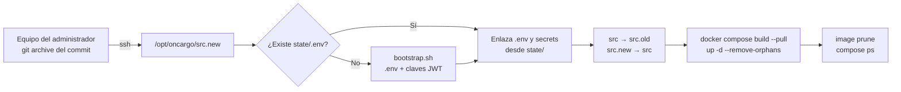

# S2 · Entregable 3 — Implementación y Control del Centro de Datos (VPS Hostinger)
> Competencias C3.2 (Implementación) · C3.3 (Control y operación)  
> Proyecto: OnCargo — Sistema Operativo Logístico Colaborativo para PYMEs  
> Equipo: Jorge Gutiérrez Miranda · Fabrizio Sanchez Saravia · Alex Coila Jarita  
> Semestre 2 · Agosto–Noviembre 2026 · **Versión 2.3 (alertas por ntfy, contraseña demo propia y reinicio por kernel, 19-nov-2026)** · v2.2: respaldos, monitoreo y endurecimiento aplicados · v2.1: estado real del despliegue · v2.0: diseño previo al despliegue · v1.0: AWS

!!! info "Versión 2.1: el centro de datos tal como está en operación"
    La versión 1.0 implementaba el centro de datos con Terraform sobre AWS. La versión 2.0 lo rediseñó para un VPS Hostinger con Cloudflare, R2, respaldos cifrados y Uptime Kuma, pero se escribió **antes** de aprovisionar el servidor. Esta versión 2.1 documenta **lo que se desplegó**, tomado de `infra/vps/` del monorepo (`compose.yml`, `Caddyfile`, `bootstrap.sh`, `deploy.sh`, `publish-apk.sh`, `downloads/` y `README.md`; commit `cad2b77` del 16-nov-2026).

    **En operación:** VPS Hostinger KVM 2 con Ubuntu 24.04, cinco contenedores (Caddy, web, backend, PostgreSQL, MinIO), HTTPS automático, despliegue por script con vuelta atrás y página de descarga del APK. **Desde la v2.2 (19-nov-2026):** respaldo diario cifrado con prueba de restauración, chequeo de salud cada 5 minutos y endurecimiento del host versionado en `infra/vps/harden.sh` (commits `9d1f6a2` y `b44014a` de `oncargo-code`). **Desde la v2.3:** alertas del chequeo de salud por ntfy.sh, contraseña demo propia del VPS y reinicio por kernel verificado (todo volvió solo). **Pendiente:** copia de los respaldos fuera del VPS, monitor externo, registro CAA, Cloudflare/R2 y la salida del modo de pruebas. El servidor funciona hoy como **entorno de pruebas** con cuentas demo (`DEMO_DATA=true`).

---

## Resumen Ejecutivo

El centro de datos de OnCargo es un único **VPS Hostinger KVM 2** (2 vCPU, 8 GB de RAM, 96 GB de disco, Ubuntu 24.04 LTS) endurecido con usuario `deploy` con `sudo`, SSH solo con clave, UFW, fail2ban, `unattended-upgrades`, 2 GB de swap, rotación de logs de Docker y zona horaria America/Lima. Sobre él, **Docker Compose** levanta cinco servicios: **Caddy** (proxy inverso con HTTPS automático y descarga del APK), **web** (Astro 7 SSR, Node 22), **backend** (Quarkus 3.40, Java 21, con REST, SSE y trabajos programados), **PostgreSQL 16** (RLS y tres roles de mínimo privilegio) y **MinIO** (almacén S3 de documentos y evidencias).

El despliegue lo hace `infra/vps/deploy.sh` desde el equipo del administrador: empaqueta un commit con `git archive`, lo copia a `/opt/oncargo/src`, conserva la versión anterior en `src.old`, genera los secretos en el primer despliegue (`bootstrap.sh`) y reconstruye las imágenes en el propio servidor.

El diseño acepta **un único dominio de falla** (equivalente a Tier I). Desde la v2.2 hay **respaldos diarios cifrados** con prueba de restauración (RPO 24 h ante errores lógicos o corrupción), pero se guardan **en el mismo disco**: ante la pérdida del VPS el RPO sigue sin garantía hasta configurar una copia externa. Es el pendiente de mayor prioridad, y mientras tanto se mantiene el procedimiento manual de la sección 2.2 para bajar una copia.

**Leyenda de estados:**

| Estado | Significado |
|--------|-------------|
| **Desplegado en el VPS** | Está en `infra/vps/` y aplicado en el servidor según `infra/vps/README.md`. |
| **Implementado en el repositorio** | Existe en el código del monorepo y viaja con cada despliegue. |
| **Pendiente de ejecución** | Procedimiento o medición definidos; falta ejecutarlos y adjuntar evidencia. |
| **No implementado (mejora)** | Formaba parte del diseño v2.0 y no se desplegó. |

**Servicios implementados** (la rúbrica menciona AD, DNS, Web y BD):

| Servicio | Implementación | Estado |
|----------|---------------|--------|
| Web (HTTP/HTTPS) | Caddy 2.10 (proxy inverso, TLS automático de Let's Encrypt, HTTP/3) + `web` (Astro 7 SSR, Node 22) | Desplegado en el VPS |
| API | `backend` (Quarkus 3.40, Java 21): REST, SSE, trabajos programados | Desplegado en el VPS |
| Base de datos | PostgreSQL 16 con RLS y tres roles | Desplegado en el VPS |
| Almacenamiento de objetos | MinIO (API S3) para documentos y evidencias de entrega | Desplegado en el VPS |
| Distribución de la app | Página `https://oncargo.tech/app/` con QR, `oncargo.apk` y `version.json` (`publish-apk.sh`) | Desplegado en el VPS |
| DNS | Registros A en el panel de Hostinger (público); DNS embebido de Docker (interno) | Desplegado (ver [Red, sección 1.5](implementacion-red.md)) |
| Directorio (AD/LDAP) | **No aplica:** la identidad vive en la aplicación (JWT RSA, bcrypt, roles por organización); no hay un dominio de Windows ni usuarios de red | Decisión de diseño |
| Correo saliente (restablecer contraseña, invitaciones y avisos por persona de V16) | Quarkus Mailer: el compose del VPS **no define** `SMTP_*`, así que esos correos no se entregan; los enlaces de los avisos usan `WEB_URL` (por omisión `https://oncargo.tech`) | No implementado (configurar SMTP) |
| Monitoreo | `healthcheck` de Docker + `restart: unless-stopped`; `oncargo-health` cada 5 min (servicio, disco, memoria, certificado, respaldo) | Implementado (v2.2); monitor externo y canal de alertas: pendientes |
| Respaldo | `oncargo-backup` diario (03:30, Lima): Postgres, MinIO y `state/` cifrados con age, 14 días | Implementado (v2.2) en el VPS; copia externa pendiente |

---

## Sección 1 — Configuración de Servidores y Servicios (C3.2)

### 1.1 Aprovisionamiento del VPS

| Paso | Acción | Resultado | Estado |
|------|--------|-----------|--------|
| 1 | Contratar **Hostinger VPS KVM 2** con plantilla **Ubuntu 24.04 LTS** sin panel | VPS con IPv4 pública | Desplegado (2 vCPU, 8 GB, 96 GB) |
| 2 | Registrar la clave SSH pública del administrador (`~/.ssh/hostinger_kvm2`) | Acceso por clave | Desplegado |
| 3 | Crear el usuario `deploy` con `sudo` y desactivar el acceso por contraseña | Superficie administrativa mínima | Desplegado |
| 4 | UFW (22/80/443), fail2ban (`sshd`), `unattended-upgrades`, 2 GB de swap, rotación de logs de Docker (10 MB × 3), zona horaria America/Lima | Host endurecido | Desplegado |
| 5 | Instalar Docker Engine y el plugin Compose | `docker compose version` operativo | Desplegado |
| 6 | Desde el equipo del administrador: `infra/vps/deploy.sh` | Código en `/opt/oncargo/src`, secretos generados, servicios en marcha | Desplegado |
| 7 | Crear los registros A (`@`, `www`, `api`) en el panel DNS de Hostinger | Caddy emite los certificados al propagar | Definido en el README; propagación por verificar (Red, T1) |
| 8 | `infra/vps/publish-apk.sh` | APK disponible en `/app/` | Desplegado |

La región del centro de datos se confirma en el panel de Hostinger (hPanel → VPS → Información) y se registra en el Anexo A.

### 1.2 Endurecimiento inicial

El detalle de cada control está en [Implementación de Seguridad, sección 1](implementacion-seguridad.md). Lista de comprobación:

| # | Control | Comando de verificación | Estado |
|---|---------|-------------------------|--------|
| 1 | Usuario `deploy` con `sudo`; `root` solo con clave | `sudo sshd -T \| grep -E 'permitrootlogin\|passwordauthentication'` | Desplegado |
| 2 | SSH solo con clave pública | `ssh -o PreferredAuthentications=password deploy@<IP>` debe fallar | Desplegado |
| 3 | UFW: entrada `deny`, 22/80/443 permitidos | `sudo ufw status verbose` | Desplegado |
| 4 | fail2ban con la *jail* `sshd` | `sudo fail2ban-client status sshd` | Desplegado |
| 5 | `unattended-upgrades` activo | `systemctl status unattended-upgrades` | Desplegado |
| 6 | 2 GB de swap | `swapon --show && free -m` | Desplegado |
| 7 | Rotación de logs de Docker (10 MB × 3) | `docker info \| grep -iA2 'logging driver'` | Desplegado |
| 8 | Zona horaria America/Lima | `timedatectl` | Desplegado |
| 9 | SSH adicional: `AllowUsers deploy root`, sin X11/agente/túneles, algoritmos modernos | `sudo sshd -T \| grep -E 'allowusers\|x11forwarding\|kexalgorithms'` | Implementado (v2.2) |
| 10 | `DOCKER-USER`: solo 80/443 hacia contenedores | `sudo iptables -S DOCKER-USER` | Implementado (v2.2) |
| 11 | fail2ban `recidive` y *jails* de Caddy | `sudo fail2ban-client status` | Implementado (v2.2) |
| 12 | `sysctl` de red, journald (1 GB / 30 días), auditd | `sysctl net.ipv4.conf.all.send_redirects`, `journalctl --disk-usage`, `sudo auditctl -l` | Implementado (v2.2) |
| 13 | Docker `live-restore` | `docker info --format '{{.LiveRestoreEnabled}}'` | Implementado (v2.2) |
| 14 | Permisos de `state/` (`700`, `.env` `600`, clave JWT privada `640`) | `stat -c '%a %n' /opt/oncargo/state/.env` | Implementado (v2.2) |
| 15 | Temporizadores `oncargo-backup` y `oncargo-health` | `systemctl list-timers 'oncargo-*'` | Implementado (v2.2) |

Los pasos 9 a 15 se aplican con `sudo /opt/oncargo/src/infra/vps/harden.sh` (idempotente; también por pasos: `harden.sh ssh firewall …`). La evidencia de cada uno está en [Implementación de Seguridad, Sección 0](implementacion-seguridad.md).

### 1.3 Instalación de Docker Engine y Compose

```bash
# Repositorio oficial de Docker para Ubuntu 24.04
sudo install -m 0755 -d /etc/apt/keyrings
sudo curl -fsSL https://download.docker.com/linux/ubuntu/gpg -o /etc/apt/keyrings/docker.asc
sudo chmod a+r /etc/apt/keyrings/docker.asc
echo "deb [arch=$(dpkg --print-architecture) signed-by=/etc/apt/keyrings/docker.asc] https://download.docker.com/linux/ubuntu $(. /etc/os-release && echo "$VERSION_CODENAME") stable" \
  | sudo tee /etc/apt/sources.list.d/docker.list > /dev/null
sudo apt-get update
sudo apt-get install -y docker-ce docker-ce-cli containerd.io docker-buildx-plugin docker-compose-plugin

sudo usermod -aG docker deploy
sudo install -d -o deploy -g deploy /opt/oncargo
# /etc/docker/daemon.json: { "log-driver": "json-file", "log-opts": { "max-size": "10m", "max-file": "3" } }
sudo systemctl restart docker && docker version && docker compose version
```

El código **no se clona** en el servidor: lo copia `deploy.sh` (sección 4.1).

### 1.4 `compose.yml` del VPS

Este es el archivo `infra/vps/compose.yml` desplegado, completo:

```yaml
# OnCargo — VPS (Hostinger KVM 2). Ver infra/vps/README.md.
# Caddy es lo único publicado en el host (80/443); el resto vive en redes internas de Docker,
# así UFW no queda puenteado por puertos que Docker publique.
name: oncargo

services:
  db:
    image: postgres:16-alpine
    restart: unless-stopped
    environment:
      POSTGRES_DB: postgres
      POSTGRES_USER: postgres
      POSTGRES_PASSWORD: ${POSTGRES_SUPERUSER_PASSWORD:?falta en .env}
      LOGYX_DB: logyx
      LOGYX_OWNER_PASSWORD: ${DB_ADMIN_PASSWORD:?falta en .env}
      LOGYX_APP_PASSWORD: ${DB_APP_PASSWORD:?falta en .env}
    volumes:
      - pgdata:/var/lib/postgresql/data
      - ../db/init-roles.sh:/docker-entrypoint-initdb.d/10-init-roles.sh:ro
    healthcheck:
      test: ["CMD-SHELL", "pg_isready -U postgres -d logyx"]
      interval: 5s
      timeout: 5s
      retries: 20
    networks: [internal]
    mem_limit: 768m

  minio:
    # Almacén S3 de documentos para el entorno de pruebas. En producción: Cloudflare R2 (ver README).
    image: chainguard/minio@sha256:fb893e36fc369d41e92f678b17ec27378fa5bf0576aeef7ac15460c13629ab5a
    restart: unless-stopped
    command: ["server", "/data"]
    environment:
      MINIO_ROOT_USER: ${MINIO_ROOT_USER:?falta en .env}
      MINIO_ROOT_PASSWORD: ${MINIO_ROOT_PASSWORD:?falta en .env}
    volumes:
      - miniodata:/data
    healthcheck:
      test: ["CMD", "bash", "-c", "exec 3<>/dev/tcp/127.0.0.1/9000 && printf 'GET /minio/health/ready HTTP/1.1\\r\\nHost: localhost\\r\\nConnection: close\\r\\n\\r\\n' >&3 && read -r status <&3 && [[ $$status == *' 200 '* ]]"]
      interval: 5s
      timeout: 5s
      retries: 20
    networks: [internal]
    mem_limit: 384m

  backend:
    build:
      context: ../../backend
      args:
        DEMO_DATA: ${DEMO_DATA:-false}
    image: oncargo-backend:local
    restart: unless-stopped
    depends_on:
      db: { condition: service_healthy }
      minio: { condition: service_healthy }
    environment:
      DB_URL: jdbc:postgresql://db:5432/logyx
      DB_ADMIN_USER: logyx_owner
      DB_ADMIN_PASSWORD: ${DB_ADMIN_PASSWORD}
      DB_APP_USER: logyx_api
      DB_APP_PASSWORD: ${DB_APP_PASSWORD}
      JWT_PUBLIC_KEY: /run/secrets/jwt_public_key
      JWT_PRIVATE_KEY: /run/secrets/jwt_private_key
      LOGYX_DOCUMENTS_STORAGE: s3
      LOGYX_S3_ENDPOINT: http://minio:9000
      LOGYX_S3_BUCKET: oncargo-documents
      LOGYX_S3_ACCESS_KEY: ${MINIO_ROOT_USER}
      LOGYX_S3_SECRET_KEY: ${MINIO_ROOT_PASSWORD}
      LOGYX_S3_CREATE_BUCKET: "true"
      CORS_ENABLED: "false"
      # Solo Caddy (red edge de Docker) puede fijar X-Forwarded-For.
      TRUSTED_PROXIES: 172.16.0.0/12
      JAVA_TOOL_OPTIONS: "-XX:MaxRAMPercentage=70 -XX:+ExitOnOutOfMemoryError -Djava.util.logging.manager=org.jboss.logmanager.LogManager"
    secrets: [jwt_private_key, jwt_public_key]
    networks: [internal, edge]
    mem_limit: 1g

  web:
    build: ../../web
    image: oncargo-web:local
    restart: unless-stopped
    depends_on:
      backend: { condition: service_healthy }
    environment:
      API_URL: http://backend:8080
      # false mientras se prueba por IP (http). Con el dominio en HTTPS: true.
      COOKIE_SECURE: ${COOKIE_SECURE:-true}
    networks: [edge]
    mem_limit: 512m

  caddy:
    image: caddy:2.10-alpine
    restart: unless-stopped
    depends_on: [web, backend]
    ports:
      - "80:80"
      - "443:443"
      - "443:443/udp"
    environment:
      DOMAIN: ${DOMAIN:-oncargo.tech}
      PUBLIC_IP: ${PUBLIC_IP:-127.0.0.1}
    volumes:
      - ./Caddyfile:/etc/caddy/Caddyfile:ro
      - ${DOWNLOADS_DIR:-/opt/oncargo/downloads}:/srv/downloads:ro
      - caddy_data:/data
      - caddy_config:/config
    networks: [edge]
    mem_limit: 128m

secrets:
  jwt_private_key:
    file: ../secrets/jwt-private.pem
  jwt_public_key:
    file: ../secrets/jwt-public.pem

volumes:
  pgdata:
  miniodata:
  caddy_data:
  caddy_config:

networks:
  internal:
  edge:
```

| Decisión | Justificación |
|----------|---------------|
| Imágenes de `backend` y `web` compiladas **en el VPS** (`build:`) | No hace falta un registro de imágenes; `deploy.sh` ejecuta `docker compose build --pull` |
| `DEMO_DATA` como argumento de compilación | La imagen de pruebas incluye el *seed* demo (`DemoDataSeeder`); con `false` la imagen no lo contiene |
| `depends_on` con `service_healthy` | Arranque ordenado: `db` y `minio` → `backend` → `web` → `caddy` |
| JVM al 70 % del límite (`MaxRAMPercentage=70`) y `ExitOnOutOfMemoryError` | El heap respeta el `mem_limit` de 1 GB; ante un OOM el proceso termina y Docker lo reinicia |
| Claves JWT como `secrets:` | No aparecen en variables de entorno ni en la imagen |
| Suma de límites: 768 + 384 + 1,024 + 512 + 128 MB ≈ **2.8 GB** | Deja más de 5 GB para el sistema, la caché de disco y los picos de compilación de imágenes |

**Estado:** Desplegado en el VPS.

### 1.5 Variables de entorno (`/opt/oncargo/state/.env`)

`bootstrap.sh` crea el archivo en el primer despliegue con `umask 077`. Las contraseñas son aleatorias (`openssl rand -base64 36`, 32 caracteres) y **nunca salen del servidor**:

```bash
# /opt/oncargo/state/.env — generado por infra/vps/bootstrap.sh; permiso 600; NO se versiona
DOMAIN=oncargo.tech
PUBLIC_IP=<IP pública detectada con ifconfig.me>
POSTGRES_SUPERUSER_PASSWORD=<aleatoria>
DB_ADMIN_PASSWORD=<aleatoria>          # logyx_owner (Flyway y SystemTx)
DB_APP_PASSWORD=<aleatoria>            # logyx_api (RLS)
MINIO_ROOT_USER=oncargo-minio
MINIO_ROOT_PASSWORD=<aleatoria>
# Entorno de pruebas: cuentas demo. En producción real: false.
DEMO_DATA=true
LOGYX_DEMO_PASSWORD=<aleatoria>   # v2.3: contraseña de las cuentas demo del VPS (no la del repositorio); la genera deploy.sh si falta
# Cookie de sesión solo por HTTPS (el acceso por IP redirige al dominio).
COOKIE_SECURE=true
DOWNLOADS_DIR=/opt/oncargo/downloads
LOGYX_UNSUBSCRIBE_SECRET=<aleatoria>   # V24: clave HMAC del enlace de baja; la agrega deploy.sh si falta
```

| Variable | Valor actual | Valor para producción |
|----------|--------------|-----------------------|
| `DEMO_DATA` | `true` (cuentas `*@logyx.pe` con contraseña propia del VPS desde la v2.3) | `false` y base de datos nueva |
| `COOKIE_SECURE` | `true` (desde el 19-nov-2026) | `true` |
| `SMTP_HOST`, `SMTP_PORT`, `SMTP_USERNAME`, `SMTP_PASSWORD`, `MAIL_FROM` | Ya pasan al backend por `compose.yml`; sin proveedor elegido, `SMTP_HOST=localhost` (el envío falla y se registra) | Definir el proveedor SMTP en `state/.env` |
| `WEB_URL`, `PASSWORD_RESET_URL` | No definidas: valen por omisión `https://oncargo.tech` y `https://oncargo.tech/restablecer` | Correctas para el dominio actual; definirlas solo si cambia el dominio |

### 1.6 PostgreSQL: roles y migraciones

**Inicialización de roles.** En el primer arranque del volumen vacío, la imagen oficial ejecuta `infra/db/init-roles.sh` (montado en `docker-entrypoint-initdb.d`) como superusuario:

| Rol / objeto | Atributos | Quién lo usa |
|--------------|-----------|--------------|
| `logyx_owner` | `LOGIN`, dueño de la BD `logyx` y del esquema `public`; sin `SUPERUSER`, `CREATEDB`, `CREATEROLE`, `REPLICATION` ni `BYPASSRLS` | Flyway y `SystemTx` (datasource por defecto) |
| `logyx_app` | `NOLOGIN`, sin `BYPASSRLS`; las políticas RLS son `TO logyx_app` | Rol de pertenencia |
| `logyx_api` | `LOGIN`, miembro **solo** de `logyx_app`, `CONNECTION LIMIT 50` | Datasource `app` de Hibernate |
| BD `logyx` | `REVOKE ALL … FROM PUBLIC`; `CONNECT` solo para `logyx_api` | — |

**Parámetros.** El compose no fija parámetros: PostgreSQL usa los valores por omisión de la imagen (`shared_buffers` 128 MB, `max_connections` 100), suficientes para el volumen de pruebas. Los pools del backend usan 8 conexiones (`logyx_owner`) + 20 (`logyx_api`). El ajuste de diseño (`shared_buffers` ≈ 25 % del límite, `log_min_duration_statement` 1000 ms) queda como mejora.

**Migraciones (Flyway).** El backend migra la base al arrancar con `logyx_owner`. El código del repositorio tiene las migraciones **V1 a V18** (V16 avisos por persona, V17 direcciones frecuentes y búsqueda, V18 parámetros de sistema, comisión y términos versionados; ADR-0010). Las que estén aplicadas en el VPS dependen del commit desplegado: se confirman con la consulta siguiente.

```bash
cd /opt/oncargo/src/infra/vps
docker compose exec db psql -U postgres -d logyx -c "SELECT installed_rank, version, description, success FROM flyway_schema_history ORDER BY installed_rank DESC LIMIT 5;"
# Esperado: la última migración del commit desplegado (V23 al 19-nov-2026) con success = t
docker compose exec db psql -U postgres -d logyx -c "SELECT count(*) AS politicas_rls FROM pg_policies;"   # Esperado: > 0
docker compose exec db psql -U postgres -d logyx -c "SELECT pg_size_pretty(pg_database_size('logyx'));"
```

### 1.7 Almacenamiento de objetos: MinIO

Los documentos (guías, fotos de entrega, firmas) se guardan en **MinIO**, un servidor compatible con S3 que corre en el mismo VPS. El backend usa el adaptador `S3DocumentStorage` (AWS SDK v2), el mismo que serviría para Cloudflare R2: migrar implica cambiar solo las variables `LOGYX_S3_*`.

| Aspecto | Valor | Estado |
|---------|-------|--------|
| Endpoint | `http://minio:9000` (red `internal`, sin puerto publicado) | Desplegado en el VPS |
| Bucket | `oncargo-documents`, creado por el backend al arrancar (`LOGYX_S3_CREATE_BUCKET=true`) | Desplegado en el VPS |
| Datos | Volumen `miniodata` en el disco del VPS | Desplegado en el VPS |
| Credenciales | Las de administrador de MinIO (`MINIO_ROOT_USER`/`PASSWORD`) | Desplegado; mejora pendiente: usuario limitado al bucket |
| Consola web de MinIO | Desactivada (`MINIO_BROWSER=off`); antes escuchaba en un puerto aleatorio de la red interna | Implementado (v2.2) |
| Salida a Internet | Ninguna: red `internal: true` | Implementado (v2.2) |
| Validación de archivos | jpg/png/pdf por firma binaria, máximo 10 MB, claves generadas por el servidor | Implementado en el repositorio |
| Descarga | Solo a través de la API (con RLS); el bucket no es público (petición anónima → `403 Forbidden`, verificado el 19-nov-2026) | Implementado en el repositorio |
| Cloudflare R2 (diseño v2.0) | — | No implementado (mejora para producción) |

```bash
# Verificación: el bucket existe y contiene objetos (desde el contenedor de MinIO)
docker compose exec minio bash -c 'ls -la /data/oncargo-documents | head'   # la imagen Chainguard trae bash (lo usa su healthcheck)
```

### 1.8 Trabajos programados

Los trabajos corren **dentro del backend** (`@Scheduled` de Quarkus, con `SystemTx` para operar sin contexto de organización):

| Trabajo (identidad) | Frecuencia | Qué hace | Estado |
|--------------------|-----------|----------|--------|
| `AuctionScheduler` (`auction-closer`) | Cada 30 s | Cierra las subastas vencidas | Desplegado en el VPS |
| `OutboxDispatcher` (`outbox-dispatcher`) | Cada 5 s | Despacha eventos pendientes del outbox (reintentos con *backoff*, máximo 10 intentos, luego `FAILED`) | Desplegado en el VPS |
| `OutboxDispatcher` (`outbox-cleanup`) | Cada 1 h | Elimina eventos `DONE` con más de 7 días | Desplegado en el VPS |
| `TripScheduler` (`smart-load-planner`) | Cada 15 min | Calcula sugerencias Smart Load | Desplegado en el VPS |
| `TripScheduler` (`trip-maintenance`) | Cada 5 min | Cierra viajes que ya salieron, completa los antiguos y vence sugerencias | Desplegado en el VPS |
| `RealtimeMaintenance` (`realtime-cleanup`) | Cada 1 h | Retiene `realtime_events` 24 h | Desplegado en el VPS |
| `AuthTokenCleanup` (`auth-token-cleanup`) | Cada 1 h | Borra tokens de contraseña y de *refresh* vencidos | Desplegado en el VPS |

En el **host**, desde la v2.2, hay tres unidades de systemd propias (en `infra/vps/host/systemd/`, instaladas por `harden.sh`):

| Unidad | Frecuencia | Qué hace | Estado |
|--------|-----------|----------|--------|
| `oncargo-backup.timer` | Diaria, 03:30 (Lima) ± 15 min, `Persistent=true` | Respaldo cifrado (sección 2.2) | Implementado (v2.2) |
| `oncargo-health.timer` | Cada 5 min | Chequeo de salud (sección 3.2) | Implementado (v2.2) |
| `oncargo-docker-user.service` | Al arrancar Docker | Lista blanca `DOCKER-USER` ([Red, 1.4](implementacion-red.md)) | Implementado (v2.2) |
| `firewall-cloudflare.timer`, `mantenimiento-mensual.timer` (diseño v2.0) | — | — | Pendientes: dependen de Cloudflare y de aprobar reinicios automáticos |

!!! note "Escalado horizontal"
    El outbox usa `SKIP LOCKED` y el SSE se reparte por `LISTEN/NOTIFY`, así que varias réplicas del backend son viables. La exclusión `ConcurrentExecution.SKIP` de los `@Scheduled` y el *rate limiting* son **por instancia**; con más de una réplica hay que revisar esos dos puntos.

---

## Sección 2 — Almacenamiento y Backup (C3.2)

### 2.1 Almacenamiento

La rúbrica menciona RAID, SAN y NAS. Aquí **no se administra ninguno**: el disco es un volumen virtualizado de 96 GB cuya redundancia física depende del proveedor y no está especificada. La protección de los datos viene de los **respaldos cifrados** (sección 2.2), que hoy quedan en el mismo disco; la copia externa sigue pendiente.

| Volumen o ubicación | Contenido | Protección actual |
|---------------------|-----------|-------------------|
| Volumen `pgdata` | Base de datos PostgreSQL | Respaldo diario cifrado en `/var/backups/oncargo` (14 días); **ninguna fuera del VPS** |
| Volumen `miniodata` | Documentos, fotos de entrega y firmas | Respaldo diario cifrado (tar); **ninguna fuera del VPS** |
| Volúmenes `caddy_data` y `caddy_config` | Certificados y cuenta ACME | Se regeneran (ver los límites de Let's Encrypt en la sección 4.3) |
| `/opt/oncargo/state` | `.env` (incluye `LOGYX_UNSUBSCRIBE_SECRET` y `LOGYX_PAYOUT_KEY`, sin la cual los datos de cobro cifrados no se pueden leer), claves JWT, `DEPLOYED` | Respaldo diario cifrado; ninguna fuera del VPS (si se pierden, `bootstrap.sh` genera otras y las sesiones se invalidan) |
| `/var/backups/oncargo` | Respaldos cifrados y manifiestos | root `700`; rotación de 14 días |
| `/opt/oncargo/src` y `src.old` | Código desplegado y el anterior | El código está en GitHub |
| `/opt/oncargo/downloads` | `index.html`, QR, `oncargo.apk`, `version.json` | Se vuelven a publicar con `deploy.sh` y `publish-apk.sh` |
| Imágenes de Docker | `oncargo-backend:local`, `oncargo-web:local`, `postgres`, `caddy`, `minio` | Se reconstruyen desde el repositorio |
| Logs de contenedores | `json-file` rotado (10 MB × 3 por contenedor) | Rotación |

```bash
df -h /
docker system df
docker volume ls --filter name=oncargo
```

### 2.2 Política de backup

**Respaldo automático (implementado en la v2.2).** `oncargo-backup.timer` ejecuta cada día `infra/vps/backup.sh` (instalado como `/usr/local/sbin/oncargo-backup`):

| Paso | Detalle |
|------|---------|
| 1. Base de datos | `pg_dump -U postgres -d logyx -Fc` dentro del contenedor `db` (socket local, sin contraseñas en la línea de comandos), validado con `pg_restore -l` **antes** de cifrar; si el índice no es legible, el respaldo falla |
| 2. Conteos de referencia | Última migración, tablas, políticas RLS, organizaciones, perfiles y envíos, guardados en el manifiesto |
| 3. Documentos y secretos | `tar` del volumen `oncargo_miniodata` y de `/opt/oncargo/state` |
| 4. Cifrado | **age** (X25519) para las claves públicas de `infra/vps/backup-recipients.txt`. La identidad privada **no está en el VPS**: la guarda el administrador (gestor de contraseñas). Quien comprometa el servidor no puede leer los respaldos antiguos de otra copia, y quien obtenga una copia no puede leerla sin la clave |
| 5. Manifiesto | Fecha, commit desplegado, número de objetos del volcado, conteos y sha256 de cada archivo (sin secretos) |
| 6. Rotación | Se borran los archivos con más de 14 días (`BACKUP_KEEP_DAYS`) |
| 7. Copia externa | Opcional con `rclone` si existe `BACKUP_RCLONE_REMOTE` en `/etc/oncargo/backup.env` (p. ej. `r2:oncargo-backups/vps` con un *token* de solo escritura). **Pendiente:** requiere las credenciales del responsable del proyecto |
| 8. Latido | `/var/lib/oncargo/backup-last-ok`; `oncargo-health` alerta si tiene más de 26 h |

```text
$ sudo oncargo-backup list            (19-nov-2026)
-rw------- root  db-20261119-1048.dump.age        ~305 KB
-rw------- root  minio-20261119-1048.tar.gz.age    ~17 KB
-rw------- root  state-20261119-1048.tar.gz.age    ~2.5 KB
-rw------- root  manifest-20261119-1048.txt
manifiesto: objetos_toc=666 migracion=23 tablas=47 politicas_rls=126 organizaciones=4 perfiles=7 envios=3
```

**Copia fuera del VPS (manual, hasta configurar R2).** Se ejecuta antes de cada despliegue con migraciones y, mientras haya datos que importen, al menos una vez por semana. Las copias quedan en el equipo del administrador. Con la v2.2 basta con bajar los archivos ya cifrados (`sudo tar -C /var/backups/oncargo -cf - . | …`); el procedimiento original, sin depender del respaldo automático, sigue siendo válido:

```bash
# En el equipo del administrador
SSH="ssh -i ~/.ssh/hostinger_kvm2 deploy@<IP_PUBLICA_VPS>"
F=oncargo-$(date +%F-%H%M)

# 1) Base de datos: volcado en formato custom, sin contraseñas en la línea de comandos (socket local del contenedor)
$SSH "cd /opt/oncargo/src/infra/vps && docker compose exec -T db pg_dump -U postgres -d logyx -Fc" > "$F.dump"
pg_restore -l "$F.dump" | head -5            # verificación: el índice del volcado es legible

# 2) Documentos de MinIO: copia del volumen
$SSH "docker run --rm -v oncargo_miniodata:/data:ro alpine tar -czf - -C /data ." > "$F-minio.tgz"

# 3) Secretos (para restaurar sin invalidar sesiones): copiar cifrados al gestor de contraseñas
$SSH "sudo tar -czf - -C /opt/oncargo state" | gpg -c -o "$F-state.tgz.gpg"

ls -lh "$F"*
```

| Parámetro | Objetivo (diseño v2.0) | Situación actual (v2.2) |
|-----------|------------------------|------------------|
| Frecuencia | Diaria, 02:00 | **Diaria, 03:30 (Lima)**: implementado |
| Destino | Fuera del proveedor (R2) | `/var/backups/oncargo` en el VPS; **externo pendiente** (decisión del usuario) |
| Cifrado | `age` con clave pública en el VPS | **age**: implementado; la identidad privada está fuera del VPS |
| Retención | 30 días | 14 días locales (ajustable); la retención externa se fijará con R2 |
| RPO | 24 h | 24 h ante errores lógicos o corrupción; **sin garantía** ante la pérdida del VPS hasta la copia externa |
| Automatización | Script + temporizador de `systemd` + latido a Uptime Kuma | Script + temporizador + latido local vigilado por `oncargo-health`: implementado |

### 2.3 Prueba de restauración

Se restaura el último volcado en un PostgreSQL temporal **en el equipo del administrador**, con los mismos roles, y se verifican las migraciones y los conteos:

```bash
# Desde el monorepo clonado, con el archivo oncargo-AAAA-MM-DD-HHMM.dump
CT=oncargo-restore-test
docker run -d --name $CT -e POSTGRES_PASSWORD=restore-test -e LOGYX_DB=logyx \
  -e LOGYX_OWNER_PASSWORD=owner-test -e LOGYX_APP_PASSWORD=api-test \
  -v "$PWD/infra/db/init-roles.sh:/docker-entrypoint-initdb.d/10-init-roles.sh:ro" postgres:16-alpine
until docker exec $CT pg_isready -h 127.0.0.1 -U postgres -d logyx >/dev/null 2>&1; do sleep 2; done
docker cp oncargo-*.dump $CT:/tmp/restore.dump
time docker exec $CT pg_restore -U postgres -d logyx --no-owner --role=logyx_owner /tmp/restore.dump
docker exec $CT psql -U postgres -d logyx -At -c "
  SELECT 'migraciones_ok=' || bool_and(success) || ' ultima=' || max(version) FROM flyway_schema_history;
  SELECT 'organizaciones=' || count(*) FROM organizations;
  SELECT 'envios=' || count(*) FROM shipments;
  SELECT 'politicas_rls=' || count(*) FROM pg_policies;"
docker rm -f $CT
```

**Criterio de aceptación:** `migraciones_ok=true`, la última migración del commit desplegado, conteos coherentes con el VPS y `politicas_rls` mayor que cero.

**Prueba automatizada en el VPS (v2.2).** `oncargo-backup verify` hace lo mismo **dentro del VPS** sin dejar la clave en él: la identidad age llega por la entrada estándar desde el equipo del administrador, se comprueban los sha256 del manifiesto, se descifran los tres archivos (los tar se listan y se exige `state/.env`), y el volcado se restaura en un `postgres:16-alpine` temporal **sin red** (`--network none`, 512 MB) con los roles de `init-roles.sh`. Luego se comparan los conteos con los del manifiesto y se elimina el contenedor.

```text
$ ssh deploy@<IP> 'sudo oncargo-backup verify -' < backup-age-identity.txt     (19-nov-2026)
[oncargo-backup] verificando db-20261119-1048.dump.age
[oncargo-backup] restauración en 3 s
[oncargo-backup] OK: conteos idénticos al momento del respaldo:
    migracion=23  tablas=47  politicas_rls=126  organizaciones=4  perfiles=7  envios=3
```

**Estado:** SIM-1 **ejecutado** el 19-nov-2026 (dos veces, con los respaldos de las 10:40 y 10:48). Frecuencia: mensual (sección 4.5).

---

## Sección 3 — SLA y Monitoreo (C3.3)

### 3.1 Definición de SLA

Es un **SLA interno de objetivos**, no un contrato con clientes: Hostinger no ofrece un acuerdo que OnCargo pueda trasladar. Los números son metas; **no son mediciones**.

| Componente | Objetivo | Cómo se mide hoy | Estado de la medición |
|-----------|----------|------------------|-----------------------|
| Disponibilidad mensual | **≥ 99 %** (RNF-02) ≈ máx. 7.2 h de caída al mes | Sin monitor externo: solo se detectan las caídas que alguien observa | No medible hasta activar UptimeRobot |
| Disponibilidad estimada de diseño | ≈ 99.5 % (un solo nodo; ver Anexo B de [Diseño de Centro de Datos](../semestre-1/diseno-datacenter.md)) | Cálculo | Referencia |
| Respuesta de la API (P95) | < 2.0 s (RNF-01) | Pruebas de [Red, sección 4.2](implementacion-red.md) | Pendiente de medición |
| Cierre de subastas | Retraso máximo de ~30 s | Periodo del trabajo `auction-closer` | Implementado |
| Despacho de eventos | Ciclo de 5 s; eventos en `FAILED` = 0 | Tabla `outbox_events` | Revisión manual |
| Latido del stream SSE | 20 s | Prueba T7 de [Red](implementacion-red.md) | Pendiente de medición |
| RTO | 1–2 h para volver a tener servicio | Runbook 4.3 | Pendiente de simulacro |
| RPO | 24 h (objetivo) | `backup-last-ok` y manifiestos | 24 h ante errores lógicos (implementado, v2.2); sin garantía ante la pérdida del VPS hasta la copia externa |

| Objetivo de disponibilidad | Caída máxima mensual (30 días) | Observación |
|---------------------------|-------------------------------|-------------|
| 99.9 % | ≈ 43 min | **No se promete**: exigiría un segundo nodo y réplica de la BD |
| 99 % (objetivo) | 7.2 h | Meta del SRS (RNF-02) |

### 3.2 Monitoreo

| Capa | Herramienta | Detalle | Estado |
|------|-------------|---------|--------|
| Contenedores | `healthcheck` de Docker | `db`, `minio`, `backend`, `web`; reinicio automático con `restart: unless-stopped` | Desplegado en el VPS |
| Aplicación | `/q/health/ready` (incluye la comprobación de la BD) | Lo consulta Docker | Desplegado en el VPS |
| Logs | `docker compose logs` (rotación 10 MB × 3); registro de accesos de Caddy (14 días); journald (1 GB / 30 días) | Revisión manual y fail2ban | Desplegado en el VPS (v2.2) |
| Interna | **`oncargo-health`** (`infra/vps/healthcheck.sh`, cada 5 min) | Web, `/login`, `/app/` y APK con `200`; `/q/health/ready`; los cinco contenedores en marcha y sanos; reinicios u OOM; disco < 85 %; memoria disponible ≥ 500 MB; swap ≤ 1 GB; certificados con ≥ 14 días; último respaldo < 26 h; reinicio pendiente > 7 días. Estado en `/var/lib/oncargo/health.txt` y `journalctl -t oncargo-health`; alerta solo al cambiar el estado | Implementado (v2.2) |
| Canal de alertas | `ALERT_WEBHOOK_URL` (p. ej. un tema aleatorio de ntfy) en `/etc/oncargo/alert.env` | Mensaje al pasar a FALLA y al volver a OK | **Implementado (v2.3)**: tema aleatorio de ntfy.sh, fuera del repositorio; probado con `oncargo-health --test-alert` (Seguridad, E14) |
| Externa | **UptimeRobot** o **healthchecks.io** (`HEARTBEAT_URL`, latido en cada chequeo correcto) | Caída del VPS entero, que el chequeo interno no puede reportar | Pendiente (decisión del usuario: cuenta gratuita) |
| Uptime Kuma | — | — | Descartado: `oncargo-health` cubre lo mismo sin otro servicio residente |

### 3.3 Métricas del host y umbrales

`oncargo-health` evalúa automáticamente disco, memoria, swap, reinicios y OOM cada 5 minutos (umbrales de abajo). No guarda series históricas. Para el detalle, los comandos se consultan a mano en la revisión semanal y en cada incidente:

```bash
cd /opt/oncargo/src/infra/vps
docker compose ps                                  # estado y health de los cinco servicios
docker stats --no-stream                           # CPU y memoria por contenedor frente a su mem_limit
free -m && swapon --show                           # memoria y uso de swap
df -h /                                            # disco (96 GB)
uptime                                             # carga promedio (2 vCPU)
docker inspect -f '{{.Name}} reinicios={{.RestartCount}} OOM={{.State.OOMKilled}}' $(docker ps -aq)
```

| Métrica | Umbral | Acción |
|---------|--------|--------|
| Memoria disponible | < 1.5 GB (revisión) · < 500 MB (`oncargo-health`: FALLA) | Revisar `docker stats`; evaluar subir de plan |
| Uso de swap sostenido | > 500 MB | Revisar qué contenedor presiona la memoria |
| Disco | > 70 % (revisión) · > 85 % (`oncargo-health`: FALLA) | `docker image prune -a`, `docker builder prune`, revisar volúmenes y `/var/backups/oncargo` |
| Carga promedio | > 2 durante 15 min | Revisar CPU por contenedor |
| Reinicios de un contenedor | > 0 inesperados | `docker compose logs` del servicio; ¿OOM? |

---

## Sección 4 — Procedimientos Operativos y Eficiencia (C3.3)

### 4.1 Runbook — Despliegue

El despliegue se ejecuta **desde el equipo del administrador** con `infra/vps/deploy.sh [ref]` (por omisión `HEAD`). Despliega el **commit**, nunca los cambios sin confirmar del árbol de trabajo:



| Paso | Qué hace `deploy.sh` |
|------|----------------------|
| 1 | `git archive` del commit (`backend`, `web`, `infra`) y lo descomprime en `/opt/oncargo/src.new` por SSH |
| 2 | Si es el primer despliegue: ejecuta `bootstrap.sh` (contraseñas aleatorias y claves JWT) y los mueve a `/opt/oncargo/state/` |
| 3 | Enlaza `state/.env` y `state/secrets/` dentro del código nuevo |
| 4 | Rota las carpetas: borra `src.old`, mueve `src` → `src.old` y `src.new` → `src`; guarda el SHA en `state/DEPLOYED` |
| 5 | Copia la página de descarga (`index.html`, QR) a `/opt/oncargo/downloads` (el APK no se toca) |
| 6 | `docker compose build --pull`, `up -d --remove-orphans`, `image prune -f` y muestra el estado |

```bash
# Uso (desde la raíz del monorepo)
infra/vps/deploy.sh                 # despliega HEAD
infra/vps/deploy.sh v0.3.0          # despliega una etiqueta o un SHA
infra/vps/publish-apk.sh            # publica android/app/build/outputs/apk/staging/app-staging.apk en /app/ (rechaza un APK de debug)
```

**Vuelta atrás** (al commit anterior):

```bash
ssh -i ~/.ssh/hostinger_kvm2 deploy@<IP_PUBLICA_VPS>
cd /opt/oncargo && mv src src.bad && mv src.old src
cd src/infra/vps && docker compose build && docker compose up -d
```

!!! warning "Limitaciones declaradas"
    (1) Hay **segundos o minutos de interrupción** por despliegue: no existe *rolling update* y el backend tarda en pasar a `healthy` (periodo de arranque de 60 s). (2) La vuelta atrás no deshace migraciones de base de datos ya aplicadas; por eso se hace el volcado manual (sección 2.2) antes de desplegar migraciones. (3) La compilación de las imágenes ocurre en el VPS y consume CPU y memoria mientras dura. (4) No hay despliegue continuo desde GitHub Actions; la CI existente (cinco *workflows*) solo prueba.

### 4.2 Runbook — Respuesta a incidente de disponibilidad

```
NIVEL 0 — Detección: oncargo-health (cada 5 min) → sudo cat /var/lib/oncargo/health.txt ; journalctl -t oncargo-health

NIVEL 1 — Alerta menor (lentitud o errores puntuales):
  1. cd /opt/oncargo/src/infra/vps && docker compose ps
  2. docker stats --no-stream ; free -m ; df -h /
  3. docker compose logs --tail=200 backend web caddy
  4. Escalar si persiste > 15 min

NIVEL 2 — Alerta mayor (5xx sostenidos, /q/health/ready falla):
  1. docker compose ps ; docker compose logs --tail=200 backend db minio caddy
  2. Base de datos: docker compose exec db pg_isready -U postgres -d logyx
  3. Memoria: docker inspect -f '{{.Name}} OOM={{.State.OOMKilled}}' $(docker ps -aq)
  4. Reiniciar solo el servicio afectado: docker compose restart backend
  5. Si el último despliegue es sospechoso: vuelta atrás (runbook 4.1)
  6. Documentar el informe posterior en 48 h

NIVEL 3 — Incidente crítico (servicio totalmente caído):
  1. Notificar al equipo; abrir el registro de incidente
  2. ¿El VPS responde por SSH? Revisar el panel de Hostinger (estado, consola de recuperación, reinicio)
  3. Sospecha de ataque: fail2ban-client status, registro de Caddy (/var/log/oncargo/caddy), ausearch -k oncargo_secrets,
     journalctl; bloquear IPs (Seguridad, sección 1.9)
  4. Si el VPS está perdido o comprometido: reconstrucción (runbook 4.3)
  5. Comunicar a los usuarios por los canales del proyecto
```

### 4.3 Runbook — Reconstrucción del VPS desde cero

**Cuándo:** pérdida del VPS, compromiso del servidor o migración a otro plan. **Limitación actual:** los respaldos automáticos están en el mismo disco; si se pierde el VPS, la reconstrucción recupera el **servicio** y la configuración (todo está en el repositorio), pero los datos solo si existe una copia fuera del VPS (sección 2.2).

| # | Paso | Acción | Tiempo estimado |
|---|------|--------|-----------------|
| 1 | VPS nuevo | En el panel de Hostinger: reinstalar o crear un VPS KVM 2 con Ubuntu 24.04 y la clave SSH del administrador | 10–20 min |
| 2 | Endurecimiento base | Sección 1.2, pasos 1–8: `deploy` con `sudo`, SSH solo con clave, UFW, fail2ban, `unattended-upgrades`, swap, `daemon.json`, zona horaria | 20–30 min |
| 3 | Docker | Sección 1.3 | 10 min |
| 4 | Secretos | Si hay copia de `state/`: restaurarla en `/opt/oncargo/state` (permisos `600`/`700`); si no, `deploy.sh` genera secretos nuevos | 5 min |
| 5 | Despliegue | Desde el equipo del administrador: `VPS=deploy@<IP_NUEVA> infra/vps/deploy.sh` | 15–25 min (compilación) |
| 5b | Endurecimiento versionado | `ssh deploy@<IP_NUEVA> sudo /opt/oncargo/src/infra/vps/harden.sh` (pasos 9–15 de la sección 1.2, respaldos y salud), con una segunda sesión SSH abierta y probando un login nuevo al terminar | 5 min |
| 6 | DNS | Si la IP cambió: actualizar los registros A en el panel de Hostinger y `PUBLIC_IP` en `state/.env` | 5 min + propagación |
| 7 | Datos | Si hay copia fuera del VPS: descifrarla con la identidad age y restaurar la BD (runbook 4.4), el volumen de MinIO y, si se quiere conservar las sesiones y los datos de cobro, `state/` | 10–30 min |
| 8 | APK | `infra/vps/publish-apk.sh` | 5 min |
| 9 | Verificación | Pruebas T2, T3, T8, T9 y T15 de [Red](implementacion-red.md); inicio de sesión y subida de una foto de prueba | 15 min |
| 10 | Cierre | Informe posterior al incidente; rotar las credenciales si hubo compromiso | 48 h |

!!! note "Límites de emisión de certificados"
    Un VPS nuevo no tiene el volumen `caddy_data`, así que Caddy pide certificados nuevos. Let's Encrypt limita las emisiones de certificados duplicados por semana; si se reconstruye varias veces en pocos días, se usa temporalmente el acceso por IP o el entorno *staging* de Let's Encrypt.

### 4.4 Runbook — Restauración de la base de datos

**Requisito:** un volcado de la sección 2.2: el respaldo automático cifrado (`db-<fecha>.dump.age`) o una copia manual.

```bash
# 1) Obtener el volcado en claro en el VPS
#    a) Desde el respaldo automático: se descifra con la identidad que llega por stdin (no queda en disco)
ssh deploy@<IP_PUBLICA_VPS> "sudo sh -c 'umask 077; age -d -i - -o /tmp/restore.dump /var/backups/oncargo/db-AAAAMMDD-HHMM.dump.age' && sudo chown deploy /tmp/restore.dump" < backup-age-identity.txt
#    b) Desde una copia manual del equipo del administrador
scp -i ~/.ssh/hostinger_kvm2 oncargo-AAAA-MM-DD-HHMM.dump deploy@<IP_PUBLICA_VPS>:/tmp/restore.dump

# 2) En el VPS
cd /opt/oncargo/src/infra/vps
docker compose stop web backend                                        # detiene las escrituras
docker compose exec -T db pg_dump -U postgres -d logyx -Fc > /tmp/pre-restore-$(date +%F-%H%M).dump   # estado actual, si es legible
docker compose exec -T db psql -U postgres -c "DROP DATABASE IF EXISTS logyx WITH (FORCE);"
docker compose exec -T db bash /docker-entrypoint-initdb.d/10-init-roles.sh   # recrea BD, permisos y dueño del esquema (idempotente)
docker compose exec -T db pg_restore -U postgres -d logyx --no-owner --role=logyx_owner < /tmp/restore.dump

# 3) Verificación y arranque
docker compose exec -T db psql -U postgres -d logyx -At -c "SELECT bool_and(success), max(version) FROM flyway_schema_history; SELECT count(*) FROM organizations; SELECT count(*) FROM pg_policies;"
docker compose up -d backend web
rm -f /tmp/restore.dump
```

**Después de cualquier restauración:** registrar la fecha de la copia usada (el RPO real), comunicar a los usuarios que los cambios posteriores deben repetirse y revisar `outbox_events`.

### 4.5 Calendario operativo

| Frecuencia | Actividad | Responsable |
|-----------|-----------|-------------|
| Cada 5 min (automática) | Chequeo de salud `oncargo-health` | Sistema |
| Diaria (automática) | Parches de seguridad del SO; trabajos del backend; reinicio automático de contenedores; **respaldo cifrado** (03:30) | Sistema |
| Semanal | Revisión: `health.txt`, `oncargo-backup list`, `docker stats`, fail2ban, registro de Caddy, `outbox_events` en `FAILED`, PR de Dependabot; **copia fuera del VPS** (sección 2.2) mientras no exista la externa | Jorge G., Fabrizio S. |
| Por despliegue | Copia manual si hay migraciones; `deploy.sh`; verificación T2/T3 | Quien despliega |
| Mensual | Prueba de restauración (`oncargo-backup verify`, SIM-1); reinicio si hay parches de kernel; escaneo con Trivy; `harden.sh` para comprobar que no hubo desvíos (debe reportar sin cambios) | Alex C. |
| Trimestral | Revisión de accesos y claves SSH; escaneo con ZAP y Nmap | Equipo |
| Semestral | Simulacros SIM-2 y SIM-3; revisión del dimensionamiento y de los costos | Equipo |

### 4.6 Análisis de eficiencia energética y de recursos

**Alcance y límites.** Hostinger no publica el PUE ni el consumo eléctrico de sus centros de datos, y un VPS compartido no permite medir el consumo del servidor. Por eso este análisis **no estima kWh, PUE ni emisiones**: compara uso de recursos.

| Aspecto | AWS (versión 1.0) | VPS Hostinger (versión 2.1, real) |
|---------|-------------------|-----------------------------------|
| Unidades de cómputo siempre activas | Varias (EC2 ×2, RDS con standby, ElastiCache, SIEM, bastión, NAT ×2) | **1** VPS |
| Servicios que mantener | Más de 12 servicios administrados | **5 contenedores** |
| Memoria comprometida por límites | — | ≈ 2.8 GB de 8 GB |
| Costo mensual | ~USD 333 | ≈ USD 13 (sección 4.7) |
| Contrapartida | Alta disponibilidad | Un solo dominio de falla; sin respaldos aún |

**Eficiencia de recursos: metas y mediciones.**

| Indicador | Meta | Cómo se mide | Resultado |
|-----------|------|--------------|-----------|
| Memoria comprometida (límites) | ≤ 5 GB de 8 GB | Suma de `mem_limit` | ≈ 2.8 GB (cálculo sobre el compose) |
| Memoria en uso real | 30–60 % de 8 GB | `docker stats --no-stream`, `free -m` | Pendiente de medición |
| CPU promedio | < 40 % en operación normal | `uptime`, `docker stats` | Pendiente de medición |
| Disco usado | < 30 % de 96 GB al año; alerta al 70 % | `df -h /` | Pendiente de medición |
| Transferencia mensual | < 100 GB (estimado) | Panel de Hostinger | Pendiente de medición |
| Tamaño de las imágenes | Bases `alpine` | `docker images` | Pendiente de medición |

**Prácticas de eficiencia aplicadas:** imágenes base `alpine` y JRE sin JDK en ejecución; compilación en etapas (*multi-stage*); límites de memoria por contenedor y heap de la JVM al 70 %; compresión `zstd`/`gzip` en Caddy; HTTP/3; trabajos programados dentro del backend (sin servicios extra); limpieza de imágenes en cada despliegue.

### 4.7 Análisis de costos

Tipo de cambio de referencia: **S/ 3.45 por USD**. Los precios provienen del diseño de S1 y se verifican en el panel de cada proveedor.

| Concepto | USD/mes | S/ /mes | Observación |
|----------|---------|---------|-------------|
| VPS Hostinger KVM 2 (promoción, prepago de 24 meses) | 8.99 | 31.02 | USD 215.76 pagados al inicio (precio del diseño; confirmar con la factura) |
| Dominio `oncargo.tech` | 4.10 | 14.14 | USD 49.20/año (referencia, a confirmar con la factura) |
| Caddy, Let's Encrypt, Docker, MinIO, UFW, fail2ban | 0.00 | 0.00 | Software libre |
| Cloudflare / R2 / UptimeRobot | 0.00 | 0.00 | No se usan hoy |
| **Total actual en promoción** | **≈ 13.09** | **≈ 45** | |
| **Total con el VPS renovado a USD 14.99** | **≈ 19.09** | **≈ 66** | |

| Horizonte | Cálculo | USD | S/ |
|-----------|---------|-----|----|
| 24 meses (promoción) | 215.76 + 49.20 × 2 | ≈ 314.16 | ≈ 1,084 |
| Año 1 frente a AWS (~USD 333/mes) | 13.09 × 12 frente a 333 × 12 | ≈ 157 frente a ≈ 3,996 | ≈ 542 frente a ≈ 13,786 |
| Reducción mensual | (333 − 13.09) / 333 | ≈ 96 % | — |

Las mejoras pendientes no cambian el orden de magnitud: UptimeRobot y el plan gratuito de Cloudflare cuestan 0, y R2 costaría menos de USD 1/mes con el volumen estimado (10 GB-mes gratuitos).

### 4.8 Métricas de disponibilidad (a medir)

`oncargo-health` registra cada 5 minutos el estado visto **desde el propio VPS** (`journalctl -t oncargo-health`), lo que permite reconstruir los periodos de falla del servicio, pero no detecta la caída del VPS entero. La disponibilidad oficial exige el monitor externo, que está pendiente; las filas no se completan con estimaciones.

| Mes de operación | Disponibilidad medida (objetivo ≥ 99 %) | Incidentes | MTTR | Causa principal |
|------------------|----------------------------------------|-----------|------|-----------------|
| Noviembre 2026 (inicio de operación) | Pendiente (requiere UptimeRobot) | Pendiente | Pendiente | — |
| Diciembre 2026 | Pendiente | Pendiente | Pendiente | — |

**Método:** porcentaje de comprobaciones exitosas de `https://api.oncargo.tech/q/health/ready` en UptimeRobot; el MTTR, con la hora de la alerta y la de recuperación registradas en el informe del incidente.

---

## Anexos

### Anexo A — Evidencias de implementación

| Evidencia | Origen | Estado |
|-----------|--------|--------|
| `infra/vps/compose.yml`, `Caddyfile`, `bootstrap.sh`, `deploy.sh`, `publish-apk.sh`, `downloads/index.html`, `README.md` | Repositorio (commit `cad2b77`) | Disponible |
| `infra/db/init-roles.sh`, `infra/scripts/gen-jwt-keys.sh`, `backend/Dockerfile`, `web/Dockerfile` | Repositorio | Disponible |
| Trabajos programados (`AuctionScheduler`, `OutboxDispatcher`, `TripScheduler`, `RealtimeMaintenance`, `AuthTokenCleanup`) | Repositorio | Implementado en el repositorio |
| Migraciones Flyway V1–V18 y pruebas de aislamiento (`RowLevelSecurityTest`, `DatabasePrivilegesTest`) | Repositorio / CI | Implementado en el repositorio |
| `infra/vps/harden.sh`, `host/`, `backup.sh`, `healthcheck.sh`, `backup-recipients.txt` | Repositorio (commits `9d1f6a2`, `b44014a`) | Disponible (v2.2) |
| Panel de Hostinger: VPS KVM 2, Ubuntu 24.04, región del centro de datos (Brasil) | Hostinger | Pendiente de captura del panel |
| `docker compose ps` con los cinco servicios y `cat /opt/oncargo/state/DEPLOYED` | VPS | Capturado (19-nov-2026): cinco servicios `Up`, cuatro `healthy`; `DEPLOYED=b44014a` |
| `docker stats --no-stream`, `free -m`, `df -h /` en operación normal | VPS | Capturado (19-nov-2026): web 53 MiB, backend 296 MiB, caddy 16 MiB, db 48 MiB, minio 73 MiB; 6.5 GB disponibles de 7.9; swap 0; disco 10 % (9.2 de 96 GB) |
| Última migración aplicada | VPS | Capturado: V23 (`migracion=23` en el manifiesto del respaldo) |
| Salida de un despliegue con `deploy.sh` | VPS | Capturado: despliegues de `9d1f6a2` y `b44014a` (19-nov-2026). Vuelta atrás con `src.old` (SIM-2): ejecutada de hecho al restaurar el backend con el compose anterior durante el despliegue de `9d1f6a2` (ver nota) |
| Respaldo automático y prueba de restauración (SIM-1) | VPS | Capturado (secciones 2.2 y 2.3) |
| `https://oncargo.tech/app/` y `oncargo.apk` (`200`, tipo APK) | VPS | Capturado (Red, T15) |

!!! note "Incidente durante el despliegue del 19-nov-2026"
    El despliegue de `9d1f6a2` incluía variables de correo nuevas (`SMTP_*`) y dejaba `SMTP_HOST` **vacío**. Quarkus interpreta la cadena vacía como valor ausente, así que la propiedad obligatoria `quarkus.mailer.host` quedó sin valor y el backend no arrancó (`SRCFG00040`). El servicio se restableció en unos 60 s levantando el backend con el `compose.yml` de `src.old`, el procedimiento de vuelta atrás, y se corrigió en `b44014a` (`SMTP_HOST` por omisión `localhost`). Lección: una variable opcional del compose nunca debe pasar la cadena vacía a una propiedad obligatoria. La prueba posterior al despliegue (T2, T3 y login) detectó el problema de inmediato.

### Anexo B — URLs operativas

| Recurso | URL / Comando | Observación |
|---------|--------------|-------------|
| Aplicación web | `https://oncargo.tech` | Astro SSR detrás de Caddy |
| Descarga de la app Android | `https://oncargo.tech/app/` | QR, `oncargo.apk` y `version.json` |
| API: disponibilidad | `https://api.oncargo.tech/q/health/ready` | `200` con `"status":"UP"`; incluye la comprobación de la BD |
| API: salud general | `https://api.oncargo.tech/q/health` | `/q/health/live` para el estado del proceso |
| Acceso por IP | `http://<IP_PUBLICA_VPS>` | Desde la v2.2 redirige (`308`) a `https://oncargo.tech` |
| Estado de salud | `sudo cat /var/lib/oncargo/health.txt` (en el VPS) | Actualizado cada 5 min |
| Panel de Hostinger | `https://hpanel.hostinger.com` | Estado del VPS, consola de recuperación, DNS, facturación |
| Acceso al servidor | `ssh -i ~/.ssh/hostinger_kvm2 deploy@<IP_PUBLICA_VPS>` | Solo con clave |
| Contrato de la API | `docs/api/openapi.yaml` del monorepo | Swagger UI desactivado en producción |
| Página de estado pública | — | No existe |

---

*OnCargo · S2 Entregable 3 · Implementación del Centro de Datos · Competencias C3.2–C3.3 · Versión 2.2 · Noviembre 2026*
