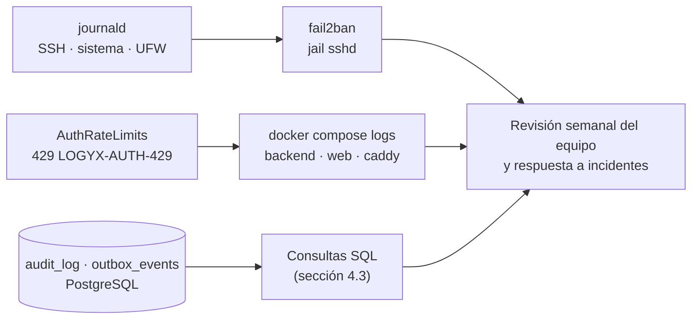

# S2 · Entregable 2 — Implementación, Monitoreo y Ética de Seguridad
> Competencias C2.2 (Controles) · C2.3 (Monitoreo y mejora) · C2.4 (Ética ACM)  
> Proyecto: OnCargo — Sistema Operativo Logístico Colaborativo para PYMEs  
> Equipo: Jorge Gutiérrez Miranda · Fabrizio Sanchez Saravia · Alex Coila Jarita  
> Semestre 2 · Agosto–Noviembre 2026 · **Versión 2.3 (contraseña demo propia, alertas y reinicio por kernel, 19-nov-2026)** · v2.2: endurecimiento aplicado y verificado · v2.1: estado real del despliegue · v2.0: diseño previo al despliegue · v1.0: AWS

!!! info "Versión 2.1: controles realmente aplicados en el VPS Hostinger"
    La versión 1.0 implementaba la seguridad con servicios administrados de AWS. La versión 2.0 la rediseñó para un VPS Hostinger detrás de Cloudflare, pero se escribió **antes** de aprovisionar el servidor. Esta versión 2.1 documenta los controles **realmente aplicados**, tomados de `infra/vps/` del monorepo (`compose.yml`, `Caddyfile`, `bootstrap.sh`, `deploy.sh`, `README.md`; commit `cad2b77`) y del código de la aplicación.

    **Diferencias principales con la v2.0:** no hay Cloudflare (ni WAF, ni filtro de origen); los documentos están en MinIO dentro del VPS y no en R2; el despliegue es manual con `deploy.sh` desde el equipo del administrador (no con GitHub Actions); el servidor tiene un solo usuario administrativo (`deploy`, con `sudo`) y funciona como **entorno de pruebas** con cuentas demo.

!!! success "Versión 2.2: propuesta de seguridad evaluada y aplicada en el VPS (19-nov-2026)"
    La propuesta de la v2.1 se contrastó control por control con el servidor real (inspección por SSH, `curl`, `openssl`, Lynis) y se aplicó lo de bajo riesgo y reversible. Todo quedó **versionado** en el monorepo (commits `9d1f6a2` y `b44014a` de `oncargo-code`): `infra/vps/harden.sh` (sistema operativo, idempotente), `infra/vps/host/` (configuraciones), `compose.yml` y `Caddyfile` (contenedores y proxy), `backup.sh` y `healthcheck.sh`. La [Sección 0](#seccion-0-evaluacion-y-endurecimiento-aplicado-v22) resume cada control con su decisión y su evidencia; las secciones siguientes se actualizaron donde la v2.1 quedó superada (respaldos, *jails* de Caddy, contenedores, acceso por IP).

!!! success "Versión 2.3: decisiones del responsable aplicadas (19-nov-2026)"
    Commits `f11fea9` y `017ac9e` de `oncargo-code`. (1) **Contraseña demo propia del VPS** (cierra H-03): `Logyx2026!` queda solo para desarrollo; las cuentas `*@logyx.pe` del VPS usan una contraseña aleatoria que vive solo en el servidor y se cambió por la API (E13). (2) **Alertas por ntfy.sh** del chequeo de salud, probadas de punta a punta (E14). (3) **Reinicio por el kernel 6.8.0-149**: todo volvió solo (E15). (4) Se **descartan por ahora**, con su razón, el cambio del puerto SSH y HSTS `preload`. (5) Lo que necesita cuentas del responsable (respaldo externo en R2, registro CAA, UptimeRobot, Cloudflare) queda como guía paso a paso en `infra/vps/README.md` § «Pendiente del dueño».

---

## Resumen Ejecutivo

Este documento registra los controles de seguridad de OnCargo tal como están desplegados. En el **host**: SSH solo con clave pública, usuario `deploy` con `sudo`, UFW con entrada denegada salvo 22/80/443, fail2ban para SSH, `unattended-upgrades`, rotación de logs de Docker y 2 GB de swap. En los **contenedores**: solo Caddy publica puertos, la base de datos y MinIO viven en una red interna, todos tienen límite de memoria, y `backend` y `web` corren sin `root`. En los **secretos**: contraseñas aleatorias y claves JWT generadas en el propio servidor por `bootstrap.sh`, fuera de Git y del árbol de código. En la **aplicación**: RLS por organización, tres roles de base de datos con mínimo privilegio, `AuthRateLimits`, sesiones revocables, contraseñas con bcrypt, cabeceras de seguridad y auditoría en `audit_log`.

En la versión 2.2 se añadieron y verificaron: lista blanca `DOCKER-USER`, endurecimiento adicional de SSH, *jails* de fail2ban sobre el registro de accesos de Caddy, contenedores sin capacidades y con sistema de archivos de solo lectura, red de datos sin salida a Internet, respaldos diarios cifrados con prueba de restauración, chequeo de salud cada 5 minutos, auditd y ajustes de `sysctl` y journald. El acceso HTTP por IP ya no sirve contenido y la cookie de sesión viaja solo por HTTPS.

Lo que **sigue pendiente** se declara con honestidad: la copia de los respaldos **fuera del VPS**, un monitor externo, el registro CAA, Cloudflare y la salida del modo de pruebas (datos demo). Desde la v2.3 ya hay canal de alertas (ntfy), el reinicio por kernel está hecho y la contraseña demo del VPS dejó de ser la publicada. Cada pendiente indica quién debe decidirlo. Las secciones de detección (3 y 4) y de ética ACM (5) se conservan, ajustadas al entorno real.

**Leyenda de estados:**

| Estado | Significado |
|--------|-------------|
| **Desplegado en el VPS** | Está en `infra/vps/` y aplicado en el servidor según `infra/vps/README.md`. |
| **Implementado en el repositorio** | Existe en el código del monorepo (roles de BD, RLS, `AuthRateLimits`, cabeceras, Dependabot, Dockerfiles) y viaja con cada despliegue. |
| **Pendiente de ejecución** | Prueba o procedimiento definido; falta ejecutarlo y adjuntar evidencia. |
| **No implementado (mejora)** | Formaba parte del diseño v2.0 y no se desplegó. |
| **Implementado (v2.2)** | Aplicado y verificado en el VPS el 19-nov-2026, con evidencia en la Sección 0. |
| **Pendiente (decisión del usuario)** | Requiere credenciales, un cambio de DNS o una ventana de mantenimiento que decide el responsable del proyecto. |
| **Descartado (razón)** | Evaluado y no aplicado; se indica por qué. |

---

## Sección 0 — Evaluación y endurecimiento aplicado (v2.2)

### 0.1 Método

1. **Inspección en solo lectura** del VPS (`ufw status verbose`, `ss -tlnpu`, `iptables -S DOCKER-USER`, `fail2ban-client status`, `sshd -T`, `docker inspect`, `apt list --upgradable`), de las cabeceras con `curl -I` y del TLS con `openssl s_client`.
2. **Decisión por control:** *aplicar ahora* (bajo riesgo y reversible), *aplicar con aprobación* (DNS, credenciales, reinicios o cambios irreversibles), *descartar* (con la razón) o *ya estaba*.
3. **Aplicación segura:** antes de tocar SSH o el firewall se abrió una segunda sesión SSH de respaldo (conexión maestra persistente), se validó con `sshd -t`, se recargó y se **probó un login nuevo** antes de seguir. Cada archivo del sistema se respaldó como `<archivo>.bak-<fecha>`. Tras cada cambio se verificó el servicio: `https://oncargo.tech/`, `/login`, `/app/` y `/app/oncargo.apk` con `200`, login de la API con `200` y los cinco contenedores en `healthy`.
4. **Reconstrucción desde el repositorio:** nada se dejó configurado a mano. Los cambios de contenedores y proxy van en `compose.yml` y `Caddyfile` (se aplican con `deploy.sh`), y los del sistema operativo en `harden.sh` + `host/` (`sudo harden.sh [paso…]`). Se ejecutó dos veces para comprobar que es **idempotente**: la segunda pasada no cambió nada.

### 0.2 Controles: propuesta, decisión y evidencia

| Control (propuesta v2.1 / revisión) | Decisión | Estado en el VPS | Evidencia (sección 0.3) |
|---|---|---|---|
| SSH solo con clave, `root` solo con clave, `MaxAuthTries 4` | Ya estaba | Desplegado en el VPS | E1 |
| SSH: `AllowUsers deploy root`, sin X11, agente ni túneles, `LoginGraceTime 30`, KEX/cifrados/MAC modernos (sin SHA-1) | Aplicar ahora | **Implementado (v2.2)** | E1 |
| Cambio del puerto SSH | Descartado por ahora (v2.3) | **Descartado (razón)**: solo reduce el ruido de bots; la protección real ya está (clave obligatoria, `AllowUsers`, fail2ban `sshd` + `recidive`) y la consola web de Hostinger sirve de respaldo. Cambiarlo suma riesgo de quedarse fuera | — |
| `PermitRootLogin no` y usuario `admin` separado | Con aprobación | **Pendiente**: el terminal web de Hostinger entra como `root` con una clave temporal; quitarlo elimina el acceso de emergencia | — |
| UFW: entrada `deny`, 22/80/443 (TCP y 443/UDP) | Ya estaba | Desplegado en el VPS | E2 |
| Cadena `DOCKER-USER` (puertos publicados por Docker) | Aplicar ahora | **Implementado (v2.2)**: lista blanca por puerto original (80/443) | E2, E3 |
| fail2ban `sshd` | Ya estaba | Desplegado (5 fallos / 10 min → 1 h) | E4 |
| fail2ban `recidive`, `oncargo-caddy-probe`, `oncargo-caddy-auth` | Aplicar ahora | **Implementado (v2.2)** | E4 |
| Registro de accesos de Caddy (H-09) | Aplicar ahora | **Implementado (v2.2)**: JSON, 14 días, tokens redactados | E5 |
| Cabeceras: `Permissions-Policy`, ocultar `Server` y `Via`, CSP en `/app/` | Aplicar ahora | **Implementado (v2.2)** | E6 |
| HSTS `preload` | Descartado por ahora (v2.3) | **Descartado (razón)**: la inclusión en la lista de los navegadores es prácticamente irreversible y obliga a HTTPS en todo subdominio futuro; no mientras el dominio está en fase de pruebas. Se mantiene HSTS de 1 año sin `preload` | E6 |
| `/q/*` de Quarkus público (H-04) | Aplicar ahora | **Implementado (v2.2)**: `404` salvo `/q/health*` | E6 |
| Acceso `http://<IP>` sin TLS (H-01) y cookie sin `Secure` (H-02) | Aplicar ahora | **Implementado (v2.2)**: `308` al dominio; `COOKIE_SECURE=true` | E6 |
| Límite de tasa en Caddy | Descartado (razón) | `caddy:2.10-alpine` no incluye el módulo `rate_limit` (es de terceros y exige compilar una imagen propia con `xcaddy`). Lo cubren `AuthRateLimits` y la *jail* `oncargo-caddy-auth` | E4 |
| Contenedores: `no-new-privileges`, `cap_drop: ALL`, `pids_limit` | Aplicar ahora | **Implementado (v2.2)** en los cinco servicios | E7 |
| Contenedores: `read_only` + `tmpfs /tmp` | Aplicar ahora (caddy, web, backend) | **Implementado (v2.2)**. Descartado en `db` y `minio`: escriben fuera de sus volúmenes y el beneficio no compensa el riesgo | E7 |
| Red `internal` con `internal: true` (H-06) | Aplicar ahora | **Implementado (v2.2)**: `db` y `minio` sin salida a Internet | E7 |
| Imágenes de Caddy y Postgres fijadas por *digest* | Descartado (razón) | Sin un actualizador automático, fijar el *digest* congela los parches; las etiquetas `2.10-alpine` y `16-alpine` reciben correcciones | — |
| MinIO: consola desactivada y bucket privado | Aplicar ahora | **Implementado (v2.2)**: `MINIO_BROWSER=off`; acceso anónimo → `403` | E7 |
| MinIO: usuario limitado al bucket (sin credenciales raíz) | Con aprobación | **Pendiente** (cambio coordinado con el backend) | — |
| AppArmor | Ya estaba | Perfil `docker-default` en todos los contenedores; perfiles propios **descartados** (mantenimiento alto frente a `cap_drop` + `no-new-privileges`) | E7 |
| `sysctl` de red (`syncookies`, `rp_filter`, *redirects*) | Aplicar ahora | **Implementado (v2.2)**; `rp_filter=2` (laxo) por compatibilidad con los *bridges* de Docker | E8 |
| auditd | Aplicar ahora | **Implementado (v2.2)**: 13 reglas sobre accesos, `sudoers`, `authorized_keys`, `state/` y configuración de Docker, UFW y fail2ban | E8 |
| journald y logrotate | Aplicar ahora | **Implementado (v2.2)**: journald ≤ 1 GB y 30 días; Caddy rota su propio registro; Docker ya rotaba (10 MB × 3) | E8 |
| Docker `live-restore` | Aplicar ahora | **Implementado (v2.2)**: un reinicio o actualización de `dockerd` no baja los contenedores | E8 |
| Permisos de `/opt/oncargo/state` | Aplicar ahora | **Implementado (v2.2)**: directorio `700`, `.env` `600`, clave privada JWT `640` (grupo del usuario del backend) | E9 |
| Respaldos `pg_dump` diarios cifrados, con rotación y prueba de restauración | Aplicar ahora (destino local) | **Implementado (v2.2)** | E10 |
| Copia de los respaldos fuera del VPS (R2 u otro) | Con aprobación | **Pendiente (decisión del usuario)**: requiere sus credenciales; el script ya admite `rclone`. Guía paso a paso (bucket, token limitado al bucket, `rclone.conf`, prueba) en `infra/vps/README.md` § Pendiente del dueño | — |
| Monitoreo: chequeo de salud con temporizador | Aplicar ahora | **Implementado (v2.2)**: cada 5 min | E11 |
| Canal de alertas (ntfy.sh) | Aplicar ahora (v2.3) | **Implementado (v2.3)**: tema aleatorio de 128 bits, sin cuenta, en `/etc/oncargo/alert.env` (fuera del repositorio); mensaje sin secretos | E14 |
| Monitor externo (UptimeRobot, healthchecks.io) y registro CAA | Con aprobación | **Pendiente (decisión del usuario)**: requieren su cuenta o su panel DNS; guía en `infra/vps/README.md` § Pendiente del dueño | — |
| Parches del sistema | Ya estaba (`unattended-upgrades`) | Se instalaron a mano las pendientes (`docker-compose-plugin`, `libgstreamer`). **Reinicio por kernel hecho (v2.3)**: 6.8.0-147 → 6.8.0-149, todo volvió solo | E12, E15 |
| Contraseña demo publicada (`Logyx2026!`, H-03) | Aprobado (v2.3) | **Implementado (v2.3)**: contraseña propia del VPS (`LOGYX_DEMO_PASSWORD` en `state/.env`), cambiada por la API en las 7 cuentas demo; el APK de pruebas la toma de una propiedad de Gradle fuera del repositorio (sección 1.4) | E13 |
| IP real del cliente en la web (`security.allowedDomains`, H-10 de Red) | Aplicar ahora | **Corregido en el código** (`848ba00`): sin esto, los límites por IP de login, registro y cotización se compartían entre todos los usuarios de la web. Pendiente: desplegar y verificar con A9 | A9 (pendiente) |
| APK de pruebas firmado (H-11 de Red) | Aplicar ahora | **Implementado**: `/app/` publica la variante *staging* con keystore de pruebas y `publish-apk.sh` rechaza un APK de *debug*. Producción: *release* firmado, pendiente | Red, T15 |
| Cloudflare (proxy, WAF; sin *Bot Fight Mode*, que rompería la app Android) | Solo evaluación | **Pendiente (decisión del usuario)**: plan en la sección 4.1 y resumen en `infra/vps/README.md` § Pendiente del dueño | — |

### 0.3 Evidencias (salidas recortadas, sin secretos)

**E1 — SSH efectivo** (`sudo sshd -T`) y pruebas de acceso:

```text
port 22
logingracetime 30
maxauthtries 4
permitrootlogin without-password
pubkeyauthentication yes
passwordauthentication no
kbdinteractiveauthentication no
x11forwarding no
allowagentforwarding no
allowusers deploy
allowusers root
kexalgorithms sntrup761x25519-sha512@openssh.com,curve25519-sha256,curve25519-sha256@libssh.org,diffie-hellman-group16-sha512,...
macs hmac-sha2-512-etm@openssh.com,hmac-sha2-256-etm@openssh.com,umac-128-etm@openssh.com

$ ssh -o ControlPath=none deploy@<IP> 'echo LOGIN-NUEVO-OK; sudo -n true && echo SUDO-OK'
LOGIN-NUEVO-OK
SUDO-OK
$ ssh -o PreferredAuthentications=password -o PubkeyAuthentication=no deploy@<IP> true
deploy@<IP>: Permission denied (publickey).
$ ssh nobody@<IP> true
nobody@<IP>: Permission denied (publickey).
```

**E2 — Firewall** (`ufw status verbose` y `iptables -S DOCKER-USER`):

```text
Status: active
Default: deny (incoming), allow (outgoing), deny (routed)
22/tcp   ALLOW IN  Anywhere
80/tcp   ALLOW IN  Anywhere
443/tcp  ALLOW IN  Anywhere
443/udp  ALLOW IN  Anywhere        (más las mismas reglas en IPv6)

-A DOCKER-USER -m conntrack --ctstate RELATED,ESTABLISHED -j RETURN
-A DOCKER-USER -i eth0 -p tcp -m conntrack --ctorigdstport 80 --ctdir ORIGINAL -j RETURN
-A DOCKER-USER -i eth0 -p tcp -m conntrack --ctorigdstport 443 --ctdir ORIGINAL -j RETURN
-A DOCKER-USER -i eth0 -p udp -m conntrack --ctorigdstport 443 --ctdir ORIGINAL -j RETURN
-A DOCKER-USER -i eth0 -m conntrack --ctstate INVALID,NEW -j DROP
-A DOCKER-USER -j RETURN
```

**E3 — Prueba de la brecha Docker/UFW.** Se publicó un contenedor de prueba en el puerto 18080, que UFW **no** permite:

```text
ANTES de DOCKER-USER:   curl http://<IP>:18080/  →  "puerto-expuesto"      (Docker salta UFW)
1.ª versión de la regla (--dports 80,443):        →  "puerto-expuesto"      (falla: compara el puerto
                                                     DESPUÉS del DNAT, y el contenedor escuchaba en su 80)
Versión final (--ctorigdstport):                  →  sin respuesta (bloqueado; contador DROP = 6 paquetes)
```

El primer intento muestra un error frecuente: la cadena `FORWARD` ve el puerto **ya traducido**, así que una lista blanca por `--dport 80` deja pasar cualquier contenedor que escuche internamente en el 80. La versión final compara el puerto **original** con `conntrack`, como recomienda la documentación de Docker.

Escaneo TCP externo desde Lima (19-nov-2026, 10:46):

```text
22/tcp abierto · 80/tcp abierto · 443/tcp abierto
2019, 4321, 5432, 8080, 9000, 9001/tcp cerrados o filtrados
```

**E4 — fail2ban** (`fail2ban-client status` y parámetros de cada *jail*):

```text
Jail list: oncargo-caddy-auth, oncargo-caddy-probe, recidive, sshd
sshd:                 5 fallos / 600 s   → 3600 s   (solo 22)
recidive:             3 bloqueos de sshd / 1 día → 604800 s (todos los puertos)
oncargo-caddy-probe:  3 rutas de escaneo / 600 s → 86400 s (solo 80/443, TCP y UDP)
oncargo-caddy-auth:   20 respuestas 429 en /api/v1/auth|public / 600 s → 3600 s (solo 80/443)
```

Prueba controlada con una IP de documentación (`fail2ban-client set … banip 203.0.113.7`): la dirección aparece en las cadenas `f2b-chain` (*hook* `input`, para IPv6 que entra por `docker-proxy`) y `f2b-fwd` (*hook* `forward`, para IPv4 con DNAT hacia Caddy). `fail2ban-regex` sobre el registro real detectó las 3 peticiones de prueba (`/wp-login.php`, `/.env`, `/.git/config`).

!!! warning "Lección operativa: la prueba bloqueó al administrador"
    En la primera versión, `oncargo-caddy-probe` bloqueaba **todos los puertos**. Las tres peticiones de prueba desde la IP del administrador bastaron para bloquearla también en el puerto 22 y cortar la sesión SSH. El acceso se recuperó **por IPv6** (el conjunto bloqueado era solo IPv4) tras confirmar que la huella de la clave de host coincidía con la de IPv4. Corrección aplicada: las *jails* web bloquean **solo 80/443**, y `recidive` solo cuenta bloqueos de `sshd`, de modo que probar la web nunca deja al administrador sin SSH. Se documentó `ignoreip` para fijar IP propias.

**E5 — Registro de accesos de Caddy** (`/var/log/oncargo/caddy/access.log`, una línea JSON por petición; IP omitida aquí):

```text
{"ts":"2026-11-19T15:48:33.276Z","status":200,"request":{"client_ip":"<omitida>","method":"POST",
 "host":"api.oncargo.tech","uri":"/api/v1/auth/login","headers_cookie":null}}
"uri":"/baja?t=REDACTED&x=1"          ← enlace de baja del correo
"uri":"/s/REDACTED"                   ← seguimiento público
"uri":"/restablecer?token=REDACTED"   ← restablecer contraseña
$ grep -c SECRETOtoken123 access.log  →  0
```

Caddy ya oculta `Cookie` y `Authorization`. El filtro añadido tapa los tokens que viajan en la URL. La retención es de 14 días porque la IP es un dato personal (Ley 29733).

**E6 — Proxy: cabeceras, rutas internas y acceso por IP:**

```text
https://api.oncargo.tech/q/openapi       404   (antes: 200)
https://api.oncargo.tech/q/health/ready  200
http://<IP>/login?x=1                    308 → https://oncargo.tech/login?x=1   (antes: 200 sin TLS)
/app/   content-security-policy: default-src 'self'; ... object-src 'none'; frame-ancestors 'none' ...
        x-frame-options: DENY
        permissions-policy: camera=(), microphone=(), geolocation=(), payment=(), usb=()
(sin cabeceras Server ni Via en web y API)
HTTP/3: curl --http3-only https://oncargo.tech/ → versión 3
TLS: certificado Let's Encrypt (YE1) para oncargo.tech, vigente hasta el 15-feb-2027; acepta TLS 1.2 y 1.3, rechaza 1.0 y 1.1
```

**E7 — Contenedores y redes** (`docker inspect`, `docker network inspect`):

```text
backend  user=10001:10001 ro=true  capdrop=[ALL] capadd=[]                     nnp=true pids=1024 apparmor=docker-default
db       user=(entrypoint) ro=false capdrop=[ALL] capadd=[CHOWN DAC_OVERRIDE FOWNER SETGID SETUID] nnp=true pids=512
caddy    user=root     ro=true  capdrop=[ALL] capadd=[NET_BIND_SERVICE]        nnp=true pids=256
web      user=node     ro=true  capdrop=[ALL] capadd=[]                        nnp=true pids=256
minio    user=65532    ro=false capdrop=[ALL] capadd=[]                        nnp=true pids=512
oncargo_internal internal=true  172.19.0.0/16
oncargo_edge     internal=false 172.18.0.0/16

db  → wget http://1.1.1.1         SIN-SALIDA     (red internal)
backend → https://ifconfig.me    CON-SALIDA     (sale por edge: SMTP futuro)
db  → http://minio:9000/oncargo-documents/  403 Forbidden (bucket privado)
```

Pruebas funcionales con el backend en solo lectura: subida de un documento (*multipart*) a MinIO y descarga **idénticas** byte a byte; el stream SSE entregó `stream.ready` al instante.

**E8 — Sistema:**

```text
net.ipv4.tcp_syncookies = 1
net.ipv4.conf.all.rp_filter = 2
net.ipv4.conf.all.accept_redirects = 0
net.ipv4.conf.all.send_redirects = 0      (antes: 1)
auditctl -l → 13 reglas
journald: SystemMaxUse=1G, MaxRetentionSec=30day
docker info → live-restore=true (aplicado con reload: los contenedores no se reiniciaron)
```

**E9 — Permisos de los secretos** (`stat`; antes, `state/` y `secrets/` tenían `775` y la clave privada `644`):

```text
700 deploy:1000  /opt/oncargo/state
600 deploy:1000  /opt/oncargo/state/.env
750 deploy:1000  /opt/oncargo/state/secrets
640 deploy:10001 /opt/oncargo/state/secrets/jwt-private.pem
644 deploy:1000  /opt/oncargo/state/secrets/jwt-public.pem
```

**E10 — Respaldo y prueba de restauración** (`oncargo-backup run` y `oncargo-backup verify`):

```text
-rw------- root  db-20261119-1048.dump.age        (pg_dump -Fc cifrado con age)
-rw------- root  minio-20261119-1048.tar.gz.age   (documentos)
-rw------- root  state-20261119-1048.tar.gz.age   (.env y claves JWT)
-rw------- root  manifest-20261119-1048.txt       (sha256 + conteos, sin secretos)
manifiesto: objetos_toc=666 migracion=23 tablas=47 politicas_rls=126 organizaciones=4 perfiles=7 envios=3

[oncargo-backup] verificando db-20261119-1048.dump.age
[oncargo-backup] restauración en 3 s
[oncargo-backup] OK: conteos idénticos al momento del respaldo
```

**E11 — Chequeo de salud** (`systemctl list-timers 'oncargo-*'`, `/var/lib/oncargo/health.txt`):

```text
oncargo-health.timer  cada 5 min      → estado=OK fecha=2026-11-19T10:45:30-05:00
oncargo-backup.timer  diario 03:30 (Lima, ±15 min)
Prueba de falla (umbral de disco forzado al 5 %): estado=FALLA "disco / al 10% (máx. 5%)", registrado con prioridad err; la siguiente pasada volvió a OK.
```

**E12 — Lynis** (`lynis audit system`, 266 pruebas): índice de endurecimiento **65**. Avisos: *KRNL-5830* (reinicio pendiente por el kernel) y *PKGS-7392* (paquetes con actualización de seguridad). Se instalaron las actualizaciones pendientes y queda solo la imagen del kernel, que se aplica con el reinicio pendiente de aprobación.

**E13 — Contraseña demo propia del VPS** (v2.3; sin mostrar el valor):

```text
Backend: DemoDataSeeder lee logyx.demo.password (por omisión Logyx2026! en dev/tests); no la escribe en el log.
state/.env: LOGYX_DEMO_PASSWORD=<16 caracteres aleatorios>   (600, deploy) · en el contenedor backend: coincide (sha256)
POST /api/v1/auth/change-password (contraseña actual → nueva), una por cuenta:
  pyme@ 200 · pyme.ops@ 200 · pyme.viewer@ 200 · carrier@ 200 · carrier2@ 200 · driver@ 200 · operator@ 200
POST /api/v1/auth/login  pyme@logyx.pe con Logyx2026!  → 401   ·  con la nueva → 200  (las 7 cuentas)
APK staging 0.2.0-f11fea9 (versionCode 30): chips con la contraseña nueva (propiedad oncargo.demoPassword
  en ~/.gradle/gradle.properties); Logyx2026! no aparece en el APK publicado.
Web de producción: los botones de cuentas demo solo se pintan con import.meta.env.DEV; /dev/ui → 404.
```
Riesgo residual: el APK de `/app/` es público y lleva la contraseña en los chips; quien lo descompile la obtiene. Son datos demo y se rota con el mismo procedimiento (`infra/vps/README.md` § Entorno de pruebas).

**E14 — Alerta por ntfy.sh** (`sudo oncargo-health --test-alert` y lectura del tema con `curl "https://ntfy.sh/<tema>/json?poll=1&since=5m"`):

```text
Alerta de prueba enviada
{"event":"message","topic":"oncargo-<32 hex>","title":"OnCargo VPS: PRUEBA",
 "message":"Alerta de prueba de oncargo-health (2026-11-19T12:04:39-05:00). No hay nada caído.","tags":["test_tube"]}
```
El mensaje real lleva solo el estado, la hora y qué falló (URL pública, código HTTP, servicio); FALLA va con prioridad alta. El tema es la única protección de ntfy.sh sin cuenta: no está en el repositorio ni en este documento.

**E15 — Reinicio por el kernel** (`sudo systemctl reboot`, 19-nov-2026 12:05; de vuelta por SSH a las 12:07):

```text
antes: 6.8.0-147-generic (up 2 days, 15 h)       después: 6.8.0-149-generic · sin /var/run/reboot-required
docker compose ps: backend, db, minio, web (healthy) · caddy Up        (solos, restart: unless-stopped)
ufw: Status: active (22, 80, 443 tcp/udp)
iptables -S FORWARD: -A FORWARD -j DOCKER-USER (primera) · DOCKER-USER con la lista blanca 80/443 (oncargo-docker-user.service)
fail2ban: oncargo-caddy-auth, oncargo-caddy-probe, recidive, sshd · auditd active
timers: oncargo-health (cada 5 min), oncargo-backup (diario) · oncargo-health -v → estado=OK
https://oncargo.tech/ 200 · /login 200 · /app/ 200 · /app/oncargo.apk 200 · POST api…/auth/login 200
```
No hizo falta ningún arreglo para el próximo reinicio.

### 0.4 Reversión

| Cambio | Cómo revertir |
|---|---|
| SSH (`/etc/ssh/sshd_config.d/20-oncargo.conf`) | Borrar el archivo, `sshd -t && systemctl reload ssh` |
| `DOCKER-USER` | `systemctl disable --now oncargo-docker-user && iptables -F DOCKER-USER` |
| fail2ban | Borrar `/etc/fail2ban/jail.d/oncargo.local` y los filtros `oncargo-*`, `systemctl restart fail2ban`. Desbloquear una IP: `fail2ban-client unban <ip>` |
| `sysctl`, journald, auditd | Borrar `/etc/sysctl.d/60-oncargo.conf` (`sysctl --system`), `/etc/systemd/journald.conf.d/60-oncargo.conf` (reiniciar journald) y `/etc/audit/rules.d/60-oncargo.rules` (`augenrules --load`) |
| `live-restore` | Restaurar `/etc/docker/daemon.json.bak-<fecha>` y `systemctl reload docker` |
| Contenedores y Caddy | `deploy.sh <commit anterior>` (o volver a `src.old`); los volúmenes no se tocan |
| Respaldos y salud | `systemctl disable --now oncargo-backup.timer oncargo-health.timer` |
| Alertas (v2.3) | Borrar `/etc/oncargo/alert.env` (o cambiar de tema y suscribirse de nuevo) |
| Contraseña demo (v2.3) | No se revierte a la publicada. Rotarla: `change-password` por cuenta, `state/.env`, `~/.gradle/gradle.properties` y volver a publicar el APK |

---

## Sección 1 — Implementación de Controles Técnicos (C2.2)

### 1.1 Usuarios, SSH y mínimo privilegio en el host

| Identidad | Permisos | Autenticación | Estado |
|-----------|----------|---------------|--------|
| `deploy` | Usuario administrativo con `sudo`; ejecuta `docker compose` en `/opt/oncargo` | Clave SSH (`ed25519`); sin contraseña por SSH | Desplegado en el VPS |
| `root` | Acceso de emergencia | **Solo con clave** (sin contraseñas) | Desplegado en el VPS |
| `admin` separado de `deploy` y clave de CI restringida a un comando | — | — | No implementado (mejora) |

Según `infra/vps/README.md`, el acceso es `ssh -i ~/.ssh/hostinger_kvm2 deploy@<IP_PUBLICA_VPS>`, con *root solo con clave; sin contraseñas*. La configuración real está en dos archivos (sshd usa el **primer** valor que encuentra):

```
# /etc/ssh/sshd_config.d/10-hardening.conf (aprovisionamiento)
PasswordAuthentication no
KbdInteractiveAuthentication no
PermitRootLogin prohibit-password      # root solo con clave
MaxAuthTries 4

# /etc/ssh/sshd_config.d/20-oncargo.conf (v2.2: infra/vps/host/sshd-20-oncargo.conf, instalado por harden.sh)
AllowUsers deploy root
X11Forwarding no
AllowAgentForwarding no
PermitTunnel no
LoginGraceTime 30
MaxStartups 10:30:60
ClientAliveInterval 300
KexAlgorithms sntrup761x25519-sha512@openssh.com,curve25519-sha256,...   # sin curvas NIST ni grupo 14
Ciphers chacha20-poly1305@openssh.com,aes256-gcm@openssh.com,...         # AEAD y CTR
MACs hmac-sha2-512-etm@openssh.com,hmac-sha2-256-etm@openssh.com,umac-128-etm@openssh.com
```

Las claves de host **no** se restringieron: los `known_hosts` de los equipos del equipo guardan las claves ed25519, RSA y ECDSA, y quitar un tipo haría fallar la verificación del servidor en clientes no interactivos. **Estado:** Implementado (v2.2); evidencia E1.

```bash
sudo sshd -T | grep -E 'permitrootlogin|passwordauthentication|pubkeyauthentication'
# Esperado: permitrootlogin without-password (o prohibit-password) · passwordauthentication no · pubkeyauthentication yes
ssh -o PreferredAuthentications=password -o PubkeyAuthentication=no deploy@<IP_PUBLICA_VPS>
# Esperado: Permission denied (publickey)
```

!!! warning "`deploy` tiene `sudo` y controla Docker"
    El usuario `deploy` es a la vez administrador y desplegador, y quien controla el *socket* de Docker equivale a `root`. La seguridad depende de **proteger la clave privada** `~/.ssh/hostinger_kvm2` del administrador (con frase de paso y fuera de equipos compartidos). Mejoras recomendadas: `PermitRootLogin no`, un usuario `admin` para administrar y una clave de despliegue limitada a `deploy.sh` mediante `command=` en `authorized_keys`.

La base de datos y las consolas internas **no se exponen**: el administrador entra por SSH y usa `docker compose exec db psql …`.

### 1.2 Firewall y fail2ban

El firewall se documenta en [Implementación de Red, sección 1.4](implementacion-red.md): UFW con entrada denegada por omisión y solo 22, 80 y 443 permitidos. Solo Caddy publica puertos en el host, así que UFW no queda puenteado por Docker.

**fail2ban** tiene cuatro *jails* (evidencia E4): `sshd` (5 fallos en 10 min → 1 h), `recidive` (3 bloqueos de `sshd` en un día → 1 semana en todos los puertos) y dos sobre el registro de accesos de Caddy, que bloquean **solo 80/443**: `oncargo-caddy-probe` (3 peticiones a rutas de escaneo como `.php`, `/.env` o `/.git/` en 10 min → 1 día) y `oncargo-caddy-auth` (20 respuestas `429` del backend en rutas de autenticación en 10 min → 1 h). Como Docker publica 80/443 con DNAT, el bloqueo se instala en los *hooks* `input` y `forward` de nftables. Los umbrales son altos a propósito: muchas redes móviles de Perú usan CGNAT y una IP puede ser de muchos usuarios.

```bash
sudo fail2ban-client status              # Esperado: Jail list: sshd
sudo fail2ban-client status sshd         # Currently failed / Total banned / Banned IP list
sudo fail2ban-client get sshd bantime maxretry findtime
```

| Control | Estado |
|---------|--------|
| UFW: entrada `deny`, permitidos 22/80/443 | Desplegado en el VPS |
| fail2ban, *jail* `sshd` | Desplegado en el VPS |
| `recidive` (reincidentes de SSH) | Implementado (v2.2) |
| *Jails* sobre Caddy: `oncargo-caddy-probe` y `oncargo-caddy-auth` (solo 80/443) | Implementado (v2.2) |
| `DOCKER-USER` como lista blanca de puertos publicados (80/443 por puerto original) | Implementado (v2.2) |
| Filtro "solo Cloudflare" en `DOCKER-USER` | Pendiente (depende de Cloudflare, sección 4.1) |

### 1.3 Contenedores

Valores reales de `infra/vps/compose.yml` y de los Dockerfiles:

| Control | `caddy` | `web` | `backend` | `db` | `minio` |
|---------|---------|-------|-----------|------|---------|
| Imagen | `caddy:2.10-alpine` | `oncargo-web:local` (`node:22-alpine`) | `oncargo-backend:local` (`eclipse-temurin:21-jre-alpine`) | `postgres:16-alpine` | `chainguard/minio` fijada por *digest* |
| Usuario no `root` | `root` sin capacidades salvo `NET_BIND_SERVICE` | `node` | `10001` | `postgres` (lo cambia el *entrypoint*) | `65532` (Chainguard) |
| Puertos publicados en el host | 80/tcp, 443/tcp, 443/udp | Ninguno | Ninguno | Ninguno | Ninguno |
| Red | `edge` | `edge` | `edge` + `internal` | `internal` | `internal` |
| `mem_limit` | 128 MB | 512 MB | 1 GB (JVM al 70 %) | 768 MB | 384 MB |
| `healthcheck` | — | `GET /login` | `GET /q/health/ready` | `pg_isready` | `/minio/health/ready` |
| `restart: unless-stopped` | Sí | Sí | Sí | Sí | Sí |
| Secretos | — | — | Claves JWT como `secrets:` de Compose | Contraseñas por variables del `.env` | Contraseña por variable del `.env` |

**Estado:** todo lo anterior **Desplegado en el VPS**. El *daemon* de Docker rota los logs de cada contenedor a **10 MB × 3 archivos** (según `infra/vps/README.md`), lo que evita que llenen el disco:

```json
// /etc/docker/daemon.json (equivalente a lo aplicado)
{ "log-driver": "json-file", "log-opts": { "max-size": "10m", "max-file": "3" } }
```

**Verificación:**

```bash
docker inspect --format '{{.Name}} user={{.Config.User}} mem={{.HostConfig.Memory}} ro={{.HostConfig.ReadonlyRootfs}} capdrop={{.HostConfig.CapDrop}}' $(docker ps -q)
docker ps --format '{{.Names}}  {{.Ports}}'      # Esperado: solo oncargo-caddy-1 con 0.0.0.0:80, :443
docker info | grep -iA2 'logging driver'
```

| Mejora de endurecimiento (diseño v2.0) | Estado |
|-----------------------------------------|--------|
| `security_opt: no-new-privileges:true` | Implementado (v2.2) en los cinco servicios (ancla `x-hardening` del compose) |
| `cap_drop: [ALL]` con las capacidades mínimas por servicio | Implementado (v2.2): `db` conserva `CHOWN`, `DAC_OVERRIDE`, `FOWNER`, `SETUID`, `SETGID` (el *entrypoint* ajusta dueños y pasa a `postgres`); `caddy`, `NET_BIND_SERVICE` |
| `pids_limit` | Implementado (v2.2): 256 (caddy, web), 512 (db, minio), 1024 (backend) |
| `read_only: true` con `tmpfs: /tmp` | Implementado (v2.2) en `caddy`, `web` y `backend` (64 MB: subidas *multipart* y `vertx-cache`). Descartado en `db` y `minio` |
| Red `internal` con `internal: true` | Implementado (v2.2): `db` y `minio` sin salida a Internet |
| MinIO sin consola (`MINIO_BROWSER=off`) | Implementado (v2.2) |
| Imágenes de Caddy y Postgres fijadas por *digest* | Descartado: sin actualizador automático congelaría los parches; solo MinIO usa *digest* |

Cada opción se probó antes en un contenedor desechable (Caddy con `--cap-drop ALL --read-only`; Postgres con las capacidades mínimas, inicialización y reinicio sobre un volumen de prueba) y después en el servicio real, con subida y descarga de un documento y el stream SSE (evidencia E7).

### 1.4 Gestión de secretos

Los secretos los genera **`infra/vps/bootstrap.sh` en el propio VPS** durante el primer despliegue: crea el `.env` con contraseñas aleatorias de 32 caracteres (`openssl rand`) y ejecuta `infra/scripts/gen-jwt-keys.sh`. `deploy.sh` los mueve a `/opt/oncargo/state/`, fuera del código, y los enlaza en cada despliegue. **Nunca salen del servidor**.

| Secreto | Ubicación | Permisos | Estado |
|---------|-----------|----------|--------|
| Contraseñas de `postgres`, `logyx_owner`, `logyx_api` y MinIO | `/opt/oncargo/state/.env` | `600` (`umask 077`) | Desplegado en el VPS |
| Claves RSA 2048 del JWT | `/opt/oncargo/state/secrets/jwt-*.pem` | Privada `640` con grupo `10001` (el usuario del backend la lee por *bind mount*), pública `644`, directorio `750` dentro de `state/` `700`. Antes de la v2.2: `775` y `644` | Implementado (v2.2), evidencia E9 |
| Clave SSH del administrador | Equipo del administrador (`~/.ssh/hostinger_kvm2`) | `600`, con frase de paso recomendada | Desplegado (fuera del VPS) |
| Copia cifrada de los secretos | `state-<fecha>.tar.gz.age` en `/var/backups/oncargo` (incluye `.env` con `LOGYX_UNSUBSCRIBE_SECRET` y `LOGYX_PAYOUT_KEY`, y las claves JWT) | Cifrada con age; root `600` | Implementado (v2.2) en el VPS; **copia fuera del VPS pendiente** |
| Identidad privada de age (descifra los respaldos) | Equipo del administrador, **nunca en el VPS** | `600`; debe guardarse en el gestor de contraseñas del equipo | Implementado (v2.2) |

Todo está excluido del repositorio (`infra/.env`, `infra/vps/.env` e `infra/secrets/` en `.gitignore`).

!!! warning "Datos de acceso publicados en el monorepo"
    `infra/vps/README.md` y `infra/vps/deploy.sh` incluyen la IP pública del VPS y el nombre del usuario SSH. No son secretos, pero facilitan el reconocimiento. En esta documentación se usa `<IP_PUBLICA_VPS>`. Si el repositorio es público, conviene pasar esos valores a variables (`VPS=deploy@…`).

!!! success "Contraseña demo publicada (H-03): cerrado en la v2.3"
    Las cuentas `*@logyx.pe` del VPS usaban `Logyx2026!`, que figura en el repositorio público (entre ellas, una de **operador**). Desde la v2.3 el *seeder* lee `logyx.demo.password` (por omisión `Logyx2026!`, solo en desarrollo y pruebas) y el VPS define `LOGYX_DEMO_PASSWORD` en `state/.env`: 16 caracteres aleatorios que `deploy.sh` genera si faltan y que nunca salen del servidor ni van al repositorio. Las cuentas ya creadas se cambiaron por la API (`POST /api/v1/auth/change-password`, que además cerró sus sesiones). El APK de pruebas toma la contraseña de una propiedad de Gradle fuera del repositorio (sin ella, no muestra los chips) y la web de producción no muestra cuentas demo. Se comparte solo con los evaluadores. **Residual:** el APK publicado la lleva dentro; el VPS se sigue tratando como público, sin datos reales (evidencia E13).

**Rotación:**

| Secreto | Procedimiento | Efecto |
|---------|---------------|--------|
| Contraseña de `logyx_api` o `logyx_owner` | `docker compose exec db psql -U postgres -d logyx` y `\password logyx_api`; actualizar `state/.env`; `docker compose up -d backend` | Reinicio breve del backend |
| Claves JWT | Borrar `state/secrets/jwt-*.pem`, ejecutar `gen-jwt-keys.sh` y copiar los PEM a `state/secrets/`; `docker compose up -d backend` | **Invalida todas las sesiones** (web: 8 h; móvil: también el *refresh token*) |
| Contraseña de MinIO | Actualizar `MINIO_ROOT_PASSWORD` en `state/.env`; `docker compose up -d minio backend` | Reinicio breve |
| Clave SSH | Reemplazar la línea en `~deploy/.ssh/authorized_keys` | Inmediato |

### 1.5 Mínimo privilegio de identidades

| Identidad | Alcance | Estado |
|-----------|---------|--------|
| Rol `logyx_owner` | `LOGIN`, dueño del esquema; solo Flyway y `SystemTx`; sin `SUPERUSER` ni `BYPASSRLS` | Desplegado en el VPS (`infra/db/init-roles.sh`, montado en el *entrypoint* de `db`) |
| Rol `logyx_app` | `NOLOGIN`, sin `BYPASSRLS`; las políticas RLS son `TO logyx_app` | Desplegado en el VPS |
| Rol `logyx_api` | `LOGIN`, miembro solo de `logyx_app`, `CONNECTION LIMIT 50`; no puede `SET ROLE` a otro rol | Desplegado en el VPS |
| Superusuario `postgres` | Solo para el *entrypoint* y administración por `docker compose exec`; contraseña aleatoria | Desplegado en el VPS |
| MinIO | El backend usa las credenciales raíz de MinIO (`LOGYX_S3_ACCESS_KEY = MINIO_ROOT_USER`) | Desplegado; **mejora:** crear un usuario de MinIO limitado al bucket `oncargo-documents` |
| Usuario `deploy` | `sudo` completo (ver sección 1.1) | Desplegado en el VPS |
| Roles de organización en la aplicación (`ADMIN`, `OPS`, `VIEWER`) y versión de sesión `sv` | Ver [Seguridad del software](../../software/entregable-2/seguridad.md) | Implementado en el repositorio |

**Verificación del mínimo privilegio en la base de datos:**

```bash
cd /opt/oncargo/src/infra/vps
docker compose exec db psql -U postgres -d logyx -c \
  "SELECT rolname, rolsuper, rolbypassrls, rolcanlogin, rolconnlimit FROM pg_roles WHERE rolname LIKE 'logyx_%' ORDER BY 1;"
# Esperado: logyx_api (f, f, t, 50) · logyx_app (f, f, f, -1) · logyx_owner (f, f, t, -1)

docker compose exec db psql -U logyx_api -d logyx -c "SET ROLE logyx_owner;"
# Esperado: ERROR: permission denied to set role "logyx_owner"
docker compose exec db psql -U logyx_api -d logyx -c "CREATE TABLE prueba(x int);"
# Esperado: ERROR: permission denied for schema public
```

Las pruebas automatizadas equivalentes (`DatabasePrivilegesTest`, `RowLevelSecurityTest`) forman parte del *build* del backend y corren en CI.

### 1.6 Cifrado

| Ámbito | Mecanismo | Estado |
|--------|-----------|--------|
| Tránsito: cliente → VPS | TLS de Let's Encrypt emitido y renovado por Caddy; HTTP/3 en 443/udp | Desplegado en el VPS (activo al apuntar el DNS) |
| Tránsito por IP (`http://<IP>`) | Ya no sirve contenido: `308` a `https://oncargo.tech` | Implementado (v2.2): H-01 cerrado |
| HSTS (1 año) | Caddy en `oncargo.tech` y `api.oncargo.tech`; además la API (perfil `prod`) y la web | Desplegado en el VPS |
| Tránsito: backend ↔ PostgreSQL / MinIO | Red Docker `internal`, sin puertos publicados; sin TLS (un solo host) | Desplegado en el VPS |
| Reposo: documentos (MinIO) | Volumen `miniodata` en el disco del VPS; sin cifrado de objetos (`LOGYX_S3_SSE` no se activa) | Desplegado; cifrado en reposo pendiente |
| Reposo: base de datos (`pgdata`) | Volumen en el disco del VPS; el cifrado de disco del proveedor no está garantizado | Pendiente (decisión) |
| Contraseñas de usuario | Hash adaptativo bcrypt (`BcryptPasswordHasher`) | Implementado en el repositorio |
| Sesión web | JWT RSA de 8 h en cookie `httpOnly`, `SameSite=Lax`, `Secure` (`COOKIE_SECURE=true`) | Implementado: H-02 cerrado |
| Sesión móvil | JWT de 1 h + *refresh token* rotativo de 30 días (solo su hash SHA-256 en la BD) | Implementado en el repositorio |
| Respaldos cifrados | age (X25519) con la clave pública versionada en `infra/vps/backup-recipients.txt`; la privada fuera del VPS | Implementado (v2.2) |

### 1.7 Respaldos como control técnico

Desde la v2.2, `oncargo-backup.timer` ejecuta cada día a las 03:30 (hora de Lima) `infra/vps/backup.sh`: volcado `pg_dump -Fc`, validado con `pg_restore -l` **antes** de cifrar; los documentos de MinIO y `/opt/oncargo/state`, todo cifrado con **age**; manifiesto con sha256 y conteos de referencia; retención de 14 días; marca `backup-last-ok`, que vigila el chequeo de salud. `oncargo-backup verify` restaura el último volcado en un PostgreSQL temporal **sin red** y compara los conteos (evidencia E10).

!!! warning "Residual: las copias siguen en el mismo disco"
    Los respaldos protegen frente a un borrado accidental, una migración defectuosa o una corrupción lógica (RPO 24 h). **No** protegen frente a la pérdida del VPS o de su disco: eso exige una copia externa (Cloudflare R2 u otro proveedor). El script ya admite `rclone` (`BACKUP_RCLONE_REMOTE`); falta que el responsable del proyecto cree el bucket y un *token* de solo escritura. Hasta entonces, el procedimiento manual de [Implementación de Datacenter, sección 2.2](implementacion-datacenter.md) baja una copia al equipo del administrador.

### 1.8 Plan de continuidad operativa

| Escenario | Estrategia actual | RTO | RPO | Estado |
|-----------|-------------------|-----|-----|--------|
| Caída de un contenedor | `restart: unless-stopped` + `healthcheck` | < 1–2 min | 0 | Desplegado en el VPS |
| Reinicio del VPS | Docker arranca al *boot*; `depends_on` con `service_healthy` | 2–5 min | 0 | Desplegado en el VPS |
| Despliegue defectuoso | Volver a `src.old`: `cd /opt/oncargo && mv src src.bad && mv src.old src && cd src/infra/vps && docker compose up -d --build` | 10–20 min | 0 | Desplegado en el VPS |
| Corrupción de la base de datos | Restaurar el respaldo diario cifrado (Datacenter, runbook 4.4) | 30–60 min | 24 h | Implementado (v2.2) |
| Pérdida total del VPS | Nuevo VPS + `deploy.sh` + `harden.sh`; los datos solo se recuperan si hay una copia fuera del VPS | 1–2 h | **Sin garantía** hasta la copia externa | Código y configuración: implementados; datos: pendiente (copia externa) |
| Compromiso de secretos | Rotación (sección 1.4) y revisión de logs | < 4 h | 0 | Procedimiento definido |
| Pérdida de la cuenta de Hostinger | Recuperación por soporte; 2FA y correo de recuperación del equipo | Variable | — | Pendiente (acción administrativa) |

**Simulacros:**

| Simulacro | Descripción | Resultado esperado | Estado |
|-----------|-------------|--------------------|--------|
| SIM-1 | Restaurar el último respaldo cifrado en un PostgreSQL temporal y validar conteos | Restauración correcta; tiempo medido | **Ejecutado** el 19-nov-2026: 3 s, conteos idénticos (E10) |
| SIM-2 | Volver a la versión anterior con `src.old` | Servicio operativo con el commit anterior | Pendiente de ejecución |
| SIM-3 | Rotación de claves JWT y contraseñas de BD | Sesiones invalidadas; servicio restablecido en < 30 min | Pendiente de ejecución |

### 1.9 Respuesta a incidentes

Se conserva el procedimiento de S1 (detección, clasificación en 15 min, contención en 30 min, erradicación en 4 h, recuperación, informe posterior en 48 h). Acciones de contención en el entorno real:

| Situación | Contención |
|-----------|-----------|
| Tráfico abusivo contra la aplicación | `AuthRateLimits` responde 429 y `oncargo-caddy-auth` bloquea la IP en 80/443. Bloqueo manual: `sudo fail2ban-client set oncargo-caddy-probe banip <IP>` (1 día, en `input` y `forward`). `ufw deny` no sirve para 80/443 porque Docker los publica por DNAT; y una regla manual en `DOCKER-USER` se pierde al reaplicar `harden.sh` |
| Fuerza bruta SSH | fail2ban la bloquea; `sudo fail2ban-client set sshd banip <IP>` manual |
| Credencial filtrada | Rotar según la sección 1.4 |
| Sospecha de compromiso del VPS | Detener los servicios (`docker compose down`), copiar logs (`docker compose logs > incidente.log`), reconstruir un VPS limpio con secretos nuevos |
| Datos personales expuestos | Notificar a los afectados en menos de 72 h (sección 5) |

---

## Sección 2 — Gestión de Parches y Actualizaciones (C2.2)

### 2.1 Parches del sistema operativo (`unattended-upgrades`)

`unattended-upgrades` está activo en el VPS (según `infra/vps/README.md`) e instala a diario las actualizaciones de seguridad de Ubuntu 24.04. La configuración por omisión de Ubuntu **no reinicia** el servidor de forma automática, así que los parches de kernel quedan a la espera de un reinicio manual.

```bash
systemctl status unattended-upgrades --no-pager
cat /etc/apt/apt.conf.d/20auto-upgrades           # Esperado: Update-Package-Lists "1"; Unattended-Upgrade "1";
sudo unattended-upgrade --dry-run --debug | tail -20
ls /var/run/reboot-required 2>/dev/null && echo "Reinicio pendiente"
```

| Control | Estado |
|---------|--------|
| Parches de seguridad diarios automáticos | Desplegado en el VPS |
| Reinicio cuando hay parches de kernel | Manual, en una ventana. Hecho el 19-nov-2026 (6.8.0-147 → 6.8.0-149, v2.3): todo volvió solo (E15) |
| Actualizaciones fuera del repositorio de seguridad (Docker) | Manuales: el 19-nov-2026 se actualizó `docker-compose-plugin` 5.7.1 → 5.8.0. Con `live-restore` un reinicio de `dockerd` ya no baja los contenedores |
| Temporizador de reinicio mensual (`mantenimiento-mensual.timer`) | No implementado (mejora) |

**Reinicio manual de mantenimiento** (cuando exista `/var/run/reboot-required`, fuera del horario de uso):

```bash
sudo systemctl reboot
# Tras el arranque vuelven solos los contenedores (restart: unless-stopped), UFW, DOCKER-USER, fail2ban y los timers:
uname -r; cd /opt/oncargo/src/infra/vps && docker compose ps
sudo iptables -S DOCKER-USER; sudo fail2ban-client status; sudo oncargo-health -v
```

### 2.2 Dependencias del código (Dependabot)

El repositorio ya tiene Dependabot configurado (`.github/dependabot.yml`): **Implementado en el repositorio**.

| Ecosistema | Directorio | Frecuencia | Observación |
|-----------|------------|-----------|-------------|
| Maven | `/backend` | Semanal | PR agrupados de versiones menores y *patch* |
| npm | `/web` | Semanal | Ídem |
| Gradle | `/android` | Semanal | Ídem |
| GitHub Actions | `/` | Semanal | Ídem |
| Docker | `/backend` y `/web` | Semanal | Actualiza las imágenes base (Temurin, Node) |

Las pruebas de CI (`backend.yml`, `web.yml`, `android.yml`, `contract.yml`, `e2e.yml`) validan cada actualización antes de fusionarla; el despliegue continuo sigue **Pendiente** (ver la Auditoría de Software).

### 2.3 Imágenes base de Docker

| Imagen | Origen | Actualización |
|--------|--------|---------------|
| `eclipse-temurin:21-jdk/jre-alpine`, `node:22-alpine` | Base de `backend/Dockerfile` y `web/Dockerfile` | **En cada despliegue:** `deploy.sh` ejecuta `docker compose build --pull`, que descarga la versión vigente de las bases |
| `postgres:16-alpine`, `caddy:2.10-alpine` | Docker Hub (oficiales) | Manual: `docker compose pull db caddy && docker compose up -d` |
| `chainguard/minio` | Fijada por *digest* en el compose | Se cambia editando el *digest* en `infra/vps/compose.yml` |
| Limpieza | — | `deploy.sh` ejecuta `docker image prune -f` al final |

Una actualización de `postgres` de versión mayor (16 a 17) **no** se hace con `pull`: requiere `pg_dump`/`pg_restore` o `pg_upgrade` y se planifica aparte.

### 2.4 Procedimiento y calendario

| Actividad | Frecuencia | Responsable | Rollback |
|-----------|-----------|-------------|----------|
| Parches de seguridad del SO | Diaria (automática) | Alex C. | `apt` permite instalar la versión anterior del paquete |
| Reinicio del SO con parches de kernel | Cuando exista `/var/run/reboot-required` | Alex C. | Instantánea del panel de Hostinger antes de cambios mayores |
| Revisión de PR de Dependabot | Semanal | Fabrizio S. | Revertir el PR |
| Despliegue (incluye actualizar las imágenes base) | Por versión, con `infra/vps/deploy.sh` | Quien despliega | `src.old` (sección 1.8) |
| Revisión de CVE críticos (NVD, avisos de GitHub) | Semanal | Alex C. | — |
| Respaldo manual antes de desplegar migraciones | Antes de cada cambio con migraciones | Quien despliega | Restauración del volcado (Datacenter 2.2) |

---

## Sección 3 — Detección y Simulación de Ataques (C2.3)

### 3.1 Arquitectura de detección ligera

En un VPS de 8 GB un SIEM completo (Wazuh o Elastic) no es viable: compite con la base de datos y el backend por memoria. La detección se apoya en lo que ya existe:



| Fuente | Qué detecta | Respuesta | Estado |
|--------|-------------|-----------|--------|
| fail2ban `sshd` | Fuerza bruta SSH | Bloqueo automático | Desplegado en el VPS |
| `AuthRateLimits` | Fuerza bruta de login y registros masivos (`429 LOGYX-AUTH-429`) | Bloqueo automático en la aplicación | Implementado en el repositorio |
| Logs de los contenedores | Errores del backend y la web; mensajes de Caddy | Revisión manual | Desplegado en el VPS |
| `audit_log`, `outbox_events` | Acciones críticas; eventos en `FAILED` | Consultas de la sección 4.3 | Tablas desplegadas; consultas manuales |
| Registro de accesos HTTP (Caddy) | Peticiones por IP, estado y ruta | fail2ban `oncargo-caddy-probe` / `oncargo-caddy-auth` | Implementado (v2.2) |
| auditd | Cambios en accesos, `sudoers`, claves SSH, secretos y firewall | `ausearch -k <clave> -i` | Implementado (v2.2) |
| `oncargo-health` (cada 5 min) | Caídas de web/API/APK, contenedores, disco, memoria, certificado, respaldo atrasado | Journal + canal opcional | Implementado (v2.2); canal de alerta pendiente |
| Cloudflare *Security Events*, monitor externo | Bloqueos en el borde, caída del VPS entero | — | Pendiente (decisión del usuario) |

### 3.2 Reglas de la prueba (ética y alcance)

| Regla | Detalle |
|-------|---------|
| Alcance | Solo infraestructura propia: el VPS de OnCargo, el dominio `oncargo.tech` y el *staging* local. Ningún sistema de terceros. |
| Pruebas intrusivas | Fuerza bruta, inyección automatizada y escaneo activo de la aplicación se ejecutan **solo contra el *staging* local** (`docker compose` en un equipo del equipo, con las mismas imágenes y datos de prueba). |
| Pruebas sobre producción | Solo no intrusivas: Nmap externo y comprobaciones con `curl`, con aviso previo al equipo y fuera del horario de mayor uso. |
| Equipo atacante | Un equipo del equipo, o un contenedor `kalilinux/kali-rolling` bajo demanda; no se mantiene una instancia atacante en la nube. |
| Autorización | Aprobación escrita del Responsable de Seguridad (Jorge G.) antes de cada sesión; registro de fecha, hora, IP de origen y herramienta. |
| Datos | Solo cuentas y datos sintéticos; ningún dato real de clientes. |
| Marco legal | Ley 30096 (delitos informáticos): se actúa únicamente sobre sistemas propios. |

### 3.3 Escenarios de ataque simulado

Cada escenario indica el entorno, el comando, el resultado esperado según la configuración real y la detección esperada. En la v2.2 se ejecutaron A1 (parcial), A5 y una variante de A8; el resto sigue **Pendiente de ejecución**. No se registran salidas de herramientas que no se hayan ejecutado.

| ID | Escenario | Entorno | Resultado esperado | Detección esperada | Resultado |
|----|-----------|---------|--------------------|--------------------|-----------|
| A1 | Escaneo de puertos con Nmap | VPS (externo) | Abiertos solo 22, 80 y 443; 5432/8080/4321/9000 cerrados o filtrados | Entradas `UFW BLOCK` en el *journal* | **Parcial (v2.2):** escaneo TCP de 9 puertos desde Lima con `bash /dev/tcp` (sin Nmap): solo 22, 80 y 443 abiertos (E3). Falta el barrido completo con Nmap |
| A2 | Fuerza bruta al login | *Staging* local y, de forma acotada, el VPS | `429 LOGYX-AUTH-429` tras 10 fallos por correo y tras 50 intentos por IP | Logs del backend | Pendiente de ejecución |
| A3 | Inyección SQL con sqlmap | *Staging* local | Sin inyección explotable; sin datos de otra organización | Logs | Pendiente de ejecución |
| A4 | Escaneo dinámico con OWASP ZAP | *Staging* local | Sin hallazgos altos sin tratar | Informe HTML | Pendiente de ejecución |
| A5 | Acceso a la BD y a MinIO desde fuera | VPS (externo) | Sin conexión a 5432 ni 9000 | Escaneo de A1 | **Ejecutado (v2.2):** 5432, 9000 y 9001 cerrados; además un puerto publicado por error (18080) queda bloqueado por `DOCKER-USER` (E3) |
| A6 | Prueba de SSRF | *Staging* local | Ninguna petición saliente originada por datos del usuario | Captura de tráfico; revisión de código | Pendiente de ejecución |
| A7 | Fuerza bruta SSH | VPS (acceso controlado) | Bloqueo de la IP por fail2ban | `fail2ban-client status sshd` | Pendiente de ejecución |
| A8 | Credenciales en texto claro por el acceso HTTP por IP | VPS (externo) | Desde la v2.2, `http://<IP>` responde `308` al dominio con HTTPS: el formulario de login ya no se sirve en claro | `curl` | **Ejecutado (v2.2):** `308 → https://oncargo.tech/login` (E6); H-01 cerrado |
| A9 | Límite por IP compartido en la web | VPS (externo, cuenta inexistente) | Antes de la corrección: tras 50 intentos de login desde **un** equipo, el login web respondía 429 también desde **otro** equipo y otra red. Con `security.allowedDomains` (`848ba00`), el segundo equipo no debe verse afectado | Logs del backend (IP registrada = la del cliente, no la de `caddy`) | Pendiente de ejecución tras desplegar `848ba00` (cierra H-10 de Red) |

#### A1 — Escaneo de puertos (VPS, externo)

```bash
sudo nmap -Pn -sS -p- --min-rate 1000 -oN a1-nmap.txt <IP_PUBLICA_VPS>
# Esperado: 22/tcp open ssh · 80/tcp open http · 443/tcp open https; el resto filtered o closed
sudo journalctl -k --since "10 min ago" | grep -c 'UFW BLOCK'     # Esperado: > 0 (bloqueos registrados)
```

#### A2 — Fuerza bruta al login (staging local)

El backend usa JSON, de modo que se prueba con un ciclo de `curl` (Hydra solo soporta formularios y no encaja con la API):

```bash
BASE=http://127.0.0.1:8680   # staging local (perfil prod del compose del repositorio)

# 2a) Un mismo correo: 10 fallos y bloqueo (15 min)
for i in $(seq 1 12); do
  printf 'intento %2d -> ' "$i"
  curl -s -o /dev/null -w "%{http_code}\n" -X POST "$BASE/api/v1/auth/login" \
    -H 'Content-Type: application/json' -d '{"email":"victima@prueba.local","password":"incorrecta-'$i'"}'
done
# Esperado: 401 (x10) y luego 429 con cabecera Retry-After y código LOGYX-AUTH-429

# 2b) Correos distintos desde una IP: bloqueo por IP tras 50 intentos en 15 min
for i in $(seq 1 60); do
  curl -s -o /dev/null -w "%{http_code} " -X POST "$BASE/api/v1/auth/login" \
    -H 'Content-Type: application/json' -d '{"email":"u'$i'@prueba.local","password":"x"}'
done; echo
# Esperado: 401 hasta el intento 50 y 429 desde el 51
```

Contra el VPS solo se ejecuta la variante 2a con una cuenta inexistente (12 intentos) para confirmar el código `429` en el entorno real. No hay otra barrera delante: sin Cloudflare, `AuthRateLimits` es el único control del login.

#### A3 y A4 — sqlmap y OWASP ZAP (staging local)

```bash
# A3: sqlmap sobre un endpoint con parámetros (token de una cuenta de prueba)
TOKEN="<JWT de staging>"
sqlmap -u "http://127.0.0.1:8680/api/v1/shipment-requests?status=PUBLISHED" \
  --headers="Authorization: Bearer $TOKEN" --batch --level=3 --risk=2 --dbs
# Esperado: "all tested parameters do not appear to be injectable" (JPA con consultas parametrizadas)

# A4: ZAP con el contrato OpenAPI versionado del repositorio (sin autenticar: cubre rutas públicas y
# la comprobación de que los endpoints protegidos responden 401; el escaneo autenticado se afina con la
# configuración de autenticación de ZAP en una segunda pasada)
docker run --rm --network host -v "$PWD/docs/api:/zap/wrk:rw" ghcr.io/zaproxy/zaproxy:stable \
  zap-api-scan.py -t /zap/wrk/openapi.yaml -f openapi -r zap-report.html -O 127.0.0.1:8680
# Esperado: sin alertas de riesgo alto; las medias y bajas se registran con su tratamiento
```

**Análisis:** incluso con un WAF mediocre, la defensa no depende de él. La capa de aplicación usa consultas parametrizadas y la conexión `logyx_api` no puede escalar (`RESET ROLE`, `SET ROLE`, `ALTER`, `DROP POLICY` fallan, `DatabasePrivilegesTest`). El riesgo residual documentado en `docs/security.md` es que una inyección podría cambiar el contexto de organización con `set_config` dentro de lo que permite `logyx_app` (ADR-0006); por eso el análisis de A3 revisa también el aislamiento entre organizaciones.

#### A5 y A8 — Datos desde fuera y acceso HTTP por IP

```bash
psql -h <IP_PUBLICA_VPS> -p 5432 -U logyx_api -d logyx      # Esperado: sin conexión
nmap -Pn -p 5432,9000 <IP_PUBLICA_VPS>                      # Esperado: filtered / closed

# A8 (v2.2): el acceso por IP ya no sirve contenido
curl -s -o /dev/null -w '%{http_code} %{redirect_url}\n' "http://<IP_PUBLICA_VPS>/login"
# Resultado: 308 https://oncargo.tech/login
```

#### A6 — Prueba de SSRF

El backend **no realiza peticiones HTTP a destinos controlados por el usuario**: el único cliente HTTP del código es el adaptador de documentos S3 (`S3DocumentStorage`), cuyo destino viene de la variable `LOGYX_S3_ENDPOINT`, no de la entrada del usuario; las rutas por carretera usan datos precalculados en el repositorio (ADR-0008). La prueba confirma esa propiedad:

```bash
# 1) Revisión estática: los únicos usos de clientes HTTP salientes
grep -rn "HttpClient\|new URL(\|URI.create\|RestClient\|WebClient" backend/src/main/java
# Esperado: solo el cliente del SDK S3 en S3DocumentStorage

# 2) Dinámica (staging local): se envían URLs y direcciones internas en los campos de texto libres
#    (p. ej. `notes` de una oferta, `fullName` y `legalName` del registro, cuerpo de un mensaje de negociación)
#    mientras se captura el tráfico saliente del contenedor del backend:
sudo tcpdump -ni any 'host 169.254.169.254 or port 2019' -w ssrf.pcap &
# ... enviar las peticiones con curl usando http://169.254.169.254/latest/meta-data y http://127.0.0.1:2019/config/ como valores ...
sudo kill %1 && tcpdump -nr ssrf.pcap | wc -l
# Esperado: 0 paquetes; el valor se almacena o se rechaza por validación, pero nunca se solicita
```

La IP de metadatos `169.254.169.254` no aplica a un VPS de Hostinger como en AWS; la prueba conserva el vector clásico y además verifica el acceso a la API de administración de Caddy (`:2019`), que solo escucha dentro de su contenedor.

#### A7 — Fuerza bruta SSH

```bash
# Desde un equipo del equipo (IP que NO está en ignoreip), con una clave inexistente
for i in 1 2 3 4 5; do ssh -o PreferredAuthentications=password -o PubkeyAuthentication=no deploy@<IP_PUBLICA_VPS> true; done
# En el VPS:
sudo fail2ban-client status sshd      # Esperado: la IP aparece en "Banned IP list"
sudo ufw status | grep <IP_DEL_TESTER>
sudo fail2ban-client set sshd unbanip <IP_DEL_TESTER>
```

### 3.4 Alertas y revisión

Desde la v2.2, `oncargo-health` evalúa cada 5 minutos el servicio y el host, deja el estado en `/var/lib/oncargo/health.txt` y en el *journal* (`journalctl -t oncargo-health`), y avisa **solo cuando el estado cambia**. Desde la v2.3 el canal de salida es **ntfy.sh** (tema aleatorio en `/etc/oncargo/alert.env`, sin cuenta; el responsable se suscribe en la app ntfy). El latido externo (healthchecks.io, que avisa también si el VPS entero se cae) y UptimeRobot siguen pendientes de su cuenta.

| Alerta | Origen | Umbral | Canal | Estado |
|--------|--------|--------|-------|--------|
| IP bloqueada por fail2ban | fail2ban | Cada bloqueo `sshd` (informativo) | Revisión semanal | Desplegado (revisión manual) |
| Contenedor caído, `unhealthy` o reiniciado | `oncargo-health` | Cualquiera | Journal + ntfy | Implementado (v2.3) |
| Disco > 85 %, memoria < 500 MB, swap > 1 GB | `oncargo-health` | Umbrales | Journal + ntfy | Implementado (v2.3) |
| `outbox_events` en `FAILED` | Consulta SQL (sección 4.3) | > 0 | Revisión semanal | Implementado en el repositorio (sin alerta automática) |
| Web, API o APK caídos (visto desde el VPS) | `oncargo-health` | Cualquier código distinto de 200 | Journal + ntfy | Implementado (v2.3) |
| VPS entero caído (visto desde fuera) | UptimeRobot o healthchecks.io | 3 fallos de 5 min / sin latido | Correo | Pendiente (decisión del usuario: cuenta gratuita) |
| Certificado por vencer | `oncargo-health` | < 14 días | Journal + ntfy | Implementado (v2.3) |
| Respaldo no ejecutado | `oncargo-health` (`backup-last-ok`) | > 26 h | Journal + ntfy | Implementado (v2.3) |

**Revisión semanal (30 min, Jorge G.):** bloqueos de fail2ban, consultas de la sección 4.3, `docker compose ps`, actualizaciones pendientes (`apt list --upgradable`), `/var/run/reboot-required`, uso de disco y memoria.

### 3.5 KPIs de seguridad (C2.3)

| KPI | Objetivo | Frecuencia | Fuente | Valor medido |
|-----|----------|-----------|--------|--------------|
| CVE críticos sin parchear (dependencias e imágenes) | 0 | Semanal | Dependabot, Trivy, `npm audit` | Pendiente |
| Respaldos exitosos | 100 % de los programados | Diaria | `oncargo-backup` / `backup-last-ok` | 2 de 2 (19-nov-2026, ejecuciones manuales; el temporizador arranca el 20-nov) |
| Pruebas de restauración exitosas | 1 por mes | Mensual | `oncargo-backup verify` | 2 de 2 (19-nov-2026) |
| IP bloqueadas por fail2ban `sshd` | Informativo (tendencia) | Semanal | `fail2ban-client status sshd` | Pendiente |
| Cuentas bloqueadas por `LOGYX-AUTH-429` y cuentas comprometidas | 0 cuentas comprometidas | Semanal | Logs de la aplicación | Pendiente |
| `outbox_events` en `FAILED` sin revisar más de 7 días | 0 | Semanal | Consulta SQL | Pendiente |
| Actualizaciones de seguridad del SO pendientes más de 7 días | 0 | Semanal | `apt list --upgradable` | Pendiente |
| Reinicios pendientes por parches de kernel más de 30 días | 0 | Mensual | `/var/run/reboot-required` | Pendiente |
| Desviación entre el commit desplegado y la rama principal | Conocida y registrada | Por despliegue | `cat /opt/oncargo/state/DEPLOYED` | Pendiente |
| Hallazgos abiertos del modo de pruebas (H-01 a H-03 de Red) | 0 antes de producción | Por versión | Este documento | 0 abiertos: H-01 y H-02 cerrados en la v2.2, H-03 (contraseña demo) en la v2.3 |
| Índice de endurecimiento Lynis | Tendencia creciente | Semestral | `lynis audit system` | 65 (19-nov-2026, antes del reinicio por kernel; repetir en la próxima revisión) |

---

## Sección 4 — Detección Automatizada y Apoyo de IA a Costo Cero o Bajo (C2.3)

La versión 1.0 apoyaba la seguridad en servicios de IA/ML de AWS (GuardDuty, Detective, Macie, Wazuh, Bedrock) que cuestan decenas de dólares al mes y que el nuevo diseño no usa. Esta sección conserva la idea (automatizar la detección y reducir el ruido para el equipo) con herramientas gratuitas o de costo marginal, y distingue lo que ya existe de lo que es una **propuesta**. En el despliegue real no hay ninguna herramienta adicional instalada: las consultas de la sección 4.3 se ejecutan a mano.

### 4.1 Protección en el borde (Cloudflare): evaluada, pendiente de decisión

El diseño v2.0 ponía Cloudflare delante del VPS (WAF gestionado, *Bot Fight Mode*, mitigación DDoS y una regla de *rate limiting*, todo en el plan gratuito). **No se desplegó**: el DNS apunta directo al VPS. Hoy la contención del abuso depende de la aplicación (`AuthRateLimits` en login, registro, restablecer contraseña, *refresh* y la cotización pública sin sesión `/public/pricing/quote`; límite de 5 streams SSE por usuario; límite de cuerpo de 12 MB) y, desde la v2.2, de fail2ban sobre el registro de Caddy (80/443) además de SSH. Ojo: desde la web esos límites por IP hoy se comparten entre todos los usuarios (hallazgo H-10 de Red, que corresponde al código de la web).

**Plan propuesto** (lo ejecuta el responsable del proyecto, porque cambia los servidores DNS del dominio):

| Paso | Acción | Riesgo y verificación |
|------|--------|-----------------------|
| 1 | Crear la zona `oncargo.tech` en Cloudflare (plan gratuito), copiar los registros A y cambiar los *nameservers* en Hostinger | Propagación de hasta 24 h; sin corte si los registros son idénticos |
| 2 | Proxy (nube naranja) en `@`, `www` y `api`; SSL **Full (strict)**: Caddy sigue con su certificado de Let's Encrypt | `curl -I` debe mostrar `server: cloudflare`; la renovación HTTP-01 sigue funcionando a través del proxy |
| 3 | Caddy: `trusted_proxies` con los rangos publicados de Cloudflare (`servers { trusted_proxies static … }`) y `client_ip_headers CF-Connecting-IP`, para que el registro de accesos, fail2ban y `AuthRateLimits` vean la IP real | Sin este paso **todas** las peticiones parecerían venir de Cloudflare y un solo bloqueo afectaría a todos |
| 4 | `DOCKER-USER`: aceptar 80/443 solo desde los rangos de Cloudflare (`ipset`), para ocultar el origen | Hacerlo **después** de confirmar el paso 2, con sesión SSH de respaldo |
| 5 | Reglas: WAF gestionado gratuito; una regla de *rate limiting* sobre `/api/v1/auth/*` | Revisar *Security Events* una semana en modo registro |
| 6 | ***Bot Fight Mode*: no activarlo** en `api.oncargo.tech` | Desafía a clientes que no son navegadores con JavaScript: la app Android (OkHttp) y el stream SSE quedarían bloqueados. En la web puede activarse con una regla que excluya `api.` |
| 7 | SSE: Cloudflare corta las respuestas que tardan más de 100 s en empezar y las conexiones inactivas; el stream responde al instante y envía un latido cada 20 s | Repetir la prueba T7 de Red a través del proxy |

| Capacidad | Estado | Observación |
|-----------|--------|-------------|
| WAF gestionado, DDoS, *rate limiting* en el borde | Pendiente (decisión del usuario) | Plan anterior |
| *Bot Fight Mode* | Descartado para la API (razón: rompe la app Android); opcional en la web | — |
| *Rate limiting* del login en la aplicación | Implementado en el repositorio | 50 por IP / 15 min; 10 fallos por correo |
| Bloqueo de IP abusivas en el host (fail2ban sobre Caddy) | Implementado (v2.2) | 80/443, sección 1.2 |
| Registro CAA `oncargo.tech. CAA 0 issue "letsencrypt.org"` | Pendiente (decisión del usuario, panel DNS) | Impide que otra autoridad emita certificados para el dominio |

### 4.2 CrowdSec (opcional, propuesta)

CrowdSec es un motor de detección por comportamiento con una lista de reputación comunitaria. Se evalúa como mejora **opcional**: consume memoria y necesita una fuente de logs de acceso, que existe desde la v2.2 (`/var/log/oncargo/caddy/access.log`). Las *jails* de fail2ban cubren hoy el caso básico sin otro servicio residente.

| Aspecto | Planteamiento |
|---------|---------------|
| Fuente de datos | Logs de acceso de Caddy (tras activar `log`) y *journal* de SSH |
| Acción | *Bouncer* de firewall (`iptables`/`nftables`) en el host |
| Costo | Software libre; consumo de memoria estimado de 100–200 MB (sin medir) |
| Condición para adoptarlo | Registro de accesos activo (cumplido en la v2.2) y > 3 GB libres con carga normal (hoy ~6.5 GB disponibles) |
| Estado | **Pendiente (opcional)** |

### 4.3 Reglas de detección en SQL sobre `audit_log` y `outbox_events` (propuesta)

La base de datos ya registra la actividad crítica. Las consultas siguientes se ejecutarían de forma programada (por ejemplo, un temporizador de `systemd` semanal o diario) con el rol `logyx_owner` en una transacción de solo lectura. **Son una propuesta**: los umbrales son iniciales y deben calibrarse con datos reales; no se afirma que detecten fraude con una exactitud conocida.

```bash
# Ejemplo de ejecución (solo lectura):
cd /opt/oncargo/src/infra/vps && docker compose exec -T db \
  psql -U logyx_owner -d logyx -v ON_ERROR_STOP=1 -c "SET default_transaction_read_only = on;" -f - < regla.sql
```

**R-SQL-1 — Eventos del outbox en `FAILED`** (disponible hoy; no hay alerta automática):

```sql
SELECT event_type, count(*) AS fallidos, max(created_at) AS ultimo, max(left(last_error, 120)) AS ultimo_error
FROM outbox_events
WHERE status = 'FAILED'
GROUP BY event_type
ORDER BY fallidos DESC;
```

**R-SQL-2 — Posible *bid sniping* (ofertas en los últimos 60 s antes del cierre, repetidas en varias subastas):**

```sql
SELECT b.carrier_org_id, count(DISTINCT a.id) AS subastas_con_oferta_tardia
FROM bids b
JOIN auctions a ON a.id = b.auction_id
WHERE a.status = 'CLOSED'
  AND a.closed_at > now() - interval '7 days'
  AND b.created_at >= a.closes_at - interval '60 seconds'
GROUP BY b.carrier_org_id
HAVING count(DISTINCT a.id) >= 3
ORDER BY subastas_con_oferta_tardia DESC;
```

**R-SQL-3 — Transportistas con cancelaciones repetidas tras adjudicar:**

```sql
SELECT carrier_org_id, count(*) AS cancelados_30d
FROM shipments
WHERE status = 'CANCELLED' AND created_at > now() - interval '30 days'
GROUP BY carrier_org_id
HAVING count(*) >= 3
ORDER BY cancelados_30d DESC;
```

**R-SQL-4 — Ráfagas de acciones por un mismo usuario (posible automatización o cuenta comprometida):**

```sql
SELECT actor_profile_id, organization_id, count(*) AS acciones_5min, min(occurred_at) AS desde
FROM audit_log
WHERE occurred_at > now() - interval '5 minutes'
GROUP BY actor_profile_id, organization_id
HAVING count(*) >= 50
ORDER BY acciones_5min DESC;
```

Cada resultado no vacío se revisa manualmente: las consultas **señalan**, no sancionan. No se actualiza ninguna tabla (la versión 1.0 marcaba `fraud_flag` automáticamente; se descarta por el riesgo de sancionar a una organización con una regla no validada). Estado: **Pendiente (propuesta)**, salvo R-SQL-1 que puede ejecutarse hoy.

### 4.4 Triage manual asistido por un LLM sobre registros anonimizados (propuesta futura)

La versión 1.0 usaba una función Lambda que enviaba alarmas a un modelo en Bedrock. Se propone una variante **sin automatización de envío**: una revisión semanal en la que una persona pega en un asistente de IA un extracto de logs **ya anonimizado** y le pide resumir patrones y priorizar. El objetivo es reducir tiempo de lectura, no decidir.

| Condición | Detalle |
|-----------|---------|
| Sin datos personales | Antes de salir del VPS se eliminan correos, RUC, DNI, teléfonos, tokens y contenido de mensajes; las IP se reemplazan por un *hash* con sal local |
| Sin credenciales | Nunca se incluyen secretos, cabeceras `Authorization` ni cookies |
| Sin decisiones automáticas | La salida del modelo es una sugerencia; la clasificación y la acción las decide una persona |
| Base legal | Si algún dato personal pudiera quedar en el extracto, la transferencia a un tercero en el extranjero exigiría revisión legal (Ley 29733); por eso el diseño la evita |
| Verificación | Las afirmaciones del modelo se contrastan con los logs originales antes de actuar |

Script de anonimización (propuesta) para los logs de Caddy:

```bash
#!/usr/bin/env bash
# anonimizar-logs.sh — salida lista para revisión: sin IP real, sin query string, sin cabeceras
# Fuente: registro de accesos de Caddy (activo desde la v2.2; los tokens de URL ya llegan redactados)
# Uso: sudo ./anonimizar-logs.sh /var/log/oncargo/caddy/access.log > resumen-semanal.jsonl
SAL=$(cat /etc/oncargo/log-salt)     # valor aleatorio local, no se comparte
jq -c --arg sal "$SAL" '{
  ts: .ts,
  ip: (.request.client_ip + $sal | @base64 | .[0:10]),
  method: .request.method,
  path: (.request.uri | split("?")[0] | gsub("[0-9a-f]{8}-[0-9a-f-]{27}"; ":id")),
  status: .status,
  dur_ms: ((.duration * 1000) | floor)
}' "$1"
```

El hash anterior es una **seudonimización de apoyo**, no un cifrado: sirve para agrupar eventos sin mostrar la IP, y se acompaña de la regla de no enviar el archivo completo.

### 4.5 Mapa de capas de detección y protección

```
┌─────────────────────────────────────────────────────────────────┐
│               CAPA 7 — APLICACIÓN (implementada)                │
│  RN07: bloqueo de datos de contacto en textos libres (regex)    │
│  Trust Score bayesiano · AuthRateLimits (429) · sesiones `sv`   │
├─────────────────────────────────────────────────────────────────┤
│        CAPA 6 — SEÑALES DE NEGOCIO (consultas manuales, 4.3)    │
│  Consultas SQL sobre audit_log, outbox_events, bids, shipments  │
├─────────────────────────────────────────────────────────────────┤
│        CAPA 5 — APOYO HUMANO ASISTIDO (propuesta, sección 4.4)  │
│  Triage semanal con un LLM sobre logs anonimizados              │
├─────────────────────────────────────────────────────────────────┤
│        CAPA 4 — DETECCIÓN EN EL HOST (desplegada, v2.2)         │
│  fail2ban: sshd, recidive, caddy-probe, caddy-auth · auditd     │
│  oncargo-health cada 5 min · CrowdSec (opcional, no instalado)  │
├─────────────────────────────────────────────────────────────────┤
│        CAPA 3 — BORDE (pendiente de decisión, sección 4.1)      │
│  Cloudflare: WAF, DDoS, rate limiting (sin Bot Fight en la API) │
├─────────────────────────────────────────────────────────────────┤
│        CAPA 2 — FILTRADO DE RED (desplegada)                    │
│  UFW: solo 22/80/443 · DOCKER-USER: solo 80/443 a contenedores  │
├─────────────────────────────────────────────────────────────────┤
│        CAPA 1 — SEGMENTACIÓN (desplegada)                       │
│  edge / internal (sin Internet) · db y minio sin puertos · RLS  │
└─────────────────────────────────────────────────────────────────┘
```

---

## Sección 5 — Ética ACM (C2.4)

### 5.1 Marco de referencia

El Código de Ética de la ACM (Association for Computing Machinery) establece principios que guían las decisiones técnicas de OnCargo. A continuación se analiza el impacto ético de las decisiones de seguridad tomadas.

### 5.2 Principio 1 — Contribuir al bienestar social y humano

**Decisión:** OnCargo registra el avance del conductor parada por parada (llegada y entrega), sin GPS continuo.

**Análisis:**
- Los datos de ubicación son necesarios para el tracking de envíos, que beneficia a las PYMEs.
- **Límite ético:** La ubicación solo se recopila durante un envío activo, no de forma continua. El conductor puede ver exactamente qué datos se envían (transparencia).
- **Control implementado:** el sistema guarda solo la hora de llegada y de cierre de cada parada en `shipment_stops`, vinculadas a un envío específico. La app no envía coordenadas GPS (el GPS en vivo figura como pendiente en el roadmap); si se incorpora, aplicará el mismo límite de solo durante un envío activo.

### 5.3 Principio 2 — Evitar daño

**Decisión:** Datos de RUC, DNI y contratos de organizaciones peruanas.

**Análisis:**
- Una brecha de datos podría exponer información comercialmente sensible.
- **Controles implementados o definidos:** TLS de Let's Encrypt en Caddy, RLS que impide que una organización acceda a datos de otra, `audit_log` para trazabilidad, mínimo privilegio en la base de datos y, desde la v2.2, respaldos diarios cifrados. Los volúmenes de MinIO y de la base de datos no tienen cifrado en reposo, y los respaldos aún no salen del VPS (secciones 1.6 y 1.7).
- **Limitación reconocida:** el disco del VPS no cuenta con cifrado garantizado por el proveedor (sección 1.6), y un único servidor es un único dominio de falla; ambas decisiones se aceptaron por costo. La mitigación hoy es el control de acceso al host (SSH solo con clave); los respaldos cifrados fuera del VPS son el pendiente de mayor prioridad antes de manejar datos reales.
- **Incidente hipotético:** Si OnCargo detecta una brecha, el plan de respuesta (secciones 1.8 y 1.9) exige notificar a los afectados en < 72 horas, alineado con las mejores prácticas internacionales (plazo a validar con asesoría legal).

### 5.4 Principio 3 — Ser honesto y confiable

**Decisión 1:** Moderación automática de mensajes (filtro de contacto).

**Análisis:**
- El sistema bloquea mensajes que contienen números de teléfono, emails o handles sociales para proteger el modelo de negocio.
- **Obligación ética:** Los usuarios DEBEN ser informados de esta política al registrarse y cuando un mensaje es bloqueado. El sistema no guarda el mensaje y responde con el error `LOGYX-NEG-001`, que se muestra bajo el campo: *"El texto contiene datos de contacto (teléfono, email, enlace o usuario de red social)…"* (`ContactInfoPolicy`).
- No se bloquean mensajes silenciosamente sin notificar al remitente.

**Decisión 2:** Honestidad sobre la disponibilidad y las pruebas.

**Análisis:**
- La documentación del rediseño declara que un solo VPS ofrece una disponibilidad estimada de ~99.47 % (no 99.9 %), que no existe SLA contractual con el proveedor y que las pruebas de seguridad y rendimiento están **pendientes de ejecución**. No se presentan resultados no medidos como si lo fueran: afirmar una robustez no verificada a clientes o evaluadores sería una forma de engaño.

### 5.5 Principio 4 — Respetar la privacidad

**Decisión 1:** Uso de datos para el Trust Score y la reputación.

**Análisis:**
- El Trust Score agrega datos de comportamiento de las organizaciones.
- **Control ético:** El score y sus componentes son **visibles para el propio usuario**. Ningún componente es un "puntaje secreto".
- Las calificaciones negativas requieren que la entrega esté completa (no se puede calificar sin haber completado el ciclo). No se permiten calificaciones anónimas.

**Decisión 2:** Uso de herramientas de IA en la seguridad (sección 4).

**Análisis:**
- El apoyo de un LLM se limita a **registros anonimizados**, sin correos, RUC, DNI, tokens ni contenido de mensajes, y sin automatizar decisiones sobre personas u organizaciones.
- Las reglas de señales de negocio (sección 4.3) **no sancionan automáticamente**: una persona revisa cada resultado, para evitar perjudicar a una organización por un falso positivo.
- **Principio de minimización:** los logs de Caddy ocultan las cabeceras `Authorization` y `Cookie`, y los logs de la aplicación no registran correos, RUC, teléfonos ni tokens (`docs/security.md`).

### 5.6 Principio 5 — Respetar la propiedad intelectual y el derecho contractual

**Decisión:** Simulación de ataques sobre infraestructura propia.

**Análisis:**
- Las pruebas intrusivas se realizan **exclusivamente sobre sistemas propios** de OnCargo: el *staging* local con datos sintéticos y, de forma no intrusiva, el propio VPS y dominio (sección 3.2).
- No se ataca infraestructura de terceros, incluido Hostinger: el escaneo y las pruebas se limitan a la IP y los dominios del proyecto, y se respetan sus políticas de uso aceptable. Las pruebas de carga se mantienen en volúmenes moderados y con la IP del evaluador identificada.
- No se utiliza ninguna herramienta contra sistemas ajenos, lo que cumple las condiciones de la Ley de Delitos Informáticos del Perú (Ley 30096).
- Las dependencias de código abierto se usan conforme a su licencia (Dependabot, revisión de CVE); los datos de OpenStreetMap usados en las rutas se atribuyen conforme a la ODbL (ADR-0008).

### 5.7 Cumplimiento legal (Perú)

| Ley / Norma | Aplicación en OnCargo |
|------------|---------------------|
| **Ley 29733** — Protección de Datos Personales | RUC, DNI, emails, ubicaciones: tratados con consentimiento explícito (aceptación de la política de privacidad en el registro). Derechos de acceso, rectificación y cancelación a implementar o verificar según el alcance del MVP. |
| **Ley 30096** — Delitos Informáticos | Los ataques simulados son sobre infraestructura propia. Documentados con autorización explícita del equipo. |
| **Reglamento de la Ley 29733** (DS 003-2013-JUS; su sustitución por un nuevo reglamento debe verificarse con asesoría legal) | Medidas de seguridad técnicas: cifrado, acceso restringido, auditoría (`audit_log`), respaldos y control de accesos. |
| **Flujo transfronterizo de datos personales** | Los datos (base de datos y documentos) residen en el VPS de Hostinger, fuera del Perú (región del centro de datos a confirmar en el panel); el tratamiento y la política de privacidad deben informarlo y evaluarse con asesoría legal (el nivel de protección del país receptor debe ser adecuado). |

### 5.8 Impacto social de las decisiones del rediseño

| Decisión | Beneficio | Riesgo para las personas | Mitigación |
|----------|-----------|--------------------------|------------|
| Alojar en un VPS de bajo costo | Mantiene viable el servicio para PYMEs con márgenes estrechos | Menor disponibilidad que una nube multi-zona | RTO declarado, comunicación transparente de los límites; respaldos externos pendientes |
| Aceptar un único dominio de falla | Reduce el costo en ~96 % frente a AWS | Una caída detiene subastas y seguimiento | La app del conductor encola evidencias y reintenta; las subastas son de minutos u horas |
| Monitoreo ligero en vez de un SIEM | No sobrecarga el servidor | Menor visibilidad forense | `audit_log`, logs de los contenedores, revisión semanal; registro de accesos de Caddy y CrowdSec como mejoras |

---

## Anexos

### Anexo A — Evidencias de implementación de seguridad

| Evidencia | Origen | Estado |
|-----------|--------|--------|
| `infra/vps/compose.yml`, `Caddyfile`, `bootstrap.sh`, `deploy.sh`, `README.md` | Repositorio (commit `cad2b77`) | Disponible |
| `infra/vps/harden.sh`, `host/`, `backup.sh`, `healthcheck.sh`, `backup-recipients.txt` | Repositorio (commits `9d1f6a2` y `b44014a`) | Disponible (v2.2) |
| `infra/db/init-roles.sh` y salida de `SELECT … FROM pg_roles` (sección 1.5) | Repositorio / VPS | Script disponible; salida pendiente de captura |
| `DatabasePrivilegesTest`, `RowLevelSecurityTest`, `RealtimeStreamFlowTest` en verde en CI | Repositorio | Implementado en el repositorio |
| `.github/dependabot.yml` y PR de Dependabot | Repositorio | Implementado en el repositorio |
| `sshd -T` (SSH efectivo) y pruebas de acceso | VPS | Capturado (Sección 0, E1) |
| `ufw status verbose` e `iptables -S DOCKER-USER` | VPS | Capturado (E2, E3) |
| `fail2ban-client status` y parámetros de las *jails* | VPS | Capturado (E4) |
| `docker inspect` (usuario, solo lectura, capacidades, PIDs, AppArmor) y redes | VPS | Capturado (E7) |
| Permisos de `/opt/oncargo/state` | VPS | Capturado (E9) |
| `/etc/apt/apt.conf.d/20auto-upgrades` (`Update-Package-Lists "1"`, `Unattended-Upgrade "1"`) | VPS | Capturado (19-nov-2026) |
| Respaldo, manifiesto y restauración | VPS | Capturado (E10) |
| Resultados de los escenarios A1–A8 | Equipo / VPS | A1 parcial, A5 y A8 ejecutados; el resto pendiente |
| Informe de OWASP ZAP (`zap-report.html`) y de Trivy | Equipo | Pendiente de ejecución |
| Registro de SIM-1 a SIM-3 | Equipo | SIM-1 ejecutado (E10); SIM-2 y SIM-3 pendientes |

### Anexo B — Escaneos de vulnerabilidades

```bash
# 1) OWASP ZAP — API REST (contrato OpenAPI del repositorio), contra el staging local
docker run --rm --network host -v "$PWD/docs/api:/zap/wrk:rw" ghcr.io/zaproxy/zaproxy:stable \
  zap-api-scan.py -t /zap/wrk/openapi.yaml -f openapi -r zap-report.html -O 127.0.0.1:8680

# 2) Trivy — vulnerabilidades de las imágenes Docker (reemplaza a AWS Inspector)
docker run --rm -v /var/run/docker.sock:/var/run/docker.sock aquasec/trivy:latest image \
  --severity HIGH,CRITICAL --ignore-unfixed oncargo-backend:local
docker run --rm -v /var/run/docker.sock:/var/run/docker.sock aquasec/trivy:latest image \
  --severity HIGH,CRITICAL --ignore-unfixed oncargo-web:local
docker run --rm aquasec/trivy:latest image --severity HIGH,CRITICAL --ignore-unfixed postgres:16-alpine
docker run --rm aquasec/trivy:latest image --severity HIGH,CRITICAL --ignore-unfixed caddy:2.10-alpine

# 3) Dependencias de la web (npm)
cd web && npm audit --omit=dev --audit-level=high

# 4) Dependencias del backend (Maven) — OWASP Dependency-Check
cd backend && ./mvnw -B org.owasp:dependency-check-maven:check -DfailBuildOnCVSS=7

# 5) Secretos accidentales en el repositorio
docker run --rm -v "$PWD:/repo" aquasec/trivy:latest fs --scanners secret /repo

# 6) Endurecimiento del host (referencia CIS) y de Docker
sudo apt install -y lynis && sudo lynis audit system
git clone https://github.com/docker/docker-bench-security.git && cd docker-bench-security && sudo sh docker-bench-security.sh
```

| Escaneo | Frecuencia | Criterio de aceptación | Resultado |
|---------|-----------|------------------------|-----------|
| OWASP ZAP (API) | Trimestral y antes de un lanzamiento | Sin alertas altas sin tratar | Pendiente de ejecución |
| Trivy (imágenes) | Mensual y tras cada actualización de imagen base | 0 CVE críticos con corrección disponible | Pendiente de ejecución |
| `npm audit` | Semanal (con Dependabot) | 0 vulnerabilidades altas en producción | Pendiente de ejecución |
| OWASP Dependency-Check (Maven) | Mensual | Sin CVSS ≥ 7 sin tratamiento | Pendiente de ejecución |
| Lynis y Docker Bench | Semestral | Índice de endurecimiento registrado y mejoras priorizadas | Lynis ejecutado el 19-nov-2026: índice 65 (E12); Docker Bench pendiente |

---

*OnCargo · S2 Entregable 2 · Seguridad · Competencias C2.2–C2.3–C2.4 · Versión 2.2 · Noviembre 2026*
