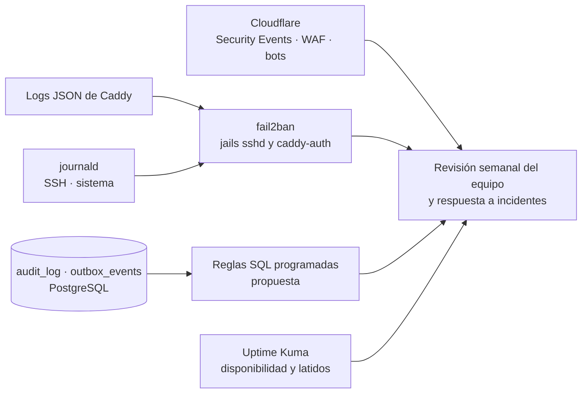

# S2 · Entregable 2 — Implementación, Monitoreo y Ética de Seguridad
> Competencias C2.2 (Controles) · C2.3 (Monitoreo y mejora) · C2.4 (Ética ACM)  
> Proyecto: OnCargo — Sistema Operativo Logístico Colaborativo para PYMEs  
> Equipo: Jorge Gutiérrez Miranda · Fabrizio Sanchez Saravia · Alex Coila Jarita  
> Semestre 2 · Agosto–Noviembre 2026 · **Versión 2.0 (rediseño, noviembre 2026)** · Versión original 1.0 sobre AWS

!!! info "Versión 2.0: controles para un VPS Hostinger detrás de Cloudflare"
    La versión 1.0 implementaba la seguridad con servicios administrados de AWS (IAM, KMS, WAF, GuardDuty, Detective, Macie, Wazuh, Bedrock). Al migrar a un **VPS Hostinger KVM 2** con Docker Compose, Caddy y Cloudflare, el documento se **reescribió por completo** sobre [Planificación de Seguridad v2.0](../semestre-1/planificacion-seguridad.md). El cambio principal es el **modelo de responsabilidad**: el equipo administra el sistema operativo, el firewall, los parches, los respaldos y los secretos. Contexto y cifras en [Rebrand OnCargo y migración a Hostinger](../../software/cambios-diseno-inicial.md#7-rebrand-oncargo-y-migracion-a-hostinger).

    **Alcance honesto:** los controles de la aplicación (RLS, mínimo privilegio, *rate limiting*, cabeceras, JWT) ya existen en el monorepo. Los controles del servidor (SSH, UFW, fail2ban, respaldos, parches) están **definidos con sus comandos y configuraciones** y se ejecutan al aprovisionar el VPS. Las pruebas de ataque de la sección 3 son un **plan con resultado esperado**; ninguna cifra ni salida se presenta como medida si no se ejecutó.

---

## Resumen Ejecutivo

Este documento registra la implementación de los controles de seguridad definidos en S1-E2 para OnCargo: cuentas y acceso SSH con mínimo privilegio, firewall (UFW y filtro de Cloudflare), fail2ban, contenedores endurecidos, secretos y tokens de alcance mínimo, cifrado en tránsito y de los respaldos, plan de continuidad con **RTO de 2–4 h y RPO de 24 h**, gestión de parches (`unattended-upgrades`, Dependabot, imágenes base) y un plan de **detección y simulación controlada de ataques** adaptado a un servidor único.

La sección 4 reemplaza la capa de IA sobre servicios de AWS por **detección automatizada y apoyo de IA a costo cero o bajo**: reglas gestionadas de Cloudflare, CrowdSec (opcional), reglas SQL propuestas sobre `audit_log` y `outbox_events`, y triage manual asistido por un LLM sobre registros anonimizados. La sección 5 conserva el análisis ético bajo el Código de la ACM y lo actualiza al nuevo entorno.

**Leyenda de estados:**

| Estado | Significado |
|--------|-------------|
| **Implementado en el repositorio** | Existe en `infra/` o en el código del monorepo `logyx` (roles de BD, RLS, `AuthRateLimits`, cabeceras, Dependabot, Dockerfiles). |
| **Definido para el VPS (pendiente de ejecutar)** | La configuración está escrita aquí y se aplica al aprovisionar el servidor. |
| **Pendiente** | Depende de una integración, una verificación o una acción administrativa. |

---

## Sección 1 — Implementación de Controles Técnicos (C2.2)

### 1.1 Usuarios, SSH y mínimo privilegio en el host

| Identidad | Permisos | Autenticación | Estado |
|-----------|----------|---------------|--------|
| `admin` | `sudo` con registro; administración del servidor | Clave SSH individual + contraseña solo para `sudo` | Definido para el VPS (pendiente de ejecutar) |
| `deploy` | Grupo `docker`; ejecuta el despliegue en `/opt/oncargo` | Clave SSH dedicada de GitHub Actions, **restringida a un comando** | Definido para el VPS (pendiente de ejecutar) |
| `root` | Sin acceso remoto | `PermitRootLogin no` | Definido para el VPS (pendiente de ejecutar) |

!!! warning "El grupo `docker` equivale a `root`"
    Quien controla el *socket* de Docker puede montar el sistema de archivos del host. Por eso la clave del usuario `deploy` no abre una *shell*: en `authorized_keys` queda atada al único comando `deploy.sh` (ver [Datacenter, sección 4.1](implementacion-datacenter.md)). Un robo de la clave de GitHub Actions permite lanzar un despliegue de la versión indicada, no ejecutar comandos arbitrarios.

**Aprovisionamiento de cuentas (primer acceso como `root` desde el panel de Hostinger):**

```bash
adduser --disabled-password --gecos "" admin && usermod -aG sudo admin && passwd admin
adduser --disabled-password --gecos "" deploy
# Claves públicas (se generan con: ssh-keygen -t ed25519 -C "nombre@equipo")
install -d -m 700 -o admin  -g admin  /home/admin/.ssh
install -d -m 700 -o deploy -g deploy /home/deploy/.ssh
echo 'ssh-ed25519 AAAA... admin-jorge'  >  /home/admin/.ssh/authorized_keys
echo 'ssh-ed25519 AAAA... admin-alex'   >> /home/admin/.ssh/authorized_keys
# Clave de GitHub Actions: solo puede ejecutar el script de despliegue, sin tty ni reenvíos
echo 'command="/opt/oncargo/infra/scripts/deploy.sh",no-port-forwarding,no-agent-forwarding,no-pty,no-X11-forwarding ssh-ed25519 AAAA... github-actions' \
  > /home/deploy/.ssh/authorized_keys
chown admin:admin  /home/admin/.ssh/authorized_keys;  chmod 600 /home/admin/.ssh/authorized_keys
chown deploy:deploy /home/deploy/.ssh/authorized_keys; chmod 600 /home/deploy/.ssh/authorized_keys
```

**Endurecimiento de SSH** (archivo `/etc/ssh/sshd_config.d/10-oncargo.conf`):

```
PermitRootLogin no
PasswordAuthentication no
KbdInteractiveAuthentication no
PubkeyAuthentication yes
AuthenticationMethods publickey
AllowUsers admin deploy
MaxAuthTries 3
LoginGraceTime 20
X11Forwarding no
ClientAliveInterval 300
ClientAliveCountMax 2

Match User deploy
    AllowTcpForwarding no
    PermitTTY no
```

```bash
sudo sshd -t && sudo systemctl reload ssh     # validar ANTES de recargar
# Mantener una segunda sesión abierta y probar el acceso con clave antes de cerrar la primera
ssh -o PreferredAuthentications=password admin@<IP_PUBLICA_VPS>   # Esperado: Permission denied (publickey)
```

La base de datos y las consolas internas **no se exponen**: el administrador entra por SSH y usa `docker compose exec db psql ...`; no se abren túneles hacia puertos de contenedores.

### 1.2 Firewall y fail2ban

El firewall (UFW para el host y filtro de Cloudflare en `DOCKER-USER`) se implementa en [Implementación de Red, sección 1.4](implementacion-red.md). Resumen de la política: entrada denegada por omisión, 22/tcp con `limit`, 80 y 443 solo desde los rangos de Cloudflare.

**fail2ban** (`apt install -y fail2ban`; archivo `/etc/fail2ban/jail.local`):

```ini
[DEFAULT]
backend   = systemd
banaction = ufw
bantime   = 1h
findtime  = 10m
maxretry  = 5
# Agregar la IP fija del equipo si existe, para no bloquearse a sí mismo
ignoreip  = 127.0.0.1/8 ::1

[sshd]
enabled  = true
port     = ssh
maxretry = 4
bantime  = 2h
bantime.increment = true
bantime.factor    = 2
bantime.maxtime   = 1w
```

La *jail* `caddy-auth` (intentos de login rechazados leídos de los logs de Caddy) está en [Implementación de Red, sección 5.3](implementacion-red.md). Detrás de Cloudflare no se puede bloquear en el host (los paquetes llegan desde Cloudflare), por lo que esa *jail* solo registra y la contención se hace en el borde.

```bash
sudo systemctl enable --now fail2ban
sudo fail2ban-client status sshd        # Esperado: Currently banned / Total banned
```

**Estado:** Definido para el VPS (pendiente de ejecutar).

### 1.3 Docker endurecido

| Control | `caddy` | `web` | `backend` | `db` | Estado |
|---------|---------|-------|-----------|------|--------|
| Usuario no `root` | No (imagen oficial; escucha 80/443) | `node` | `10001` | `postgres` (cede desde `root` en el *entrypoint*) | Implementado en el repositorio (`web`, `backend`); `caddy`/`db` por imagen oficial |
| Sin puertos publicados en `0.0.0.0` | Publica 80/443 | No | No | No | Implementado en el repositorio (`db`); definido para el VPS (resto) |
| `security_opt: no-new-privileges:true` | Sí | Sí | Sí | Sí | Definido para el VPS (pendiente de ejecutar) |
| `cap_drop: [ALL]` | + `NET_BIND_SERVICE` | Sí | Sí | + `CHOWN`, `DAC_OVERRIDE`, `FOWNER`, `SETGID`, `SETUID` | Definido; **verificar el arranque** |
| `read_only: true` con `tmpfs` | `/data` y `/config` en volúmenes | `tmpfs: /tmp` | `tmpfs: /tmp` | No (escribe en `pgdata`) | Definido; **verificar el arranque** |
| `mem_limit` | 128 MB | 512 MB | 1.5 GB | 2 GB | Implementado parcialmente (el compose actual usa 384/768/512 MB); valores finales definidos para el VPS |
| `healthcheck` | `wget` a la API admin | `GET /login` | `GET /q/health/ready` | `pg_isready` | Implementado en el repositorio (`web`, `backend`, `db`) |
| `restart: unless-stopped` | Sí | Sí | Sí | Sí | Implementado en el repositorio (`web`, `backend`, `db`) |
| Imagen fijada y actualizada | `caddy:2-alpine` | `node:22-alpine` | `eclipse-temurin:21-jre-alpine` | `postgres:16-alpine` | Implementado en el repositorio (etiquetas); *digest* fijo pendiente |
| Secretos fuera de la imagen y del repositorio | — | — | `secrets:` de Compose (claves JWT) y variables de `infra/.env` | `.env` (contraseñas) | Implementado en el repositorio (`.gitignore`, `secrets:`) |

Si `read_only` o `cap_drop` impiden el arranque de un servicio, se relaja **solo ese servicio** y se documenta el motivo (el endurecimiento es defensa en profundidad; la seguridad primaria está en la red y en los roles de BD).

**Daemon de Docker** (`/etc/docker/daemon.json`; se aplica antes del primer arranque):

```json
{
  "log-driver": "json-file",
  "log-opts": { "max-size": "10m", "max-file": "3" },
  "no-new-privileges": true,
  "live-restore": true
}
```

El límite de tamaño de los logs de los contenedores evita que llenen el disco de 100 GB.

**Verificación:**

```bash
docker inspect --format '{{.Name}} user={{.Config.User}} ro={{.HostConfig.ReadonlyRootfs}} capdrop={{.HostConfig.CapDrop}} sec={{.HostConfig.SecurityOpt}} mem={{.HostConfig.Memory}}' $(docker ps -q)
docker ps --format '{{.Names}}  {{.Ports}}'      # Esperado: solo caddy muestra 0.0.0.0:80->80 y 0.0.0.0:443->443
```

### 1.4 Gestión de secretos

| Secreto | Ubicación | Permisos | Copia fuera del VPS |
|---------|-----------|----------|---------------------|
| Contraseñas de `postgres`, `logyx_owner`, `logyx_api` | `/opt/oncargo/infra/.env` | `600`, dueño `deploy` | Gestor de contraseñas del equipo |
| Claves RSA del JWT | `/opt/oncargo/infra/secrets/jwt-*.pem` (directorio `700`) | Los PEM son `644` dentro de un directorio `700`: el contenedor (usuario 10001) los lee por el *bind mount*; ningún otro usuario del host puede entrar al directorio | Gestor de contraseñas (cifrado) |
| Credenciales R2 de documentos (`LOGYX_S3_ACCESS_KEY`/`SECRET_KEY`) | `infra/.env` | `600` | Gestor de contraseñas |
| Credenciales R2 de respaldos y `rclone.conf` | `/etc/oncargo/rclone.conf` | `640`, `root:deploy` | Gestor de contraseñas |
| Clave privada de cifrado de respaldos (`age`) | **Nunca en el VPS** | — | Gestor de contraseñas + copia impresa en sobre sellado |
| Clave SSH de GitHub Actions | GitHub *Secrets* (`DEPLOY_SSH_KEY`) | — | — |

Todos los secretos están excluidos del repositorio (`infra/.env` e `infra/secrets/` en `.gitignore`, ver `docs/security.md`). El *secret scanning* de GitHub se activa en el repositorio. **Estado:** `.gitignore` y `secrets:` de Compose, Implementado en el repositorio; permisos, `rclone.conf` y gestor de contraseñas, Definido para el VPS (pendiente de ejecutar).

**Rotación** (política POL-01 de S1: tokens de R2 y Cloudflare cada 90 días; contraseñas de BD y claves JWT ante sospecha o salida de un integrante):

| Secreto | Procedimiento | Efecto |
|---------|---------------|--------|
| Contraseña de `logyx_api` o `logyx_owner` | `docker compose exec db psql -U postgres -d logyx` y `\password logyx_api`; actualizar `infra/.env`; `docker compose up -d backend` | Reinicio breve del backend |
| Claves JWT | Borrar `infra/secrets/jwt-*.pem`, ejecutar `infra/scripts/gen-jwt-keys.sh`, `docker compose up -d backend` | **Invalida todas las sesiones** (TTL de 8 h, sin *refresh token*): los usuarios inician sesión de nuevo |
| Token R2 | Crear el token nuevo en Cloudflare, actualizar `.env`, reiniciar `backend`, revocar el anterior | Sin interrupción si se reinicia después de crear el nuevo |
| Clave SSH de un integrante | Retirar su línea de `authorized_keys` | Inmediato |

### 1.5 Mínimo privilegio de identidades y tokens

| Identidad | Alcance | Estado |
|-----------|---------|--------|
| Rol `logyx_owner` | `LOGIN`, dueño del esquema; solo Flyway y `SystemTx`; sin `SUPERUSER` ni `BYPASSRLS` | Implementado en el repositorio (`infra/db/init-roles.sh`) |
| Rol `logyx_app` | `NOLOGIN`, sin `BYPASSRLS`; las políticas RLS son `TO logyx_app` | Implementado en el repositorio |
| Rol `logyx_api` | `LOGIN`, miembro solo de `logyx_app`, `CONNECTION LIMIT 50`; no puede `SET ROLE` a otro rol | Implementado en el repositorio |
| Token R2 `oncargo-documents-rw` | Lectura y escritura **solo** del bucket `oncargo-documents` | Definido para el VPS (pendiente de ejecutar) |
| Token R2 `oncargo-backups-w` | Escritura **solo** en el bucket `oncargo-backups` | Definido; ver la nota siguiente |
| Token R2 `oncargo-backups-r` (adicional) | Lectura de `oncargo-backups`; **no se instala en el VPS**, lo usa el administrador en su equipo para las pruebas de restauración | Definido para el VPS (pendiente de ejecutar) |
| Token de Cloudflare para DNS | Editar DNS de la zona `oncargo.tech`; solo si se automatiza la emisión de certificados por DNS-01 | Pendiente (no se necesita con HTTP-01) |
| Usuario `deploy` | Solo `deploy.sh` por SSH | Definido para el VPS (pendiente de ejecutar) |

!!! note "Token de solo escritura para los respaldos"
    El diseño de S1 pide que el token de respaldos no pueda borrar. Los permisos de objeto que ofrece el panel de R2 son, según la documentación consultada, de lectura y escritura o de solo lectura; **si no existe una opción de solo escritura**, el token de respaldos del VPS tendrá lectura/escritura acotada al bucket `oncargo-backups` y el riesgo de borrado por un atacante que comprometa el VPS se compensa con (a) la regla de ciclo de vida, (b) una copia mensual de un respaldo a un destino distinto (equipo del administrador) y (c) el aislamiento del bucket de documentos. Se verifica al crear los tokens.

**Verificación del mínimo privilegio en la base de datos** (desde el VPS, con el contenedor `db` en ejecución; las conexiones por *socket* local dentro del contenedor usan autenticación `trust` de la imagen oficial):

```bash
cd /opt/oncargo/infra
docker compose -f docker-compose.prod.yml exec db psql -U postgres -d logyx -c \
  "SELECT rolname, rolsuper, rolbypassrls, rolcanlogin, rolconnlimit FROM pg_roles WHERE rolname LIKE 'logyx_%' ORDER BY 1;"
# Esperado: logyx_api (f, f, t, 50) · logyx_app (f, f, f, -1) · logyx_owner (f, f, t, -1)

docker compose -f docker-compose.prod.yml exec db psql -U logyx_api -d logyx -c "SET ROLE logyx_owner;"
# Esperado: ERROR: permission denied to set role "logyx_owner"
docker compose -f docker-compose.prod.yml exec db psql -U logyx_api -d logyx -c "CREATE TABLE prueba(x int);"
# Esperado: ERROR: permission denied for schema public
```

Las pruebas automatizadas equivalentes (`DatabasePrivilegesTest`, `RowLevelSecurityTest`) ya forman parte del *build* del backend y corren en CI.

### 1.6 Cifrado

| Ámbito | Mecanismo | Estado |
|--------|-----------|--------|
| Tránsito: visitante → Cloudflare | TLS 1.2/1.3 de Cloudflare (mínimo 1.2) | Definido para el VPS (pendiente de ejecutar) |
| Tránsito: Cloudflare → origen | Modo **Full (strict)** con certificado de Caddy (Let's Encrypt) u Origin CA | Definido para el VPS (pendiente de ejecutar) |
| HSTS (1 año) | API en perfil `prod` y web cuando llega por HTTPS | Implementado en el repositorio |
| Tránsito: backend ↔ PostgreSQL | Red Docker `internal` aislada; `sslmode=require` solo si la BD se separa a otro host | Implementado en el repositorio (red); TLS Pendiente (no aplica en un solo host) |
| Reposo: documentos | Cifrado en reposo gestionado por Cloudflare R2; `LOGYX_S3_SSE=false` (verificar al integrar si R2 acepta la cabecera SSE-S3 del SDK) | Definido; verificación pendiente |
| Reposo: disco del VPS (`pgdata`) | El cifrado de disco del proveedor no está garantizado en la información consultada; el control es el acceso al host (SSH con clave, sin `root`). Evaluar cifrar el volumen o los respaldos como compensación | Pendiente (decisión) |
| Contraseñas de usuario | Hash adaptativo bcrypt (`BcryptPasswordHasher`); no reversible | Implementado en el repositorio |
| Sesión | JWT RSA de 8 h en cookie `httpOnly`, `Secure`, `SameSite=Lax` | Implementado en el repositorio |
| Respaldos | `pg_dump -Fc` cifrado con `age` **antes** de salir del VPS; el servidor solo conoce la clave pública | Definido para el VPS (pendiente de ejecutar) |

**Cifrado de respaldos con `age`** (`sudo apt install -y age`):

```bash
# En el equipo del administrador, NO en el VPS:
age-keygen -o oncargo-backup.agekey
# Imprime: Public key: age1xxxxxxxx...   -> esa clave pública va en /etc/oncargo/backup.env (AGE_RECIPIENT)
# El archivo oncargo-backup.agekey (clave privada) se guarda en el gestor de contraseñas y en una copia impresa.

# Cifrar (en el VPS, con la clave pública) y descifrar (en el equipo del administrador):
age -r "$AGE_RECIPIENT" -o respaldo.dump.age respaldo.dump
age -d -i oncargo-backup.agekey -o respaldo.dump respaldo.dump.age
```

Alternativa con OpenSSL (clave simétrica): `openssl enc -aes-256-cbc -pbkdf2 -salt -in respaldo.dump -out respaldo.dump.enc -pass file:/etc/oncargo/backup.key`. Se prefiere `age` porque el VPS no guarda ninguna clave capaz de descifrar.

### 1.7 Respaldos como control técnico

La política (POL-03 de S1) se implementa en [Implementación de Datacenter, sección 2](implementacion-datacenter.md): `pg_dump -Fc` diario a las 02:00 (hora de Lima), cifrado y subido a R2, retención de 30 días por regla de ciclo de vida, respaldo manual antes de cada despliegue con migraciones y prueba de restauración mensual. **Estado:** Definido para el VPS (pendiente de ejecutar).

### 1.8 Plan de continuidad operativa

| Escenario | Estrategia | RTO | RPO | Estado |
|-----------|-----------|-----|-----|--------|
| Caída de un contenedor | `restart: unless-stopped` + `healthcheck` | < 1–2 min | 0 | Implementado en el repositorio |
| Reinicio del VPS | Docker arranca al *boot*; `depends_on` con `service_healthy` | 2–5 min | 0 | Implementado en el repositorio |
| Corrupción de la base de datos | Restauración del último `pg_dump` desde R2 | 1–2 h | Hasta 24 h | Definido para el VPS (pendiente de ejecutar) |
| Pérdida total del VPS | Nuevo VPS, runbook de reconstrucción y último respaldo | 2–4 h | Hasta 24 h | Definido para el VPS (pendiente de ejecutar) |
| Compromiso de secretos o de un token | Rotación (sección 1.4), revocación y revisión de logs | < 4 h | 0 | Definido para el VPS (pendiente de ejecutar) |
| Caída de Cloudflare | DNS directo al VPS (la IP se conserva en el runbook), con el filtro de firewall desactivado temporalmente | Variable | 0 | Aceptado |
| Caída de R2 | Documentos no disponibles; el resto opera; el adaptador `DocumentStorage` permite volver al disco local de forma temporal | Variable | 0 | Aceptado |
| Pérdida de la cuenta de Hostinger o de Cloudflare | Recuperación por el soporte del proveedor; 2FA y correo de recuperación del equipo | Variable | 0 | Pendiente (acción administrativa) |

El RPO baja de 24 h a minutos agregando archivado de WAL hacia R2 (pgBackRest o WAL-G) sin cambiar la topología; no se implementa en esta fase.

**Simulacros planificados** (la rúbrica valora la continuidad con simulaciones):

| Simulacro | Descripción | Frecuencia | Resultado esperado | Estado |
|-----------|-------------|-----------|--------------------|--------|
| SIM-1 | Restaurar el último respaldo en un entorno local y validar conteos | Mensual | Restauración correcta; tiempo medido | Pendiente de ejecución en el VPS |
| SIM-2 | Reconstruir el servicio completo en una máquina limpia siguiendo el runbook | Semestral | Servicio operativo en < 4 h; defectos del runbook corregidos | Pendiente |
| SIM-3 | Rotación de claves JWT y contraseñas de BD | Semestral | Sesiones invalidadas; servicio restablecido en < 30 min | Pendiente |

### 1.9 Respuesta a incidentes

Se conserva el procedimiento de S1 (detección, clasificación en 15 min, contención en 30 min, erradicación en 4 h, recuperación en 2–4 h, informe posterior en 48 h). Acciones de contención específicas del nuevo entorno:

| Situación | Contención |
|-----------|-----------|
| Tráfico abusivo o ataque a la aplicación | Regla de bloqueo en Cloudflare o modo *Under Attack*; `fail2ban-client set sshd banip <IP>` si es SSH |
| Credencial o token filtrado | Revocar en Cloudflare, rotar según la sección 1.4 |
| Sospecha de compromiso del VPS | Aislar (cerrar 80/443 en `DOCKER-USER`), tomar copia de logs, reconstruir el VPS desde cero con secretos nuevos |
| Datos personales expuestos | Notificar a los afectados en menos de 72 h (ver sección 5) |

---

## Sección 2 — Gestión de Parches y Actualizaciones (C2.2)

### 2.1 Parches del sistema operativo (`unattended-upgrades`)

```bash
sudo apt install -y unattended-upgrades
sudo dpkg-reconfigure -plow unattended-upgrades    # habilita 20auto-upgrades
```

```
# /etc/apt/apt.conf.d/20auto-upgrades
APT::Periodic::Update-Package-Lists "1";
APT::Periodic::Unattended-Upgrade "1";

# /etc/apt/apt.conf.d/52oncargo-unattended
Unattended-Upgrade::Allowed-Origins {
    "${distro_id}:${distro_codename}-security";
    "${distro_id}ESMApps:${distro_codename}-apps-security";
    "${distro_id}ESM:${distro_codename}-infra-security";
};
Unattended-Upgrade::Automatic-Reboot "false";      // el reinicio ocurre en la ventana mensual
Unattended-Upgrade::Remove-Unused-Kernel-Packages "true";
Unattended-Upgrade::Mail "admin@<dominio-del-equipo>";   // opcional
```

Los parches de seguridad se instalan a diario; el **reinicio** (necesario para parches de kernel) se concentra en una ventana mensual con un temporizador de `systemd`:

```ini
# /etc/systemd/system/mantenimiento-mensual.service
[Unit]
Description=Reinicio de mantenimiento si hay parches pendientes
[Service]
Type=oneshot
ExecStart=/bin/sh -c 'if [ -f /var/run/reboot-required ]; then /usr/sbin/shutdown -r +1 "Reinicio mensual de mantenimiento"; fi'

# /etc/systemd/system/mantenimiento-mensual.timer
[Unit]
Description=Ventana mensual de mantenimiento (primer domingo, 03:00 Lima)
[Timer]
OnCalendar=Sun *-*-01..07 03:00:00 America/Lima
Persistent=true
[Install]
WantedBy=timers.target
```

```bash
sudo systemctl enable --now mantenimiento-mensual.timer
systemctl list-timers mantenimiento-mensual.timer       # verificar la próxima ejecución
```

Los contenedores vuelven a levantarse solos (`restart: unless-stopped`); `docker compose ps` confirma el estado `healthy` tras cada reinicio. **Estado:** Definido para el VPS (pendiente de ejecutar).

### 2.2 Dependencias del código (Dependabot)

El repositorio ya tiene Dependabot configurado (`.github/dependabot.yml`): **Implementado en el repositorio**.

| Ecosistema | Directorio | Frecuencia | Observación |
|-----------|------------|-----------|-------------|
| Maven | `/backend` | Semanal | PR agrupados de versiones menores y *patch* |
| npm | `/web` | Semanal | Ídem |
| Gradle | `/android` | Semanal | Ídem |
| GitHub Actions | `/` | Semanal | Ídem |
| Docker | `/backend` y `/web` | Semanal | Actualiza las imágenes base (Temurin, Node) |

Las pruebas de CI (`backend.yml`, `web.yml`, `android.yml`, `contract.yml`, `e2e.yml`) validan cada actualización antes de fusionarla; el despliegue continuo sigue **Pendiente** (ver la Auditoría de Software).

### 2.3 Imágenes base de Docker

| Imagen | Origen | Actualización |
|--------|--------|---------------|
| `postgres:16-alpine`, `caddy:2-alpine` | Docker Hub (oficiales) | Mensual en la ventana de mantenimiento: `docker compose pull db caddy && docker compose up -d` |
| `eclipse-temurin:21-jre-alpine`, `node:22-alpine` | Base de `backend/Dockerfile` y `web/Dockerfile` | Mensual: `docker compose build --pull backend` y luego `web` (una imagen a la vez por la memoria) |
| Limpieza | — | `docker image prune -f` tras cada actualización |

Una actualización de `postgres` de versión mayor (16 a 17) **no** se hace con `pull`: requiere `pg_dump`/`pg_restore` o `pg_upgrade` y se planifica aparte.

### 2.4 Procedimiento y calendario

| Actividad | Frecuencia | Responsable | Rollback |
|-----------|-----------|-------------|----------|
| Parches de seguridad del SO | Diaria (automática) | Alex C. | `apt` permite instalar la versión anterior del paquete |
| Reinicio del SO | Mensual, domingo 03:00 | Alex C. | Snapshot del panel de Hostinger previo a cambios mayores (si el plan lo permite) |
| Revisión de PR de Dependabot | Semanal | Fabrizio S. | Revertir el PR |
| Actualización de imágenes base | Mensual | Alex C. | Reconstruir con la etiqueta de imagen anterior |
| Revisión de CVE críticos (NVD, avisos de GitHub) | Semanal | Alex C. | — |
| Respaldo manual antes de actualizar | Antes de cada cambio con migraciones | Quien despliega | Restauración desde `predeploy/` |

---

## Sección 3 — Detección y Simulación de Ataques (C2.3)

### 3.1 Arquitectura de detección ligera

La versión 1.0 usaba Wazuh sobre una instancia dedicada y una instancia Kali aislada. En un VPS de 8 GB un SIEM completo (Wazuh o Elastic) no es viable: compite con la base de datos y el backend por memoria y su costo operativo no se justifica en el MVP. La detección se apoya en lo que el sistema ya produce:



| Fuente | Qué detecta | Respuesta | Estado |
|--------|-------------|-----------|--------|
| Cloudflare *Security Events* | Bloqueos del WAF, desafíos de bots, *rate limiting* | Revisión semanal; reglas de bloqueo manuales | Definido para el VPS (pendiente de ejecutar) |
| fail2ban `sshd` | Fuerza bruta SSH | Bloqueo automático por UFW | Definido para el VPS (pendiente de ejecutar) |
| fail2ban `caddy-auth` | Intentos de login rechazados por IP | Registro y revisión; bloqueo manual en Cloudflare | Definido para el VPS (pendiente de ejecutar) |
| `AuthRateLimits` | Fuerza bruta de login y registros masivos (`429 LOGYX-AUTH-429`) | Bloqueo automático en la aplicación | Implementado en el repositorio |
| `audit_log`, `outbox_events` | Acciones críticas; eventos en `FAILED` | Consultas de la sección 4.3 | Tablas implementadas en el repositorio; reglas Pendientes |
| Uptime Kuma | Caídas y respaldos que no se ejecutaron | Alerta por correo o mensajería | Definido para el VPS (pendiente de ejecutar) |

### 3.2 Reglas de la prueba (ética y alcance)

| Regla | Detalle |
|-------|---------|
| Alcance | Solo infraestructura propia: el VPS de OnCargo, el dominio `oncargo.tech` y el *staging* local. Ningún sistema de terceros. |
| Pruebas intrusivas | Fuerza bruta, inyección automatizada y escaneo activo de la aplicación se ejecutan **solo contra el *staging* local** (`docker compose` en un equipo del equipo, con las mismas imágenes y datos de prueba). |
| Pruebas sobre producción | Solo no intrusivas: Nmap externo y comprobaciones con `curl`, con aviso previo al equipo y fuera del horario de mayor uso. |
| Equipo atacante | Un equipo del equipo, o un contenedor `kalilinux/kali-rolling` bajo demanda; no se mantiene una instancia atacante en la nube. |
| Autorización | Aprobación escrita del Responsable de Seguridad (Jorge G.) antes de cada sesión; registro de fecha, hora, IP de origen y herramienta. |
| Datos | Solo cuentas y datos sintéticos; ningún dato real de clientes. |
| Marco legal | Ley 30096 (delitos informáticos): se actúa únicamente sobre sistemas propios. |

### 3.3 Escenarios de ataque simulado

Cada escenario indica el entorno, el comando, el resultado esperado y la detección esperada. **Todos están en estado Pendiente de ejecución**; no se registran salidas de herramientas que no se hayan ejecutado.

| ID | Escenario | Entorno | Resultado esperado | Detección esperada | Resultado |
|----|-----------|---------|--------------------|--------------------|-----------|
| A1 | Escaneo de puertos con Nmap | Producción (externo) | Solo 22/tcp visible; 80/443/5432/8080/4321 filtrados | Entradas de `ufw` en el *journal* | Pendiente de ejecución en el VPS |
| A2 | Fuerza bruta al login | *Staging* local | `429 LOGYX-AUTH-429` tras 10 fallos por correo y tras 50 intentos por IP | Logs de Caddy y de la aplicación | Pendiente de ejecución en el VPS |
| A3 | Inyección SQL con sqlmap | *Staging* local | Sin inyección explotable; sin datos de otra organización | Logs; WAF en producción | Pendiente de ejecución en el VPS |
| A4 | Escaneo dinámico con OWASP ZAP | *Staging* local | Sin hallazgos altos sin tratar | Informe HTML | Pendiente de ejecución en el VPS |
| A5 | Acceso a la BD desde fuera | Producción (externo) | Sin conexión al puerto 5432 | Escaneo de A1 | Pendiente de ejecución en el VPS |
| A6 | Prueba de SSRF | *Staging* local | Ninguna petición saliente originada por datos del usuario | Captura de tráfico; revisión de código | Pendiente de ejecución en el VPS |
| A7 | Fuerza bruta SSH | Producción (acceso controlado) | Bloqueo de la IP por fail2ban tras 4 intentos | `fail2ban-client status sshd` | Pendiente de ejecución en el VPS |
| A8 | Acceso directo al origen sin Cloudflare | Producción (externo) | Sin respuesta | Contadores de `CLOUDFLARE_ONLY` | Pendiente de ejecución en el VPS |

#### A1 — Escaneo de puertos (producción, externo)

```bash
sudo nmap -Pn -sS -p- --min-rate 1000 -oN a1-nmap.txt <IP_PUBLICA_VPS>
# Esperado: 22/tcp open ssh; todos los demás puertos filtered o closed
sudo journalctl -k --since "10 min ago" | grep -c 'UFW BLOCK'     # Esperado: > 0 (bloqueos registrados)
```

#### A2 — Fuerza bruta al login (staging local)

El backend usa JSON, de modo que se prueba con un ciclo de `curl` (Hydra solo soporta formularios y no encaja con la API):

```bash
BASE=http://127.0.0.1:8680   # staging local (perfil prod del compose del repositorio)

# 2a) Un mismo correo: 10 fallos y bloqueo (15 min)
for i in $(seq 1 12); do
  printf 'intento %2d -> ' "$i"
  curl -s -o /dev/null -w "%{http_code}\n" -X POST "$BASE/api/v1/auth/login" \
    -H 'Content-Type: application/json' -d '{"email":"victima@prueba.local","password":"incorrecta-'$i'"}'
done
# Esperado: 401 (x10) y luego 429 con cabecera Retry-After y código LOGYX-AUTH-429

# 2b) Correos distintos desde una IP: bloqueo por IP tras 50 intentos en 15 min
for i in $(seq 1 60); do
  curl -s -o /dev/null -w "%{http_code} " -X POST "$BASE/api/v1/auth/login" \
    -H 'Content-Type: application/json' -d '{"email":"u'$i'@prueba.local","password":"x"}'
done; echo
# Esperado: 401 hasta el intento 50 y 429 desde el 51
```

En producción el mismo patrón debe quedar contenido además por la regla de *rate limiting* de Cloudflare y registrado por la *jail* `caddy-auth`.

#### A3 y A4 — sqlmap y OWASP ZAP (staging local)

```bash
# A3: sqlmap sobre un endpoint con parámetros (token de una cuenta de prueba)
TOKEN="<JWT de staging>"
sqlmap -u "http://127.0.0.1:8680/api/v1/shipment-requests?status=PUBLISHED" \
  --headers="Authorization: Bearer $TOKEN" --batch --level=3 --risk=2 --dbs
# Esperado: "all tested parameters do not appear to be injectable" (JPA con consultas parametrizadas)

# A4: ZAP con el contrato OpenAPI versionado del repositorio (sin autenticar: cubre rutas públicas y
# la comprobación de que los endpoints protegidos responden 401; el escaneo autenticado se afina con la
# configuración de autenticación de ZAP en una segunda pasada)
docker run --rm --network host -v "$PWD/docs/api:/zap/wrk:rw" ghcr.io/zaproxy/zaproxy:stable \
  zap-api-scan.py -t /zap/wrk/openapi.yaml -f openapi -r zap-report.html -O 127.0.0.1:8680
# Esperado: sin alertas de riesgo alto; las medias y bajas se registran con su tratamiento
```

**Análisis:** incluso con un WAF mediocre, la defensa no depende de él. La capa de aplicación usa consultas parametrizadas y la conexión `logyx_api` no puede escalar (`RESET ROLE`, `SET ROLE`, `ALTER`, `DROP POLICY` fallan, `DatabasePrivilegesTest`). El riesgo residual documentado en `docs/security.md` es que una inyección podría cambiar el contexto de organización con `set_config` dentro de lo que permite `logyx_app` (ADR-0006); por eso el análisis de A3 revisa también el aislamiento entre organizaciones.

#### A5 y A8 — Acceso a la base de datos y al origen desde fuera

```bash
psql -h <IP_PUBLICA_VPS> -p 5432 -U logyx_api -d logyx      # Esperado: tiempo de espera agotado, sin conexión
nmap -Pn -p 5432 <IP_PUBLICA_VPS>                          # Esperado: filtered / closed
curl -sv --max-time 8 --resolve oncargo.tech:443:<IP_PUBLICA_VPS> https://oncargo.tech/ -o /dev/null   # Esperado: sin respuesta
sudo iptables -L CLOUDFLARE_ONLY -n -v                     # Esperado: contador del DROP incrementado
```

#### A6 — Prueba de SSRF

El backend **no realiza peticiones HTTP a destinos controlados por el usuario**: el único cliente HTTP del código es el adaptador de documentos S3 (`S3DocumentStorage`), cuyo destino viene de la variable `LOGYX_S3_ENDPOINT`, no de la entrada del usuario; las rutas por carretera usan datos precalculados en el repositorio (ADR-0008). La prueba confirma esa propiedad:

```bash
# 1) Revisión estática: los únicos usos de clientes HTTP salientes
grep -rn "HttpClient\|new URL(\|URI.create\|RestClient\|WebClient" backend/src/main/java
# Esperado: solo el cliente del SDK S3 en S3DocumentStorage

# 2) Dinámica (staging local): se envían URLs y direcciones internas en los campos de texto libres
#    (p. ej. `notes` de una oferta, `fullName` y `legalName` del registro, cuerpo de un mensaje de negociación)
#    mientras se captura el tráfico saliente del contenedor del backend:
sudo tcpdump -ni any 'host 169.254.169.254 or port 2019' -w ssrf.pcap &
# ... enviar las peticiones con curl usando http://169.254.169.254/latest/meta-data y http://127.0.0.1:2019/config/ como valores ...
sudo kill %1 && tcpdump -nr ssrf.pcap | wc -l
# Esperado: 0 paquetes; el valor se almacena o se rechaza por validación, pero nunca se solicita
```

La IP de metadatos `169.254.169.254` no aplica a un VPS de Hostinger como en AWS; la prueba conserva el vector clásico y además verifica el acceso a la API de administración de Caddy (`:2019`), que solo escucha dentro de su contenedor.

#### A7 — Fuerza bruta SSH

```bash
# Desde un equipo del equipo (IP que NO está en ignoreip), con una clave inexistente
for i in 1 2 3 4 5; do ssh -o PreferredAuthentications=password -o PubkeyAuthentication=no admin@<IP_PUBLICA_VPS> true; done
# En el VPS:
sudo fail2ban-client status sshd      # Esperado: la IP aparece en "Banned IP list"
sudo ufw status | grep <IP_DEL_TESTER>
sudo fail2ban-client set sshd unbanip <IP_DEL_TESTER>
```

### 3.4 Alertas y dashboard ligeros

El panel operativo es el de **Uptime Kuma** (estado de monitores y latidos) más la lista semanal de revisión; no se mantiene un dashboard de métricas pesado.

| Alerta | Origen | Umbral | Canal | Estado |
|--------|--------|--------|-------|--------|
| Web o API caída | Uptime Kuma y UptimeRobot | 3 fallos de 60 s | Correo y mensajería | Definido para el VPS (pendiente de ejecutar) |
| Respaldo diario no ejecutado | Monitor *push* | Sin latido en 26 h | Correo y mensajería | Definido para el VPS (pendiente de ejecutar) |
| Certificado por vencer | Uptime Kuma | < 14 días | Correo | Definido para el VPS (pendiente de ejecutar) |
| IP bloqueada por fail2ban | fail2ban | Cada bloqueo `sshd` (informativo) | Revisión semanal | Definido para el VPS (pendiente de ejecutar) |
| Eventos de seguridad altos en Cloudflare | Panel de Cloudflare | Pico anómalo de bloqueos | Revisión semanal | Definido para el VPS (pendiente de ejecutar) |
| `outbox_events` en `FAILED` | Consulta SQL (sección 4.3) | > 0 | Revisión semanal | Pendiente (sin alerta automática hoy, según `docs/security.md`) |

**Revisión semanal (30 min, Jorge G.):** bloqueos de fail2ban, *Security Events* de Cloudflare, consultas de la sección 4.3, actualizaciones pendientes (`apt list --upgradable`), uso de disco y memoria, estado del último respaldo.

### 3.5 KPIs de seguridad (C2.3)

| KPI | Objetivo | Frecuencia | Fuente | Valor medido |
|-----|----------|-----------|--------|--------------|
| CVE críticos sin parchear (dependencias e imágenes) | 0 | Semanal | Dependabot, Trivy, `npm audit` | Pendiente (se mide al operar) |
| Respaldos diarios exitosos | 100 % | Diaria | Monitor *push* de Uptime Kuma | Pendiente |
| Pruebas de restauración exitosas | 1 por mes | Mensual | Registro de SIM-1 | Pendiente |
| Tiempo de reconocimiento de una alerta crítica | < 30 min | Por evento | Uptime Kuma + registro de incidentes | Pendiente |
| Eventos de seguridad bloqueados por Cloudflare sobre el total de solicitudes | < 0.5 % (tendencia; un pico se investiga) | Semanal | Panel de Cloudflare | Pendiente |
| IP bloqueadas por fail2ban `sshd` | Informativo (tendencia) | Semanal | `fail2ban-client status sshd` | Pendiente |
| Cuentas bloqueadas por `LOGYX-AUTH-429` y cuentas comprometidas | 0 cuentas comprometidas | Semanal | Logs de la aplicación | Pendiente |
| `outbox_events` en `FAILED` sin revisar más de 7 días | 0 | Semanal | Consulta SQL | Pendiente |
| Actualizaciones de seguridad del SO pendientes más de 7 días | 0 | Semanal | `apt list --upgradable` | Pendiente |
| Meses sin reinicio de mantenimiento con parches pendientes | 0 (máximo 1 mes) | Mensual | `/var/run/reboot-required` | Pendiente |
| Desviación entre el repositorio y el servidor | 0 archivos modificados en `/opt/oncargo` | Semanal | `git -C /opt/oncargo status --porcelain` | Pendiente |
| Credenciales con rotación vencida (90 días) | 0 | Trimestral | Registro de rotación | Pendiente |

---

## Sección 4 — Detección Automatizada y Apoyo de IA a Costo Cero o Bajo (C2.3)

La versión 1.0 apoyaba la seguridad en servicios de IA/ML de AWS (GuardDuty, Detective, Macie, Wazuh, Bedrock) que cuestan decenas de dólares al mes y que el nuevo diseño no usa. Esta sección conserva la idea (automatizar la detección y reducir el ruido para el equipo) con herramientas gratuitas o de costo marginal, y distingue lo que ya existe de lo que es una **propuesta**.

### 4.1 Cloudflare: reglas gestionadas y puntuación de bots

| Capacidad | Disponibilidad | Uso en OnCargo | Estado |
|-----------|----------------|----------------|--------|
| Reglas gestionadas del WAF (conjunto gratuito) | Plan gratuito | Mitigación de vulnerabilidades de alto impacto y de ataques comunes; revisión de eventos | Definido para el VPS (pendiente de ejecutar) |
| *Bot Fight Mode* | Plan gratuito | Reduce el tráfico automatizado de bajo costo; verificar con la app Android | Pendiente de verificar |
| Mitigación DDoS (capas 3, 4 y 7) | Plan gratuito | Absorbe ataques volumétricos antes del origen | Definido para el VPS (pendiente de ejecutar) |
| *Rate limiting* (una regla) | Plan gratuito | Contiene el abuso del login antes de `AuthRateLimits` | Definido para el VPS (pendiente de ejecutar) |
| Puntuación de bots detallada, OWASP Core Ruleset, WAF avanzado | Planes de pago | **No se usa** | — |

La puntuación de bots detallada y el conjunto de reglas OWASP completo son de pago: la protección del plan gratuito es una **primera barrera**, no sustituye la validación y el aislamiento de la aplicación.

### 4.2 CrowdSec (opcional, propuesta)

CrowdSec es un motor de detección de comportamiento basado en escenarios y en una lista de reputación comunitaria. Se evalúa como mejora **opcional** porque consume memoria y requiere un *bouncer* que actúe en Cloudflare (para que el bloqueo sea efectivo detrás del proxy).

| Aspecto | Planteamiento |
|---------|---------------|
| Fuente de datos | Logs JSON de Caddy y *journal* de SSH |
| Acción | *Bouncer* de Cloudflare (bloqueo en el borde) y de firewall para SSH |
| Costo | Software libre; consumo de memoria **estimado** en el orden de 100–200 MB (sin medir) |
| Condición para adoptarlo | Medir la memoria libre del host tras 30 días de operación; adoptarlo solo si quedan > 3 GB libres con carga normal |
| Estado | **Pendiente (opcional)** |

### 4.3 Reglas de detección en SQL sobre `audit_log` y `outbox_events` (propuesta)

La base de datos ya registra la actividad crítica. Las consultas siguientes se ejecutarían de forma programada (por ejemplo, un temporizador de `systemd` semanal o diario) con el rol `logyx_owner` en una transacción de solo lectura. **Son una propuesta**: los umbrales son iniciales y deben calibrarse con datos reales; no se afirma que detecten fraude con una exactitud conocida.

```bash
# Ejemplo de ejecución (solo lectura):
docker compose -f /opt/oncargo/infra/docker-compose.prod.yml exec -T db \
  psql -U logyx_owner -d logyx -v ON_ERROR_STOP=1 -c "SET default_transaction_read_only = on;" -f - < regla.sql
```

**R-SQL-1 — Eventos del outbox en `FAILED`** (disponible hoy; no hay alerta automática):

```sql
SELECT event_type, count(*) AS fallidos, max(created_at) AS ultimo, max(left(last_error, 120)) AS ultimo_error
FROM outbox_events
WHERE status = 'FAILED'
GROUP BY event_type
ORDER BY fallidos DESC;
```

**R-SQL-2 — Posible *bid sniping* (ofertas en los últimos 60 s antes del cierre, repetidas en varias subastas):**

```sql
SELECT b.carrier_org_id, count(DISTINCT a.id) AS subastas_con_oferta_tardia
FROM bids b
JOIN auctions a ON a.id = b.auction_id
WHERE a.status = 'CLOSED'
  AND a.closed_at > now() - interval '7 days'
  AND b.created_at >= a.closes_at - interval '60 seconds'
GROUP BY b.carrier_org_id
HAVING count(DISTINCT a.id) >= 3
ORDER BY subastas_con_oferta_tardia DESC;
```

**R-SQL-3 — Transportistas con cancelaciones repetidas tras adjudicar:**

```sql
SELECT carrier_org_id, count(*) AS cancelados_30d
FROM shipments
WHERE status = 'CANCELLED' AND created_at > now() - interval '30 days'
GROUP BY carrier_org_id
HAVING count(*) >= 3
ORDER BY cancelados_30d DESC;
```

**R-SQL-4 — Ráfagas de acciones por un mismo usuario (posible automatización o cuenta comprometida):**

```sql
SELECT actor_profile_id, organization_id, count(*) AS acciones_5min, min(occurred_at) AS desde
FROM audit_log
WHERE occurred_at > now() - interval '5 minutes'
GROUP BY actor_profile_id, organization_id
HAVING count(*) >= 50
ORDER BY acciones_5min DESC;
```

Cada resultado no vacío se revisa manualmente: las consultas **señalan**, no sancionan. No se actualiza ninguna tabla (la versión 1.0 marcaba `fraud_flag` automáticamente; se descarta por el riesgo de sancionar a una organización con una regla no validada). Estado: **Pendiente (propuesta)**, salvo R-SQL-1 que puede ejecutarse hoy.

### 4.4 Triage manual asistido por un LLM sobre registros anonimizados (propuesta futura)

La versión 1.0 usaba una función Lambda que enviaba alarmas a un modelo en Bedrock. Se propone una variante **sin automatización de envío**: una revisión semanal en la que una persona pega en un asistente de IA un extracto de logs **ya anonimizado** y le pide resumir patrones y priorizar. El objetivo es reducir tiempo de lectura, no decidir.

| Condición | Detalle |
|-----------|---------|
| Sin datos personales | Antes de salir del VPS se eliminan correos, RUC, DNI, teléfonos, tokens y contenido de mensajes; las IP se reemplazan por un *hash* con sal local |
| Sin credenciales | Nunca se incluyen secretos, cabeceras `Authorization` ni cookies |
| Sin decisiones automáticas | La salida del modelo es una sugerencia; la clasificación y la acción las decide una persona |
| Base legal | Si algún dato personal pudiera quedar en el extracto, la transferencia a un tercero en el extranjero exigiría revisión legal (Ley 29733); por eso el diseño la evita |
| Verificación | Las afirmaciones del modelo se contrastan con los logs originales antes de actuar |

Script de anonimización (propuesta) para los logs de Caddy:

```bash
#!/usr/bin/env bash
# anonimizar-logs.sh — salida lista para revisión: sin IP real, sin query string, sin cabeceras
# Uso: sudo ./anonimizar-logs.sh /var/log/caddy/access.log > resumen-semanal.jsonl
SAL=$(cat /etc/oncargo/log-salt)     # valor aleatorio local, no se comparte
jq -c --arg sal "$SAL" '{
  ts: .ts,
  ip: (.request.client_ip + $sal | @base64 | .[0:10]),
  method: .request.method,
  path: (.request.uri | split("?")[0] | gsub("[0-9a-f]{8}-[0-9a-f-]{27}"; ":id")),
  status: .status,
  dur_ms: ((.duration * 1000) | floor)
}' "$1"
```

El hash anterior es una **seudonimización de apoyo**, no un cifrado: sirve para agrupar eventos sin mostrar la IP, y se acompaña de la regla de no enviar el archivo completo.

### 4.5 Mapa de capas de detección automatizada

```
┌─────────────────────────────────────────────────────────────────┐
│               CAPA 7 — APLICACIÓN (implementada)                │
│  Moderación de mensajes (fn_contains_contact_info) — regex      │
│  Trust Score bayesiano — estadística en PostgreSQL              │
│  AuthRateLimits — 429 LOGYX-AUTH-429                            │
├─────────────────────────────────────────────────────────────────┤
│        CAPA 6 — SEÑALES DE NEGOCIO (propuesta, sección 4.3)     │
│  Consultas SQL programadas sobre audit_log y outbox_events      │
├─────────────────────────────────────────────────────────────────┤
│        CAPA 5 — APOYO HUMANO ASISTIDO (propuesta, sección 4.4)  │
│  Triage semanal con un LLM sobre logs anonimizados              │
├─────────────────────────────────────────────────────────────────┤
│        CAPA 4 — DETECCIÓN EN EL HOST (definida)                 │
│  fail2ban (sshd, caddy-auth) · CrowdSec (opcional)              │
├─────────────────────────────────────────────────────────────────┤
│        CAPA 3 — BORDE (definida)                                │
│  Cloudflare: WAF gestionado, Bot Fight Mode, DDoS, rate limiting│
├─────────────────────────────────────────────────────────────────┤
│        CAPA 2 — FILTRADO DE RED (definida)                      │
│  DOCKER-USER + ipset (solo Cloudflare en 80/443) · UFW          │
├─────────────────────────────────────────────────────────────────┤
│        CAPA 1 — SEGMENTACIÓN (implementada en el compose)       │
│  Redes edge e internal · db sin puertos · RLS y mínimo privilegio│
└─────────────────────────────────────────────────────────────────┘
```

---

## Sección 5 — Ética ACM (C2.4)

### 5.1 Marco de referencia

El Código de Ética de la ACM (Association for Computing Machinery) establece principios que guían las decisiones técnicas de OnCargo. A continuación se analiza el impacto ético de las decisiones de seguridad tomadas.

### 5.2 Principio 1 — Contribuir al bienestar social y humano

**Decisión:** OnCargo recopila ubicaciones GPS de conductores durante la entrega.

**Análisis:**
- Los datos de ubicación son necesarios para el tracking de envíos, que beneficia a las PYMEs.
- **Límite ético:** La ubicación solo se recopila durante un envío activo, no de forma continua. El conductor puede ver exactamente qué datos se envían (transparencia).
- **Control implementado:** Los datos de ubicación se almacenan solo en `shipment_stops` vinculados a un envío específico. No existe tabla de histórico de GPS permanente.

### 5.3 Principio 2 — Evitar daño

**Decisión:** Datos de RUC, DNI y contratos de organizaciones peruanas.

**Análisis:**
- Una brecha de datos podría exponer información comercialmente sensible.
- **Controles implementados o definidos:** TLS de extremo a extremo (Cloudflare y Caddy), cifrado en reposo de los documentos en R2, respaldos cifrados con `age`, RLS que impide que una organización acceda a datos de otra, `audit_log` para trazabilidad, mínimo privilegio en la base de datos y en los tokens.
- **Limitación reconocida:** el disco del VPS no cuenta con cifrado garantizado por el proveedor (sección 1.6), y un único servidor es un único dominio de falla; ambas decisiones se aceptaron por costo y se documentan con sus mitigaciones (control de acceso al host, respaldos cifrados fuera del proveedor).
- **Incidente hipotético:** Si OnCargo detecta una brecha, el plan de respuesta (secciones 1.8 y 1.9) exige notificar a los afectados en < 72 horas, alineado con las mejores prácticas internacionales (plazo a validar con asesoría legal).

### 5.4 Principio 3 — Ser honesto y confiable

**Decisión 1:** Moderación automática de mensajes (filtro de contacto).

**Análisis:**
- El sistema bloquea mensajes que contienen números de teléfono, emails o handles sociales para proteger el modelo de negocio.
- **Obligación ética:** Los usuarios DEBEN ser informados de esta política al registrarse y cuando un mensaje es bloqueado. El mensaje bloqueado muestra claramente: `"[Mensaje bloqueado: el sistema detectó información de contacto directa]"`.
- No se bloquean mensajes silenciosamente sin notificar al remitente.

**Decisión 2:** Honestidad sobre la disponibilidad y las pruebas.

**Análisis:**
- La documentación del rediseño declara que un solo VPS ofrece una disponibilidad estimada de ~99.47 % (no 99.9 %), que no existe SLA contractual con el proveedor y que las pruebas de seguridad y rendimiento están **pendientes de ejecución**. No se presentan resultados no medidos como si lo fueran: afirmar una robustez no verificada a clientes o evaluadores sería una forma de engaño.

### 5.5 Principio 4 — Respetar la privacidad

**Decisión 1:** Uso de datos para el Trust Score y la reputación.

**Análisis:**
- El Trust Score agrega datos de comportamiento de las organizaciones.
- **Control ético:** El score y sus componentes son **visibles para el propio usuario**. Ningún componente es un "puntaje secreto".
- Las calificaciones negativas requieren que la entrega esté completa (no se puede calificar sin haber completado el ciclo). No se permiten calificaciones anónimas.

**Decisión 2:** Uso de herramientas de IA en la seguridad (sección 4).

**Análisis:**
- El apoyo de un LLM se limita a **registros anonimizados**, sin correos, RUC, DNI, tokens ni contenido de mensajes, y sin automatizar decisiones sobre personas u organizaciones.
- Las reglas de señales de negocio (sección 4.3) **no sancionan automáticamente**: una persona revisa cada resultado, para evitar perjudicar a una organización por un falso positivo.
- **Principio de minimización:** los logs de Caddy ocultan las cabeceras `Authorization` y `Cookie`, y los logs de la aplicación no registran correos, RUC, teléfonos ni tokens (`docs/security.md`).

### 5.6 Principio 5 — Respetar la propiedad intelectual y el derecho contractual

**Decisión:** Simulación de ataques sobre infraestructura propia.

**Análisis:**
- Las pruebas intrusivas se realizan **exclusivamente sobre sistemas propios** de OnCargo: el *staging* local con datos sintéticos y, de forma no intrusiva, el propio VPS y dominio (sección 3.2).
- No se ataca infraestructura de terceros, incluidos Hostinger y Cloudflare: el escaneo y las pruebas se limitan a la IP y los dominios del proyecto, y se respetan sus políticas de uso aceptable. Las pruebas de carga contra Cloudflare se mantienen en volúmenes moderados y con la IP del evaluador identificada.
- No se utiliza ninguna herramienta contra sistemas ajenos, lo que cumple las condiciones de la Ley de Delitos Informáticos del Perú (Ley 30096).
- Las dependencias de código abierto se usan conforme a su licencia (Dependabot, revisión de CVE); los datos de OpenStreetMap usados en las rutas se atribuyen conforme a la ODbL (ADR-0008).

### 5.7 Cumplimiento legal (Perú)

| Ley / Norma | Aplicación en OnCargo |
|------------|---------------------|
| **Ley 29733** — Protección de Datos Personales | RUC, DNI, emails, ubicaciones: tratados con consentimiento explícito (aceptación de la política de privacidad en el registro). Derechos de acceso, rectificación y cancelación a implementar o verificar según el alcance del MVP. |
| **Ley 30096** — Delitos Informáticos | Los ataques simulados son sobre infraestructura propia. Documentados con autorización explícita del equipo. |
| **Reglamento de la Ley 29733** (DS 003-2013-JUS; su sustitución por un nuevo reglamento debe verificarse con asesoría legal) | Medidas de seguridad técnicas: cifrado, acceso restringido, auditoría (`audit_log`), respaldos y control de accesos. |
| **Flujo transfronterizo de datos personales** | Los datos residen en un VPS en Brasil y en Cloudflare R2; el tratamiento y la política de privacidad deben informarlo y evaluarse con asesoría legal (el nivel de protección del país receptor debe ser adecuado). |

### 5.8 Impacto social de las decisiones del rediseño

| Decisión | Beneficio | Riesgo para las personas | Mitigación |
|----------|-----------|--------------------------|------------|
| Alojar en un VPS de bajo costo | Mantiene viable el servicio para PYMEs con márgenes estrechos | Menor disponibilidad que una nube multi-zona | Respaldos externos, RTO/RPO declarados, comunicación transparente de los límites |
| Aceptar un único dominio de falla | Reduce el costo en ~96 % frente a AWS | Una caída detiene subastas y seguimiento | La app del conductor encola evidencias y reintenta; las subastas son de minutos u horas |
| Monitoreo ligero en vez de un SIEM | No sobrecarga el servidor | Menor visibilidad forense | Logs JSON de Caddy, `audit_log`, revisión semanal; CrowdSec opcional |

---

## Anexos

### Anexo A — Evidencias de implementación de seguridad

| Evidencia | Origen | Estado |
|-----------|--------|--------|
| `infra/db/init-roles.sh` y salida de `SELECT ... FROM pg_roles` (sección 1.5) | Repositorio / VPS | Script: Implementado en el repositorio; salida: Pendiente de ejecución en el VPS |
| `DatabasePrivilegesTest`, `RowLevelSecurityTest`, `RealtimeStreamFlowTest` en verde en CI | Repositorio | Implementado en el repositorio |
| `.github/dependabot.yml` y PR de Dependabot abiertos | Repositorio | Implementado en el repositorio |
| `sshd -T \| grep -E 'permitrootlogin\|passwordauthentication'` | VPS | Pendiente de ejecución en el VPS |
| `ufw status verbose`, `iptables -S DOCKER-USER`, `ipset list cloudflare4` | VPS | Pendiente de ejecución en el VPS |
| `fail2ban-client status` (jails `sshd` y `caddy-auth`) | VPS | Pendiente de ejecución en el VPS |
| `docker inspect` de usuario, capacidades y sistema de archivos de solo lectura (sección 1.3) | VPS | Pendiente de ejecución en el VPS |
| Panel de Cloudflare: modo SSL, WAF, *rate limiting*, tokens de API con alcance mínimo | Cloudflare | Pendiente de ejecución en el VPS |
| Panel de R2: buckets privados, tokens por bucket, reglas de ciclo de vida | Cloudflare | Pendiente de ejecución en el VPS |
| Salida de `unattended-upgrades --dry-run` y de `systemctl list-timers` | VPS | Pendiente de ejecución en el VPS |
| Resultados de los escenarios A1–A8 | Equipo / VPS | Pendiente de ejecución en el VPS |
| Informe de OWASP ZAP (`zap-report.html`) y de Trivy | Equipo | Pendiente de ejecución en el VPS |
| Registro de SIM-1 (restauración mensual de un respaldo) | Equipo | Pendiente de ejecución en el VPS |

### Anexo B — Escaneos de vulnerabilidades

```bash
# 1) OWASP ZAP — API REST (contrato OpenAPI del repositorio), contra el staging local
docker run --rm --network host -v "$PWD/docs/api:/zap/wrk:rw" ghcr.io/zaproxy/zaproxy:stable \
  zap-api-scan.py -t /zap/wrk/openapi.yaml -f openapi -r zap-report.html -O 127.0.0.1:8680

# 2) Trivy — vulnerabilidades de las imágenes Docker (reemplaza a AWS Inspector)
docker run --rm -v /var/run/docker.sock:/var/run/docker.sock aquasec/trivy:latest image \
  --severity HIGH,CRITICAL --ignore-unfixed oncargo-backend:prod
docker run --rm -v /var/run/docker.sock:/var/run/docker.sock aquasec/trivy:latest image \
  --severity HIGH,CRITICAL --ignore-unfixed oncargo-web:prod
docker run --rm aquasec/trivy:latest image --severity HIGH,CRITICAL --ignore-unfixed postgres:16-alpine
docker run --rm aquasec/trivy:latest image --severity HIGH,CRITICAL --ignore-unfixed caddy:2-alpine

# 3) Dependencias de la web (npm)
cd web && npm audit --omit=dev --audit-level=high

# 4) Dependencias del backend (Maven) — OWASP Dependency-Check
cd backend && ./mvnw -B org.owasp:dependency-check-maven:check -DfailBuildOnCVSS=7

# 5) Secretos accidentales en el repositorio
docker run --rm -v "$PWD:/repo" aquasec/trivy:latest fs --scanners secret /repo

# 6) Endurecimiento del host (referencia CIS) y de Docker
sudo apt install -y lynis && sudo lynis audit system
git clone https://github.com/docker/docker-bench-security.git && cd docker-bench-security && sudo sh docker-bench-security.sh
```

| Escaneo | Frecuencia | Criterio de aceptación | Resultado |
|---------|-----------|------------------------|-----------|
| OWASP ZAP (API) | Trimestral y antes de un lanzamiento | Sin alertas altas sin tratar | Pendiente de ejecución en el VPS |
| Trivy (imágenes) | Mensual y tras cada actualización de imagen base | 0 CVE críticos con corrección disponible | Pendiente de ejecución en el VPS |
| `npm audit` | Semanal (con Dependabot) | 0 vulnerabilidades altas en producción | Pendiente de ejecución en el VPS |
| OWASP Dependency-Check (Maven) | Mensual | Sin CVSS ≥ 7 sin tratamiento | Pendiente de ejecución en el VPS |
| Lynis y Docker Bench | Semestral | Índice de endurecimiento registrado y mejoras priorizadas | Pendiente de ejecución en el VPS |

---

*OnCargo · S2 Entregable 2 · Seguridad · Competencias C2.2–C2.3–C2.4 · Versión 2.0 · Noviembre 2026 (original: Agosto–Noviembre 2026)*
