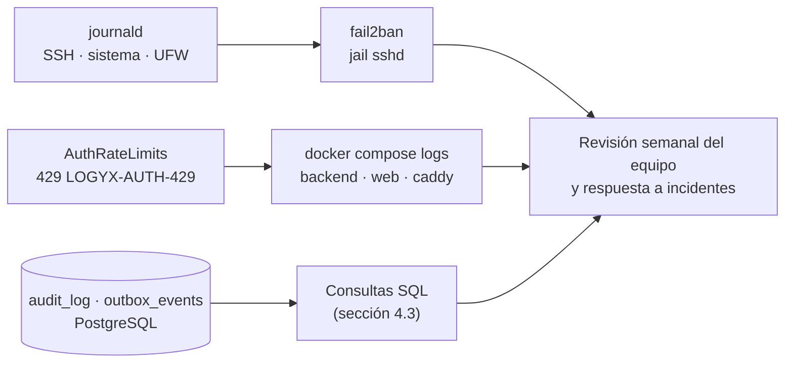

# S2 · Entregable 2 — Implementación, Monitoreo y Ética de Seguridad
> Competencias C2.2 (Controles) · C2.3 (Monitoreo y mejora) · C2.4 (Ética ACM)  
> Proyecto: OnCargo — Sistema Operativo Logístico Colaborativo para PYMEs  
> Equipo: Jorge Gutiérrez Miranda · Fabrizio Sanchez Saravia · Alex Coila Jarita  
> Semestre 2 · Agosto–Noviembre 2026 · **Versión 2.1 (estado real del despliegue, noviembre 2026)** · v2.0: diseño previo al despliegue · v1.0: AWS

!!! info "Versión 2.1: controles realmente aplicados en el VPS Hostinger"
    La versión 1.0 implementaba la seguridad con servicios administrados de AWS. La versión 2.0 la rediseñó para un VPS Hostinger detrás de Cloudflare, pero se escribió **antes** de aprovisionar el servidor. Esta versión 2.1 documenta los controles **realmente aplicados**, tomados de `infra/vps/` del monorepo (`compose.yml`, `Caddyfile`, `bootstrap.sh`, `deploy.sh`, `README.md`; commit `cad2b77`) y del código de la aplicación.

    **Diferencias principales con la v2.0:** no hay Cloudflare (ni WAF, ni filtro de origen); los documentos están en MinIO dentro del VPS y no en R2; **todavía no hay respaldos automáticos** ni monitoreo de disponibilidad; el despliegue es manual con `deploy.sh` desde el equipo del administrador (no con GitHub Actions); el servidor tiene un solo usuario administrativo (`deploy`, con `sudo`) y funciona como **entorno de pruebas** con cuentas demo.

---

## Resumen Ejecutivo

Este documento registra los controles de seguridad de OnCargo tal como están desplegados. En el **host**: SSH solo con clave pública, usuario `deploy` con `sudo`, UFW con entrada denegada salvo 22/80/443, fail2ban para SSH, `unattended-upgrades`, rotación de logs de Docker y 2 GB de swap. En los **contenedores**: solo Caddy publica puertos, la base de datos y MinIO viven en una red interna, todos tienen límite de memoria, y `backend` y `web` corren sin `root`. En los **secretos**: contraseñas aleatorias y claves JWT generadas en el propio servidor por `bootstrap.sh`, fuera de Git y del árbol de código. En la **aplicación**: RLS por organización, tres roles de base de datos con mínimo privilegio, `AuthRateLimits`, sesiones revocables, contraseñas con bcrypt, cabeceras de seguridad y auditoría en `audit_log`.

También registra con honestidad lo que **falta**: respaldos automáticos (hoy el RPO real no está garantizado), monitoreo de disponibilidad, registro de accesos HTTP en Caddy, endurecimiento adicional de los contenedores y la salida del modo de pruebas (`DEMO_DATA`, acceso HTTP por IP, cookie sin `Secure`). Para cada pendiente se deja el procedimiento listo. Las secciones de detección (3 y 4) y de ética ACM (5) se conservan, ajustadas al entorno real.

**Leyenda de estados:**

| Estado | Significado |
|--------|-------------|
| **Desplegado en el VPS** | Está en `infra/vps/` y aplicado en el servidor según `infra/vps/README.md`. |
| **Implementado en el repositorio** | Existe en el código del monorepo (roles de BD, RLS, `AuthRateLimits`, cabeceras, Dependabot, Dockerfiles) y viaja con cada despliegue. |
| **Pendiente de ejecución** | Prueba o procedimiento definido; falta ejecutarlo y adjuntar evidencia. |
| **No implementado (mejora)** | Formaba parte del diseño v2.0 y no se desplegó. |

---

## Sección 1 — Implementación de Controles Técnicos (C2.2)

### 1.1 Usuarios, SSH y mínimo privilegio en el host

| Identidad | Permisos | Autenticación | Estado |
|-----------|----------|---------------|--------|
| `deploy` | Usuario administrativo con `sudo`; ejecuta `docker compose` en `/opt/oncargo` | Clave SSH (`ed25519`); sin contraseña por SSH | Desplegado en el VPS |
| `root` | Acceso de emergencia | **Solo con clave** (sin contraseñas) | Desplegado en el VPS |
| `admin` separado de `deploy` y clave de CI restringida a un comando | — | — | No implementado (mejora) |

Según `infra/vps/README.md`, el acceso es `ssh -i ~/.ssh/hostinger_kvm2 deploy@<IP_PUBLICA_VPS>`, con *root solo con clave; sin contraseñas*. La configuración equivalente de SSH es:

```
# /etc/ssh/sshd_config.d/10-oncargo.conf (equivalente a lo aplicado)
PasswordAuthentication no
KbdInteractiveAuthentication no
PubkeyAuthentication yes
PermitRootLogin prohibit-password      # root solo con clave
```

```bash
sudo sshd -T | grep -E 'permitrootlogin|passwordauthentication|pubkeyauthentication'
# Esperado: permitrootlogin without-password (o prohibit-password) · passwordauthentication no · pubkeyauthentication yes
ssh -o PreferredAuthentications=password -o PubkeyAuthentication=no deploy@<IP_PUBLICA_VPS>
# Esperado: Permission denied (publickey)
```

!!! warning "`deploy` tiene `sudo` y controla Docker"
    El usuario `deploy` es a la vez administrador y desplegador, y quien controla el *socket* de Docker equivale a `root`. La seguridad depende de **proteger la clave privada** `~/.ssh/hostinger_kvm2` del administrador (con frase de paso y fuera de equipos compartidos). Mejoras recomendadas: `PermitRootLogin no`, un usuario `admin` para administrar y una clave de despliegue limitada a `deploy.sh` mediante `command=` en `authorized_keys`.

La base de datos y las consolas internas **no se exponen**: el administrador entra por SSH y usa `docker compose exec db psql …`.

### 1.2 Firewall y fail2ban

El firewall se documenta en [Implementación de Red, sección 1.4](implementacion-red.md): UFW con entrada denegada por omisión y solo 22, 80 y 443 permitidos. Solo Caddy publica puertos en el host, así que UFW no queda puenteado por Docker.

**fail2ban** está activo con la *jail* `sshd` (según `infra/vps/README.md`). La configuración por omisión de Ubuntu para esa *jail* bloquea una IP tras 5 fallos en 10 minutos durante 10 minutos; si se ajustó, se registra la salida real en el Anexo A.

```bash
sudo fail2ban-client status              # Esperado: Jail list: sshd
sudo fail2ban-client status sshd         # Currently failed / Total banned / Banned IP list
sudo fail2ban-client get sshd bantime maxretry findtime
```

| Control | Estado |
|---------|--------|
| UFW: entrada `deny`, permitidos 22/80/443 | Desplegado en el VPS |
| fail2ban, *jail* `sshd` | Desplegado en el VPS |
| *Jail* sobre el login web (`caddy-auth`) | No implementado: Caddy no registra accesos (ver Red, sección 5.2); la aplicación ya limita con `AuthRateLimits` |
| Filtro "solo Cloudflare" en `DOCKER-USER` | No implementado (no se usa Cloudflare) |

### 1.3 Contenedores

Valores reales de `infra/vps/compose.yml` y de los Dockerfiles:

| Control | `caddy` | `web` | `backend` | `db` | `minio` |
|---------|---------|-------|-----------|------|---------|
| Imagen | `caddy:2.10-alpine` | `oncargo-web:local` (`node:22-alpine`) | `oncargo-backend:local` (`eclipse-temurin:21-jre-alpine`) | `postgres:16-alpine` | `chainguard/minio` fijada por *digest* |
| Usuario no `root` | Imagen oficial | `node` | `10001` | `postgres` (lo cambia el *entrypoint*) | Imagen Chainguard (no `root`) |
| Puertos publicados en el host | 80/tcp, 443/tcp, 443/udp | Ninguno | Ninguno | Ninguno | Ninguno |
| Red | `edge` | `edge` | `edge` + `internal` | `internal` | `internal` |
| `mem_limit` | 128 MB | 512 MB | 1 GB (JVM al 70 %) | 768 MB | 384 MB |
| `healthcheck` | — | `GET /login` | `GET /q/health/ready` | `pg_isready` | `/minio/health/ready` |
| `restart: unless-stopped` | Sí | Sí | Sí | Sí | Sí |
| Secretos | — | — | Claves JWT como `secrets:` de Compose | Contraseñas por variables del `.env` | Contraseña por variable del `.env` |

**Estado:** todo lo anterior **Desplegado en el VPS**. El *daemon* de Docker rota los logs de cada contenedor a **10 MB × 3 archivos** (según `infra/vps/README.md`), lo que evita que llenen el disco:

```json
// /etc/docker/daemon.json (equivalente a lo aplicado)
{ "log-driver": "json-file", "log-opts": { "max-size": "10m", "max-file": "3" } }
```

**Verificación:**

```bash
docker inspect --format '{{.Name}} user={{.Config.User}} mem={{.HostConfig.Memory}} ro={{.HostConfig.ReadonlyRootfs}} capdrop={{.HostConfig.CapDrop}}' $(docker ps -q)
docker ps --format '{{.Names}}  {{.Ports}}'      # Esperado: solo oncargo-caddy-1 con 0.0.0.0:80, :443
docker info | grep -iA2 'logging driver'
```

| Mejora de endurecimiento (diseño v2.0) | Estado |
|-----------------------------------------|--------|
| `security_opt: no-new-privileges:true` | No implementado (mejora) |
| `cap_drop: [ALL]` con las capacidades mínimas por servicio | No implementado (mejora) |
| `read_only: true` con `tmpfs: /tmp` en `web` y `backend` | No implementado (mejora) |
| Imágenes de Caddy y Postgres fijadas por *digest* | Parcial: solo MinIO usa *digest* |

Si se aplican, se activan **de a un servicio** y se verifica el arranque antes de seguir.

### 1.4 Gestión de secretos

Los secretos los genera **`infra/vps/bootstrap.sh` en el propio VPS** durante el primer despliegue: crea el `.env` con contraseñas aleatorias de 32 caracteres (`openssl rand`) y ejecuta `infra/scripts/gen-jwt-keys.sh`. `deploy.sh` los mueve a `/opt/oncargo/state/`, fuera del código, y los enlaza en cada despliegue. **Nunca salen del servidor**.

| Secreto | Ubicación | Permisos | Estado |
|---------|-----------|----------|--------|
| Contraseñas de `postgres`, `logyx_owner`, `logyx_api` y MinIO | `/opt/oncargo/state/.env` | `600` (`umask 077`) | Desplegado en el VPS |
| Claves RSA 2048 del JWT | `/opt/oncargo/state/secrets/jwt-*.pem` | PEM `644` dentro de un directorio `700` (el contenedor, usuario 10001, los lee por *bind mount*) | Desplegado en el VPS |
| Clave SSH del administrador | Equipo del administrador (`~/.ssh/hostinger_kvm2`) | `600`, con frase de paso recomendada | Desplegado (fuera del VPS) |
| Copia de los secretos fuera del VPS | — | — | No implementado: si se pierde el VPS se pierden también las claves (ver sección 1.8) |

Todo está excluido del repositorio (`infra/.env`, `infra/vps/.env` e `infra/secrets/` en `.gitignore`).

!!! warning "Datos de acceso publicados en el monorepo"
    `infra/vps/README.md` y `infra/vps/deploy.sh` incluyen la IP pública del VPS y el nombre del usuario SSH. No son secretos, pero facilitan el reconocimiento. En esta documentación se usa `<IP_PUBLICA_VPS>`. Si el repositorio es público, conviene pasar esos valores a variables (`VPS=deploy@…`).

**Rotación:**

| Secreto | Procedimiento | Efecto |
|---------|---------------|--------|
| Contraseña de `logyx_api` o `logyx_owner` | `docker compose exec db psql -U postgres -d logyx` y `\password logyx_api`; actualizar `state/.env`; `docker compose up -d backend` | Reinicio breve del backend |
| Claves JWT | Borrar `state/secrets/jwt-*.pem`, ejecutar `gen-jwt-keys.sh` y copiar los PEM a `state/secrets/`; `docker compose up -d backend` | **Invalida todas las sesiones** (web: 8 h; móvil: también el *refresh token*) |
| Contraseña de MinIO | Actualizar `MINIO_ROOT_PASSWORD` en `state/.env`; `docker compose up -d minio backend` | Reinicio breve |
| Clave SSH | Reemplazar la línea en `~deploy/.ssh/authorized_keys` | Inmediato |

### 1.5 Mínimo privilegio de identidades

| Identidad | Alcance | Estado |
|-----------|---------|--------|
| Rol `logyx_owner` | `LOGIN`, dueño del esquema; solo Flyway y `SystemTx`; sin `SUPERUSER` ni `BYPASSRLS` | Desplegado en el VPS (`infra/db/init-roles.sh`, montado en el *entrypoint* de `db`) |
| Rol `logyx_app` | `NOLOGIN`, sin `BYPASSRLS`; las políticas RLS son `TO logyx_app` | Desplegado en el VPS |
| Rol `logyx_api` | `LOGIN`, miembro solo de `logyx_app`, `CONNECTION LIMIT 50`; no puede `SET ROLE` a otro rol | Desplegado en el VPS |
| Superusuario `postgres` | Solo para el *entrypoint* y administración por `docker compose exec`; contraseña aleatoria | Desplegado en el VPS |
| MinIO | El backend usa las credenciales raíz de MinIO (`LOGYX_S3_ACCESS_KEY = MINIO_ROOT_USER`) | Desplegado; **mejora:** crear un usuario de MinIO limitado al bucket `oncargo-documents` |
| Usuario `deploy` | `sudo` completo (ver sección 1.1) | Desplegado en el VPS |
| Roles de organización en la aplicación (`ADMIN`, `OPS`, `VIEWER`) y versión de sesión `sv` | Ver [Seguridad del software](../../software/entregable-2/seguridad.md) | Implementado en el repositorio |

**Verificación del mínimo privilegio en la base de datos:**

```bash
cd /opt/oncargo/src/infra/vps
docker compose exec db psql -U postgres -d logyx -c \
  "SELECT rolname, rolsuper, rolbypassrls, rolcanlogin, rolconnlimit FROM pg_roles WHERE rolname LIKE 'logyx_%' ORDER BY 1;"
# Esperado: logyx_api (f, f, t, 50) · logyx_app (f, f, f, -1) · logyx_owner (f, f, t, -1)

docker compose exec db psql -U logyx_api -d logyx -c "SET ROLE logyx_owner;"
# Esperado: ERROR: permission denied to set role "logyx_owner"
docker compose exec db psql -U logyx_api -d logyx -c "CREATE TABLE prueba(x int);"
# Esperado: ERROR: permission denied for schema public
```

Las pruebas automatizadas equivalentes (`DatabasePrivilegesTest`, `RowLevelSecurityTest`) forman parte del *build* del backend y corren en CI.

### 1.6 Cifrado

| Ámbito | Mecanismo | Estado |
|--------|-----------|--------|
| Tránsito: cliente → VPS | TLS de Let's Encrypt emitido y renovado por Caddy; HTTP/3 en 443/udp | Desplegado en el VPS (activo al apuntar el DNS) |
| Tránsito por IP (`http://<IP>`) | **Sin cifrar** (bloque temporal de pruebas) | Abierto: retirar al pasar a producción (Red, H-01) |
| HSTS (1 año) | Caddy en `oncargo.tech` y `api.oncargo.tech`; además la API (perfil `prod`) y la web | Desplegado en el VPS |
| Tránsito: backend ↔ PostgreSQL / MinIO | Red Docker `internal`, sin puertos publicados; sin TLS (un solo host) | Desplegado en el VPS |
| Reposo: documentos (MinIO) | Volumen `miniodata` en el disco del VPS; sin cifrado de objetos (`LOGYX_S3_SSE` no se activa) | Desplegado; cifrado en reposo pendiente |
| Reposo: base de datos (`pgdata`) | Volumen en el disco del VPS; el cifrado de disco del proveedor no está garantizado | Pendiente (decisión) |
| Contraseñas de usuario | Hash adaptativo bcrypt (`BcryptPasswordHasher`) | Implementado en el repositorio |
| Sesión web | JWT RSA de 8 h en cookie `httpOnly`, `SameSite=Lax`; `Secure` **desactivado** mientras se prueba por IP (`COOKIE_SECURE=false`) | Desplegado; activar `Secure` con H-01 |
| Sesión móvil | JWT de 1 h + *refresh token* rotativo de 30 días (solo su hash SHA-256 en la BD) | Implementado en el repositorio |
| Respaldos cifrados | — | No implementado (no hay respaldos; ver sección 1.7) |

### 1.7 Respaldos como control técnico

!!! danger "Hoy no hay respaldos automáticos"
    `infra/vps/README.md` deja los respaldos como **pendientes** (*backups `pg_dump` diarios a R2 (pendiente)*). Los datos de PostgreSQL (`pgdata`) y los documentos (`miniodata`) existen **solo en el disco del VPS**. Una falla del disco o la pérdida del servidor implicaría perder todos los datos. Mientras el entorno sea de pruebas con datos demo, el impacto es bajo; **antes de cargar datos reales, este control es obligatorio**.

Lo único que existe hoy es la copia del código anterior (`/opt/oncargo/src.old`), que permite volver a la versión previa de la aplicación, pero no protege los datos. El procedimiento mínimo propuesto (manual, hasta automatizarlo) está en [Implementación de Datacenter, sección 2](implementacion-datacenter.md).

### 1.8 Plan de continuidad operativa

| Escenario | Estrategia actual | RTO | RPO | Estado |
|-----------|-------------------|-----|-----|--------|
| Caída de un contenedor | `restart: unless-stopped` + `healthcheck` | < 1–2 min | 0 | Desplegado en el VPS |
| Reinicio del VPS | Docker arranca al *boot*; `depends_on` con `service_healthy` | 2–5 min | 0 | Desplegado en el VPS |
| Despliegue defectuoso | Volver a `src.old`: `cd /opt/oncargo && mv src src.bad && mv src.old src && cd src/infra/vps && docker compose up -d --build` | 10–20 min | 0 | Desplegado en el VPS |
| Corrupción de la base de datos | Sin respaldo: no hay recuperación | — | **Sin garantía** | No implementado (prioridad 1) |
| Pérdida total del VPS | Nuevo VPS + `deploy.sh` (genera secretos nuevos); los datos se pierden | 1–2 h (servicio vacío) | **Sin garantía** | Código: desplegado; datos: no implementado |
| Compromiso de secretos | Rotación (sección 1.4) y revisión de logs | < 4 h | 0 | Procedimiento definido |
| Pérdida de la cuenta de Hostinger | Recuperación por soporte; 2FA y correo de recuperación del equipo | Variable | — | Pendiente (acción administrativa) |

**Simulacros:**

| Simulacro | Descripción | Resultado esperado | Estado |
|-----------|-------------|--------------------|--------|
| SIM-1 | Restaurar un `pg_dump` manual en un entorno local y validar conteos | Restauración correcta; tiempo medido | Pendiente de ejecución (requiere el respaldo manual de Datacenter 2.2) |
| SIM-2 | Volver a la versión anterior con `src.old` | Servicio operativo con el commit anterior | Pendiente de ejecución |
| SIM-3 | Rotación de claves JWT y contraseñas de BD | Sesiones invalidadas; servicio restablecido en < 30 min | Pendiente de ejecución |

### 1.9 Respuesta a incidentes

Se conserva el procedimiento de S1 (detección, clasificación en 15 min, contención en 30 min, erradicación en 4 h, recuperación, informe posterior en 48 h). Acciones de contención en el entorno real:

| Situación | Contención |
|-----------|-----------|
| Tráfico abusivo contra la aplicación | `AuthRateLimits` responde 429; bloqueo manual de la IP con `sudo ufw insert 1 deny from <IP>` (no afecta a puertos publicados por Docker: para 80/443 se usa `iptables -I DOCKER-USER -s <IP> -j DROP`) |
| Fuerza bruta SSH | fail2ban la bloquea; `sudo fail2ban-client set sshd banip <IP>` manual |
| Credencial filtrada | Rotar según la sección 1.4 |
| Sospecha de compromiso del VPS | Detener los servicios (`docker compose down`), copiar logs (`docker compose logs > incidente.log`), reconstruir un VPS limpio con secretos nuevos |
| Datos personales expuestos | Notificar a los afectados en menos de 72 h (sección 5) |

---

## Sección 2 — Gestión de Parches y Actualizaciones (C2.2)

### 2.1 Parches del sistema operativo (`unattended-upgrades`)

`unattended-upgrades` está activo en el VPS (según `infra/vps/README.md`) e instala a diario las actualizaciones de seguridad de Ubuntu 24.04. La configuración por omisión de Ubuntu **no reinicia** el servidor de forma automática, así que los parches de kernel quedan a la espera de un reinicio manual.

```bash
systemctl status unattended-upgrades --no-pager
cat /etc/apt/apt.conf.d/20auto-upgrades           # Esperado: Update-Package-Lists "1"; Unattended-Upgrade "1";
sudo unattended-upgrade --dry-run --debug | tail -20
ls /var/run/reboot-required 2>/dev/null && echo "Reinicio pendiente"
```

| Control | Estado |
|---------|--------|
| Parches de seguridad diarios automáticos | Desplegado en el VPS |
| Reinicio cuando hay parches de kernel | Manual (procedimiento abajo) |
| Temporizador de reinicio mensual (`mantenimiento-mensual.timer`) | No implementado (mejora) |

**Reinicio manual de mantenimiento** (cuando exista `/var/run/reboot-required`, fuera del horario de uso):

```bash
sudo reboot
# Tras el arranque, los contenedores se levantan solos (restart: unless-stopped):
cd /opt/oncargo/src/infra/vps && docker compose ps
```

### 2.2 Dependencias del código (Dependabot)

El repositorio ya tiene Dependabot configurado (`.github/dependabot.yml`): **Implementado en el repositorio**.

| Ecosistema | Directorio | Frecuencia | Observación |
|-----------|------------|-----------|-------------|
| Maven | `/backend` | Semanal | PR agrupados de versiones menores y *patch* |
| npm | `/web` | Semanal | Ídem |
| Gradle | `/android` | Semanal | Ídem |
| GitHub Actions | `/` | Semanal | Ídem |
| Docker | `/backend` y `/web` | Semanal | Actualiza las imágenes base (Temurin, Node) |

Las pruebas de CI (`backend.yml`, `web.yml`, `android.yml`, `contract.yml`, `e2e.yml`) validan cada actualización antes de fusionarla; el despliegue continuo sigue **Pendiente** (ver la Auditoría de Software).

### 2.3 Imágenes base de Docker

| Imagen | Origen | Actualización |
|--------|--------|---------------|
| `eclipse-temurin:21-jdk/jre-alpine`, `node:22-alpine` | Base de `backend/Dockerfile` y `web/Dockerfile` | **En cada despliegue:** `deploy.sh` ejecuta `docker compose build --pull`, que descarga la versión vigente de las bases |
| `postgres:16-alpine`, `caddy:2.10-alpine` | Docker Hub (oficiales) | Manual: `docker compose pull db caddy && docker compose up -d` |
| `chainguard/minio` | Fijada por *digest* en el compose | Se cambia editando el *digest* en `infra/vps/compose.yml` |
| Limpieza | — | `deploy.sh` ejecuta `docker image prune -f` al final |

Una actualización de `postgres` de versión mayor (16 a 17) **no** se hace con `pull`: requiere `pg_dump`/`pg_restore` o `pg_upgrade` y se planifica aparte.

### 2.4 Procedimiento y calendario

| Actividad | Frecuencia | Responsable | Rollback |
|-----------|-----------|-------------|----------|
| Parches de seguridad del SO | Diaria (automática) | Alex C. | `apt` permite instalar la versión anterior del paquete |
| Reinicio del SO con parches de kernel | Cuando exista `/var/run/reboot-required` | Alex C. | Instantánea del panel de Hostinger antes de cambios mayores |
| Revisión de PR de Dependabot | Semanal | Fabrizio S. | Revertir el PR |
| Despliegue (incluye actualizar las imágenes base) | Por versión, con `infra/vps/deploy.sh` | Quien despliega | `src.old` (sección 1.8) |
| Revisión de CVE críticos (NVD, avisos de GitHub) | Semanal | Alex C. | — |
| Respaldo manual antes de desplegar migraciones | Antes de cada cambio con migraciones | Quien despliega | Restauración del volcado (Datacenter 2.2) |

---

## Sección 3 — Detección y Simulación de Ataques (C2.3)

### 3.1 Arquitectura de detección ligera

En un VPS de 8 GB un SIEM completo (Wazuh o Elastic) no es viable: compite con la base de datos y el backend por memoria. La detección se apoya en lo que ya existe:



| Fuente | Qué detecta | Respuesta | Estado |
|--------|-------------|-----------|--------|
| fail2ban `sshd` | Fuerza bruta SSH | Bloqueo automático | Desplegado en el VPS |
| `AuthRateLimits` | Fuerza bruta de login y registros masivos (`429 LOGYX-AUTH-429`) | Bloqueo automático en la aplicación | Implementado en el repositorio |
| Logs de los contenedores | Errores del backend y la web; mensajes de Caddy | Revisión manual | Desplegado en el VPS |
| `audit_log`, `outbox_events` | Acciones críticas; eventos en `FAILED` | Consultas de la sección 4.3 | Tablas desplegadas; consultas manuales |
| Registro de accesos HTTP (Caddy) | Peticiones por IP, estado y ruta | — | No implementado (Red, H-09) |
| Cloudflare *Security Events*, Uptime Kuma | Bloqueos en el borde, caídas, respaldos no ejecutados | — | No implementado (mejora) |

### 3.2 Reglas de la prueba (ética y alcance)

| Regla | Detalle |
|-------|---------|
| Alcance | Solo infraestructura propia: el VPS de OnCargo, el dominio `oncargo.tech` y el *staging* local. Ningún sistema de terceros. |
| Pruebas intrusivas | Fuerza bruta, inyección automatizada y escaneo activo de la aplicación se ejecutan **solo contra el *staging* local** (`docker compose` en un equipo del equipo, con las mismas imágenes y datos de prueba). |
| Pruebas sobre producción | Solo no intrusivas: Nmap externo y comprobaciones con `curl`, con aviso previo al equipo y fuera del horario de mayor uso. |
| Equipo atacante | Un equipo del equipo, o un contenedor `kalilinux/kali-rolling` bajo demanda; no se mantiene una instancia atacante en la nube. |
| Autorización | Aprobación escrita del Responsable de Seguridad (Jorge G.) antes de cada sesión; registro de fecha, hora, IP de origen y herramienta. |
| Datos | Solo cuentas y datos sintéticos; ningún dato real de clientes. |
| Marco legal | Ley 30096 (delitos informáticos): se actúa únicamente sobre sistemas propios. |

### 3.3 Escenarios de ataque simulado

Cada escenario indica el entorno, el comando, el resultado esperado según la configuración real y la detección esperada. **Todos están Pendientes de ejecución**; no se registran salidas de herramientas que no se hayan ejecutado.

| ID | Escenario | Entorno | Resultado esperado | Detección esperada | Resultado |
|----|-----------|---------|--------------------|--------------------|-----------|
| A1 | Escaneo de puertos con Nmap | VPS (externo) | Abiertos solo 22, 80 y 443; 5432/8080/4321/9000 cerrados o filtrados | Entradas `UFW BLOCK` en el *journal* | Pendiente de ejecución |
| A2 | Fuerza bruta al login | *Staging* local y, de forma acotada, el VPS | `429 LOGYX-AUTH-429` tras 10 fallos por correo y tras 50 intentos por IP | Logs del backend | Pendiente de ejecución |
| A3 | Inyección SQL con sqlmap | *Staging* local | Sin inyección explotable; sin datos de otra organización | Logs | Pendiente de ejecución |
| A4 | Escaneo dinámico con OWASP ZAP | *Staging* local | Sin hallazgos altos sin tratar | Informe HTML | Pendiente de ejecución |
| A5 | Acceso a la BD y a MinIO desde fuera | VPS (externo) | Sin conexión a 5432 ni 9000 | Escaneo de A1 | Pendiente de ejecución |
| A6 | Prueba de SSRF | *Staging* local | Ninguna petición saliente originada por datos del usuario | Captura de tráfico; revisión de código | Pendiente de ejecución |
| A7 | Fuerza bruta SSH | VPS (acceso controlado) | Bloqueo de la IP por fail2ban | `fail2ban-client status sshd` | Pendiente de ejecución |
| A8 | Credenciales en texto claro por el acceso HTTP por IP | VPS (externo) | El login por `http://<IP>` viaja sin cifrar mientras exista el bloque de pruebas | Captura con `tcpdump` en el equipo del tester | Pendiente de ejecución (confirma el hallazgo H-01 de Red) |
| A9 | Límite por IP compartido en la web | VPS (externo, cuenta inexistente) | Con H-10 abierto: tras 50 intentos de login desde **un** equipo, el login web responde 429 también desde **otro** equipo y otra red. Tras corregirlo, el segundo equipo no se ve afectado | Logs del backend (IP registrada = la de `caddy`) | Pendiente de ejecución (confirma el hallazgo H-10 de Red) |

#### A1 — Escaneo de puertos (VPS, externo)

```bash
sudo nmap -Pn -sS -p- --min-rate 1000 -oN a1-nmap.txt <IP_PUBLICA_VPS>
# Esperado: 22/tcp open ssh · 80/tcp open http · 443/tcp open https; el resto filtered o closed
sudo journalctl -k --since "10 min ago" | grep -c 'UFW BLOCK'     # Esperado: > 0 (bloqueos registrados)
```

#### A2 — Fuerza bruta al login (staging local)

El backend usa JSON, de modo que se prueba con un ciclo de `curl` (Hydra solo soporta formularios y no encaja con la API):

```bash
BASE=http://127.0.0.1:8680   # staging local (perfil prod del compose del repositorio)

# 2a) Un mismo correo: 10 fallos y bloqueo (15 min)
for i in $(seq 1 12); do
  printf 'intento %2d -> ' "$i"
  curl -s -o /dev/null -w "%{http_code}\n" -X POST "$BASE/api/v1/auth/login" \
    -H 'Content-Type: application/json' -d '{"email":"victima@prueba.local","password":"incorrecta-'$i'"}'
done
# Esperado: 401 (x10) y luego 429 con cabecera Retry-After y código LOGYX-AUTH-429

# 2b) Correos distintos desde una IP: bloqueo por IP tras 50 intentos en 15 min
for i in $(seq 1 60); do
  curl -s -o /dev/null -w "%{http_code} " -X POST "$BASE/api/v1/auth/login" \
    -H 'Content-Type: application/json' -d '{"email":"u'$i'@prueba.local","password":"x"}'
done; echo
# Esperado: 401 hasta el intento 50 y 429 desde el 51
```

Contra el VPS solo se ejecuta la variante 2a con una cuenta inexistente (12 intentos) para confirmar el código `429` en el entorno real. No hay otra barrera delante: sin Cloudflare, `AuthRateLimits` es el único control del login.

#### A3 y A4 — sqlmap y OWASP ZAP (staging local)

```bash
# A3: sqlmap sobre un endpoint con parámetros (token de una cuenta de prueba)
TOKEN="<JWT de staging>"
sqlmap -u "http://127.0.0.1:8680/api/v1/shipment-requests?status=PUBLISHED" \
  --headers="Authorization: Bearer $TOKEN" --batch --level=3 --risk=2 --dbs
# Esperado: "all tested parameters do not appear to be injectable" (JPA con consultas parametrizadas)

# A4: ZAP con el contrato OpenAPI versionado del repositorio (sin autenticar: cubre rutas públicas y
# la comprobación de que los endpoints protegidos responden 401; el escaneo autenticado se afina con la
# configuración de autenticación de ZAP en una segunda pasada)
docker run --rm --network host -v "$PWD/docs/api:/zap/wrk:rw" ghcr.io/zaproxy/zaproxy:stable \
  zap-api-scan.py -t /zap/wrk/openapi.yaml -f openapi -r zap-report.html -O 127.0.0.1:8680
# Esperado: sin alertas de riesgo alto; las medias y bajas se registran con su tratamiento
```

**Análisis:** incluso con un WAF mediocre, la defensa no depende de él. La capa de aplicación usa consultas parametrizadas y la conexión `logyx_api` no puede escalar (`RESET ROLE`, `SET ROLE`, `ALTER`, `DROP POLICY` fallan, `DatabasePrivilegesTest`). El riesgo residual documentado en `docs/security.md` es que una inyección podría cambiar el contexto de organización con `set_config` dentro de lo que permite `logyx_app` (ADR-0006); por eso el análisis de A3 revisa también el aislamiento entre organizaciones.

#### A5 y A8 — Datos desde fuera y acceso HTTP por IP

```bash
psql -h <IP_PUBLICA_VPS> -p 5432 -U logyx_api -d logyx      # Esperado: sin conexión
nmap -Pn -p 5432,9000 <IP_PUBLICA_VPS>                      # Esperado: filtered / closed

# A8: en el equipo del tester, capturar el tráfico hacia la IP mientras se inicia sesión por http://<IP>/login
sudo tcpdump -i any -A -s0 "host <IP_PUBLICA_VPS> and port 80" | grep -i --line-buffered 'password'
# Esperado hoy: aparece el cuerpo del login en claro (por eso H-01 exige retirar el bloque http://{$PUBLIC_IP})
# Repetir contra https://oncargo.tech/login con port 443: no debe verse nada legible
```

#### A6 — Prueba de SSRF

El backend **no realiza peticiones HTTP a destinos controlados por el usuario**: el único cliente HTTP del código es el adaptador de documentos S3 (`S3DocumentStorage`), cuyo destino viene de la variable `LOGYX_S3_ENDPOINT`, no de la entrada del usuario; las rutas por carretera usan datos precalculados en el repositorio (ADR-0008). La prueba confirma esa propiedad:

```bash
# 1) Revisión estática: los únicos usos de clientes HTTP salientes
grep -rn "HttpClient\|new URL(\|URI.create\|RestClient\|WebClient" backend/src/main/java
# Esperado: solo el cliente del SDK S3 en S3DocumentStorage

# 2) Dinámica (staging local): se envían URLs y direcciones internas en los campos de texto libres
#    (p. ej. `notes` de una oferta, `fullName` y `legalName` del registro, cuerpo de un mensaje de negociación)
#    mientras se captura el tráfico saliente del contenedor del backend:
sudo tcpdump -ni any 'host 169.254.169.254 or port 2019' -w ssrf.pcap &
# ... enviar las peticiones con curl usando http://169.254.169.254/latest/meta-data y http://127.0.0.1:2019/config/ como valores ...
sudo kill %1 && tcpdump -nr ssrf.pcap | wc -l
# Esperado: 0 paquetes; el valor se almacena o se rechaza por validación, pero nunca se solicita
```

La IP de metadatos `169.254.169.254` no aplica a un VPS de Hostinger como en AWS; la prueba conserva el vector clásico y además verifica el acceso a la API de administración de Caddy (`:2019`), que solo escucha dentro de su contenedor.

#### A7 — Fuerza bruta SSH

```bash
# Desde un equipo del equipo (IP que NO está en ignoreip), con una clave inexistente
for i in 1 2 3 4 5; do ssh -o PreferredAuthentications=password -o PubkeyAuthentication=no deploy@<IP_PUBLICA_VPS> true; done
# En el VPS:
sudo fail2ban-client status sshd      # Esperado: la IP aparece en "Banned IP list"
sudo ufw status | grep <IP_DEL_TESTER>
sudo fail2ban-client set sshd unbanip <IP_DEL_TESTER>
```

### 3.4 Alertas y revisión

No hay alertas automáticas configuradas: la detección depende de la revisión manual del equipo.

| Alerta | Origen | Umbral | Canal | Estado |
|--------|--------|--------|-------|--------|
| IP bloqueada por fail2ban | fail2ban | Cada bloqueo `sshd` (informativo) | Revisión semanal | Desplegado (revisión manual) |
| Contenedor reiniciado o `unhealthy` | `docker compose ps` / `docker events` | Cualquier reinicio | Revisión semanal | Desplegado (revisión manual) |
| `outbox_events` en `FAILED` | Consulta SQL (sección 4.3) | > 0 | Revisión semanal | Implementado en el repositorio (sin alerta automática) |
| Web o API caída | UptimeRobot (externo) | 3 fallos de 5 min | Correo | No implementado (mejora prioritaria, sin costo) |
| Certificado por vencer | UptimeRobot o Uptime Kuma | < 14 días | Correo | No implementado (mejora) |
| Respaldo no ejecutado | Monitor *push* | Sin latido en 26 h | Correo | No implementado (no hay respaldos) |

**Revisión semanal (30 min, Jorge G.):** bloqueos de fail2ban, consultas de la sección 4.3, `docker compose ps`, actualizaciones pendientes (`apt list --upgradable`), `/var/run/reboot-required`, uso de disco y memoria.

### 3.5 KPIs de seguridad (C2.3)

| KPI | Objetivo | Frecuencia | Fuente | Valor medido |
|-----|----------|-----------|--------|--------------|
| CVE críticos sin parchear (dependencias e imágenes) | 0 | Semanal | Dependabot, Trivy, `npm audit` | Pendiente |
| Respaldos exitosos | 100 % de los programados | Diaria (al implementarse) | Script de respaldo | No aplica aún (sin respaldos) |
| Pruebas de restauración exitosas | 1 por mes | Mensual | Registro de SIM-1 | Pendiente |
| IP bloqueadas por fail2ban `sshd` | Informativo (tendencia) | Semanal | `fail2ban-client status sshd` | Pendiente |
| Cuentas bloqueadas por `LOGYX-AUTH-429` y cuentas comprometidas | 0 cuentas comprometidas | Semanal | Logs de la aplicación | Pendiente |
| `outbox_events` en `FAILED` sin revisar más de 7 días | 0 | Semanal | Consulta SQL | Pendiente |
| Actualizaciones de seguridad del SO pendientes más de 7 días | 0 | Semanal | `apt list --upgradable` | Pendiente |
| Reinicios pendientes por parches de kernel más de 30 días | 0 | Mensual | `/var/run/reboot-required` | Pendiente |
| Desviación entre el commit desplegado y la rama principal | Conocida y registrada | Por despliegue | `cat /opt/oncargo/state/DEPLOYED` | Pendiente |
| Hallazgos abiertos del modo de pruebas (H-01 a H-03 de Red) | 0 antes de producción | Por versión | Este documento | 3 abiertos |

---

## Sección 4 — Detección Automatizada y Apoyo de IA a Costo Cero o Bajo (C2.3)

La versión 1.0 apoyaba la seguridad en servicios de IA/ML de AWS (GuardDuty, Detective, Macie, Wazuh, Bedrock) que cuestan decenas de dólares al mes y que el nuevo diseño no usa. Esta sección conserva la idea (automatizar la detección y reducir el ruido para el equipo) con herramientas gratuitas o de costo marginal, y distingue lo que ya existe de lo que es una **propuesta**. En el despliegue real no hay ninguna herramienta adicional instalada: las consultas de la sección 4.3 se ejecutan a mano.

### 4.1 Protección en el borde (Cloudflare): no implementada

El diseño v2.0 ponía Cloudflare delante del VPS (WAF gestionado, *Bot Fight Mode*, mitigación DDoS y una regla de *rate limiting*, todo en el plan gratuito). **No se desplegó**: el DNS apunta directo al VPS. Hoy la contención del abuso depende de la aplicación (`AuthRateLimits` en login, registro, restablecer contraseña, *refresh* y la cotización pública sin sesión `/public/pricing/quote`; límite de 5 streams SSE por usuario; límite de cuerpo de 12 MB) y de fail2ban para SSH. Ojo: desde la web esos límites por IP hoy se comparten entre todos los usuarios (hallazgo H-10 de Red).

| Capacidad | Estado | Observación |
|-----------|--------|-------------|
| WAF gestionado, *Bot Fight Mode*, DDoS, *rate limiting* en el borde | No implementado (mejora) | Plan gratuito; requiere mover el DNS a Cloudflare y adaptar Caddy (IP real con `CF-Connecting-IP`) |
| *Rate limiting* del login en la aplicación | Implementado en el repositorio | 50 por IP / 15 min; 10 fallos por correo |

### 4.2 CrowdSec (opcional, propuesta)

CrowdSec es un motor de detección por comportamiento con una lista de reputación comunitaria. Se evalúa como mejora **opcional**: consume memoria y necesita una fuente de logs de acceso, que hoy no existe (Caddy no registra accesos).

| Aspecto | Planteamiento |
|---------|---------------|
| Fuente de datos | Logs de acceso de Caddy (tras activar `log`) y *journal* de SSH |
| Acción | *Bouncer* de firewall (`iptables`/`nftables`) en el host |
| Costo | Software libre; consumo de memoria estimado de 100–200 MB (sin medir) |
| Condición para adoptarlo | Activar antes el registro de accesos y comprobar que quedan > 3 GB libres con carga normal |
| Estado | **Pendiente (opcional)** |

### 4.3 Reglas de detección en SQL sobre `audit_log` y `outbox_events` (propuesta)

La base de datos ya registra la actividad crítica. Las consultas siguientes se ejecutarían de forma programada (por ejemplo, un temporizador de `systemd` semanal o diario) con el rol `logyx_owner` en una transacción de solo lectura. **Son una propuesta**: los umbrales son iniciales y deben calibrarse con datos reales; no se afirma que detecten fraude con una exactitud conocida.

```bash
# Ejemplo de ejecución (solo lectura):
cd /opt/oncargo/src/infra/vps && docker compose exec -T db \
  psql -U logyx_owner -d logyx -v ON_ERROR_STOP=1 -c "SET default_transaction_read_only = on;" -f - < regla.sql
```

**R-SQL-1 — Eventos del outbox en `FAILED`** (disponible hoy; no hay alerta automática):

```sql
SELECT event_type, count(*) AS fallidos, max(created_at) AS ultimo, max(left(last_error, 120)) AS ultimo_error
FROM outbox_events
WHERE status = 'FAILED'
GROUP BY event_type
ORDER BY fallidos DESC;
```

**R-SQL-2 — Posible *bid sniping* (ofertas en los últimos 60 s antes del cierre, repetidas en varias subastas):**

```sql
SELECT b.carrier_org_id, count(DISTINCT a.id) AS subastas_con_oferta_tardia
FROM bids b
JOIN auctions a ON a.id = b.auction_id
WHERE a.status = 'CLOSED'
  AND a.closed_at > now() - interval '7 days'
  AND b.created_at >= a.closes_at - interval '60 seconds'
GROUP BY b.carrier_org_id
HAVING count(DISTINCT a.id) >= 3
ORDER BY subastas_con_oferta_tardia DESC;
```

**R-SQL-3 — Transportistas con cancelaciones repetidas tras adjudicar:**

```sql
SELECT carrier_org_id, count(*) AS cancelados_30d
FROM shipments
WHERE status = 'CANCELLED' AND created_at > now() - interval '30 days'
GROUP BY carrier_org_id
HAVING count(*) >= 3
ORDER BY cancelados_30d DESC;
```

**R-SQL-4 — Ráfagas de acciones por un mismo usuario (posible automatización o cuenta comprometida):**

```sql
SELECT actor_profile_id, organization_id, count(*) AS acciones_5min, min(occurred_at) AS desde
FROM audit_log
WHERE occurred_at > now() - interval '5 minutes'
GROUP BY actor_profile_id, organization_id
HAVING count(*) >= 50
ORDER BY acciones_5min DESC;
```

Cada resultado no vacío se revisa manualmente: las consultas **señalan**, no sancionan. No se actualiza ninguna tabla (la versión 1.0 marcaba `fraud_flag` automáticamente; se descarta por el riesgo de sancionar a una organización con una regla no validada). Estado: **Pendiente (propuesta)**, salvo R-SQL-1 que puede ejecutarse hoy.

### 4.4 Triage manual asistido por un LLM sobre registros anonimizados (propuesta futura)

La versión 1.0 usaba una función Lambda que enviaba alarmas a un modelo en Bedrock. Se propone una variante **sin automatización de envío**: una revisión semanal en la que una persona pega en un asistente de IA un extracto de logs **ya anonimizado** y le pide resumir patrones y priorizar. El objetivo es reducir tiempo de lectura, no decidir.

| Condición | Detalle |
|-----------|---------|
| Sin datos personales | Antes de salir del VPS se eliminan correos, RUC, DNI, teléfonos, tokens y contenido de mensajes; las IP se reemplazan por un *hash* con sal local |
| Sin credenciales | Nunca se incluyen secretos, cabeceras `Authorization` ni cookies |
| Sin decisiones automáticas | La salida del modelo es una sugerencia; la clasificación y la acción las decide una persona |
| Base legal | Si algún dato personal pudiera quedar en el extracto, la transferencia a un tercero en el extranjero exigiría revisión legal (Ley 29733); por eso el diseño la evita |
| Verificación | Las afirmaciones del modelo se contrastan con los logs originales antes de actuar |

Script de anonimización (propuesta) para los logs de Caddy:

```bash
#!/usr/bin/env bash
# anonimizar-logs.sh — salida lista para revisión: sin IP real, sin query string, sin cabeceras
# Requiere activar antes el registro de accesos de Caddy (Red, sección 5.2)
# Uso: docker compose logs --no-log-prefix caddy | ./anonimizar-logs.sh /dev/stdin > resumen-semanal.jsonl
SAL=$(cat /etc/oncargo/log-salt)     # valor aleatorio local, no se comparte
jq -c --arg sal "$SAL" '{
  ts: .ts,
  ip: (.request.client_ip + $sal | @base64 | .[0:10]),
  method: .request.method,
  path: (.request.uri | split("?")[0] | gsub("[0-9a-f]{8}-[0-9a-f-]{27}"; ":id")),
  status: .status,
  dur_ms: ((.duration * 1000) | floor)
}' "$1"
```

El hash anterior es una **seudonimización de apoyo**, no un cifrado: sirve para agrupar eventos sin mostrar la IP, y se acompaña de la regla de no enviar el archivo completo.

### 4.5 Mapa de capas de detección y protección

```
┌─────────────────────────────────────────────────────────────────┐
│               CAPA 7 — APLICACIÓN (implementada)                │
│  RN07: bloqueo de datos de contacto en textos libres (regex)    │
│  Trust Score bayesiano · AuthRateLimits (429) · sesiones `sv`   │
├─────────────────────────────────────────────────────────────────┤
│        CAPA 6 — SEÑALES DE NEGOCIO (consultas manuales, 4.3)    │
│  Consultas SQL sobre audit_log, outbox_events, bids, shipments  │
├─────────────────────────────────────────────────────────────────┤
│        CAPA 5 — APOYO HUMANO ASISTIDO (propuesta, sección 4.4)  │
│  Triage semanal con un LLM sobre logs anonimizados              │
├─────────────────────────────────────────────────────────────────┤
│        CAPA 4 — DETECCIÓN EN EL HOST (desplegada)               │
│  fail2ban (sshd) · CrowdSec (opcional, no instalado)            │
├─────────────────────────────────────────────────────────────────┤
│        CAPA 3 — BORDE (no implementada)                         │
│  Cloudflare: WAF, bots, DDoS, rate limiting (mejora)            │
├─────────────────────────────────────────────────────────────────┤
│        CAPA 2 — FILTRADO DE RED (desplegada)                    │
│  UFW: solo 22/80/443 · solo Caddy publica puertos               │
├─────────────────────────────────────────────────────────────────┤
│        CAPA 1 — SEGMENTACIÓN (desplegada)                       │
│  Redes edge e internal · db y minio sin puertos · RLS y roles   │
└─────────────────────────────────────────────────────────────────┘
```

---

## Sección 5 — Ética ACM (C2.4)

### 5.1 Marco de referencia

El Código de Ética de la ACM (Association for Computing Machinery) establece principios que guían las decisiones técnicas de OnCargo. A continuación se analiza el impacto ético de las decisiones de seguridad tomadas.

### 5.2 Principio 1 — Contribuir al bienestar social y humano

**Decisión:** OnCargo registra el avance del conductor parada por parada (llegada y entrega), sin GPS continuo.

**Análisis:**
- Los datos de ubicación son necesarios para el tracking de envíos, que beneficia a las PYMEs.
- **Límite ético:** La ubicación solo se recopila durante un envío activo, no de forma continua. El conductor puede ver exactamente qué datos se envían (transparencia).
- **Control implementado:** el sistema guarda solo la hora de llegada y de cierre de cada parada en `shipment_stops`, vinculadas a un envío específico. La app no envía coordenadas GPS (el GPS en vivo figura como pendiente en el roadmap); si se incorpora, aplicará el mismo límite de solo durante un envío activo.

### 5.3 Principio 2 — Evitar daño

**Decisión:** Datos de RUC, DNI y contratos de organizaciones peruanas.

**Análisis:**
- Una brecha de datos podría exponer información comercialmente sensible.
- **Controles implementados o definidos:** TLS de Let's Encrypt en Caddy, RLS que impide que una organización acceda a datos de otra, `audit_log` para trazabilidad, mínimo privilegio en la base de datos. Los documentos (MinIO) y la base de datos no tienen cifrado en reposo ni respaldos todavía (secciones 1.6 y 1.7).
- **Limitación reconocida:** el disco del VPS no cuenta con cifrado garantizado por el proveedor (sección 1.6), y un único servidor es un único dominio de falla; ambas decisiones se aceptaron por costo. La mitigación hoy es el control de acceso al host (SSH solo con clave); los respaldos cifrados fuera del VPS son el pendiente de mayor prioridad antes de manejar datos reales.
- **Incidente hipotético:** Si OnCargo detecta una brecha, el plan de respuesta (secciones 1.8 y 1.9) exige notificar a los afectados en < 72 horas, alineado con las mejores prácticas internacionales (plazo a validar con asesoría legal).

### 5.4 Principio 3 — Ser honesto y confiable

**Decisión 1:** Moderación automática de mensajes (filtro de contacto).

**Análisis:**
- El sistema bloquea mensajes que contienen números de teléfono, emails o handles sociales para proteger el modelo de negocio.
- **Obligación ética:** Los usuarios DEBEN ser informados de esta política al registrarse y cuando un mensaje es bloqueado. El sistema no guarda el mensaje y responde con el error `LOGYX-NEG-001`, que se muestra bajo el campo: *"El texto contiene datos de contacto (teléfono, email, enlace o usuario de red social)…"* (`ContactInfoPolicy`).
- No se bloquean mensajes silenciosamente sin notificar al remitente.

**Decisión 2:** Honestidad sobre la disponibilidad y las pruebas.

**Análisis:**
- La documentación del rediseño declara que un solo VPS ofrece una disponibilidad estimada de ~99.47 % (no 99.9 %), que no existe SLA contractual con el proveedor y que las pruebas de seguridad y rendimiento están **pendientes de ejecución**. No se presentan resultados no medidos como si lo fueran: afirmar una robustez no verificada a clientes o evaluadores sería una forma de engaño.

### 5.5 Principio 4 — Respetar la privacidad

**Decisión 1:** Uso de datos para el Trust Score y la reputación.

**Análisis:**
- El Trust Score agrega datos de comportamiento de las organizaciones.
- **Control ético:** El score y sus componentes son **visibles para el propio usuario**. Ningún componente es un "puntaje secreto".
- Las calificaciones negativas requieren que la entrega esté completa (no se puede calificar sin haber completado el ciclo). No se permiten calificaciones anónimas.

**Decisión 2:** Uso de herramientas de IA en la seguridad (sección 4).

**Análisis:**
- El apoyo de un LLM se limita a **registros anonimizados**, sin correos, RUC, DNI, tokens ni contenido de mensajes, y sin automatizar decisiones sobre personas u organizaciones.
- Las reglas de señales de negocio (sección 4.3) **no sancionan automáticamente**: una persona revisa cada resultado, para evitar perjudicar a una organización por un falso positivo.
- **Principio de minimización:** los logs de Caddy ocultan las cabeceras `Authorization` y `Cookie`, y los logs de la aplicación no registran correos, RUC, teléfonos ni tokens (`docs/security.md`).

### 5.6 Principio 5 — Respetar la propiedad intelectual y el derecho contractual

**Decisión:** Simulación de ataques sobre infraestructura propia.

**Análisis:**
- Las pruebas intrusivas se realizan **exclusivamente sobre sistemas propios** de OnCargo: el *staging* local con datos sintéticos y, de forma no intrusiva, el propio VPS y dominio (sección 3.2).
- No se ataca infraestructura de terceros, incluido Hostinger: el escaneo y las pruebas se limitan a la IP y los dominios del proyecto, y se respetan sus políticas de uso aceptable. Las pruebas de carga se mantienen en volúmenes moderados y con la IP del evaluador identificada.
- No se utiliza ninguna herramienta contra sistemas ajenos, lo que cumple las condiciones de la Ley de Delitos Informáticos del Perú (Ley 30096).
- Las dependencias de código abierto se usan conforme a su licencia (Dependabot, revisión de CVE); los datos de OpenStreetMap usados en las rutas se atribuyen conforme a la ODbL (ADR-0008).

### 5.7 Cumplimiento legal (Perú)

| Ley / Norma | Aplicación en OnCargo |
|------------|---------------------|
| **Ley 29733** — Protección de Datos Personales | RUC, DNI, emails, ubicaciones: tratados con consentimiento explícito (aceptación de la política de privacidad en el registro). Derechos de acceso, rectificación y cancelación a implementar o verificar según el alcance del MVP. |
| **Ley 30096** — Delitos Informáticos | Los ataques simulados son sobre infraestructura propia. Documentados con autorización explícita del equipo. |
| **Reglamento de la Ley 29733** (DS 003-2013-JUS; su sustitución por un nuevo reglamento debe verificarse con asesoría legal) | Medidas de seguridad técnicas: cifrado, acceso restringido, auditoría (`audit_log`), respaldos y control de accesos. |
| **Flujo transfronterizo de datos personales** | Los datos (base de datos y documentos) residen en el VPS de Hostinger, fuera del Perú (región del centro de datos a confirmar en el panel); el tratamiento y la política de privacidad deben informarlo y evaluarse con asesoría legal (el nivel de protección del país receptor debe ser adecuado). |

### 5.8 Impacto social de las decisiones del rediseño

| Decisión | Beneficio | Riesgo para las personas | Mitigación |
|----------|-----------|--------------------------|------------|
| Alojar en un VPS de bajo costo | Mantiene viable el servicio para PYMEs con márgenes estrechos | Menor disponibilidad que una nube multi-zona | RTO declarado, comunicación transparente de los límites; respaldos externos pendientes |
| Aceptar un único dominio de falla | Reduce el costo en ~96 % frente a AWS | Una caída detiene subastas y seguimiento | La app del conductor encola evidencias y reintenta; las subastas son de minutos u horas |
| Monitoreo ligero en vez de un SIEM | No sobrecarga el servidor | Menor visibilidad forense | `audit_log`, logs de los contenedores, revisión semanal; registro de accesos de Caddy y CrowdSec como mejoras |

---

## Anexos

### Anexo A — Evidencias de implementación de seguridad

| Evidencia | Origen | Estado |
|-----------|--------|--------|
| `infra/vps/compose.yml`, `Caddyfile`, `bootstrap.sh`, `deploy.sh`, `README.md` | Repositorio (commit `cad2b77`) | Disponible |
| `infra/db/init-roles.sh` y salida de `SELECT … FROM pg_roles` (sección 1.5) | Repositorio / VPS | Script disponible; salida pendiente de captura |
| `DatabasePrivilegesTest`, `RowLevelSecurityTest`, `RealtimeStreamFlowTest` en verde en CI | Repositorio | Implementado en el repositorio |
| `.github/dependabot.yml` y PR de Dependabot | Repositorio | Implementado en el repositorio |
| `sshd -T \| grep -E 'permitrootlogin\|passwordauthentication'` | VPS | Pendiente de captura |
| `ufw status verbose` | VPS | Pendiente de captura |
| `fail2ban-client status sshd` | VPS | Pendiente de captura |
| `docker inspect` de usuario y memoria; `docker ps` con puertos (sección 1.3) | VPS | Pendiente de captura |
| `ls -l /opt/oncargo/state /opt/oncargo/state/secrets` (permisos de secretos) | VPS | Pendiente de captura |
| `systemctl status unattended-upgrades` y `/etc/apt/apt.conf.d/20auto-upgrades` | VPS | Pendiente de captura |
| Resultados de los escenarios A1–A8 | Equipo / VPS | Pendiente de ejecución |
| Informe de OWASP ZAP (`zap-report.html`) y de Trivy | Equipo | Pendiente de ejecución |
| Registro de SIM-1 a SIM-3 | Equipo | Pendiente de ejecución |

### Anexo B — Escaneos de vulnerabilidades

```bash
# 1) OWASP ZAP — API REST (contrato OpenAPI del repositorio), contra el staging local
docker run --rm --network host -v "$PWD/docs/api:/zap/wrk:rw" ghcr.io/zaproxy/zaproxy:stable \
  zap-api-scan.py -t /zap/wrk/openapi.yaml -f openapi -r zap-report.html -O 127.0.0.1:8680

# 2) Trivy — vulnerabilidades de las imágenes Docker (reemplaza a AWS Inspector)
docker run --rm -v /var/run/docker.sock:/var/run/docker.sock aquasec/trivy:latest image \
  --severity HIGH,CRITICAL --ignore-unfixed oncargo-backend:local
docker run --rm -v /var/run/docker.sock:/var/run/docker.sock aquasec/trivy:latest image \
  --severity HIGH,CRITICAL --ignore-unfixed oncargo-web:local
docker run --rm aquasec/trivy:latest image --severity HIGH,CRITICAL --ignore-unfixed postgres:16-alpine
docker run --rm aquasec/trivy:latest image --severity HIGH,CRITICAL --ignore-unfixed caddy:2.10-alpine

# 3) Dependencias de la web (npm)
cd web && npm audit --omit=dev --audit-level=high

# 4) Dependencias del backend (Maven) — OWASP Dependency-Check
cd backend && ./mvnw -B org.owasp:dependency-check-maven:check -DfailBuildOnCVSS=7

# 5) Secretos accidentales en el repositorio
docker run --rm -v "$PWD:/repo" aquasec/trivy:latest fs --scanners secret /repo

# 6) Endurecimiento del host (referencia CIS) y de Docker
sudo apt install -y lynis && sudo lynis audit system
git clone https://github.com/docker/docker-bench-security.git && cd docker-bench-security && sudo sh docker-bench-security.sh
```

| Escaneo | Frecuencia | Criterio de aceptación | Resultado |
|---------|-----------|------------------------|-----------|
| OWASP ZAP (API) | Trimestral y antes de un lanzamiento | Sin alertas altas sin tratar | Pendiente de ejecución |
| Trivy (imágenes) | Mensual y tras cada actualización de imagen base | 0 CVE críticos con corrección disponible | Pendiente de ejecución |
| `npm audit` | Semanal (con Dependabot) | 0 vulnerabilidades altas en producción | Pendiente de ejecución |
| OWASP Dependency-Check (Maven) | Mensual | Sin CVSS ≥ 7 sin tratamiento | Pendiente de ejecución |
| Lynis y Docker Bench | Semestral | Índice de endurecimiento registrado y mejoras priorizadas | Pendiente de ejecución |

---

*OnCargo · S2 Entregable 2 · Seguridad · Competencias C2.2–C2.3–C2.4 · Versión 2.1 · Noviembre 2026*
