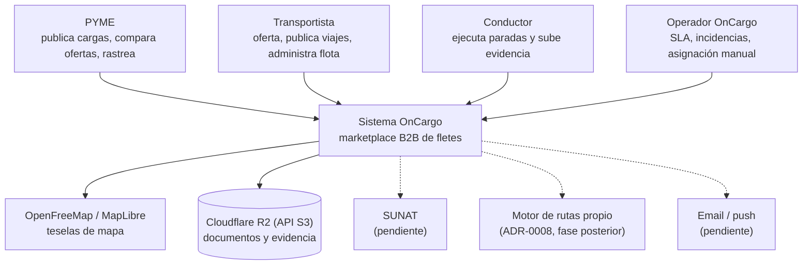
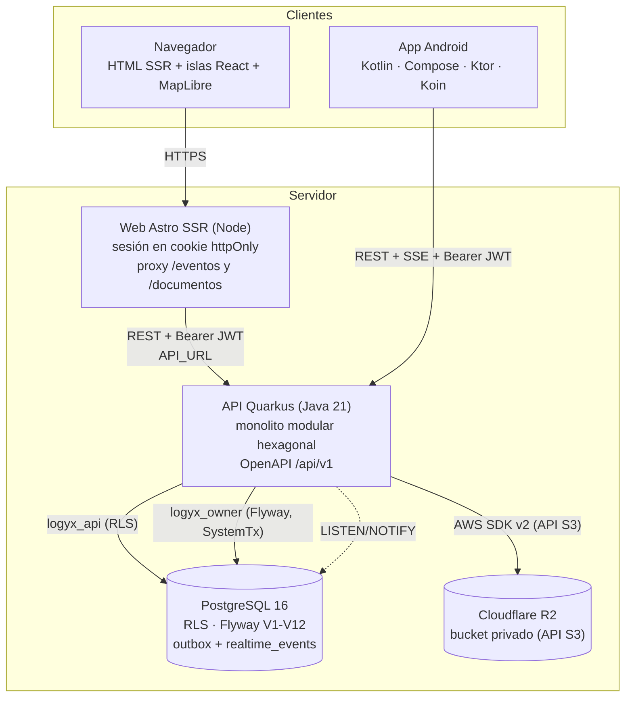
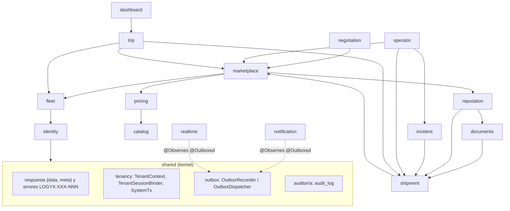
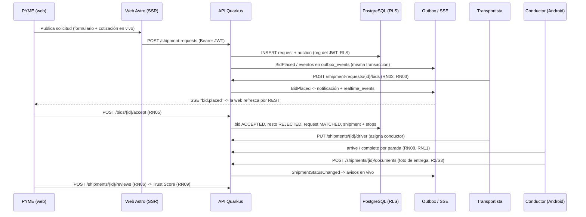
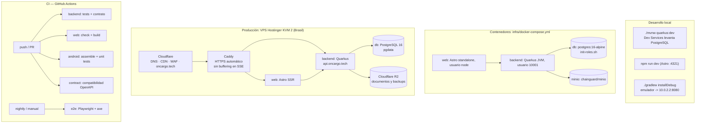

# E1 — Documento de Arquitectura del Sistema
> Estándar: IEEE 42010 + Modelo C4  · Competencia CE0213  
> Proyecto: OnCargo — Sistema Operativo Logístico Colaborativo para PYMEs  
> Equipo: Jorge Gutiérrez Miranda · Fabrizio Sanchez Saravia · Alex Coila Jarita  
> Versión: 2.0 (alineada con el sistema construido) · Noviembre 2026 · Versión original 1.0, junio 2026

!!! info "Cómo leer este documento"
    La v1.0 describía el diseño previo a la construcción (Angular, tres apps Flutter, Quarkus reactivo, Redis). Esta v2.0 documenta la arquitectura **real**, que evolucionó durante el desarrollo mediante siete ADR. Las diferencias y su justificación están resumidas en [Cambios respecto al diseño inicial](../cambios-diseno-inicial.md). La fuente primaria de las decisiones son los ADR del repositorio del sistema (`docs/adr/0001` a `0007`), resumidos aquí.

---

## 1. Información General

| Campo | Detalle |
|-------|---------|
| **Estilo arquitectónico** | Monolito modular con arquitectura hexagonal (puertos y adaptadores) por módulo; organización por feature en los clientes |
| **Estándar de documentación** | IEEE 42010 (vistas y puntos de vista) + Modelo C4 |
| **Backend** | Quarkus 3.40 · Java 21 · estilo bloqueante (JAX-RS + Hibernate ORM Panache) · Flyway · JWT RSA |
| **Web** | Astro 7 (SSR, adapter Node) · Tailwind 4 · islas React + primitivas shadcn/ui · MapLibre GL (teselas OpenFreeMap) |
| **Móvil** | Una app Android nativa: Kotlin · Jetpack Compose · Material 3 · Ktor · Koin · MapLibre. iOS (SwiftUI) planificado |
| **Base de datos** | PostgreSQL 16 con Row-Level Security; dos usuarios de conexión (`logyx_api` / `logyx_owner`) |
| **Archivos** | Cloudflare R2 en producción (API compatible con S3, adaptador `S3DocumentStorage`); MinIO en staging local; disco local en dev y test |
| **Contrato** | `docs/api/openapi.yaml` generado por el backend: fuente de verdad de web y Android |
| **Infraestructura** | Producción en un **VPS Hostinger KVM 2** (Brasil) con Docker Compose y Caddy (HTTPS automático); Cloudflare (DNS/CDN/WAF) para `oncargo.tech`; Docker multi-stage + `infra/docker-compose.yml` (PostgreSQL, backend, web; MinIO solo en staging local); CI en GitHub Actions |

### 1.1 Partes interesadas y preocupaciones (IEEE 42010)

| Parte interesada | Preocupaciones principales | Vistas que las atienden |
|---|---|---|
| PYME / transportista / conductor | Usabilidad por rol, tiempo real, confiabilidad del seguimiento | Contenedores (§4.2), flujo principal (§5) |
| Operador OnCargo | Visibilidad de SLA e incidencias, asignación manual | Componentes (§4.3) |
| Equipo de desarrollo | Mantenibilidad, módulos descubribles, contrato único | Estructura de módulos (§6), ADR-0002 |
| Jurado / auditoría | Seguridad de datos, Ley N° 29733, trazabilidad | Seguridad (§8), multitenancy (§3.2) |
| Operación | Despliegue reproducible, backups, observabilidad | Despliegue (§7) |

---

## 2. Decisiones Arquitectónicas Clave (evolución real)

El documento original definía cinco ADR (ADR-01 a ADR-05). Durante la construcción se tomaron ocho decisiones numeradas que los **reemplazan o precisan**. Cada una está en `docs/adr/` del repositorio del sistema.

| ADR | Decisión | Relación con el diseño inicial |
|---|---|---|
| **0001** | Aislamiento por organización (una BD, un esquema, filas *org-scoped*) con doble barrera: filtros por JWT + RLS de PostgreSQL. **Multitenancy completo evaluado y descartado** | Nuevo (el diseño inicial no trataba el aislamiento de datos; la nota "RLS no implementado" quedó superada) |
| **0002** | Monolito modular + hexagonal por módulo (`domain` / `application` / `infrastructure`); carpeta por feature en los clientes | Precisa ADR-01 (monolito modular) y reemplaza el estilo reactivo de ADR-02 por uno bloqueante y testeable |
| **0003** | Web en Astro SSR; móvil nativo Kotlin (luego Swift) con una sola app por roles | Reemplaza ADR-03 (tres apps Flutter) y las restricciones RT02 (Angular) y RT03 (Flutter) |
| **0004** | Eventos de dominio CDI, notificaciones in-app y escrituras acotadas del operador con RLS | Nuevo; sustituye al `notification-module` acoplado y a Redis Pub/Sub |
| **0005** | Documentos tras un puerto `DocumentStorage` (disco local, luego S3-compatible: MinIO en staging local, Cloudflare R2 en producción), validación por firma binaria, descarga solo vía API | Concreta el uso de MinIO previsto |
| **0006** | Producción con mínimo privilegio (`logyx_api` vs `logyx_owner`), outbox transaccional, almacenamiento S3 | Nuevo; resuelve riesgos abiertos de ADR-0001, 0004 y 0005 |
| **0007** | Tiempo real por SSE alimentado por el outbox (`realtime_events`, `LISTEN/NOTIFY`) | Reemplaza el chat WebSocket + Redis Pub/Sub del diseño inicial |
| **0008** | Rutas y distancias por carretera: precálculo OSM/OSRM versionado (módulo `routing`, backend implementado: `pricing`, `trip` y `GET /api/v1/routes`; faltan los mapas) y motor propio como paso siguiente; mapas con MapLibre + OpenFreeMap | Reemplaza OpenRouteService (ADR-05); `pricing` y `trip` ya usan los km por carretera; solo faltan los mapas de web y Android |

Se mantienen del diseño original: **PostgreSQL como base única** (ADR-04) y la intención de **monolito modular migrable** (ADR-01). **OpenRouteService (ADR-05)** fue reemplazado por el ADR-0008: `pricing` obtiene la distancia de un `RoadDistanceProvider` sobre el módulo `routing`, tras el mismo puerto `DistanceProvider` (el antiguo `HaversineDistanceProvider` se retiró).

### ADR-0001 — Aislamiento por organización (resumen)

Ver la sección dedicada [§3.2 Evaluación de multitenancy](#32-evaluacion-de-multitenancy).

### ADR-0002 — Monolito modular hexagonal

Un solo desplegable Quarkus; dentro, un paquete por capacidad de negocio con capas `domain` (Java puro: entidades, value objects y políticas con nombre como `PriceFloorPolicy` = RN03), `application` (casos de uso, `@Transactional`) e `infrastructure` (JPA/Panache, recursos JAX-RS, jobs y clientes). Las dependencias apuntan hacia el dominio y un módulo usa a otro **solo a través de su `application`**; `ModuleBoundariesTest` lo verifica en cada build. *Alternativas descartadas:* Clean Architecture con capas globales (dispersa cada feature) y microservicios desde el inicio (costo operativo injustificado para 3 personas).

### ADR-0003 — Astro y Kotlin

La web usa Astro 7 en SSR: las páginas se renderizan en servidor, el JWT vive en una cookie `httpOnly` y **solo el servidor de Astro habla con la API**; la interactividad se limita a islas React. En móvil se construyó **una app Android** con navegación por rol (transportista, PYME, conductor); el operador usa solo la web. `core:model` y `core:network` son Kotlin puro para convertirse en Kotlin Multiplatform cuando se haga la app SwiftUI.

### ADR-0004 — Eventos de dominio y notificaciones

Cada módulo publica *records* inmutables (`BidPlaced`, `BidAccepted`, `MessagePosted`, `ShipmentStatusChanged`, `IncidentReported`, `ReviewSubmitted`, …) y los consumidores (`NotificationObservers`, `ReputationRecalculator`) reaccionan sin acoplar a los publicadores. Las notificaciones se insertan en una transacción de sistema porque `notifications` **no tiene política de INSERT** para `logyx_app`; así ningún usuario puede fabricar avisos para otra organización. La asignación manual del operador (RN10) corre **con RLS** mediante políticas acotadas a `app_org_type() = 'OPERATOR'`.

### ADR-0005 — Documentos

Puerto `DocumentStorage` con adaptadores local y S3. La clave del archivo la genera el servidor; el formato se valida por **firma binaria** (JPG/PNG/PDF, máx. 10 MB), se guarda el SHA-256 y la descarga pasa por la API (autorización = RLS de `documents`). Completar una entrega exige una foto `DELIVERY_PHOTO` previa.

### ADR-0006 — Producción: mínimo privilegio y outbox

La aplicación se conecta como `logyx_api` (LOGIN, miembro solo de `logyx_app`, sin dueño ni `BYPASSRLS`); Flyway y `SystemTx` usan un datasource separado con `logyx_owner`. Una transacción sin JWT y fuera de `SystemTx` **no ve ninguna fila** (fail-closed). El **outbox transaccional** (`outbox_events`, V11) garantiza entrega al menos una vez de avisos y recálculos, con despacho inmediato, job de respaldo, `FOR UPDATE SKIP LOCKED` y reintentos exponenciales hasta `FAILED`.

### ADR-0007 — Tiempo real por SSE

`GET /api/v1/events/stream` entrega avisos con payload mínimo; una proyección `realtime_events` (V12) guarda **una fila por destinatario** y un trigger `pg_notify` permite el fan-out entre réplicas. La reanudación con `Last-Event-ID` corre bajo RLS. Los clientes tratan los eventos como avisos para refrescar por REST y conservan un polling lento de respaldo.

---

## 3. Evaluación de multitenancy y decisión de aislamiento

### 3.1 Cuestión evaluada

Al diseñar la seguridad de datos se evaluó si OnCargo debía ser un sistema **multitenant** (SaaS clásico: BD por tenant, esquema por tenant o discriminador `@TenantId` de Hibernate).

### 3.2 Evaluación de multitenancy

| Opción | Cómo aísla | Veredicto para OnCargo |
|---|---|---|
| BD por tenant | Una base por organización | Descartada: el flujo central cruza organizaciones; imposible consultar el marketplace; costo operativo alto |
| Esquema por tenant | Un esquema por organización | Descartada: mismas razones; migraciones N veces; consultas entre esquemas |
| Discriminador `@TenantId` (Hibernate) | Filtro automático por columna | Descartada: asume que un tenant nunca ve datos de otro; el marketplace necesita visibilidad cruzada controlada |
| **Una BD y un esquema con datos *org-scoped* + RLS** | Cada fila privada lleva su organización; filtros en aplicación y políticas RLS en PostgreSQL | **Elegida (ADR-0001)** |

**Justificación.** OnCargo es un **marketplace**: una PYME publica, varios transportistas ofertan y uno ejecuta. Los datos *deben* cruzarse entre organizaciones de forma controlada (solicitudes `PUBLISHED`, perfil público, reputación), mientras que la flota, los usuarios, las ofertas ajenas y los envíos permanecen privados. Ese patrón de "visibilidad parcial por fila" lo expresan mejor las políticas RLS que un aislamiento por tenant.

**Decisión implementada:**

1. Cada fila privada lleva su organización dueña (`organization_id`, `requester_org_id`, `carrier_org_id`); donde hace falta se **denormaliza** (p. ej. `bids.requester_org_id`, `shipments.vehicle_plate`) para que las políticas no consulten otras tablas protegidas y no haya recursión.
2. **Primera barrera (aplicación):** la organización actual sale del JWT (`TenantContext`) y el cliente nunca envía `organizationId`.
3. **Segunda barrera (PostgreSQL):** al iniciar cada transacción de usuario, `TenantSessionBinder` ejecuta `set_config('app.org_id', …, true)` y `SET LOCAL ROLE logyx_app`. Si el código olvida un `WHERE`, la BD igual filtra (`RowLevelSecurityTest`).
4. **Mínimo privilegio (ADR-0006):** la conexión es `logyx_api`, que no puede escalar privilegios (`DatabasePrivilegesTest`). Lo que corre sin usuario (login, registro, jobs, outbox) entra explícitamente por `SystemTx`, comentado en cada uso.

**Riesgo residual documentado:** con una inyección SQL dentro de una transacción de usuario, `set_config('app.org_id', …)` podría suplantar a otra organización; se mitiga con consultas parametrizadas (JPA) y se plantea a futuro firmar el contexto (HMAC en el GUC).

**Reevaluación:** si OnCargo se vendiera como SaaS de marca blanca a cooperativas, se reevaluaría un esquema por cooperativa.

---

## 4. Modelo C4

### Nivel 1 — Diagrama de Contexto del Sistema



Las líneas punteadas son integraciones **diseñadas pero aún no implementadas** (SUNAT, motor de rutas propio para direcciones arbitrarias, email/push). Las distancias entre ciudades del catálogo vendrán de un precálculo OSM/OSRM versionado en el repositorio (ADR-0008, implementado en el módulo `routing`, ya conectado a `pricing` y `trip`).

### Nivel 2 — Diagrama de Contenedores



| Contenedor | Tecnología | Responsabilidad |
|---|---|---|
| Web | Astro 7 SSR (Node), React islands | Renderiza páginas por rol; el JWT nunca llega al JS del navegador; actúa de proxy del stream SSE (`/eventos`) y de las descargas (`/documentos/[id]`) |
| API | Quarkus 3.40 | Reglas de negocio, contrato OpenAPI, RLS, outbox, SSE |
| Base de datos | PostgreSQL 16 | Datos org-scoped, RLS, outbox, proyección de tiempo real |
| Objetos | Cloudflare R2 (S3-compatible) | Documentos y evidencia; descarga solo mediante la API |
| Android | Kotlin + Compose | Transportista, PYME y conductor; SSE en primer plano |

### Nivel 3 — Diagrama de Componentes (API Quarkus = módulos hexagonales reales)



| Módulo | Qué hace | Tablas (migración) |
|---|---|---|
| `identity` | Registro, login, organizaciones, usuarios, consentimiento Ley 29733 | `organizations`, `profiles` (V1) |
| `fleet` | Vehículos y conductores | `vehicles`, `drivers` (V1) |
| `catalog` | Ciudades y tipos de carga (vocabulario compartido) | sin tablas |
| `pricing` | Motor de costos por reglas, piso RN03, distancia por carretera (`RoadDistanceProvider` → `routing`) | sin tablas |
| `marketplace` | Solicitudes, subasta inversa, ofertas, aceptación, asignación manual | `shipment_requests`, `auctions`, `bids` (V1, V3, V9) |
| `shipment` | Envíos, paradas, app del conductor, tracking | `shipments`, `shipment_stops` (V1) |
| `negotiation` | Chat con RN07 y contraofertas | `messages`, `counter_offers` (V4) |
| `documents` | Evidencia y documentos del envío | `documents` (V5) |
| `reputation` | Calificaciones y Trust Score bayesiano | `reviews`, `reputation_scores` (V6) |
| `incident` | Incidencias y comentarios (RN11) | `incidents`, `incident_comments` (V7) |
| `notification` | Centro de notificaciones por eventos | `notifications` (V8) |
| `operator` | Alertas SLA, métricas, asignación manual (RN10) | políticas de escritura (V9) |
| `trip` | Viajes publicados, reservas, retornos, Smart Load | `carrier_trips`, `trip_bookings`, `smart_load_*` (V10) |
| `dashboard` | Resumen por rol | sin tablas |
| `shared/outbox` | Outbox transaccional | `outbox_events` (V11) |
| `realtime` | Stream SSE, proyección por destinatario | `realtime_events` (V12) |

---

## 5. Flujo de Datos — Flujo Principal



El detalle de cada paso con las clases reales está en [Modelado UML](uml.md).

---

## 6. Estructura de Módulos del Proyecto

```
logyx/                                (monorepo)
├── backend/                          Quarkus 3.40 · Java 21
│   └── src/main/java/pe/logyx/
│       ├── identity/ fleet/ catalog/ pricing/ marketplace/ shipment/
│       ├── negotiation/ documents/ reputation/ incident/ notification/
│       ├── operator/ trip/ dashboard/ realtime/ devdata/
│       │   └── <modulo>/{domain, application, infrastructure}
│       └── shared/                   respuestas, errores, tenancy/RLS, outbox, auditoría
│   └── src/main/resources/db/migration/   V1__schema.sql … V12__realtime.sql
├── web/                              Astro 7 SSR
│   └── src/{pages, features/<feature>, components/{ui,domain,layout}, lib/{api,session,realtime}, middleware.ts}
├── android/                          Kotlin · Compose (multi-módulo)
│   ├── app/                          Activity, navegación por rol, DI (Koin)
│   ├── core/{model, network, data, designsystem}
│   └── feature/{auth, loads, requests, shipments, driver, negotiation, reputation, documents, incidents, notifications, trips}
├── ios/                              SwiftUI (fase posterior; reutilizará core:model/core:network vía KMP)
├── docs/{api/openapi.yaml, adr/, architecture/, design/, domain/, security.md, STATUS.md}
├── infra/                            docker-compose.yml, roles de BD, scripts de claves JWT
└── .github/workflows/                backend, web, android, contract, e2e
```

---

## 7. Modelo de Despliegue



Requisitos de despliegue: TLS en el proxy (`COOKIE_SECURE=true` por omisión en prod), `TRUSTED_PROXIES` para el rate limiting por IP, backups diarios de la base hacia R2, y un proxy sin *buffering* ni compresión para `text/event-stream` con timeout de lectura ≥ 60 s. El despliegue de producción es un **único VPS** (sin réplicas por ahora): el backend ya admite varias réplicas, pero la disponibilidad se apoya en reinicio automático y respaldos (detalle y costos en [Diseño de Centro de Datos](../../infraestructura/semestre-1/diseno-datacenter.md)).

---

## 8. Seguridad de la Arquitectura

| Capa | Mecanismo implementado |
|------|-----------|
| **Transporte** | TLS en el proxy; HSTS 1 año en prod (API siempre, web si llega por https) |
| **Autenticación** | JWT RSA (`logyx.jwt.ttl=PT8H`), cookie `httpOnly` + `SameSite=Lax` + `Secure` en la web; sin refresh token ni Google OAuth |
| **Autorización** | RBAC (`@RolesAllowed`: PYME, CARRIER, DRIVER, OPERATOR) + organización solo desde el JWT + **RLS** |
| **Mínimo privilegio** | `logyx_api` (sin dueño, sin `BYPASSRLS`) frente a `logyx_owner` (solo Flyway y `SystemTx`) |
| **Contraseñas** | Hash bcrypt (`BcryptPasswordHasher`) |
| **Rate limiting** | `AuthRateLimits` en memoria: login 50/15 min por IP, bloqueo tras 10 fallos por email, registro 10/15 min por IP (`LOGYX-AUTH-429`); por instancia (Redis no se usa) |
| **Web** | CSP `default-src 'self'`, `frame-ancestors 'none'`, `checkOrigin` de Astro contra CSRF |
| **Archivos** | Formato por firma binaria, 10 MB máx., claves generadas por el servidor, bucket privado |
| **Privacidad** | Consentimiento Ley 29733 obligatorio en el registro, política en `/privacidad`, `audit_log`, logs sin datos personales |
| **SQL Injection** | JPA con parámetros; `DatabasePrivilegesTest` verifica que `RESET ROLE`, `ALTER`, `DROP POLICY` fallan |

El modelo de amenazas completo (STRIDE) y el checklist de despliegue están en `docs/security.md` del repositorio del sistema.

---

## 9. Calidad y Estándar ISO/IEC 25010

| Característica | Cómo se aborda en la arquitectura |
|----------------|----------------------------------|
| **Funcionalidad** | Módulos por dominio, RN01–RN12 implementadas como políticas con nombre y probadas |
| **Rendimiento** | Índices parciales y compuestos, pools acotados (8 + 20 conexiones por instancia), eventos livianos por SSE; no se midió con pruebas de carga |
| **Compatibilidad** | REST/JSON con contrato OpenAPI; web verificada en Chromium; Android 10+ |
| **Usabilidad** | Sistema de diseño propio, modo claro/oscuro, WCAG AA verificado con axe en e2e, una app por rol en móvil |
| **Fiabilidad** | Transacciones ACID, outbox con reintentos, SSE con reanudación y polling de respaldo |
| **Seguridad** | RLS + mínimo privilegio + rate limiting + CSP (ver §8) |
| **Mantenibilidad** | Hexagonal con `ModuleBoundariesTest`, misma forma en todos los módulos, contrato versionado con chequeo de compatibilidad en CI |
| **Portabilidad** | Contenedores multi-stage, configuración por variables de entorno, almacenamiento intercambiable (local / S3-compatible: R2, MinIO) y despliegue reproducible en cualquier VPS |

---

*OnCargo · E1 Documento de Arquitectura · IEEE 42010 + C4 · Versión 2.0 · Noviembre 2026*
