# E1 — Modelado Técnico UML
> Competencia CE0214 · Diagramas estructurales y de comportamiento  
> Proyecto: OnCargo — Sistema Operativo Logístico Colaborativo para PYMEs  
> Equipo: Jorge Gutiérrez Miranda · Fabrizio Sanchez Saravia · Alex Coila Jarita  
> Herramienta: Mermaid  
> Versión: 2.0 (alineada con el código) · Noviembre 2026 · Versión original 1.0, junio 2026

!!! info "Alineación con el sistema construido"
    Los diagramas de la v1.0 se rehicieron a partir del código del backend (`pe.logyx.*`), de las migraciones Flyway V1–V12 y del contrato OpenAPI (corte de la fase 6; el sistema llegó luego a V24, con los módulos nuevos descritos en la [Arquitectura](arquitectura.md)). Los nombres de clases, estados y endpoints son los reales. Lo que el diseño inicial planteaba y no se construyó (Google OAuth, ORS, email, código `LGX-XXXXX`, estado de envío `ISSUE`) ya no aparece, o se marca como pendiente.

---

## 1. Diagramas de Casos de Uso

### 1.1 Sistema completo por actor

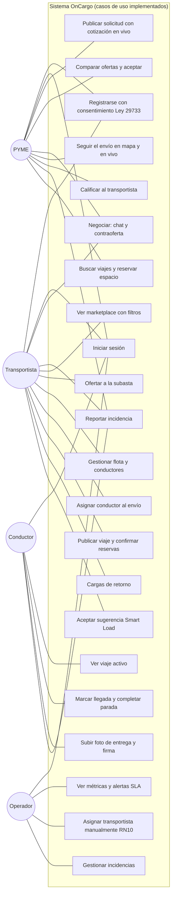

Ver notificaciones, documentos del envío y el perfil público de reputación son casos de uso transversales (PYME, transportista y operador). El conductor solo usa la app Android o la página `/conductor` de la web; el operador usa solo la web.

### 1.2 Casos de uso — Marketplace y subastas (detalle)

| Caso de uso | Actor | Precondiciones | Reglas | Módulo |
|---|---|---|---|---|
| Publicar solicitud | PYME | RUC verificado | RN01, cotización RN03 | `marketplace.PublishRequestUseCase` |
| Ofertar | Transportista | Subasta abierta, vehículo propio con capacidad | RN02, RN03, RN04 | `marketplace.PlaceBidUseCase` |
| Cierre automático | Sistema | 20 min o 5 ofertas | RN04 | `CloseExpiredAuctionsUseCase`, `AuctionScheduler` |
| Aceptar oferta | PYME | Oferta `PENDING` | RN05 | `marketplace.AcceptBidUseCase` |
| Contraofertar | PYME / Transportista | Oferta pendiente; mensaje sin contacto | RN07, RN03 (≥ piso) | `negotiation.NegotiationService` |
| Asignación manual | Operador | Solicitud sin ofertas ≥ 24 h | RN10 | `marketplace.ManualAssignmentUseCase` |

### 1.3 Casos de uso — Ejecución y evidencia (detalle)

| Caso de uso | Actor | Reglas | Módulo |
|---|---|---|---|
| Asignar conductor | Transportista | conductor de su organización | `shipment.AssignDriverUseCase` |
| Marcar llegada / completar parada | Conductor | RN08 (orden), RN11 (sin incidencia activa), foto obligatoria en la entrega (`LOGYX-TRK-006`) | `shipment.TrackStopsUseCase` |
| Subir evidencia | Conductor / partes | firma binaria jpg/png/pdf, ≤ 10 MB | `documents` |
| Reportar incidencia | Partes y conductor | RN11 | `incident.IncidentService` |
| Resolver incidencia | Operador | notas de resolución obligatorias | `incident.IncidentStatusPolicy` |
| Calificar | PYME / transportista | RN06 (entregado + foto) | `reputation.ReviewService` |

---

## 2. Diagrama de Clases (dominio real)

### 2.1 Organizaciones, flota y marketplace

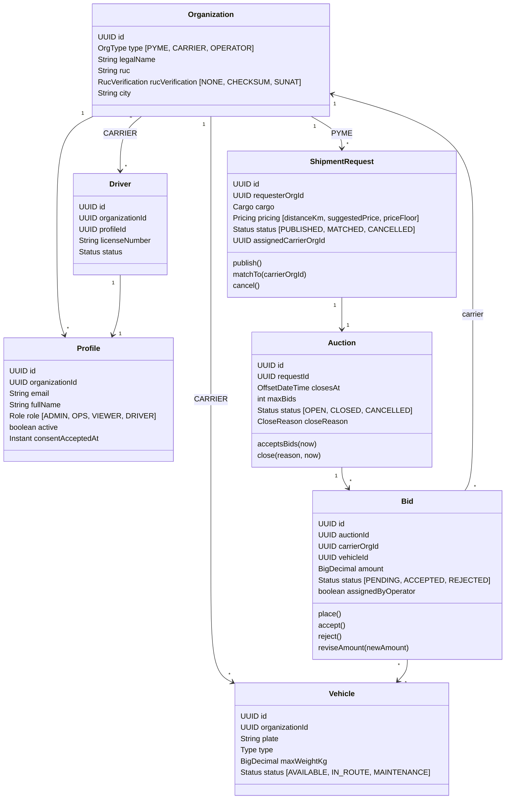

### 2.2 Ejecución, confianza y comunicación

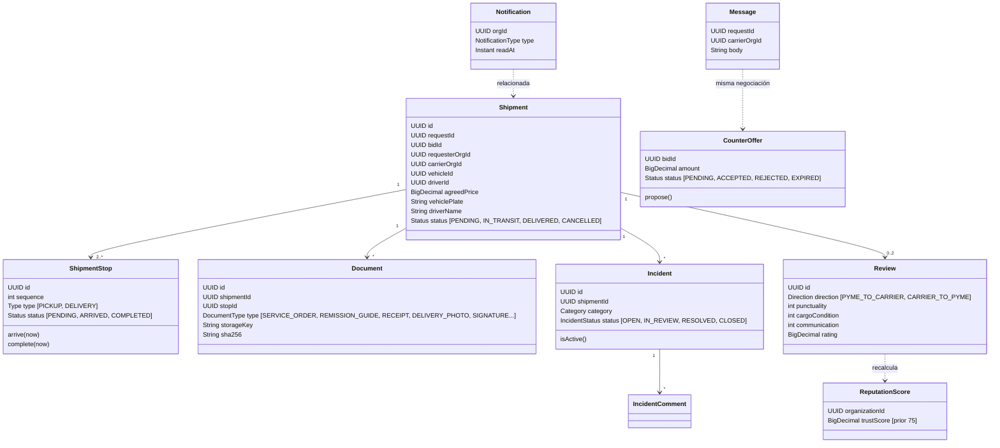

### 2.3 Viajes publicados, reservas y Smart Load

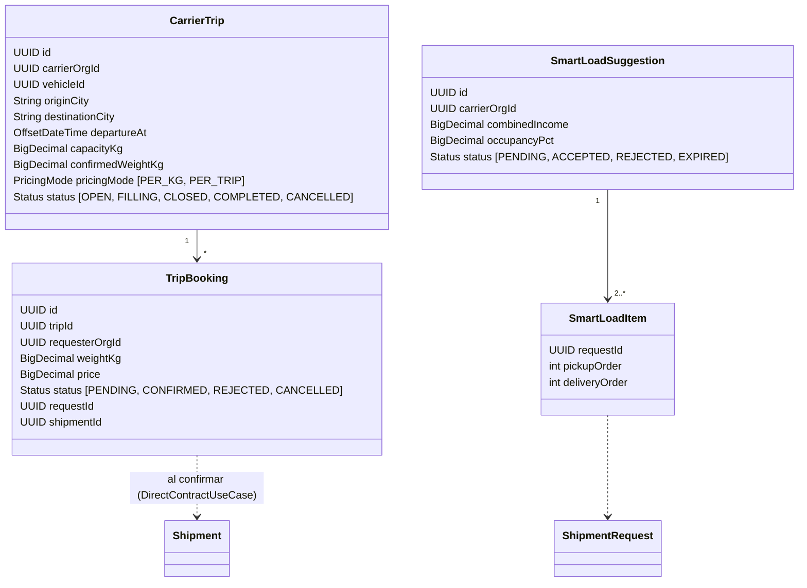

Las reglas de negocio viven en clases de dominio sin estado (políticas): `PriceFloorPolicy` (RN03), `BidEligibilityPolicy` (RN02/RN03), `AuctionClosingPolicy` (RN04), `StopSequencePolicy` (RN08), `TrustScoreCalculator` (RN09), `ManualAssignmentPolicy` (RN10), `IncidentStatusPolicy` (RN11), `TripCapacityPolicy` (RN12), `ContactInfoPolicy` (RN07) y `ReviewEligibilityPolicy` (RN06).

---

## 3. Diagramas de Secuencia

### 3.1 Flujo principal: publicar → ofertar → aceptar → envío → entrega con evidencia

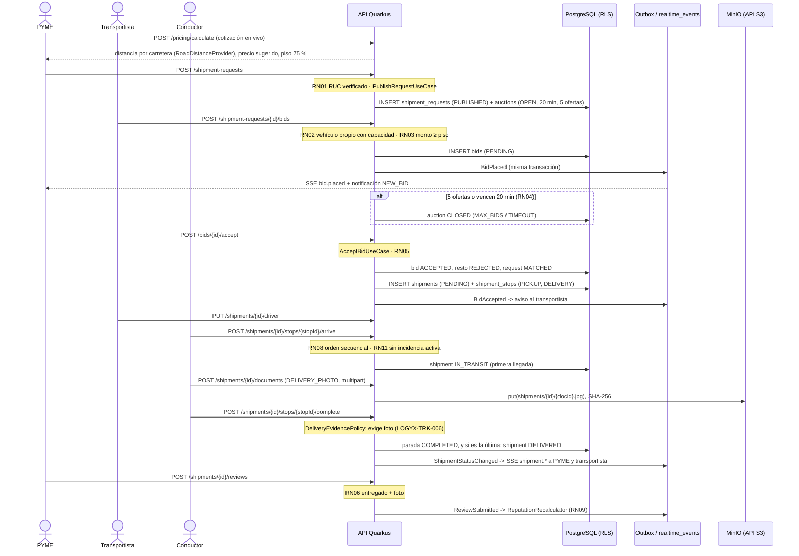

### 3.2 Flujo: negociación con contraoferta y bloqueo de contacto (RN07)

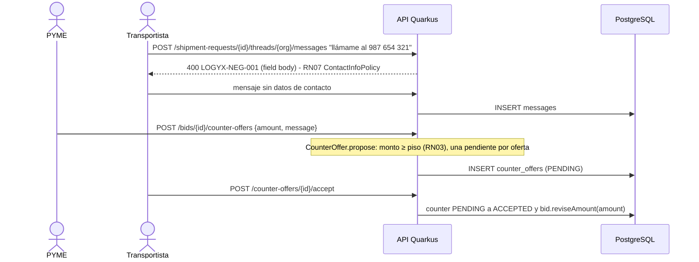

### 3.3 Flujo: tiempo real (outbox → SSE)

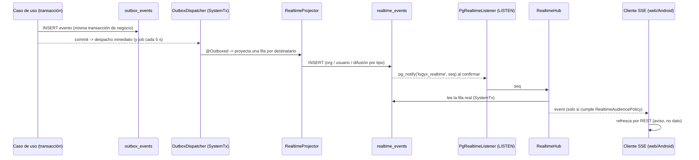

### 3.4 Flujo: reserva de espacio en un viaje publicado

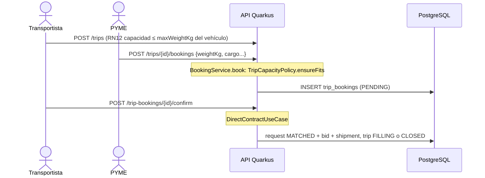

---

## 4. Diagramas de Estados

### 4.1 Solicitud y subasta

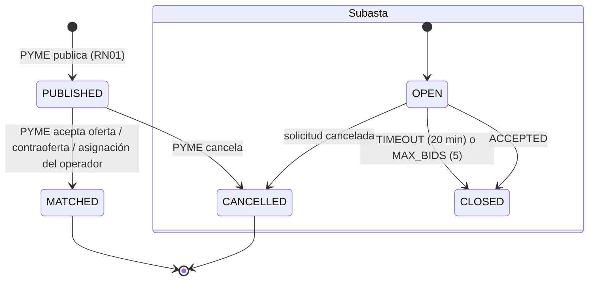

Una oferta (`Bid`) pasa de `PENDING` a `ACCEPTED` o `REJECTED` (RN05).

### 4.2 Envío y parada

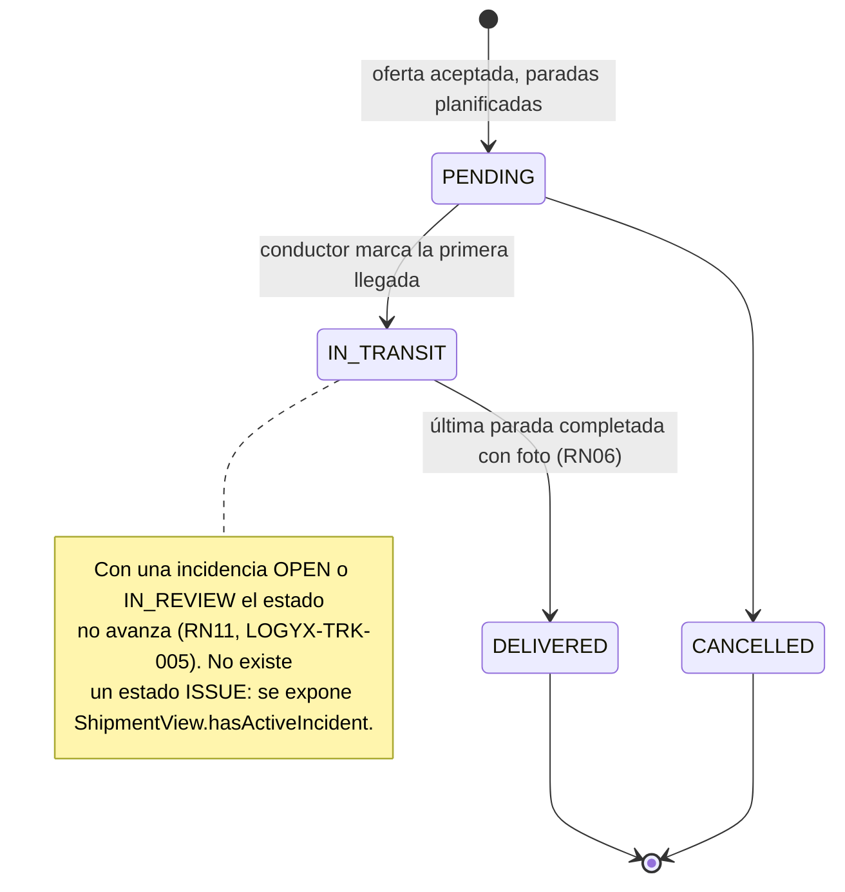

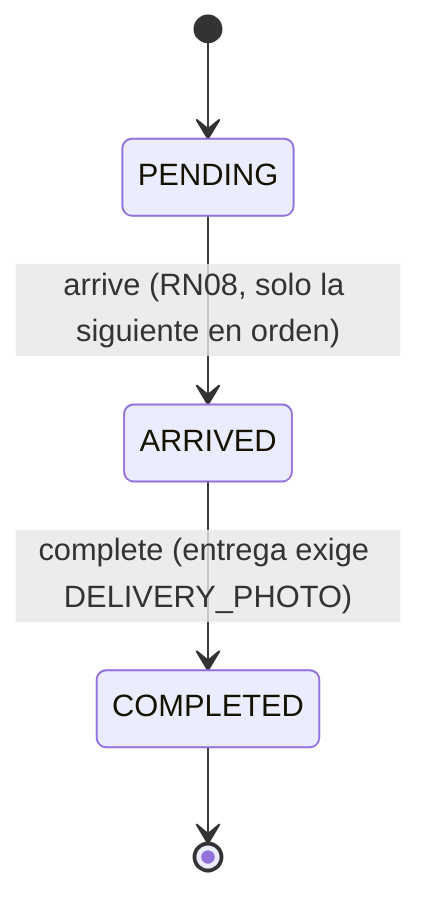

### 4.3 Incidencia, reserva y sugerencia

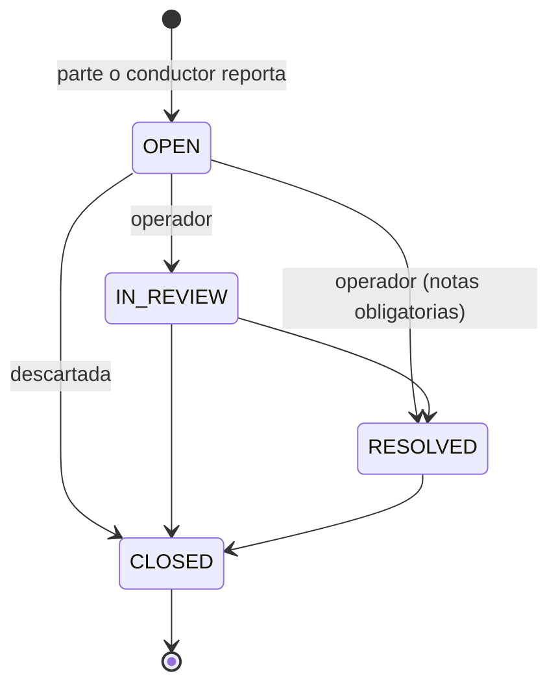

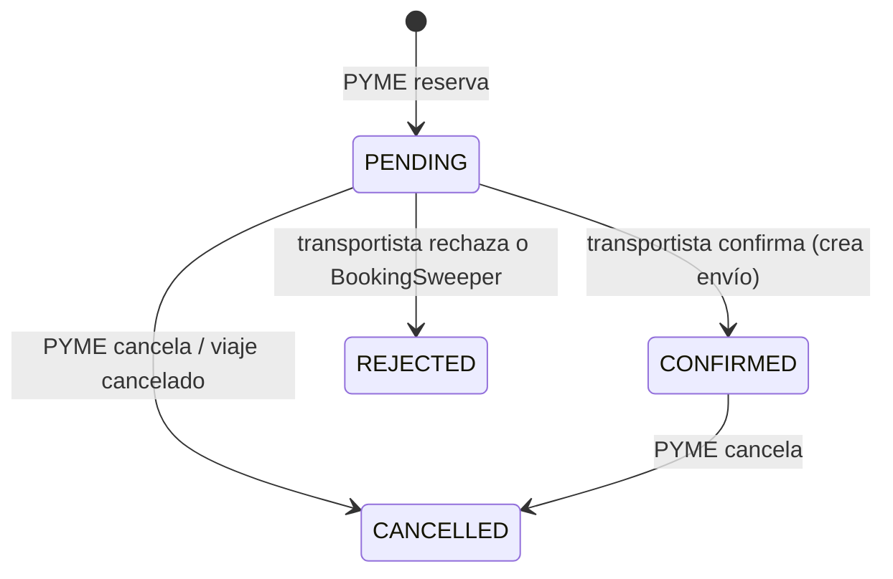

Los viajes (`CarrierTrip`) recorren `OPEN → FILLING → CLOSED → COMPLETED` o `CANCELLED`; las sugerencias Smart Load, `PENDING → ACCEPTED | REJECTED | EXPIRED`.

---

## 5. Diagrama de Componentes — Web (Astro) y Android

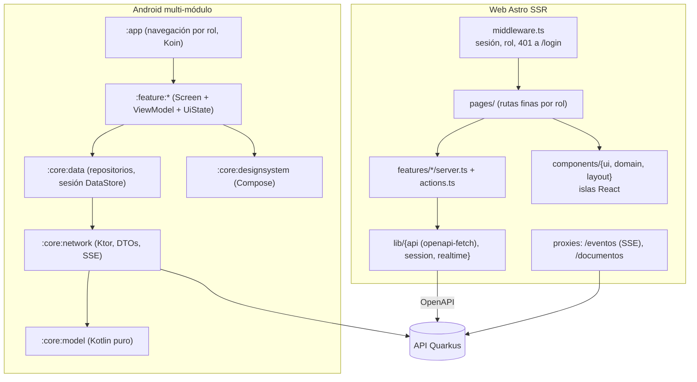

Detalle de ambos clientes en [Arquitectura Frontend](../entregable-3/arquitectura-frontend.md).

---

*OnCargo · E1 Modelado Técnico UML · Competencia CE0214 · Versión 2.0 · Noviembre 2026*
