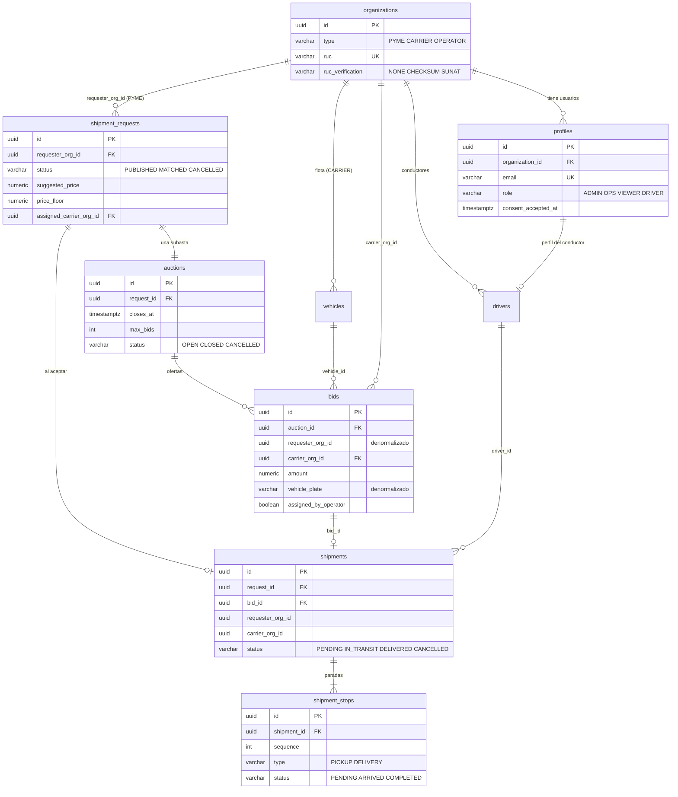
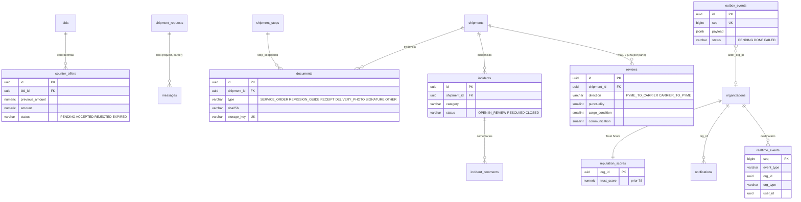
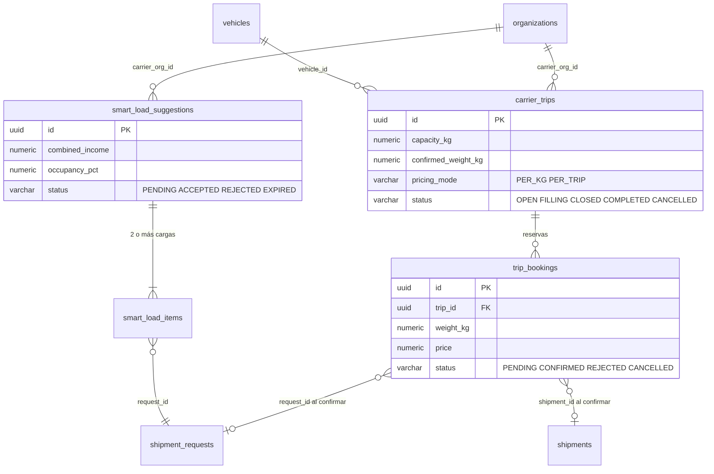

# E2 — Modelo de Base de Datos
> Competencia CE0221 · Modelo ER + Lógico + Diccionario de Datos  
> Proyecto: OnCargo — Sistema Operativo Logístico Colaborativo para PYMEs  
> Equipo: Jorge Gutiérrez Miranda · Fabrizio Sanchez Saravia · Alex Coila Jarita  
> Motor: PostgreSQL 16  
> Versión: 2.1 (cifras actualizadas a las migraciones V1–V24; el detalle de tablas corresponde a V1–V12) · Noviembre 2026 · Versión original 1.0, junio 2026

!!! info "Modelo diseñado vs. modelo implementado"
    El modelo de la v1.0 (22 tablas, PostGIS, ENUM nativos, `cost_calculations`, códigos de tracking) se **reemplazó por el modelo real** que crean las migraciones Flyway `V1__schema.sql` a `V12__realtime.sql`: **24 tablas**, sin PostGIS (las ciudades son un vocabulario cerrado y la distancia se calcula en la aplicación), enums como `VARCHAR + CHECK` y columnas **denormalizadas a propósito** para que las políticas RLS no consulten otras tablas protegidas. Los scripts exactos están en [Scripts SQL](scripts.md).

---

## 1. Información General

| Campo | Detalle |
|-------|---------|
| **Motor de base de datos** | PostgreSQL 16 (`postgres:16-alpine` en contenedores y Dev Services) |
| **Paradigma** | Relacional normalizado (3FN) con desnormalizaciones documentadas para RLS y lectura |
| **Total de tablas** | 24 (más `flyway_schema_history`) |
| **Extensiones** | Ninguna adicional: `gen_random_uuid()` es nativo desde PostgreSQL 13 |
| **Herramienta de migración** | Flyway (`quarkus.flyway.migrate-at-start=true`), 24 migraciones versionadas (57 tablas, 150 políticas RLS) |
| **Identificadores** | UUID generados por el dominio (`gen_random_uuid()` como valor por omisión); `BIGSERIAL` solo para `audit_log`, `outbox_events.seq` y `realtime_events.seq` |
| **Enums** | `VARCHAR(n) NOT NULL CHECK (col IN (...))`: agregar un valor es una migración trivial y Hibernate los mapea directo |
| **Aislamiento** | Row-Level Security activada en las tablas de usuario; ver [Seguridad](seguridad.md) |

### 1.1 Migraciones

| Migración | Contenido |
|---|---|
| `V1__schema.sql` | `organizations`, `profiles`, `vehicles`, `drivers`, `shipment_requests`, `auctions`, `bids`, `shipments`, `shipment_stops`, `audit_log` |
| `V2__row_level_security.sql` | Rol `logyx_app`, funciones `app_org()` / `app_org_type()`, RLS y políticas de V1 |
| `V3__contract_additions.sql` | Denormaliza `vehicle_type` y `vehicle_plate` en `bids` |
| `V4__negotiation.sql` | `messages`, `counter_offers` + RLS |
| `V5__documents.sql` | `documents` + RLS (evidencia inmutable) |
| `V6__reputation.sql` | `reviews`, `reputation_scores` + RLS |
| `V7__incident.sql` | `incidents`, `incident_comments` + RLS, índice único de incidencia activa |
| `V8__notification.sql` | `notifications` + RLS (sin INSERT para la app) |
| `V9__operator.sql` | `bids.assigned_by_operator` + políticas de escritura acotadas al operador |
| `V10__trip.sql` | `carrier_trips`, `trip_bookings`, `smart_load_suggestions`, `smart_load_items` + RLS; amplía tipos de notificación |
| `V11__outbox.sql` | `outbox_events` (solo INSERT para la app) |
| `V12__realtime.sql` | `realtime_events`, función y trigger `realtime_events_notify` |

---

## 2. Diagrama Entidad-Relación (ER)

### 2.1 Núcleo: organizaciones, flota, marketplace y ejecución

### 2.2 Negociación, confianza y comunicación

### 2.3 Viajes publicados y Smart Load

---

## 3. Modelo Lógico — Decisiones de modelado

### 3.1 Enums como `VARCHAR + CHECK`

No se usan `CREATE TYPE ... AS ENUM`. Cada columna enumerada es `VARCHAR(n) NOT NULL CHECK (col IN (...))`. Ventajas: agregar un valor es un `ALTER TABLE ... DROP/ADD CONSTRAINT` (como hace V10 con `notifications.type`), sin los problemas de `ALTER TYPE` dentro de transacciones, y el mapeo a Hibernate/Java es directo.

| Enum (columna) | Valores |
|---|---|
| `organizations.type` | `PYME`, `CARRIER`, `OPERATOR` |
| `organizations.ruc_verification` | `NONE`, `CHECKSUM`, `SUNAT` |
| `profiles.role` | `ADMIN`, `OPS`, `VIEWER`, `DRIVER` |
| `vehicles.type` | `VAN`, `TRUCK_SMALL`, `TRUCK_MEDIUM`, `TRUCK_LARGE`, `PLATFORM`, `REFRIGERATED`, `TANKER` |
| `vehicles.status` | `AVAILABLE`, `IN_ROUTE`, `MAINTENANCE` |
| `drivers.status` | `AVAILABLE`, `ON_DUTY`, `OFF_DUTY` |
| `shipment_requests.cargo_type` | `GENERAL`, `FRAGILE`, `PERISHABLE`, `HAZARDOUS`, `BULK`, `OVERSIZED` |
| `shipment_requests.status` | `PUBLISHED`, `MATCHED`, `CANCELLED` |
| `auctions.status` / `close_reason` | `OPEN`, `CLOSED`, `CANCELLED` / `TIMEOUT`, `MAX_BIDS`, `ACCEPTED`, `CANCELLED` |
| `bids.status` | `PENDING`, `ACCEPTED`, `REJECTED` |
| `shipments.status` | `PENDING`, `IN_TRANSIT`, `DELIVERED`, `CANCELLED` |
| `shipment_stops.type` / `status` | `PICKUP`, `DELIVERY` / `PENDING`, `ARRIVED`, `COMPLETED` |
| `counter_offers.status` | `PENDING`, `ACCEPTED`, `REJECTED`, `EXPIRED` |
| `documents.type` | `SERVICE_ORDER`, `REMISSION_GUIDE`, `RECEIPT`, `DELIVERY_PHOTO`, `SIGNATURE`, `OTHER` |
| `incidents.category` | `CARGO_DAMAGE`, `DELAY`, `LOST_CARGO`, `WRONG_DELIVERY`, `DRIVER_CONDUCT`, `OTHER` |
| `incidents.status` | `OPEN`, `IN_REVIEW`, `RESOLVED`, `CLOSED` |
| `reviews.direction` | `PYME_TO_CARRIER`, `CARRIER_TO_PYME` |
| `carrier_trips.pricing_mode` / `status` | `PER_KG`, `PER_TRIP` / `OPEN`, `FILLING`, `CLOSED`, `COMPLETED`, `CANCELLED` |
| `trip_bookings.status` | `PENDING`, `CONFIRMED`, `REJECTED`, `CANCELLED` |
| `smart_load_suggestions.status` | `PENDING`, `ACCEPTED`, `REJECTED`, `EXPIRED` |
| `outbox_events.status` | `PENDING`, `DONE`, `FAILED` |
| `notifications.type` | 9 tipos de V8 + `TRIP_BOOKING_REQUESTED/CONFIRMED/REJECTED/CANCELLED`, `TRIP_CANCELLED`, `SMART_LOAD_SUGGESTED`, `SMART_LOAD_ACCEPTED` (V10) |

### 3.2 Denormalizaciones para RLS y lectura

El aislamiento por organización (ADR-0001) exige que cada política decida la visibilidad **sin consultar otra tabla protegida** (si no, las políticas se llaman entre sí y pueden recursar o filtrar mal). Por eso hay columnas copiadas a propósito:

| Tabla | Columna(s) copiada(s) | Motivo |
|---|---|---|
| `shipment_requests` | `assigned_carrier_org_id` | El transportista adjudicado sigue viendo la solicitud después de `MATCHED` sin leer `bids` |
| `bids` | `requester_org_id` | La PYME ve las ofertas de sus solicitudes sin leer `shipment_requests` |
| `bids` | `vehicle_type`, `vehicle_plate` (V3) | La flota es privada (`vehicles_owner`); la PYME ve el vehículo ofertado sin acceso a `vehicles` |
| `shipments`, `shipment_stops` | `requester_org_id`, `carrier_org_id`; `vehicle_plate`, `driver_name` | Las dos partes del contrato filtran por su propia organización; la PYME ve placa y conductor sin leer la flota |
| `messages`, `counter_offers`, `documents`, `incidents`, `incident_comments`, `reviews` | `requester_org_id`, `carrier_org_id` (+ `CHECK` de que el autor pertenece al par) | Política "partes del contrato" directa |
| `carrier_trips`, `trip_bookings` | `vehicle_type`, `vehicle_plate`; `requester_org_id`, `carrier_org_id`, ruta y fecha | La PYME lista viajes y reservas sin leer flota ni viaje |
| `smart_load_items` | `carrier_org_id`, `requester_org_id` | Política del dueño de la sugerencia |

### 3.3 Integridad y reglas en la base de datos

- **Claves foráneas** en todas las relaciones; `UNIQUE` en `organizations.ruc`, `vehicles.plate`, `lower(profiles.email)`, `bids(auction_id, carrier_org_id)` (una oferta por transportista y subasta), `shipments.request_id` y `shipments.bid_id` (un envío por solicitud), `shipment_stops(shipment_id, sequence)`, `reviews(shipment_id, reviewer_org_id)` (una calificación por parte).
- **`CHECK`** de dominio: pesos y montos positivos, `origin_city <> destination_city`, `price_floor <= suggested_price`, `confirmed_weight_kg <= capacity_kg`, calificaciones entre 1 y 5, `trust_score` entre 0 y 100, autor ∈ {PYME, transportista} del par.
- **Índices únicos parciales** que codifican reglas: `ux_incidents_active` (una sola incidencia activa por envío, RN11) y `ux_counter_offers_pending` (una contraoferta pendiente por oferta).
- **Consentimiento Ley 29733:** `profiles.consent_accepted_at TIMESTAMPTZ NOT NULL` (sin consentimiento no hay cuenta).

---

## 4. Diccionario de Datos

Notación: PK clave primaria, FK clave foránea, UK única, **D** denormalizada. Todas las tablas usan `id UUID` y `created_at TIMESTAMPTZ` salvo indicación.

### 4.1 Identidad y flota

| Tabla | Columnas principales |
|---|---|
| `organizations` | `type`, `legal_name`, `ruc` (CHAR 11, UK), `ruc_verification`, `city`, `phone` |
| `profiles` | `organization_id` FK, `email` (UK `lower(email)`), `password_hash`, `full_name`, `role`, `active`, `consent_accepted_at` |
| `vehicles` | `organization_id` FK, `plate` UK, `type`, `max_weight_kg`, `max_volume_m3`, `status` |
| `drivers` | `organization_id` FK, `profile_id` FK UK, `license_number`, `status` |

### 4.2 Marketplace y ejecución

| Tabla | Columnas principales |
|---|---|
| `shipment_requests` | `requester_org_id` FK, `created_by` FK, ciudades y direcciones de origen/destino, `cargo_type`, `cargo_description`, `weight_kg`, `volume_m3`, `pickup_date`, `distance_km`, `suggested_price`, `price_floor`, `status`, `assigned_carrier_org_id` **D** |
| `auctions` | `request_id` FK UK, `opens_at`, `closes_at`, `max_bids`, `status`, `close_reason`, `closed_at` |
| `bids` | `auction_id` FK, `request_id` FK, `requester_org_id` **D**, `carrier_org_id` FK, `vehicle_id` FK, `vehicle_type` **D**, `vehicle_plate` **D**, `amount`, `notes`, `status`, `assigned_by_operator` |
| `shipments` | `request_id` FK UK, `bid_id` FK UK, `requester_org_id`, `carrier_org_id`, `vehicle_id`, `driver_id` FK, `agreed_price`, `vehicle_plate` **D**, `driver_name` **D**, `status`, `delivered_at` |
| `shipment_stops` | `shipment_id` FK, `requester_org_id`, `carrier_org_id`, `sequence`, `type`, `city`, `address`, `status`, `arrived_at`, `completed_at` |

### 4.3 Negociación, documentos, reputación e incidencias

| Tabla | Columnas principales |
|---|---|
| `messages` | `request_id` FK, `requester_org_id`, `carrier_org_id`, `sender_org_id`, `body` (≤ 1000), `proposed_price`, `is_system` |
| `counter_offers` | `bid_id` FK, `offered_by_org_id`, `previous_amount`, `amount`, `message`, `status`, `responded_at` |
| `documents` | `shipment_id` FK, `stop_id` FK, `type`, `file_name`, `content_type`, `file_size_bytes`, `sha256`, `storage_key` UK, `uploaded_by`, `uploaded_by_org_id` |
| `reviews` | `shipment_id` FK, `reviewer_org_id`, `reviewed_org_id`, `direction`, `punctuality`, `cargo_condition`, `communication`, `rating`, `comment` |
| `reputation_scores` | `org_id` PK, `total_reviews`, `avg_rating`, `avg_*`, `trust_score` (prior 75, RN09), `updated_at` |
| `incidents` | `shipment_id` FK, `reported_by_org_id`, `category`, `description`, `status`, `resolution_notes`, `resolved_at` |
| `incident_comments` | `incident_id` FK, `author_org_id`, `body` |

### 4.4 Viajes, avisos y plataforma

| Tabla | Columnas principales |
|---|---|
| `carrier_trips` | `carrier_org_id` FK, `vehicle_id` FK, `vehicle_type` **D**, `vehicle_plate` **D**, ciudades, `departure_at`, `capacity_kg`, `confirmed_weight_kg`, `pricing_mode`, `rate`, `status` |
| `trip_bookings` | `trip_id` FK, `requester_org_id`, `carrier_org_id`, ruta y fecha **D**, `weight_kg`, `cargo_type`, direcciones, `price`, `status`, `request_id` FK, `shipment_id` FK |
| `smart_load_suggestions` | `carrier_org_id`, `vehicle_id`, `capacity_kg`, `total_weight_kg`, `combined_income`, `occupancy_pct`, `status`, `expires_at` |
| `smart_load_items` | `suggestion_id` FK, `request_id` FK, `weight_kg`, `income`, `pickup_order`, `delivery_order` |
| `notifications` | `org_id` FK, `type`, `title`, `body`, `related_type`, `related_id`, `read_at` |
| `outbox_events` | `seq` BIGSERIAL UK, `event_type`, `payload` JSONB, `actor_org_id` (`DEFAULT app_org()`), `status`, `attempts`, `available_at`, `processed_at`, `last_error` |
| `realtime_events` | `seq` BIGSERIAL PK, `event_type`, `org_id`, `org_type`, `user_id`, `payload` JSONB, `created_at` |
| `audit_log` | `id` BIGSERIAL, `occurred_at`, `actor_profile_id`, `organization_id`, `action`, `entity`, `entity_id`, `detail` |

---

## 5. Índices Principales

| Tabla | Índice | Propósito |
|-------|--------|-----------|
| `shipment_requests` | `ix_requests_requester (requester_org_id, created_at DESC)` | Mis solicitudes |
| `shipment_requests` | `ix_requests_status (status, pickup_date)` | Marketplace: publicadas por fecha |
| `auctions` | `ix_auctions_open (closes_at) WHERE status = 'OPEN'` | Job de cierre: solo subastas abiertas |
| `bids` | `ix_bids_request (request_id, amount)` | Comparación de ofertas por monto |
| `bids` | `ix_bids_carrier (carrier_org_id, created_at DESC)` | Mis ofertas |
| `shipments` | `ix_shipments_requester` / `ix_shipments_carrier` `(org, created_at DESC)` | Envíos por parte |
| `shipments` | `ix_shipments_driver (driver_id) WHERE driver_id IS NOT NULL` | Viaje activo del conductor |
| `messages` | `ix_messages_thread (request_id, carrier_org_id, created_at DESC, id DESC)` | Chat paginado por cursor |
| `counter_offers` | `ux_counter_offers_pending (bid_id) WHERE status = 'PENDING'` | Una contraoferta pendiente (único parcial) |
| `incidents` | `ux_incidents_active (shipment_id) WHERE status IN ('OPEN','IN_REVIEW')` | Una incidencia activa por envío (RN11) |
| `notifications` | `ix_notifications_unread (org_id) WHERE read_at IS NULL` | Contador de no leídas |
| `carrier_trips` | `ix_trips_open (departure_at) WHERE status IN ('OPEN','FILLING')` | Búsqueda de viajes abiertos |
| `outbox_events` | `outbox_events_pending (seq) WHERE status = 'PENDING'` | Despacho del outbox |
| `realtime_events` | `ix_realtime_events_org (org_id, seq)`, `ix_realtime_events_broadcast (org_type, seq)` | Reanudación SSE |
| `audit_log` | `ix_audit_entity (entity, entity_id)` | Historial por registro |

---

## 6. Consistencia con el Sistema

| Componente del sistema (módulo) | Tabla(s) que soporta |
|------------------------|---------------------|
| `identity` | `organizations`, `profiles` |
| `marketplace` | `shipment_requests`, `auctions`, `bids` |
| `trip` (viajes, reservas, Smart Load) | `carrier_trips`, `trip_bookings`, `smart_load_suggestions`, `smart_load_items` |
| `negotiation` | `messages`, `counter_offers` |
| `pricing` | Sin tablas: el precio sugerido y el piso se guardan en `shipment_requests` (`distance_km`, `suggested_price`, `price_floor`) |
| `shipment` | `shipments`, `shipment_stops` |
| `reputation` | `reviews`, `reputation_scores` |
| `documents` | `documents` (archivos en MinIO, API S3) |
| `notification` | `notifications` |
| `incident` | `incidents`, `incident_comments` |
| `operator` | Sin tablas propias: políticas RLS del rol `OPERATOR` sobre las demás (V9) |
| `fleet` | `vehicles`, `drivers` |
| `shared` (auditoría, outbox) | `audit_log`, `outbox_events` |
| `realtime` | `realtime_events` |

---

*OnCargo · E2 Modelo de Base de Datos · Competencia CE0221 · Versión 2.0 · Noviembre 2026*
