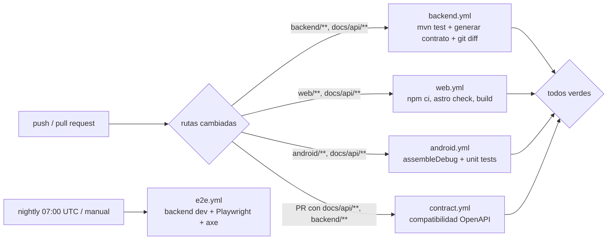

# E4 — Repositorio Git y Pipeline CI/CD
> Competencia CE0242 · Historial Git verificable + Pipeline automatizado  
> Proyecto: OnCargo — Sistema Operativo Logístico Colaborativo para PYMEs  
> Equipo: Jorge Gutiérrez Miranda · Fabrizio Sanchez Saravia · Alex Coila Jarita  
> Versión: 2.0 (workflows reales) · Noviembre 2026 · Versión original 1.0, junio 2026

!!! info "Pipeline planificado vs. pipeline real"
    La v1.0 proponía un `ci.yml` único con jobs de Angular, Flutter, Docker y despliegue a staging. El sistema real tiene **cinco workflows** en `.github/workflows/` del monorepo, filtrados por rutas, más Dependabot. Esta versión documenta esos archivos tal cual existen. Lo que sigue pendiente (despliegue automático, cobertura, escaneo de seguridad dedicado) se lista en la sección 6.

---

## 1. Información General

| Campo | Detalle |
|-------|---------|
| **Plataforma Git** | GitHub (monorepo `logyx`: `backend/`, `web/`, `android/`, `ios/`, `docs/`, `infra/`) |
| **Herramienta CI/CD** | GitHub Actions (`ubuntu-latest`) |
| **Workflows** | `backend.yml`, `web.yml`, `android.yml`, `contract.yml`, `e2e.yml` |
| **Dependencias** | Dependabot semanal para Maven, npm, Gradle y GitHub Actions (grupos *minor/patch*) |
| **Contrato** | `docs/api/openapi.yaml` y `openapi.json` versionados; fuente de verdad de web y Android |
| **Concurrencia** | Cada workflow cancela ejecuciones previas de la misma rama (`concurrency`) |

---

## 2. Estructura del Pipeline

### 2.1 `backend.yml` — pruebas y contrato generado

- Java 21 (Temurin) con caché Maven; `MAVEN_OPTS=-Xmx2g`.
- `./mvnw -B test`: 128 clases de prueba (564 casos sin fallos en `68a4c13`; 182 al cierre de la fase 6), incluidas RLS, privilegios, outbox y SSE contra PostgreSQL real (Testcontainers/Dev Services en el runner).
- `./mvnw -B package -DskipTests` regenera `docs/api/openapi.yaml` y `openapi.json`.
- **`git diff --exit-code docs/api/openapi.yaml docs/api/openapi.json`**: falla si el contrato versionado no coincide con el que genera el build (nadie puede cambiar un endpoint sin actualizar el contrato).
- Sube `surefire-reports` si hay fallos.

### 2.2 `web.yml`

Node 22 con caché npm; `npm ci`, `npm run check` (`astro check`, verifica tipos incluido el cliente generado del contrato) y `npm run build` (build SSR de producción).

### 2.3 `android.yml`

Java 21 + Gradle (`gradle/actions/setup-gradle`); instala `platforms;android-37.0` y `android-36` con `sdkmanager`; ejecuta `./gradlew --no-daemon assembleDebug testDebugUnitTest :core:network:test` (165 pruebas unitarias). Sube los reportes si falla. Las pruebas instrumentadas no corren en CI (requieren emulador).

### 2.4 `contract.yml` — chequeo de compatibilidad del contrato

En cada PR: ejecuta `scripts/test_openapi_compat.py` (pruebas del comparador) y `scripts/check-contract.sh origin/<base>`, que compara semánticamente `docs/api/openapi.json` contra el de la rama base con `scripts/openapi-compat.py` (solo biblioteca estándar de Python). **Falla si se quitan paths, schemas o campos** o se endurecen requeridos; las adiciones se informan y no fallan. Esto protege a los clientes (web y Android) de cambios incompatibles.

### 2.5 `e2e.yml` — Playwright + axe (nocturno y manual)

`workflow_dispatch` y cron `0 7 * * *`: levanta el backend con `quarkus:dev` en el puerto 8180 con `-Dlogyx.operator.sla=PT0S`, espera `/q/health/ready`, instala Chromium y corre `npm run test:e2e -- --workers=1` (85 tests, con axe). Sube `test-results` y, si falla, el log del backend.

---

## 3. Estrategia de Ramas y Protección

| Rama | Uso |
|------|-----|
| `main` | Rama integrada; los workflows de PR comparan contra ella (`origin/main`) |
| `feature/*`, `fix/*` | Trabajo por funcionalidad; PR hacia `main` |

Política recomendada (configuración de GitHub, fuera del código): PR requerido, checks `backend`, `web`, `android` y `contract` en verde, y al menos una revisión. Convención de commits: mensajes en español, prefijo por módulo.

---

## 4. Despliegue

El despliegue es reproducible con contenedores (ver [Sistema Implementado §7](../entregable-3/sistema.md#7-ce0234-despliegue-del-sistema)): `backend/Dockerfile` (multi-stage, Temurin 21, usuario 10001, *healthcheck* `/q/health/ready`), `web/Dockerfile` (Astro standalone, usuario `node`) e `infra/docker-compose.yml` (PostgreSQL 16, backend, web; MinIO solo en staging local). Producción es un **VPS Hostinger KVM 2** con Docker Compose, Caddy y Cloudflare. El **despliegue continuo no está automatizado**: el compose se verificó localmente con login web real; el diseño del despliegue por SSH desde GitHub Actions (usuario `deploy`, dump previo, `up -d`, prueba de humo) está en [Implementación de Datacenter](../../infraestructura/semestre-2/implementacion-datacenter.md) y el checklist de producción en `docs/security.md` e `infra/README.md`.

---

## 5. Secrets y configuración

El repositorio **no contiene secretos**: `infra/.env` y `infra/secrets/` están en `.gitignore` (solo `.env.example` se versiona); las claves JWT de dev/test se generan en memoria y las de producción se montan como archivos (`infra/scripts/gen-jwt-keys.sh`). Los workflows actuales no requieren *secrets* de GitHub (no publican imágenes ni despliegan); cuando se agregue despliegue se necesitarán credenciales del registro y del servidor.

---

## 6. Evidencia y pendientes de CI/CD

| Item | Estado |
|------|--------|
| Archivos `.github/workflows/{backend,web,android,contract,e2e}.yml` en el repositorio | Implementado |
| Chequeo automático de contrato (generado == versionado, y compatibilidad hacia atrás en PR) | Implementado |
| Dependabot (Maven, npm, Gradle, Actions) | Implementado |
| e2e nocturno con accesibilidad (axe) | Implementado |
| Capturas de ejecuciones del pipeline en GitHub Actions | Pendiente (agregar como evidencia al publicar el repositorio) |
| Reporte de cobertura (JaCoCo) | Pendiente |
| Publicación de imágenes y despliegue continuo a staging | Pendiente |
| Escaneo de seguridad dedicado (CodeQL/Trivy) | Pendiente (hoy: Dependabot y revisión manual) |
| Pruebas instrumentadas de Android en CI | Pendiente (requieren emulador) |

---

*OnCargo · E4 CI/CD · Competencia CE0242 · Versión 2.0 · Noviembre 2026*
